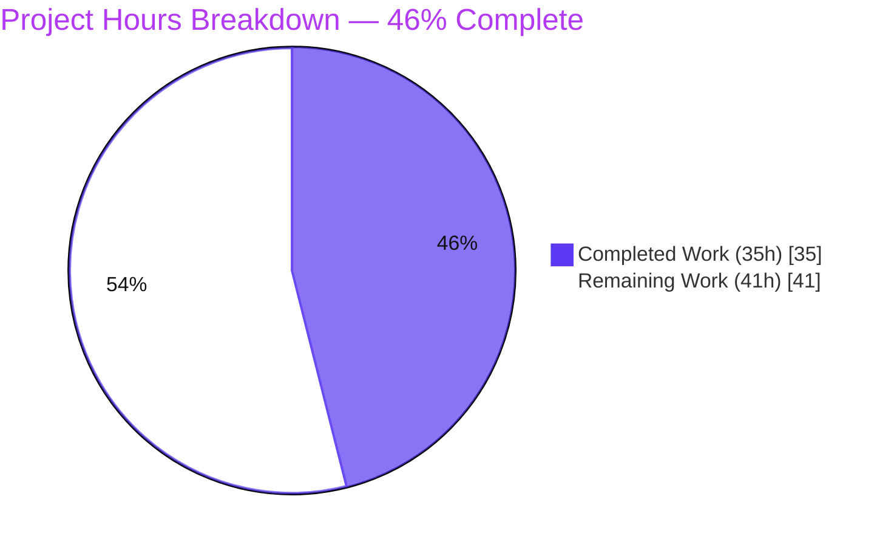
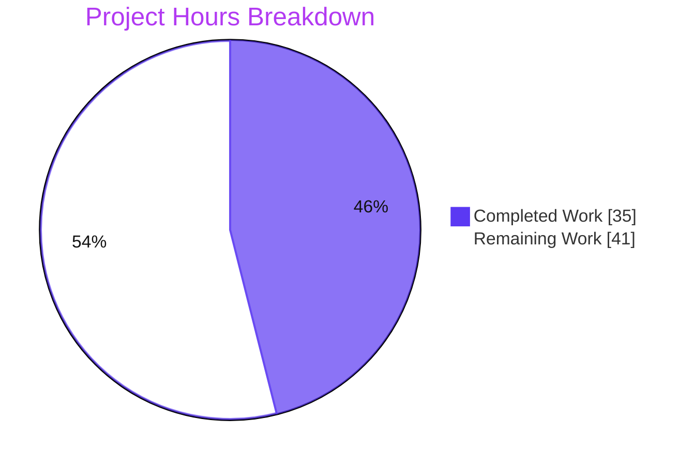

# 1. Executive Summary

The `hello_world` service answers three fixed-text greeting endpoints; this section states what the delivery contains, what proved it, and what stands between it and production.

## 1.1 Project Overview

`hello_world` is a single-process Express 5.1.0 HTTP service answering three fixed-text greeting endpoints and nothing else. Its consumers are scripts and services needing a deterministic greeting or liveness check, and its value is a surface cheap to prove and cheap to operate. Scope: one router, a twelve-factor configuration reading `HOST`, `PORT` and `NODE_ENV`, a 52-line entry point that binds the configured address and logs one line, and four Jest + Supertest suites covering every source line. No database, middleware, authentication or external service is involved.

## 1.2 Completion Status

**35 hours completed out of 76 total hours = 46% complete**, from `(35 / 76) × 100`. Completed hours are the delivered capability and its verification; the 41 remaining are path-to-production work — truthful startup failure reporting, input validation, dependency remediation, a release proof strong enough to sign, CI automation, documentation and comment accuracy.



| Metric | Hours |
|---|---|
| Total Hours | 76 |
| Completed Hours (Baseline: Human with agentic-assist) | 35 |
| Remaining Hours | 41 |
| Completion | 46% |

## 1.3 Key Accomplishments

- ✅ `GET /good-evening` answers 200 with the exact 12-byte `Good evening` as `text/plain; charset=utf-8`.
- ✅ `GET /` and `GET /evening` are preserved byte-for-byte, bodies and media types unchanged.
- ✅ The route is the third GET-only layer on the single router, pinned to that count and order.
- ✅ The 52-line entry point boots to one startup line with an empty stderr, binding the configured host and port.
- ✅ The project's own gate is green: 4 suites, 42 tests, 100% coverage, thresholds met.
- ✅ The surface exposes no secret, reads no request data, and binds loopback by default.

## 1.4 Critical Unresolved Issues

All 8 acceptance criteria the request set are met; none is open. Beyond them, **30 items remain open**, grouped so the groups sum to that total.

| Issue | Impact | Owner | ETA |
|---|---|---|---|
| Entry-point operability — bind failure reported as success with exit code 0; no signal handling or graceful shutdown (2 items) | An operator or orchestrator reads a successful start for a service that never bound; restarts drop in-flight requests | Backend owner | 1 day |
| Startup input validation — out-of-range `PORT` dies with an internal stack trace, unresolvable `HOST` fails silently (1 item) | Misconfiguration surfaces as a crash trail or a false success rather than one clear message | Backend owner | 0.5 day |
| Release-proof gaps — 5 integration-tier assertions, 4 lifecycle-tier cases, 1 configuration boundary and 1 router-pin fragility that cannot fail on the regression they claim to catch (11 items) | A regression in those areas would ship green; the release sign-off rests on weaker evidence than the test count suggests | QA / test owner | 2 days |
| Documentation and source-comment accuracy — 5 READMEs that document two endpoints, plus 8 comment, docstring and test-title inaccuracies (9 items) | A maintainer reading only the repository is told the app module is a factory, that the mount serves two paths, and never learns `GET /good-evening` exists | Maintainer | 1.5 days |
| Dependency advisories — 1 critical, 2 high and 1 moderate production advisory under `express@5.1.0` (4 items) | A known IP-spoofing advisory and three denial-of-service advisories sit in the installed tree; none is reachable through the current handlers, but none is fixed | Security owner | 1 day |
| Response-posture caveats — no hardening headers and `X-Powered-By` disclosed (1 item) | Informational while every body is a fixed literal; a future dynamic response inherits the gap | Security owner | Decision |
| Product decisions carried — `/hello-world` returns 404 although a request example named it; `HEAD` and `OPTIONS` answer 200 where the requirement said non-GET falls through to 404 (2 items) | One example command fails; a `HEAD` client reads 200 rather than 404 | Product / API owner | Decision |

## 1.5 Access Issues

No access issues identified. No credential, third-party key or elevated permission was needed, so install, test and runtime validation ran unblocked; the host's ban on port 3000 is a deployment convention, not an access restriction.

## 1.6 Recommended Next Steps

1. **[High]** Report bind failures and exit non-zero, with a test that fails if that reporting is removed (6h).
2. **[High]** Clear the four production advisories (5h) and harden the release proof (10h).
3. **[Medium]** Add graceful shutdown and validate `HOST`/`PORT` at startup (5h).
4. **[Medium]** Put the existing gate in CI and rewrite the five READMEs (10h).
5. **[Medium]** Decide whether `/hello-world` becomes an alias, before the documentation is rewritten.

# 2. Project Hours Breakdown

The hours below are the whole of the work this project was scoped against: the delivered capability plus the path-to-production work it still needs. Nothing outside that scope is counted.

## 2.1 Completed Work Detail

| Component | Hours | Description |
|---|---|---|
| HTTP entry point restoration and fidelity proof | 7 | The 52-line module named by `package.json:5,7`, `jest.config.js:19-23` and `tests/lifecycle/server.test.js:110` was restored verbatim from its last committed content and proven byte-identical (`sha256 afb318d9…edf9`); its four required properties were verified present and the seven forbidden additions verified absent (`server.js:30,37,49,51`). |
| `GET /good-evening` contract verification | 6 | Status 200, the exact 12-byte body, `text/plain; charset=utf-8` with `Content-Length: 12`, and the registration site on the single module router were verified statically, through the integration suite and over live HTTP (`src/routes/main.routes.js:53-55`, `tests/integration/endpoints.test.js:92-107`). |
| Preserved-route and method/404 regression verification | 5 | `GET /` (14 bytes, `text/html`), `GET /evening` (12 bytes, `text/html`), unknown paths, undeclared verbs, query-parameter and double-slash cases were re-exercised so the new route is proven not to have disturbed the two that predate it. |
| Test-suite and coverage-gate verification | 5 | Install from the lock, the whole-package gate (4 suites, 42 tests, 100% coverage on every file, thresholds 75/90/80/80) and the evidence that the assertions bite — a wrong body, a dropped `res.type`, a deleted registration, a swapped order and a fourth route each turn the suite red. |
| Configuration binding verification | 3 | Defaults `127.0.0.1` / `3000` / `development`, environment overrides, `parseInt` edge inputs and the falsy `HOST=''` and `PORT='0'` fallbacks were exercised at resolution level and end to end through the running server. |
| Runtime and adversarial verification | 4 | Method matrix, conditional requests (`If-None-Match` → 304), malformed and oversized requests, concurrency, startup and shutdown behaviour, and log volume under traffic. |
| Security review of the delivered surface | 3 | No secret, credential or key material anywhere in the tree; no handler reads `req`, so no input sink exists; default binding is loopback-only and a non-loopback address is refused; header and 404 parity across the three routes; production dependency audit. |
| Scope and decision record for the sanctioned departures | 2 | The two departures from the request's wording — creating the entry point and not creating `/hello-world` — were resolved on the repository's actual shape and recorded where a human can act on them. |
| **Total** | **35** | Matches the Completed Hours in Section 1.2. |

## 2.2 Remaining Work Detail

| Category | Hours | Priority |
|---|---|---|
| Entry-point operability — report a bind failure and exit non-zero (6h); graceful shutdown with a released listener on `SIGTERM`/`SIGINT` (2h) | 8 | High |
| Startup input validation — reject out-of-range or non-numeric `PORT` with one clear message, and fail loudly when `HOST` cannot be resolved | 3 | Medium |
| Dependency security remediation — clear the critical, two high and one moderate production advisories under `express@5.1.0` and add an audit step to the gate | 5 | High |
| Release-proof hardening — pin the assertions that cannot fail, assert exact media types and `Content-Length`, cover a non-GET request on `/good-evening`, add the missing configuration boundaries, and move the router pin off Express internals | 10 | High |
| CI automation of the release gate — no pipeline exists; run install, the whole-package gate with its coverage thresholds, and the audit on every change | 6 | Medium |
| Documentation refresh for the three-endpoint surface — five READMEs still describe two endpoints and none documents `GET /good-evening` | 4 | Medium |
| Source-comment and docstring accuracy — the factory claim and two-route enumeration in `src/app.js`, the stale line citations in `src/config/index.js`, the `@returns` types in `src/routes/main.routes.js`, two misleading lines in `server.js`, three test titles and ten trailing-space JSDoc lines | 5 | Low |
| **Total** | **41** | Matches the Remaining Hours in Section 1.2. |

`35 + 41 = 76` total hours, and `35 / 76 = 46%` complete.

# 3. Test Results

The project's own runner was executed against the delivered tree on Node v22.23.5 after `npm ci` installed the lock's 381 packages: `CI=true npx jest --ci` exited 0 with **4 suites and 42 tests, all passing**, in 0.55 s, and reported **100% statements, branches, functions and lines** for every collected file. The counts below are those five categories, aggregated from that run.

| Area / Category | Framework | Tests | Passed | Failed | Coverage | What This Proves |
|---|---|---|---|---|---|---|
| Greeting HTTP contract | Jest 30.2.0 + Supertest 7.1.4 | 17 | 17 | 0 | 100% of the files under `src/` in the whole-package run | Each of the three routes answers its exact status, body bytes and media type, and undeclared paths and verbs return 404 |
| Router registration | Jest 30.2.0 | 5 | 5 | 0 | 100% of `src/routes/main.routes.js` | One module-level router carries exactly three GET-only layers in the order `/`, `/evening`, `/good-evening` |
| Configuration resolution | Jest 30.2.0 | 15 | 15 | 0 | 100% of `src/config/index.js` | Defaults, environment overrides and `PORT` parsing edges resolve as specified and never yield `undefined` |
| Entry-point lifecycle | Jest 30.2.0, `src/app` and `src/config` mocked | 5 | 5 | 0 | 100% of `server.js` | `listen` is called once with port, then host, then a callback; the startup line is logged; custom configuration flows through |
| Whole-package gate | Jest with coverage thresholds 75/90/80/80 | 42 | 42 | 0 | 100% statements/branches/functions/lines on `server.js`, `src/app.js`, `src/config/index.js`, `src/routes/index.js`, `src/routes/main.routes.js` | The delivered surface runs green on the project's own runner with no threshold failure |

The result is stable: repeated whole-package runs, an in-band run, a worker-capped run, a heap-logged run and a run with `NODE_ENV`, `HOST` and `PORT` injected all produced the same totals and the same pass/fail state. The suite is not merely green — a deliberately wrong expected body, a dropped `res.type('text/plain')`, a deleted `/good-evening` registration, a swapped registration order and an added fourth route each turn it red.

**Not Covered**

The suite does not exercise the following, so each was verified over live HTTP instead and each should be covered before release:

- **A non-GET request to `/good-evening`.** No case sends one; the route's method restriction is proven only by the unit pin on the registration and by live probes (`POST`, `PUT`, `DELETE`, `PATCH`, `TRACE` all return 404).
- **`Content-Length` / byte counts.** Nothing asserts them; the exact-body comparison implies 12 and 14 bytes for ASCII, and live headers were read (`12`, `14`, `12`).
- **Exact media-type values.** Both helpers match with unanchored substrings, so a type merely containing `text/plain` would pass; the live headers are exactly `text/plain; charset=utf-8` and `text/html; charset=utf-8`.
- **The entry point's "nothing else executable" property.** No case fails if a second log line, an error listener, a signal handler, a shutdown routine or a middleware registration is added to `server.js`; the property holds today by byte-identity to the module's committed content.
- **Three cases that cannot fail.** The double-slash case admits either 200 or 404; the graceful-shutdown case asserts against the mock it builds itself; the `EADDRINUSE` case's only error assertion sits behind a guard that never executes because the module registers no error listener.
- **Falsy configuration boundaries.** No case passes `HOST=''` or `PORT='0'`, so the fallbacks those inputs take are unpinned; both were confirmed by probe (`127.0.0.1`, `3000`).
- **The `/hello-world` 404.** It rests on the absence of a registration and is checked only by hand; the suite's 404 cases target `/invalid`, `POST /`, `PUT /evening` and `DELETE /`.
- **Router-pin durability.** The strongest assertion in the suite reads Express internals (`router.stack`, `layer.route`, `route.methods`), which carry no public API guarantee, so an Express major could break the pin while every route contract still holds.

# 4. Runtime Validation & UI Verification

The service was started from the repository root on free, partitioned ports (never the default 3000) and every behaviour below was driven with real HTTP requests against the running process.

- ✅ **Startup and binding** — exactly one stdout line, `Server running at http://127.0.0.1:<port>/` (41 bytes, byte-identical to the template literal), zero bytes on stderr, one listening socket on the configured address, and every `PORT` override honoured.
- ✅ **`GET /`** — 200, `text/html; charset=utf-8`, `Content-Length: 14`, body `Hello, World!` followed by exactly one newline.
- ✅ **`GET /evening`** — 200, `text/html; charset=utf-8`, `Content-Length: 12`, body `Good evening` with no trailing newline.
- ✅ **`GET /good-evening`** — 200, `text/plain; charset=utf-8`, `Content-Length: 12`, body `G o o d   e v e n i n g` verified byte for byte with no newline.
- ✅ **Unknown paths and undeclared verbs** — `/invalid`, `/hello-world`, `/nope/deep` and `POST`/`PUT`/`DELETE`/`PATCH`/`TRACE` on all three greeting paths each return the framework's 404 with no 5xx.
- ✅ **Implicit methods** — `HEAD` returns 200 with headers and no body; `OPTIONS` returns 200 with `Allow: GET, HEAD`; both behave identically on all three paths.
- ✅ **Conditional requests** — a repeat request carrying the response's own `ETag` returns 304 with no body.
- ✅ **Configuration overrides** — `PORT`, `HOST=0.0.0.0`, `HOST=''`, whitespace-padded and malformed `PORT` values each bound and logged the value actually used; out-of-range `PORT` exits 1 with `RangeError [ERR_SOCKET_BAD_PORT]` and an empty stdout.
- ⚠ **Bind failure** — a second process started on a port already in use prints the success line, writes nothing to stderr and exits 0 while the first process keeps serving: the entry point cannot tell an operator that it never bound.
- ❌ **`GET /hello-world`** — returns 404; the path a request example named is not registered, and the greeting is served at `GET /` instead.

Shutdown was exercised with `SIGINT` and `SIGTERM`: the process exits in milliseconds, the port is released immediately, and no shutdown text is printed because the module registers no signal handler.

**No user interface exists to verify.** The deliverable is plain-text HTTP response bodies and one startup line; the repository contains no page, stylesheet, template, script bundle or asset, so there is no screen to drive, no browser console to inspect and no screenshot or recording to take. Verification is therefore entirely transport-level.

**Never exercised at runtime:** any container image, deployment manifest, CI pipeline, reverse proxy, TLS listener or non-loopback production deployment — none exists in the repository, and the service was only ever reached over plain HTTP on the loopback interface (a `HOST=0.0.0.0` override was bound once to confirm the widened address, and a request to the non-loopback container address was refused under the default). Sustained load and soak testing were not run either; the heaviest exercise was a short burst of concurrent requests, all of which returned the documented body. No health, readiness or metrics endpoint exists to probe, and no database, queue or third-party API is integrated, so there is no external dependency whose unavailability could be exercised.

# 5. Compliance & Quality Review

## 5.1 Compliance Matrix

| # | Deliverable | Benchmark | Status | Progress |
|---|---|---|---|---|
| 1 | `GET /good-evening` contract — method, path, 200, exact 12-byte body, `text/plain; charset=utf-8` | Contract fidelity | PASS | ▰▰▰▰▰ 100% |
| 2 | Registration site and framework idiom — third GET layer on the single module router, Express 5.1.0 | Architecture consistency | PASS | ▰▰▰▰▰ 100% |
| 3 | Preserved greetings — `GET /` and `GET /evening` bodies and media types unchanged | Non-regression | PASS | ▰▰▰▰▰ 100% |
| 4 | Method and unknown-path handling — undeclared verbs and unknown paths 404, no catch-all | Failure-mode correctness | PASS (caveat: `HEAD`/`OPTIONS` answer 200 by framework default) | ▰▰▰▰▱ 90% |
| 5 | HTTP entry point — restored verbatim, four required properties, seven forbidden additions absent | Plan fidelity | PASS | ▰▰▰▰▰ 100% |
| 6 | Clean start and configuration binding — one startup line, empty stderr, configured host and port | Operability | PASS (caveat: a bind failure is reported as success) | ▰▰▰▱▱ 75% |
| 7 | Automated proof on the project's own runner — 4 suites, 42 tests, 100% coverage, thresholds met | Release evidence | PASS (caveat: 11 assertions that cannot fail on the regression they claim) | ▰▰▰▰▱ 80% |
| 8 | Dependency and manifest integrity — no dependency added or changed; no known production advisory | Supply-chain hygiene | FAIL (1 critical, 2 high, 1 moderate advisory in the installed tree) | ▰▰▱▱▱ 40% |
| 9 | Secret and input-sink hygiene — no credential, key or token; no handler reads request data | Security baseline | PASS | ▰▰▰▰▰ 100% |
| 10 | Response hardening posture — headers, version disclosure, transport protection | Security baseline | PARTIAL (no hardening header, `X-Powered-By` disclosed, no TLS) | ▰▱▱▱▱ 30% |
| 11 | Documentation of the delivered surface — the endpoint a maintainer can read about | Documentation accuracy | FAIL (five READMEs describe two endpoints; `/good-evening` undocumented) | ▰▱▱▱▱ 20% |
| 12 | Source-comment and docstring accuracy — comments describe the code beneath them | Code documentation quality | PARTIAL (factory claim, two-route enumeration, stale citations, `@returns` types) | ▰▰▰▱▱ 50% |

## 5.2 AAP & Rule Divergences and Gaps

No user-specified rules were supplied at any point in this project, so there is no rule divergence to report; the four rows below are the departures from the Agent Action Plan and from the request wording the plan carried.

| # | What the AAP/Rule Required | What Was Delivered Instead | Why It Diverged | Impact | Remediation |
|---|---|---|---|---|---|
| D1 | The request's prohibitions: "add only the route definition and its handler function" and "do not modify server initialization". | A 52-line entry point, `server.js`, was created (byte-identical to its last committed content). | **Sanctioned by the AAP.** `package.json:5,7`, `jest.config.js:19-23` and `tests/lifecycle/server.test.js:110` all name a module the tree lacked; the request's own start-up, `curl` and green-suite criteria cannot pass without it. The plan resolved the conflict by restoring the module verbatim rather than authoring an initialization. | One added module; no existing line changed; no behaviour beyond binding the app. | None required — accept as recorded. |
| D2 | The request's second success command: `curl http://localhost:3000/hello-world` returns "Hello world" (unchanged). | `GET /hello-world` returns 404; nothing registers the path. The greeting is served at `GET /` → `Hello, World!` + newline as `text/html` (`src/routes/main.routes.js:27-29`). | **Sanctioned by the AAP.** The request's account of the existing surface does not match the repository, and a fourth registration would break the three-layer pin at `tests/unit/routes.test.js:49-69`; the request asks that the greeting be preserved, not that a path be created. | That one example command fails; the greeting itself is preserved unchanged at `/`. | Human product decision — serve `/hello-world` as an alias (~2h, requires editing the router and its pin) or keep the repository's surface. Captured in the Section 2.2 documentation row. |
| D3 | Requirement R1: "a non-GET request keeps falling through to the framework's 404, as on the other two paths". | `POST`, `PUT`, `DELETE`, `PATCH` and `TRACE` return 404, but `HEAD` returns 200 (headers only) and `OPTIONS` returns 200 with `Allow: GET, HEAD` — identically on all three paths. | Not carried out as worded: Express derives `HEAD` from a `GET` registration and the router answers `OPTIONS` itself. Both are framework defaults, unchanged from the routes that predate this delivery. | An API client issuing `HEAD` reads 200 rather than 404; no body or data is exposed. | Document the behaviour in the READMEs (Section 2.2 documentation row), or disable implicit `HEAD`/`OPTIONS`, which needs app-level configuration the delivery scoped out. |
| D4 | The plan's narrative environment values: Node v22.23.4 and 405 installed packages. | Verification ran on Node v22.23.5 with 381 packages installed from a lock of 405 entries. | The host moved on between planning and verification; no code consequence. | None — every runtime floor (`express` requires Node ≥ 18) is satisfied. | None. |

**D1 — the entry point the request's prohibitions would have excluded.** The request asked for a route definition and its handler and forbade touching server initialization, but the repository had no entry point at all: `package.json` names `server.js` as both `main` and the start script, the coverage configuration collects coverage from it, and the lifecycle suite requires it, while the module itself was absent from the tree. Under those conditions none of the request's own acceptance commands can run — the service cannot start, so nothing can be curled and no gate can go green. The plan therefore resolved the conflict in exactly one respect, and the delivered file is the repository's own last committed version restored byte for byte (`sha256 afb318d9…edf9`, 52 lines, `diff` clean against `d05ae63:server.js`) rather than an initialization authored here. Nothing to close: the departure is what makes the rest of the delivery verifiable, and no preserved line was rewritten to achieve it.

**D2 — the greeting path the request named does not exist.** The request's second success command curls `/hello-world` and expects `Hello world` back unchanged. Nothing in the repository registers that path: it returns 404, and the greeting the service actually serves is `GET /` returning `Hello, World!` — capitalised `W`, an exclamation mark, a trailing newline, and `text/html` rather than plain text (`src/routes/main.routes.js:27-29`). The request asked that the greeting be preserved, not that a new path be created, and a fourth registration would break the three-layer stack the unit suite pins (`tests/unit/routes.test.js:49-69`). The behaviour a human must settle is a product one: if `/hello-world` should exist as an alias, it needs a router edit and an updated pin (about 2h); if the repository's surface is correct, the READMEs should say so. Either way the decision belongs with whoever owns the public greeting surface, and it should be made before the documentation is rewritten.

**D3 — `HEAD` and `OPTIONS` do not fall through to 404.** Requirement R1 states that a non-GET request on a greeting path keeps falling through to the framework's 404. For the five methods Express does not derive that holds exactly — `POST`, `PUT`, `DELETE`, `PATCH` and `TRACE` all return 404 with the framework's page. For `HEAD` and `OPTIONS` it does not: Express answers `HEAD` from the `GET` registration, returning 200 with a correct `Content-Length` and no body, and the router answers `OPTIONS` with 200 and `Allow: GET, HEAD`. Both behaviours are identical on the two routes that predate this delivery, so nothing was introduced here, and neither returns any content. The gap is between the requirement's wording and the framework's defaults: a client that probes with `HEAD` will see 200 where the specification says 404. Closing it means either documenting the behaviour as intended or disabling the implicit handling at application level; the documentation row in Section 2.2 carries the first option.

**D4 — narrative values in the plan that the host no longer matches.** The plan cites Node v22.23.4 and 405 installed packages; verification ran on Node v22.23.5 with 381 packages installed from a lockfile of 405 entries. Neither value touches a requirement, a contract or a test: `express@5.1.0` requires Node ≥ 18, every command in the environment's own instructions was executed as written, and the lockfile pin is unchanged. Recorded so that anyone re-running the plan's verification text is not surprised by numbers one step off from the host. Nothing to close.

# 6. Risk Assessment

Each risk below is something that can still go wrong in production; none of them is a defect discovered and corrected along the way.

| Risk | Category | Severity | Probability | Mitigation | Status |
|---|---|---|---|---|---|
| A bind failure is reported as success: a second process on a held port logs `Server running at …`, writes nothing to stderr and exits 0 while the holder keeps serving | Operational | High | High | Add a bind-error path that reports the failure and exits non-zero; make readiness depend on a real request, not on the log line | Open — `server.js:49-51` |
| Four production advisories sit under `express@5.1.0`: `proxy-addr` 2.0.7 (critical, IP spoofing via IPv4-mapped IPv6), `body-parser` 2.2.1 and `path-to-regexp` 8.3.0 (high, denial of service), `qs` 6.14.0 (moderate, five denial-of-service vectors) | Security | High | Medium (unreachable today: no body parser mounted, static route patterns only, `req.ip` unread with `trust proxy` off, simple query parser) | Dependency update batch; re-run the gate and add `npm audit` to CI so a new advisory fails the build | Open — no affected path reachable through the three handlers |
| No graceful shutdown: the `listen` handle is discarded and no signal handler exists, so a restart drops in-flight requests | Operational | Medium | Medium | Retain the handle, close the listener on `SIGTERM`/`SIGINT`, exit once drained | Open — `server.js:49` |
| Unvalidated `HOST`/`PORT`: an out-of-range `PORT` dies with an internal `RangeError` stack, an unresolvable `HOST` starts "successfully" and binds nothing | Operational | Medium | Low | Validate both inputs at startup and fail with one clear message | Open — `src/config/index.js:26,33` |
| The proof behind a release has gaps and is coupled to framework internals: three cases cannot fail, the entry point's prohibitions are unenforced, media types are matched by substring, `Content-Length` is unasserted, the router pin reads `router.stack`/`layer.route`, and the lifecycle tier stubs its collaborators by module id — so a regression, an Express major or a filesystem move could weaken the proof while every contract still holds | Technical | Medium | Medium | Pin the vacuous cases, assert exact headers and lengths, add the missing method and configuration cases, and move the pin to contract-level or over-HTTP assertions | Open — `tests/integration/endpoints.test.js`, `tests/lifecycle/server.test.js`, `tests/unit/routes.test.js:23-34` |
| Comments and READMEs misdescribe the surface: `src/app.js:9` calls the module a factory, `src/app.js:20-24` enumerates two of three routes, `src/config/index.js:9-10` cite line numbers in a deleted file, and no README documents `GET /good-evening` | Operational (maintainability) | Low | High | Correct the comments and rewrite the five READMEs for the three-endpoint surface | Open |
| Bare response posture: no hardening headers, `X-Powered-By: Express` disclosed, no TLS and no rate limiting; an explicit `HOST=0.0.0.0` publishes three unauthenticated plaintext endpoints to every interface | Security | Medium | Low (defaults bind loopback; a non-loopback address was refused under the default) | Keep loopback as the default, require TLS and authentication before any widened bind, revisit headers when a dynamic response is added | Open — accepted posture, deliberate |
| Dependency drift goes unnoticed: nothing in this repository audits, updates or pins the transitive tree beyond the lockfile, and no pipeline runs the gate on a change | Operational (supply chain) | Medium | Medium | Add the audit step and the pipeline together, so a new advisory or a red suite fails the build rather than being discovered later | Open |

No external integration risk exists: the service declares one production dependency, opens no outbound connection, holds no credential and reads no store, so there is no third-party outage, API-key rotation or network configuration that could take it down.

# 7. Visual Project Status

The project stands at **46% complete**: 35 of 76 hours delivered, 41 remaining. Completed work is shown in Blitzy dark blue (`#5B39F3`); remaining work in white (`#FFFFFF`).



| Status | Hours | Share |
|---|---|---|
| Completed Work (dark blue `#5B39F3`) | 35 | 46% |
| Remaining Work (white `#FFFFFF`) | 41 | 54% |
| **Total** | **76** | **100%** |

**Remaining hours by category** (the same 41 hours detailed in Section 2.2):

| Category | Hours | Priority | Progress toward release |
|---|---|---|---|
| Entry-point operability | 8 | High | ▱▱▱▱▱ 0% |
| Startup input validation | 3 | Medium | ▱▱▱▱▱ 0% |
| Dependency security remediation | 5 | High | ▱▱▱▱▱ 0% |
| Release-proof hardening | 10 | High | ▱▱▱▱▱ 0% |
| CI automation of the release gate | 6 | Medium | ▱▱▱▱▱ 0% |
| Documentation refresh | 4 | Medium | ▱▱▱▱▱ 0% |
| Source-comment and docstring accuracy | 5 | Low | ▱▱▱▱▱ 0% |
| **Total** | **41** | — | — |

**Open items by area** (the 30 items counted in Section 1.4):

| Area | Open items | Blocking release? |
|---|---|---|
| Release-proof gaps | 11 | No — evidence quality, not behaviour |
| Documentation and source-comment accuracy | 9 | No — maintainability |
| Dependency advisories | 4 | Yes — the critical advisory should be cleared first |
| Entry-point operability | 2 | Yes — a false success on startup misleads any operator |
| Product decisions carried | 2 | Yes — the public greeting surface must be settled |
| Startup input validation | 1 | No |
| Response-posture caveats | 1 | No — revisit when a dynamic response is added |
| **Total** | **30** | — |

# 8. Summary & Recommendations

**What was delivered and verified.** The service answers three greeting endpoints on one Express 5.1.0 router: `GET /` with `Hello, World!` and a trailing newline as `text/html`, `GET /evening` with `Good evening` as `text/html`, and `GET /good-evening` with the exact 12-byte `Good evening` as `text/plain; charset=utf-8`. The 52-line entry point that the manifest, the coverage configuration and the lifecycle suite all name was restored byte for byte and boots to a single startup line with an empty stderr, binding the configured host and port. Every one of those behaviours was exercised over live HTTP and is pinned by the project's own suite: 4 suites, 42 tests, 100% statement, branch, function and line coverage against thresholds of 75/90/80/80, with mutation checks confirming the assertions bite.

**Where the project stands.** The work measured against what this project was scoped to deliver reaches **46% complete — 35 hours delivered of 76 total, with 41 hours of path-to-production work remaining**. The delivered capability itself is complete and proven: the endpoint contract, the preserved greetings, the registration site, the configuration binding and the entry point all hold, and all eight acceptance criteria the request set are met. The remaining hours are not unfinished feature work; they are what the same capability needs before it can be operated rather than only demonstrated.

**The critical path to production.** Four things stand between this tree and a production release, in order. First, the entry point must stop reporting a bind failure as a success: today a second process on a held port prints the startup line, writes nothing to stderr and exits 0 while the first process keeps serving, which misleads any operator or orchestrator reading logs or exit codes. Second, the four production advisories under `express@5.1.0` — one critical IP-spoofing advisory in `proxy-addr`, two high denial-of-service advisories in `body-parser` and `path-to-regexp`, one moderate in `qs` — should be cleared, even though none is reachable through the current handlers. Third, the release proof needs hardening so that the eleven assertions that cannot fail on the regression they claim to catch become able to fail. Fourth, the public greeting surface needs one product decision: whether `/hello-world` should exist as an alias, which determines what the five READMEs should say when they are rewritten.

**Success metrics for the next release.** The gate stays at 4 suites and 42 tests with no failures and coverage at or above the configured thresholds; every open assertion in Section 3 acquires a case that fails when the behaviour it names is removed; `npm audit --omit=dev` reports zero production advisories; a bind failure exits non-zero with one clear message and no success line; and the READMEs document all three endpoints, their exact bodies, their media types and the `HEAD`/`OPTIONS` nuance.

**Production readiness assessment.** Not yet ready, and close to it. The functional surface is small, fully covered, free of secrets and free of any request-reading code path, and its default posture binds loopback only — so the risk concentrated here is operational truthfulness at startup, supply-chain hygiene and the strength of the evidence behind a release, not the correctness of the endpoints themselves. Clearing the three High-priority items in Section 2.2 — entry-point operability and the dependency remediation, then the release-proof hardening, roughly 23 hours — moves this tree from "demonstrably correct" to "safe to operate"; the remaining 18 hours of validation, CI, documentation and comment accuracy make it maintainable afterwards.

# 9. Development Guide

Every command below was run from the repository root on the host this project was built and verified on (Node v22.23.5, npm 11.21.0) and produced the output shown.

## 9.1 System prerequisites

- **Node.js 22.x** — v22.23.5 is installed and is what verification ran on. The only runtime constraint the dependency set declares is `express@5.1.0`'s `engines.node >= 18`; nothing pins a runtime (no `.nvmrc`, no `engines` field in this manifest).
- **npm 11.x** — used for install and scripts.
- **Nothing else.** No database, message broker, container runtime, Python environment, seed data or `.env` file is used. `src/config/index.js` reads `process.env` directly, so a `.env` file has no effect; pass `HOST`, `PORT` and `NODE_ENV` inline.
- **A free TCP port.** The service binds exactly one port. Where several checkouts share a host, never bind the default 3000 — pass a port of your own inline.

## 9.2 Install dependencies

```bash
cd <repository-root>
CI=true npm ci
```

Installs the 381 packages the lockfile pins (express 5.1.0, jest 30.2.0, supertest 7.1.4) in a few seconds from a warm cache. Verify with `npm ls --depth=0`, which lists exactly those three. Use `npm ci`, not `npm install`: only the former is guaranteed to leave `package-lock.json` untouched.

## 9.3 Run the test suite

The whole-package gate — the one that matters, because the coverage thresholds are bound to it:

```bash
CI=true npx jest --ci
```

Expected: exit code 0, `Test Suites: 4 passed, 4 total`, `Tests: 42 passed, 42 total`, and a coverage table showing `100` for statements, branches, functions and lines on `server.js`, `src/app.js`, `src/config/index.js`, `src/routes/index.js` and `src/routes/main.routes.js`. `npm test`, `npm run test:ci` and `npm run test:coverage` run the same configuration.

While iterating, run a subset:

```bash
CI=true npx jest tests/unit tests/integration --ci --coverage=false
```

Expected: exit 0, 3 suites, 37 tests. **`--coverage=false` is required on any subset run.** Without it the same run exits 1 with messages such as `Jest: "global" coverage threshold for statements (80%) not met: 76.19%` even though every selected test passed — the global thresholds are applied to whatever subset you ran.

There is no linter or formatter in this project (no ESLint, Prettier or lint script, and adding one would introduce a dependency). The static gate is the syntax check plus the suites:

```bash
for f in server.js src/app.js src/config/index.js src/routes/index.js src/routes/main.routes.js jest.config.js tests/**/*.test.js; do node --check "$f"; done
```

## 9.4 Start the application

```bash
PORT=3935 node server.js
```

Expected output — exactly one line, nothing on stderr, process attached:

```text
Server running at http://127.0.0.1:3935/
```

`npm start` runs the same script with npm's banner ahead of it:

```text
> hello_world@1.0.0 start
> node server.js

Server running at http://127.0.0.1:3935/
```

Configuration is read from the environment at startup: `HOST` (default `127.0.0.1`), `PORT` (default `3000`), `NODE_ENV` (default `development`).

## 9.5 Verify the running service

With the server started on port 3935:

```bash
curl -s -o /dev/null -w '%{http_code}\n' http://127.0.0.1:3935/good-evening     # 200
curl -s http://127.0.0.1:3935/good-evening | od -An -c                        # G o o d   e v e n i n g
curl -s http://127.0.0.1:3935/good-evening | wc -c                            # 12
curl -s -D - -o /dev/null http://127.0.0.1:3935/good-evening | grep -i '^content'   # text/plain; charset=utf-8, Content-Length: 12
curl -s http://127.0.0.1:3935/ | od -An -c                                    # H e l l o ,   W o r l d ! \n  (14 bytes)
curl -s -o /dev/null -w '%{http_code}\n' http://127.0.0.1:3935/evening         # 200 (text/html, 12 bytes)
curl -s -o /dev/null -w '%{http_code}\n' http://127.0.0.1:3935/hello-world     # 404 (no such route)
curl -s -o /dev/null -w '%{http_code}\n' -X POST http://127.0.0.1:3935/good-evening  # 404
curl -s -I http://127.0.0.1:3935/good-evening | head -1                       # HTTP/1.1 200 OK (HEAD: headers only)
curl -s -D - -o /dev/null -X OPTIONS http://127.0.0.1:3935/good-evening | grep -i '^allow'  # Allow: GET, HEAD
```

Stop the server with `Ctrl-C`, or `kill <pid>` if it was backgrounded. The port is released immediately; the module prints no shutdown message.

## 9.6 Example usage

```bash
curl http://127.0.0.1:3935/good-evening
# Good evening
```

The three contracts, for reference:

| Method and path | Status | Body, exactly | Content-Type | Content-Length |
|---|---|---|---|---|
| `GET /` | 200 | `Hello, World!` followed by one newline (14 bytes) | `text/html; charset=utf-8` | 14 |
| `GET /evening` | 200 | `Good evening` (12 bytes, no newline) | `text/html; charset=utf-8` | 12 |
| `GET /good-evening` | 200 | `Good evening` (12 bytes, no newline) | `text/plain; charset=utf-8` | 12 |

Undeclared verbs on those paths, and every unknown path, return the framework's 404. `HEAD` and `OPTIONS` answer 200 by framework default, identically on all three paths.

## 9.7 Troubleshooting

| Symptom | Cause | Resolution |
|---|---|---|
| `Cannot find module '../../server' from 'tests/lifecycle/server.test.js'` (five failures, exit 1) | `server.js` is missing from the repository root, so the entry point the manifest and the lifecycle suite name cannot be required | Restore the module (`git checkout HEAD -- server.js`); the gate then returns 4/4 suites and 42/42 tests |
| A subset run exits 1 with `Jest: "global" coverage threshold … not met` although every test passed | The global thresholds are applied to the subset you selected | Re-run with `--coverage=false`, or run the whole-package gate |
| `RangeError [ERR_SOCKET_BAD_PORT]: options.port should be >= 0 and < 65536`, exit 1, empty stdout | `PORT` is out of range (for example `99999`); the value reaches `listen` unvalidated | Use a port between 1 and 65535. `PORT=abc`, `PORT=''` and `PORT=3000.5` do not fail — `parseInt(...) \|\| 3000` resolves each to 3000 |
| The startup line appears but the requests are refused or answered by another process | The port is already held: a bind failure is logged as success and the process exits 0 without listening | Pick a free port, check with `curl -s -o /dev/null -w '%{http_code}'` before starting, and stop the older instance |
| `EACCES` or a privilege error on a low port | Ports below 1024 need elevated privileges | Use an unprivileged port |
| A `.env` file has no effect | There is no dotenv dependency; configuration reads `process.env` directly | Pass `HOST`/`PORT`/`NODE_ENV` on the command line or export them in the shell |
| `package-lock.json` changed unexpectedly | `npm install` was used instead of `npm ci` | Revert the lockfile and reinstall with `CI=true npm ci` |

# 10. Appendices

## Appendix A. Command Reference

| Purpose | Command | Expected result |
|---|---|---|
| Install exactly the lockfile's packages | `CI=true npm ci` | exit 0; 381 packages; `npm ls --depth=0` lists express, jest, supertest |
| Whole-package gate (tests + coverage thresholds) | `CI=true npx jest --ci` | exit 0; 4 suites, 42 tests, 100% coverage on every file |
| Gate via scripts | `npm test` / `npm run test:ci` / `npm run test:coverage` | same suite and coverage result |
| Fast subset while iterating | `CI=true npx jest tests/unit tests/integration --ci --coverage=false` | exit 0; 3 suites, 37 tests |
| Single suite | `CI=true npx jest tests/integration/endpoints.test.js --ci --coverage=false` | exit 0; 17 tests |
| Syntax gate (no linter exists) | `node --check <file>` | no output, exit 0 |
| Service stdout | `wc -l < out.log; wc -c < err.log` | 1 line; 0 bytes of stderr |
| Production dependency audit | `npm audit --omit=dev` | currently 4 advisories (1 critical, 2 high, 1 moderate) |
| Start the service | `PORT=<free port> node server.js` | one line: `Server running at http://127.0.0.1:<port>/` |
| Start via npm | `PORT=<free port> npm start` | npm banner, then the same single application line |
| Change set since the merge base | `git diff --name-status e314cb4 HEAD` | `A server.js` |
| Entry-point fidelity | `git show d05ae63:server.js \| diff -q - server.js` | no output (identical) |

## Appendix B. Port Reference

| Port | Use |
|---|---|
| 3000 | The configuration default. Do not bind it on a host that runs more than one checkout. |
| 3100 + checkout index | The convention for parallel checkouts on one host (`PORT=$((3100 + CLONE_INDEX))`), passed inline rather than exported. |
| 3932–3935 | The free ports used for the runtime verification recorded in Section 4. |

The service binds exactly one socket, on `HOST` (`127.0.0.1` by default) and `PORT`. Tests bind no port at all: Supertest drives the app in-process, so the suite is safe to run on a host with no free ports.

## Appendix C. Key File Locations

| Path | Role | Lines |
|---|---|---|
| `server.js` | HTTP entry point: requires the app and the config, calls `listen(port, host, cb)`, logs one startup line | 52 |
| `src/app.js` | Builds the single Express instance at require time and mounts the router once at `/` | 27 |
| `src/routes/main.routes.js` | The one module-level router; three GET-only registrations in order `/`, `/evening`, `/good-evening` | 57 |
| `src/routes/index.js` | Barrel re-exporting `{ mainRoutes }` | 19 |
| `src/config/index.js` | `HOST`, `PORT`, `NODE_ENV` read from `process.env` with defaults | 41 |
| `jest.config.js` | Discovery, coverage collection and thresholds (75 branches / 90 functions / 80 lines / 80 statements) | 27 |
| `tests/integration/endpoints.test.js` | HTTP contract for all three routes, 404 cases, edge cases | 154 |
| `tests/lifecycle/server.test.js` | Entry-point lifecycle with the app and config mocked | 204 |
| `tests/unit/routes.test.js` | Router export and the ordered three-layer pin | 71 |
| `tests/unit/config.test.js` | Configuration defaults, overrides and parsing edges | 140 |
| `package.json` / `package-lock.json` | Scripts, entry-point declaration and the pinned dependency tree | — |
| `README.md`, `src/README.md`, `src/routes/README.md`, `src/config/README.md`, `tests/README.md` | Human documentation — stale: they describe two endpoints | 337 / 25 / 33 / 35 / 50 |

## Appendix D. Technology Versions

| Component | Declared | Resolved |
|---|---|---|
| Node.js | — (no `engines`, no `.nvmrc`; `express` requires ≥ 18) | v22.23.5 |
| npm | — | 11.21.0 |
| express | `^5.1.0` | 5.1.0 |
| jest | `^30.2.0` | 30.2.0 |
| supertest | `^7.1.4` | 7.1.4 |
| router (transitive) | via express | 2.2.0 |
| mime-types (transitive) | via express | 3.0.1 |
| Lockfile | `lockfileVersion` 3 | 405 entries pinned; 381 packages installed |

## Appendix E. Environment Variable Reference

| Variable | Default | Read at | Effect |
|---|---|---|---|
| `HOST` | `127.0.0.1` | `src/config/index.js:26` | Bind address passed unchanged to `listen`. The default is loopback only; `0.0.0.0` publishes the service on every interface. `HOST=''` falls back to the default. |
| `PORT` | `3000` | `src/config/index.js:33` | Bind port, parsed with `parseInt(value, 10) \|\| 3000`. Non-numeric, empty and `'0'` values resolve to 3000; a value outside 1–65535 fails at `listen` with `RangeError`. |
| `NODE_ENV` | `development` | `src/config/index.js:40` | Exported as `config.env` and read by no production code; it changes no behaviour today. |
| `CI` | — | jest | Set to `true` for non-interactive runs; never enters watch mode. |

No secret, credential, connection string or `.env` file is required or read.

## Appendix F. Developer Tools Guide

| Tool | Invocation | What it gives you |
|---|---|---|
| Jest | `npx jest --ci`, `npx jest --verbose`, `npx jest <path> --coverage=false` | Test execution, per-test titles, coverage table; `--detectOpenHandles` and `--runInBand` are useful when diagnosing a hang |
| Supertest | used inside the integration suite | In-process HTTP assertions against the real app; binds no port |
| `node --check` | `node --check <file>` | The only static gate this project has, since no linter is configured |
| `npm audit` | `npm audit --omit=dev` | Production advisory report; currently 4 findings, none reachable through the three handlers |
| curl + od | see Section 9.5 | Byte-exact contract verification: status, headers, body length and body bytes |
| `node -e` probes | e.g. `node -e "console.log(require('./src/config'))"` | Configuration resolution without starting the server |

## Appendix G. Glossary

| Term | Meaning in this project |
|---|---|
| Entry point | `server.js`, the module `package.json` names as both `main` and the `start` script; it binds the app to the configured address and logs one line. |
| Router mount | `app.use('/', mainRoutes)` in `src/app.js:25` — a root mount, so each registration keeps its concrete path with no prefix. |
| Registration | A `router.get(path, handler)` call; there are exactly three, and the unit suite pins their count, order and method. |
| Media type | The `Content-Type` value a response carries: `text/html; charset=utf-8` for `/` and `/evening`, `text/plain; charset=utf-8` for `/good-evening`. |
| Coverage threshold | The global minimums jest enforces (75 branches / 90 functions / 80 lines / 80 statements); a subset run cannot meet them, which is why `--coverage=false` exists. |
| ETag / conditional request | The response validator the framework emits; a repeat request carrying it returns 304 with no body. |
| Twelve-factor configuration | Configuration held in environment variables and read at startup, with literal defaults — the pattern `src/config/index.js` implements. |
| Loopback | The `127.0.0.1` default bind address; reachable only from the host itself. |
| Framework 404 | The page Express's final handler returns for an unmatched path or undeclared verb; structurally different from the handlers' plain-string responses. |
| Advisory (GHSA) | A published vulnerability record against a package version; four affect the installed production tree today. |
