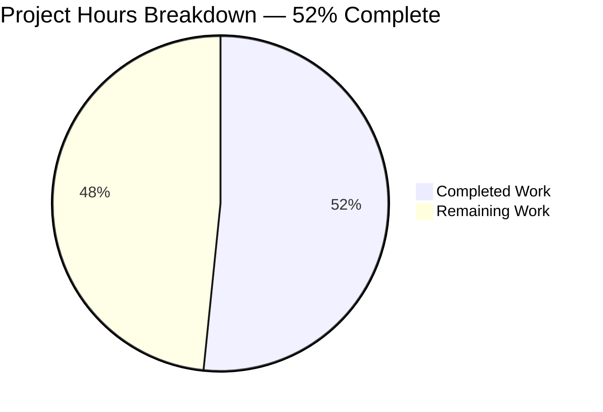
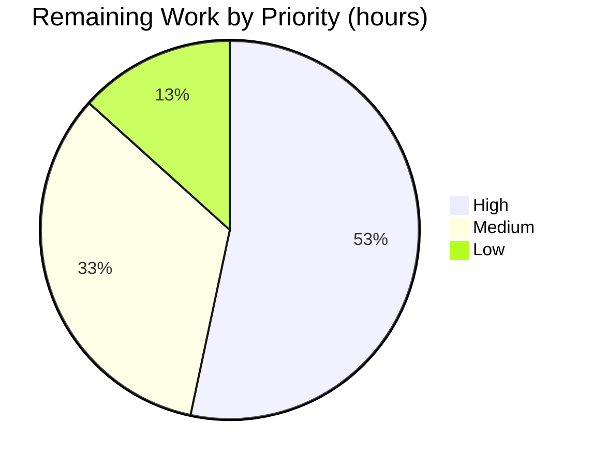

# 1. Executive Summary

## 1.1 Project Overview

`hello_world` is a compact Express 5 service that serves greeting text over HTTP at three exact paths. This delivery adds `GET /good-evening`, answering `200` with the twelve-byte literal `Good evening` under `text/plain; charset=utf-8`, and holds the two existing greetings — `GET /` (`Hello, World!\n`, HTML) and `GET /evening` (`Good evening`, HTML) — byte for byte unchanged. The work is narrow: one router gained one registration, its proof suites gained the cases that pin the contract, and every other file stayed untouched. Consumers are HTTP clients; there is no browser surface, data store, credential or external integration.

## 1.2 Completion Status

**52% complete — 16.0 of 31.0 hours.**



Completed hours are Dark Blue (`#5B39F3`); remaining hours are White (`#FFFFFF`). All 25 requirements are met; the 15.0 remaining hours are the gaps in Section 2.2.

| Metric | Hours |
|---|---|
| Total Hours | 31.0 |
| Completed Hours (AI + Manual) | 16.0 |
| Remaining Hours | 15.0 |
| Completion (16.0 ÷ 31.0) | 52% |

## 1.3 Key Accomplishments

- [x] `GET /good-evening` returns `200` with exactly `Good evening` (12 bytes, no trailing newline) as `text/plain; charset=utf-8`, observed live.
- [x] Query strings are ignored and undeclared methods return `404` on the new path.
- [x] `GET /` and `GET /evening` remain byte-identical in status, body and content type.
- [x] 39 of 39 in-scope tests pass: 17 integration, 7 router-structure, 15 configuration.
- [x] The appended cases bind — dropping the explicit content type fails two of them.
- [x] Coverage is 100% on all four metrics against 75/90/80/80; the change set is three files (+49/−4) with no dependency, middleware or configuration edit.

## 1.4 Critical Unresolved Issues

**5 open items of the 30 tracked** — the 25 requirements are met; five path-to-production gaps remain.

| Issue | Impact | Owner | ETA |
|---|---|---|---|
| No runnable service entry point: `package.json` `main`/`start` name a deleted file, so `npm start` exits 1 | Blocks the documented deployment path and keeps the whole-package test gate red | Platform engineer | 4 h |
| 22 dependency advisories installed (1 critical, 8 high, 9 moderate, 4 low) | None reachable today; inherited by any future client-IP, body-parsing or parameterised-route work | Security engineer | 4 h |
| Route inventories describe two endpoints (five READMEs, router module header, mount comment) | Consumers cannot discover `/good-evening` from the project documentation | Documentation owner | 3 h |
| The supplied `/hello-world` acceptance check returns 404 | The greeting surface is `GET /`; the second supplied command cannot pass as written | Product owner + engineer | 2 h |
| No response-hardening headers; `X-Powered-By: Express` disclosed | Minimal for constant literal bodies; inherited by any future HTML surface | Platform engineer | 2 h |

## 1.5 Access Issues

No access issues identified. No credential, API key, certificate, third-party account, database or broker is required at build or run time.

## 1.6 Recommended Next Steps

1. **[High]** Author the service entry point and turn the five lifecycle cases green so `npm start` works (4 h).
2. **[High]** Bump the advisory-bearing dependencies and re-assert the three contracts (4 h).
3. **[Medium]** Reconcile every route inventory with the three endpoints actually served (3 h).
4. **[Medium]** Decide the greeting surface: record `GET /` as authoritative, or add `/hello-world` with contract cases (2 h).
5. **[Low]** Add security headers, disable `X-Powered-By`, and add a lint gate (2 h).

# 2. Project Hours Breakdown

## 2.1 Completed Work Detail

| Component | Hours | Description |
|---|---|---|
| `GET /good-evening` registration, handler and rationale | 3.0 | Third registration on the existing router in `src/routes/main.routes.js` (`router.get('/good-evening', …)` at lines 52–54), body sent as `res.type('text/plain').send('Good evening')`, preceded by a JSDoc block carrying `@route`/`@returns` and the recorded reason both greeting paths stay registered (lines 41–51). |
| Contract proof: assertion helper and three integration cases | 3.5 | `assertSuccessfulPlainTextResponse` (lines 41–46) beside the HTML helper, plus `describe('GET /good-evening')` (lines 92–107) asserting status 200, exact body and `text/plain` with `charset=utf-8` in `tests/integration/endpoints.test.js`. |
| Three-route structure expectations | 2.0 | `tests/unit/routes.test.js`: layer count moved to three (line 53), `toContain('/good-evening')` added (line 60), three titles reworded, ordering assertion at lines 86–94 left intact. |
| Preserved-route regression proof | 2.5 | Byte-level confirmation that `GET /` (`Hello, World!\n`, 14 bytes, HTML) and `GET /evening` (`Good evening`, 12 bytes, HTML) are unchanged, together with 404 handling for undefined paths and undeclared methods and query-string tolerance. |
| Live contract verification and startup evidence | 2.5 | Application started from its factory and the three routes driven over HTTP: status, content type, `Content-Length`, ETag, body bytes, query variant, undeclared methods and `/hello-world` 404. |
| Clean-install whole-package gate and coverage thresholds | 1.5 | Lockfile-exact install, full suite run, and confirmation that 100% coverage on all four metrics satisfies the 75/90/80/80 thresholds with no threshold message. |
| Scope-containment verification | 1.0 | Confirmation that exactly three files changed, that no manifest, Jest configuration, wiring or documentation file moved, and that no dependency, middleware, authentication, database, logging or error-handling code was added. |
| **Total Completed** | **16.0** | |

## 2.2 Remaining Work Detail

| Category | Hours | Priority |
|---|---|---|
| Runnable service entry point and green lifecycle suite | 4.0 | High |
| Dependency advisory remediation (1 critical, 8 high, 9 moderate, 4 low) | 4.0 | High |
| Documentation reconciliation across route inventories and mount comment | 3.0 | Medium |
| Greeting-surface decision: record `GET /` or add `/hello-world` with cases | 2.0 | Medium |
| Baseline response hardening and a lint gate | 2.0 | Low |
| **Total Remaining** | **15.0** | |

# 3. Test Results

| Area / Category | Framework | Tests | Passed | Failed | Coverage | What This Proves |
|---|---|---|---|---|---|---|
| Endpoint contract — `GET /`, `GET /evening`, `GET /good-evening` | Jest 30.2.0 + Supertest 7.1.4 | 17 | 17 | 0 | 100% of `src/` in the whole-package run | Each route's status, exact body bytes and content type, plus 404 for undefined paths and undeclared methods and query-string tolerance |
| Router structure | Jest 30.2.0 | 7 | 7 | 0 | 100% | Three GET layers are registered in the order `/`, `/evening`, `/good-evening`, each with one handler, and `/` precedes `/evening` |
| Configuration module | Jest 30.2.0 | 15 | 15 | 0 | 100% | Host, port and environment defaults, environment overrides, and correct fallback for invalid, empty or whitespace-padded `PORT` |
| Service lifecycle (entry point) | Jest 30.2.0 | 5 | 0 | 5 | Not applicable | Nothing — every case requires an entry-point module that is absent from the tree, so all five fail with `Cannot find module '../../server'` |
| Whole-package gate | `jest --ci` | 44 | 39 | 5 | 100% statements, 100% branches, 100% functions, 100% lines against 75/90/80/80 | The coverage thresholds are met and the only red in the tree is the lifecycle suite |

The appended proof is not vacuous. On a throwaway copy, replacing `res.type('text/plain').send('Good evening')` with a bare `res.send('Good evening')` failed exactly the body case and the Content-Type case (2 failed, 37 passed of 39), because the helper's `/text\/plain/` matcher cannot be satisfied by Express's default `text/html` for a string body. Changing the literal to `Good Evening`, or appending a trailing newline, fails the exact-equality body assertion.

**Not Covered** — capabilities that exist but that no test exercises:

- **Undeclared methods and query strings on `/good-evening` itself.** No case asserts them for the new path; the mechanism is asserted only for `/` and `/evening`. Both behaviours were observed live (`POST`, `PUT`, `DELETE`, `PATCH` → 404; `?time=late` → unchanged status, bytes and content type), but nothing pins them for the new route.
- **Startup.** No automated case starts the service or binds a port; the running server evidence was produced by a manual procedure, so a regression in the factory listener would not be caught by the suite.
- **`HEAD` and `OPTIONS` on any route.** Express answers these at the framework level; no case asserts the shape of either response.
- **Case-variant and trailing-slash paths** (`/GOOD-EVENING`, `/good-evening/`). Express matches these case-insensitively and with trailing-slash tolerance; no case asserts or forbids that behaviour.
- **The whole lifecycle suite.** Its five cases assert nothing while the entry point is absent, so entry-point behaviour is entirely unverified.

A human should test, before release: the method and query behaviour of `/good-evening`, a real start-and-serve cycle through whatever entry point is introduced, and the same three response contracts again after any dependency bump.

# 4. Runtime Validation & UI Verification

- ✅ **Startup from the application factory** — printed `Server running at http://127.0.0.1:3170/` and served every request below with nothing on stderr.
- ✅ **`GET /`** — `200`, `text/html; charset=utf-8`, `14` bytes, body `Hello, World!` with its trailing newline intact.
- ✅ **`GET /evening`** — `200`, `text/html; charset=utf-8`, `12` bytes, body `Good evening`.
- ✅ **`GET /good-evening`** — `200`, `text/plain; charset=utf-8`, `Content-Length: 12`, `ETag: W/"c-ak9U7+O0BzTfZwhjDzBQxAnHCaU"`, body `Good evening` with no trailing newline (`od -c` shows exactly 12 bytes).
- ✅ **`GET /good-evening?time=late`** — identical status, byte count and content type; the query string is ignored.
- ✅ **Undeclared methods** — `POST`, `PUT`, `DELETE` and `PATCH` on `/good-evening` all return `404`, matching the existing paths.
- ✅ **Unknown paths** — `GET /hello-world` and `GET /invalid` return `404` with Express's default page (150 bytes); no `/hello-world` route exists.
- ⚠ **Documented start command** — `npm start` exits `1` with `Cannot find module '<repository>/server.js'`; the application is reachable only through its factory, so no deployment path was exercised.
- ❌ **UI and browser surface** — none exists. Every response is plain text or the framework's default 404 page, so no screen was rendered, screenshotted or driven in a browser.
- **Never exercised at runtime:** external integrations (none exist), authentication and authorisation (no mechanism exists), TLS or reverse-proxy behaviour, `HEAD`/`OPTIONS` responses, and behaviour under sustained or concurrent load beyond repeated identical requests.

# 5. Compliance & Quality Review

## 5.1 Compliance Matrix

| Deliverable | Status | Verified Evidence |
|---|---|---|
| Added endpoint contract: `200`, body `Good evening`, `text/plain; charset=utf-8` | ✅ Pass | `src/routes/main.routes.js:52-54`; three integration cases at `tests/integration/endpoints.test.js:92-107`; live response with `Content-Length: 12` |
| Handler documentation and house style | ✅ Pass | JSDoc at `src/routes/main.routes.js:41-51` with `@route`/`@returns`, 2-space indent, single quotes, semicolons |
| Duplicate-body decision recorded at the code | ✅ Pass | Rationale sentence at `src/routes/main.routes.js:45-47` explaining the same body under `text/plain` here and `text/html` on `/evening` |
| Preservation of `GET /` | ✅ Pass | `src/routes/main.routes.js:26-28` unchanged; live `200`/`text/html`/14 bytes; its three cases unedited |
| Preservation of `GET /evening` | ✅ Pass | `src/routes/main.routes.js:37-39` unchanged; live `200`/`text/html`/12 bytes; no redirect or alias |
| Test proof of the new contract | ✅ Pass | 17 of 17 integration cases pass; content-type mutation fails two of them |
| Router-structure truthfulness | ✅ Pass | 7 of 7 unit cases pass against a three-layer stack |
| Coverage thresholds | ✅ Pass | 100% statements, branches, functions and lines against 75/90/80/80; no threshold message |
| Change containment and minimal-change discipline | ✅ Pass | Three files modified (+49/−4), none added or deleted; no dependency, middleware, configuration or documentation change |
| Security posture of the added path | ✅ Pass | Handler dereferences no request member, returns a constant literal, and adds no injection, traversal or disclosure surface; app-wide hardening is a separate gap (see 5.2) |
| Dependency hygiene | ❌ Open | 22 advisories installed (1 critical, 8 high, 9 moderate, 4 low); none reachable on the current paths |
| Deployability and documentation accuracy | ❌ Open | `npm start` fails on the absent entry point, and every route inventory still lists two endpoints |

## 5.2 AAP & Rule Divergences and Gaps

| What the AAP/Rule Required | What Was Delivered Instead | Why It Diverged | Impact | Remediation |
|---|---|---|---|---|
| The supplied acceptance check `curl /hello-world` returns `Hello world` | No `/hello-world` route exists (zero occurrences in the repository); the greeting surface is `GET /`, returning `Hello, World!\n` | The path has never existed here. Inventing it, or rewording the existing literal to `Hello world`, would have altered a route marked for preservation, so the request was reconciled by repository verification instead | The second supplied acceptance command returns `404` | **Sanctioned by the plan's repository verification.** Confirm `GET /` as the greeting surface, or add `/hello-world` with its own contract cases (2 h) |
| Documentation unchanged; route tables therefore omit the new path | `README.md`, `src/routes/README.md`, `tests/README.md`, the router module header (`src/routes/main.routes.js:8-10`) and the mount comment (`src/app.js:19-24`) still describe two endpoints | Documentation was excluded from scope, and the module header falls inside the line range required to stay untouched | Consumers and newcomers cannot discover `/good-evening`; the only in-repository trace is the handler's own JSDoc | Reconcile every inventory in one pass (3 h) |
| A service is deployable by its documented command | `package.json` `main` and `start` still name a deleted entry point; `npm start` exits 1, and the five lifecycle cases fail | Creating or restoring an entry point was excluded from scope, and the deletion predates this work | No documented deployment path exists, and the whole-package test gate cannot go green | Author the entry point and make the lifecycle suite pass (4 h) |
| Dependencies are current enough to avoid known advisories | 22 advisories remain installed: 1 critical, 8 high, 9 moderate, 4 low, all transitive | Any dependency add, removal or bump was out of scope; the lockfile is unchanged | None is reachable today, but each becomes live with the feature that touches it | Bump the elementary chain on a maintenance branch and re-assert the three contracts (4 h) |
| Public endpoints carry baseline response hardening | The three `200` responses emit no `X-Content-Type-Options`, CSP/frame-ancestors or `Cache-Control`, and disclose `X-Powered-By: Express` | Middleware and header changes were excluded; the posture is app-wide and predates this work | Minimal for 12–14 byte literal bodies, inherited by any future HTML surface | Add the headers and disable the disclosure (2 h) |
| Accurate line references in the preserved-files mapping | The mapping cites the five `require('../../server')` sites at 110, 119, 140, 151, 181; they are at 110, 119, 140, 150, 181 | The citation was mis-transcribed; the only in-repository way to make line 151 hold a `require` was an edit the scope forbade | One wasted lookup for anyone auditing that row; no code effect | Correct the citation in the specification; no repository change |

**The greeting surface is `GET /`, not `/hello-world`.** The supplied acceptance commands assumed a `/hello-world` endpoint returning `Hello world`; a repository-wide search finds that string nowhere, and the greeting route that exists is `GET /` returning `Hello, World!\n` with a trailing newline (`src/routes/main.routes.js:26-28`, asserted at `tests/integration/endpoints.test.js:64-67`). Adding the assumed path would have meant a second greeting endpoint the scope forbade, and rewording the existing literal would have broken the response the same request said to preserve. The delivered behaviour is therefore the preserved route, and the consequence is concrete: `curl http://localhost:3000/hello-world` returns `404`. The decision a human owes is whether the public greeting surface is `GET /` — in which case the acceptance command should be rewritten — or whether a distinct `/hello-world` route is wanted, which is a two-hour addition with its own contract cases.

**Route documentation now understates the served surface.** Five READMEs, the router module header at `src/routes/main.routes.js:8-10` and the mount comment at `src/app.js:19-24` all describe two endpoints, while the application serves three. The header and comment sit in line ranges the delivery was required to leave byte-identical, and no documentation file was in scope, so the drift is a recorded cost rather than an oversight. The practical effect is that a consumer reading `README.md` — which still says the server exposes two HTTP GET endpoints — will not know `/good-evening` exists, and will not learn that it returns the same twelve bytes as `/evening` under a different content type. Reconciling the inventories is a three-hour, single-pass edit that touches no executable line.

**No runnable entry point.** `package.json` still declares `"main": "server.js"` and `"start": "node server.js"`, but no such file exists in the tree; `npm start` exits 1 with `MODULE_NOT_FOUND`. The five cases in `tests/lifecycle/server.test.js` each `require('../../server')` (lines 110, 119, 140, 150, 181) and fail for the same reason, which is the only reason the whole-package gate exits 1 rather than 0. This is the one gap that genuinely blocks release: a deployment cannot start the service the documented way, and every runtime observation in Section 4 was made by listening with the application factory directly. Authoring the entry point — start on the configured host and port, log the startup line, handle `EADDRINUSE` and graceful shutdown — is a four-hour task and is the first thing to do.

**Dependency advisories are frozen in place.** The installed tree carries 22 advisories: `proxy-addr` 2.0.7 is critical (IP spoofing via IPv4-mapped IPv6 trust subnets), `path-to-regexp` 8.3.0 and `body-parser` 2.2.1 are high, and `qs` 6.14.0 accounts for five moderate findings, with the remainder in development-only packages. None is reachable on the current code paths: `trust proxy` is off and `req.ip`/`req.protocol` are never read, every route is a static literal with no parameterised or optional groups, no body parser is mounted, and the default query parser is `querystring`. The exposure is therefore latent, not live — but it converts to live the moment client-IP handling, rate limiting, body parsing or a parameterised route is added, which makes the bump a prerequisite for those features rather than optional hygiene.

# 6. Risk Assessment

| Risk | Category | Severity | Probability | Mitigation | Status |
|---|---|---|---|---|---|
| No runnable entry point: `npm start` and `node server.js` fail with `MODULE_NOT_FOUND`, so the service cannot be deployed the documented way | Operational | High | Certain (already true) | Author the entry point that starts `src/app` on the configured host and port, then make the five lifecycle cases pass | Open |
| The whole-package test gate exits 1 for a known reason, so a CI gate keyed on exit code cannot distinguish that state from a new failure | Operational | Medium | Certain (already true) | Either close it via the entry point, or run `tests/lifecycle` as a separately expected-failure job and gate on `tests/unit tests/integration` | Open |
| `proxy-addr` 2.0.7 (critical, IP spoofing via IPv4-mapped IPv6 trust subnets) is inherited by any feature that enables `trust proxy` or reads `req.ip`/`req.protocol` | Security | High | Low today, high once client-IP logic lands | Bump the dependency chain before adding rate limiting, IP-based authorisation or forwarding trust | Open |
| `path-to-regexp` 8.3.0 and `body-parser` 2.2.1 (high) become reachable once a parameterised/optional-group route or a body parser is added | Security | Medium | Low | Same dependency bump; keep routes static and body-free until it lands | Open |
| `/evening` and `/good-evening` return identical 12-byte bodies and the same ETag, so a consolidation, a body-keyed cache or a validator-only proxy can conflate them | Technical | Medium | Medium | Keep the in-code rationale at `src/routes/main.routes.js:45-47`; both paths keep their own content-type assertions so a merge fails the suite | Monitored |
| Route inventories understate the served surface, so new consumers and maintainers work from a two-endpoint picture | Operational | Medium | Certain (already true) | Reconcile the five READMEs, the router module header and the mount comment in one pass | Open |
| Express matches paths case-insensitively and tolerates a trailing slash, so `/GOOD-EVENING` and `/good-evening/` also serve the body | Integration | Low | Certain (already true) | Harmless for idempotent public constants; enable strict and case-sensitive routing before any privileged route is added | Accepted |
| No lint, type or static-analysis gate exists, and the `200` responses carry no security headers while disclosing `X-Powered-By` | Technical | Low | Certain (already true) | Add a lint script and a header policy in a single hardening change; both are behavioural no-ops for the current bodies | Open |

No integration risk exists in the usual sense: the service makes no outbound call, publishes no webhook, consumes no queue, holds no data store and needs no credential, so there is no external system that can fail, drift or change contract.

# 7. Visual Project Status


Completed work is Dark Blue (`#5B39F3`); remaining work is White (`#FFFFFF`). Completed 16.0 hours, remaining 15.0 hours, total 31.0 hours.



Two High-priority items — a runnable entry point (4.0 h) and dependency advisory remediation (4.0 h) — account for just over half of the remaining effort; the Medium items reconcile documentation and settle the greeting surface (5.0 h between them), and the single Low item adds response hardening and a lint gate (2.0 h).

# 8. Summary & Recommendations

The project delivered a third greeting endpoint on an existing Express 5 service and proved it. `GET /good-evening` is a three-line registration on the router that already served `/` and `/evening`; it answers `200` with exactly `Good evening`, twelve bytes and no trailing newline, under `text/plain; charset=utf-8`. Nothing else moved: the two existing greetings still return their original bytes and content types, the mount, the barrel export, the configuration module, both manifests and the Jest configuration are untouched, and 39 of 39 in-scope tests pass at 100% coverage on all four metrics. The proof is meaningful rather than decorative — removing the explicit content type fails two of the appended cases, and neither the body literal nor its byte length can drift without an assertion failing.

What remains is not the feature but the distance between a correct endpoint and a deployable service. There is no runnable entry point: `npm start` names a file that does not exist, so the service can only be started by hand from its factory, and the five lifecycle cases that would otherwise protect that path fail for the same reason — which is the sole cause of the whole-package gate exiting 1. The installed dependency tree carries 22 advisories, including one critical and eight high findings, none reachable on today's code paths but each tied to a feature that would make it reachable. Documentation describes two endpoints where three are served, and one supplied acceptance command (`/hello-world`) cannot pass because that route has never existed.

The critical path to production is therefore three steps and 11 of the 15 remaining hours. First, author the entry point: start the application factory on the configured host and port, log `Server running at http://<host>:<port>/`, handle `EADDRINUSE` and graceful shutdown, and turn the lifecycle suite green so the full gate can pass. Second, bump the advisory-bearing dependency chain on a maintenance branch and re-assert all three response contracts byte for byte. Third, reconcile every route inventory so the served surface is discoverable. The remaining 4 hours are optional in the strict sense — settling the `/hello-world` question and adding baseline hardening — but the documentation work is what turns a correct implementation into a usable public interface.

Completion stands at **52%** (16.0 of 31.0 hours): every one of the 25 scoped requirements is met, and the 15.0 hours that remain are the five path-to-production gaps listed in Section 2.2. Production readiness is therefore **conditional**: the endpoint itself is ready — no input surface, no new dependency, no state, no concurrency, no way to alter an existing route's behaviour — while the package as a whole is not, because it cannot be started the documented way and its test gate cannot go green.

| Metric | Value |
|---|---|
| Completion against the delivered scope | 52% (16.0 of 31.0 hours) |
| Scoped requirements met | 25 of 25 |
| In-scope tests passing | 39 of 39 |
| Whole-package tests passing | 39 of 44 (5 lifecycle failures, entry point absent) |
| Coverage against 75/90/80/80 thresholds | 100% on statements, branches, functions and lines |
| Files changed | 3 modified (+49/−4), none added, none deleted |
| Open items | 5 (2 High, 2 Medium, 1 Low) |
| Remaining hours | 15.0 |

# 9. Development Guide

## Prerequisites

- **Node.js 22.x** with npm 11.x. Verified on `v22.23.5` / `11.21.0`.
- No database, message broker, container runtime, credential, seed data or `.env` file is involved. The configuration module reads `process.env` directly and no dotenv loader exists, so a `.env` file has no effect — pass `HOST`, `PORT` and `NODE_ENV` inline when you need to override them.
- All commands below run from the repository root.

## Install dependencies

```bash
CI=true npm ci
```

Installs exactly what `package-lock.json` pins (381 packages): express 5.1.0, jest 30.2.0, supertest 7.1.4. Use `npm ci`, not `npm install` — the latter can rewrite the lockfile. Do not run `npm audit fix` here; dependency changes are tracked separately (Section 2.2).

## Validate a change

```bash
# everything that must stay green: 3 suites, 39 tests
CI=true npx jest tests/unit tests/integration --ci --coverage=false

# a single suite, when you have touched one area
CI=true npx jest tests/integration/endpoints.test.js --ci --coverage=false

# syntax check of every source and test file
find src tests -name '*.js' | xargs -n1 node --check
```

`--coverage=false` is required on any subset run. Coverage thresholds are global (75 branches / 90 functions / 80 lines / 80 statements), so a subset run with coverage enabled fails on the thresholds even when every test passes — running `tests/unit` alone reports 41.17% statements.

```bash
# whole-package gate, coverage and thresholds included
CI=true npx jest --ci
```

This exits **1** in the current tree: 4 suites (1 failed, 3 passed), 44 tests (5 failed, 39 passed), coverage 100% on all four metrics. The five failures are all `Cannot find module '../../server'` from `tests/lifecycle/server.test.js` — that suite requires an entry point the tree does not contain. Expect exit 1 until the entry point exists (Section 2.2, 4 h); any other failure is new.

## Start the service

There is no entry point, so `npm start` exits 1 with `MODULE_NOT_FOUND`. Start the application factory directly, on a port you are not sharing with another process:

```bash
PORT=3170 node -e "const app=require('./src/app');const {host,port}=require('./src/config');app.listen(port,host,()=>console.log('Server running at http://'+host+':'+port+'/'))"
```

Expected output, once:

```text
Server running at http://127.0.0.1:3170/
```

`host` defaults to `127.0.0.1` and `port` to `3000` (`src/config/index.js:26-33`), both overridable. Stop it with `Ctrl-C`, or, if it is detached, by the pid that owns the port. The test suites never bind a port — Supertest drives the application in-process — so tests and a running server do not collide.

## Verify the contracts

With the server listening:

```bash
curl -s -i http://127.0.0.1:3170/good-evening
curl -s   http://127.0.0.1:3170/good-evening | wc -c     # expect 12
curl -s -i http://127.0.0.1:3170/evening
curl -s -i http://127.0.0.1:3170/
```

Expected response for the new path:

```text
HTTP/1.1 200 OK
X-Powered-By: Express
Content-Type: text/plain; charset=utf-8
Content-Length: 12
ETag: W/"c-ak9U7+O0BzTfZwhjDzBQxAnHCaU"
Date: ...
Connection: keep-alive
Keep-Alive: timeout=5

Good evening
```

Only `Date` and the connection headers vary between responses; the ETag is stable because it hashes the unchanged body. The preserved routes must answer `200` with `text/html; charset=utf-8`, `Content-Length: 14` and `Hello, World!` plus a newline for `/`, and `Content-Length: 12` with `Good evening` for `/evening`. Negative checks:

```bash
curl -s -o /dev/null -w '%{http_code}\n' http://127.0.0.1:3170/hello-world         # 404
curl -s -o /dev/null -w '%{http_code}\n' -X POST http://127.0.0.1:3170/good-evening # 404
curl -s -o /dev/null -w '%{http_code} %{size_download}\n' \
  'http://127.0.0.1:3170/good-evening?time=late'                                   # 200 12
```

## Troubleshooting

- **`npm start` fails with `Cannot find module .../server.js`.** Expected: the manifest still names an entry point the repository does not contain. Use the factory command above.
- **`CI=true npx jest tests/unit --ci` fails with "coverage threshold for statements (80%) not met".** Expected on subset runs; add `--coverage=false`, or run the whole package.
- **Five lifecycle failures reporting `Cannot find module '../../server'`.** The same absent entry point, not a regression in the routes.
- **`EADDRINUSE`.** Another process owns the port; pick a different `PORT`. Do not rely on `3000` being free.
- **A route answers unexpectedly (`/GOOD-EVENING` or `/good-evening/` returning 200).** Express matches case-insensitively and tolerates a trailing slash by default; the behaviour is identical on the preserved routes and no route option changes it today.
- **A change to the content type passes review but fails tests.** The plain-text helper asserts `text/plain` and `charset=utf-8`; a bare `res.send` of the string emits `text/html; charset=utf-8` and fails two cases.

# 10. Appendices

### A. Command Reference

| Purpose | Command | Expected result |
|---|---|---|
| Install from the lockfile | `CI=true npm ci` | exit 0, 381 packages |
| In-scope gate | `CI=true npx jest tests/unit tests/integration --ci --coverage=false` | exit 0, 3 suites, 39/39 |
| One suite | `CI=true npx jest tests/integration/endpoints.test.js --ci --coverage=false` | exit 0, 17/17 |
| Whole package | `CI=true npx jest --ci` | exit 1, 4 suites (1 failed), 44 tests (39 passed, 5 failed), coverage 100% |
| Syntax check | `find src tests -name '*.js' \| xargs -n1 node --check` | exit 0, no output |
| Dependency tree | `npm ls --depth=0` | express 5.1.0, jest 30.2.0, supertest 7.1.4 |
| Start the service | `PORT=<port> node -e "const app=require('./src/app');const {host,port}=require('./src/config');app.listen(port,host,()=>console.log('Server running at http://'+host+':'+port+'/'))"` | startup line, then serves |
| Documented start | `npm start` | exit 1, `MODULE_NOT_FOUND` (no entry point) |

### B. Port Reference

| Port | Use |
|---|---|
| `3000` | Configuration default for `port` (`src/config/index.js:33`); overridable with `PORT` |
| `127.0.0.1` | Configuration default for `host`; overridable with `HOST` |
| any free port | The application binds exactly one port. Tests bind none — Supertest runs in-process — so a running server never conflicts with the suite |

### C. Key File Locations

| Path | Role |
|---|---|
| `src/routes/main.routes.js` | The single router: `GET /` (26–28), `GET /evening` (37–39), `GET /good-evening` (52–54), with the duplicate-body rationale at 45–47 |
| `src/app.js` | Express application factory; mounts the router at `/` (line 25) |
| `src/routes/index.js` | Barrel exporting `mainRoutes` |
| `src/config/index.js` | Host, port and environment defaults with environment overrides |
| `tests/integration/endpoints.test.js` | Endpoint contract cases, including `GET /good-evening` (92–107) and the plain-text helper (41–46) |
| `tests/unit/routes.test.js` | Router-structure cases: three layers, three paths, registration order |
| `tests/unit/config.test.js` | Configuration defaults, overrides and edge cases |
| `tests/lifecycle/server.test.js` | Entry-point cases; all five require a module the tree does not contain |
| `jest.config.js` | Test discovery, coverage collection and the 75/90/80/80 thresholds |

### D. Technology Versions

| Component | Version | Notes |
|---|---|---|
| Node.js | v22.23.5 | Verified runtime |
| npm | 11.21.0 | Lockfile v3 |
| Express | 5.1.0 | Only runtime dependency; `res.type()` sets the header, `res.send()` fills in `charset=utf-8` |
| Jest | 30.2.0 | `jest --version` may print an embedded older string; trust `npm ls` |
| Supertest | 7.1.4 | Drives the app in-process; binds no port |

### E. Environment Variable Reference

| Variable | Default | Effect |
|---|---|---|
| `HOST` | `127.0.0.1` | Bind address for the listener |
| `PORT` | `3000` | Bind port; parsed as an integer, falling back to the default for invalid or empty values |
| `NODE_ENV` | `development` | Application environment label |

No variable supplies a secret; nothing is read at request time, and the handlers dereference no request member.

### F. Developer Tools Guide

| Concern | Guidance |
|---|---|
| Running the suite | Prefer the in-scope gate (`tests/unit tests/integration`) for fast feedback; always run the whole package before handing off, and read the failure list rather than the exit code |
| Coverage | Collected on every run; thresholds are global, so measure on the whole package, not on a subset |
| Linting and types | None configured — there is no lint script, no type checker and no `@types` package. `node --check` plus review are the only static gates |
| Debugging a response | `curl -s -D - -o /dev/null <url>` for headers only, `curl -s <url> \| od -c` for exact body bytes; the contracts are byte-sensitive |
| Adding a route | Register it on the same router, keep it `router.get`, set the content type explicitly, and extend the router-structure expectations plus one contract case per asserted fact |

### G. Glossary

| Term | Meaning |
|---|---|
| AAP | Agent Action Plan — the agreed scope for this delivery, including its explicit exclusions |
| Contract | The exact status, body bytes and `Content-Type` a route must return |
| Plain-text helper | `assertSuccessfulPlainTextResponse` — asserts 200, exact body, `text/plain` and `charset=utf-8` |
| Preserved route | A route whose response and source lines had to remain byte-identical through the change |
| In-scope gate | The `tests/unit tests/integration` run that must exit 0 on every change |
| Whole-package gate | The `jest --ci` run that includes the lifecycle suite and the coverage thresholds |
