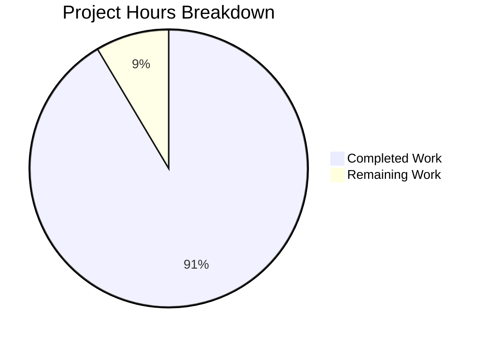

# 1. Executive Summary

Delivery summary, completion, open items and next steps for the Burger Restaurant application.

## 1.1 Project Overview

The Burger Restaurant application grows this repository's Express 5 tutorial service into two packages: a JSON API under `/api` — authentication, menu browsing, ordering and table reservation over SQLite — and a separate Vite 8 + React 19 + TypeScript client with ten screens. Diners register, browse a seeded menu, order at server-computed prices, book a table and review their own history. The three tutorial routes keep byte-identical bodies and content types.

## 1.2 Completion Status



Colours: Completed = Dark Blue `#5B39F3`, Remaining = White `#FFFFFF`. Centre label: **91.4 % complete**.

| Metric | Value |
|---|---|
| Total Hours | 421 |
| Completed Hours (Baseline: Human with agentic-assist) | 385 |
| Remaining Hours | 36 |
| Completion | **91.4 %** (385 ÷ 421) |

The 385 hours cover 38 completed requirements plus part of two; the 36 remaining are those residuals (6 h) and five deployment items (30 h) — Section 2.2.

## 1.3 Key Accomplishments

- **Twelve-endpoint JSON API** under `/api`, exact in status, body, ordering and error code.
- **Authentication leaking no secret** — scrypt with a per-user salt, SHA-256-stored tokens, revocation on logout.
- **Server-priced ordering** — integer-cent totals in one immediate transaction; foreign orders answered `404`.
- **Reservation validation** — six ordered checkpoints, 21:30 accepted, 21:31 refused, duplicates `409`.
- **Self-seeding persistence** — seven tables, foreign keys, WAL, idempotent schema, 6 categories, 14 items.
- **A ten-screen client** — strict TypeScript, typed transport, guarded routes, 44 px controls, no 360 px overflow.
- **An operable entry point** — exact startup line, `EADDRINUSE` exit 1, `SIGTERM` closing server and database.
- **The original service intact** — three tutorial routes byte-identical, their suites unmodified, floors met.

## 1.4 Critical Unresolved Issues

**7 of 45 tracked items remain open** — 2 partially complete AAP requirements and 5 path-to-production or verification items: the 36 remaining hours.

| Issue | Impact | Owner | ETA |
|---|---|---|---|
| The pinned runtime (Node.js 20.19.x / npm 10.8.x) has never been exercised; every gate ran on Node.js 22.23.5 / npm 11.21.0 | The stack pin is unverified on its own terms, though both engine ranges admit either runtime | Backend engineer | 4 h |
| The schema declares three indexes where the plan states four | Documentation and `src/db/schema.sql` disagree on the count; every named access path is still indexed | Backend engineer | 2 h |
| No deployment runbook: database placement and WAL backup, TLS-terminating proxy, `CORS_ORIGIN`, static hosting for `client/dist` | The system cannot be deployed reproducibly from the repository alone; it terminates no TLS and serves no static files itself | Ops engineer | 8 h |
| No readiness probe or log-retention policy | An operator has stdout, the process supervisor and the SQLite file only | Ops engineer | 4 h |
| The order and reservation confirmation screens have no component test | Two of nine view modules are proven structurally and in browser passes, not by an executable suite | Frontend engineer | 10 h |
| A foreign-origin CORS request is not covered by an automated test | Cross-origin behaviour was verified in a browser but would not fail a suite if it regressed | Backend engineer | 2 h |
| The item-detail screen renders no imagery, while the catalogue card does | An item with a non-null `image_url` would present differently on the catalogue and on its own page | Frontend engineer with the design owner | 6 h |

## 1.5 Access Issues

No access issues identified. No credential, third-party API, broker or database service is needed: the API binds a local port and SQLite is one file. Override `PORT`, the Vite ports and `CORS_ORIGIN` when several instances share a machine.

## 1.6 Recommended Next Steps

1. **[High]** Re-run both gates on Node.js 20.19.x with npm 10.8.x and record the result (4 h).
2. **[High]** Write the deployment runbook — database placement and WAL backup, TLS proxy, static host for `client/dist`, `CORS_ORIGIN` (8 h).
3. **[Medium]** Add component tests for the two confirmation screens and an automated foreign-origin CORS check (12 h).
4. **[Medium]** Document the readiness probe (`GET /api/categories` returns a non-empty array) and a log-retention policy (4 h).
5. **[Low]** Decide the item-detail imagery and record the delivered three-index set (8 h).

# 2. Project Hours Breakdown

Hours are estimated per AAP deliverable from file size and complexity, the test surface that proves it, and the integration work it needed. They are the basis for the completion figure in Section 1.2 and are carried unchanged into Section 7.

## 2.1 Completed Work Detail

| Component | Hours | Description |
|---|---|---|
| Server bootstrap, configuration and request pipeline | 23 | `server.js` bind/log/diagnostic/shutdown, the ten runtime settings, both manifests and `.gitignore`, and the six-stage pipeline with its barrels and API aggregator (AAP 0.5.2, 0.5.3, 0.8.2, 0.9.3) |
| Twelve API endpoint contracts | 40 | The four routers, their validators and their response mappings — register, login, session, logout, categories, menu items by filter and by id, order create/list/read, reservation create/list (AAP 0.3.3, 0.10.4) |
| Error vocabulary and the single envelope | 10 | `src/errors.js`: the thirteen codes with their statuses, the two reservation issue strings, and the one envelope writer's mapping rules (AAP 0.3.3, R-6) |
| Authentication, hashing and token lifecycle | 16 | scrypt derivation with a per-user salt, timing-safe comparison, opaque token minting and SHA-256 storage, expiry, revocation and the secret-free user projection (AAP 0.6.1, R-4) |
| User-scoped access to orders and reservations | 8 | Every user-owned statement filtered in SQL so a foreign row is indistinguishable from a missing one and answers 404, not 403 (AAP 0.6.1, R-5) |
| Order transaction and server-side pricing | 14 | One immediate transaction writing the order, its lines and its total, with prices read from `menu_items` inside it so client prices are ignored (AAP 0.11.3, R-3) |
| Reservation validation pipeline | 16 | Six checkpoints in fixed order with the 21:30 last seating, integer-minute slot arithmetic, calendar-day horizon and duplicate detection (AAP 0.11.4) |
| Database module, schema and seed | 22 | Lazy memoised connection with `foreign_keys`/WAL pragmas, idempotent schema apply, the seven tables with their constraints (declared index set partial — see Section 2.2), and the 6-category / 14-item seed (AAP 0.3.2, 0.5.4, A-6) |
| Error-handler branches and module discipline | 12 | Started-response delegation, parse-failure mapping, `AppError` mapping, logged 500 without a stack, plus the single-concern split that keeps every module under 200 lines (AAP 0.11.2, R-10) |
| Client package, toolchain and design tokens | 23 | The client manifest and lockfile, strict TypeScript and Vite/Vitest configuration, and the token home with one 768 px breakpoint and the 44 px control floor (AAP 0.5.6, 0.7.4, 0.9.2) |
| Ten screens, route table and guard | 60 | Nine view modules plus the layout shell behind a thirteen-row manifest, the `/` redirect, six guarded routes, the catch-all 404 and query-driven category filtering (AAP 0.3.2, 0.5.6) |
| Session, cart, API transport and formatters | 25 | Token persistence and restore, the 401 handler, the in-memory cart, the typed fetch wrapper with `ApiError`, and the single display-formatting home (AAP 0.5.6, 0.6.4, A-15, A-16) |
| Frozen tutorial surface and gate integrity | 12 | Three tutorial routes kept byte-identical with their suites and the coverage configuration unmodified, Express never serving the client, and no assertion or threshold relaxed (AAP 0.10.1, 0.13.4, R-1, R-9) |
| Server, client and reachability suites | 54 | Ten unit and eighteen integration suites on the server, seven client suites, and the reachability walks that prove every module is reached from a real entry point (AAP 0.7.3, 0.7.4, 0.8.4) |
| Acceptance evidence: end-to-end, coverage, latency, build | 26 | The end-to-end journey suite, the coverage gate held at 98.22 / 97.05 / 100 / 98.18 against the unchanged floors, the latency assertion, and the client typecheck and production build (AAP 0.10.3) |
| Rules, exclusions, stack pins and documentation | 24 | Absence of every excluded capability and library, the Express/Jest/Supertest/MIT pins (runtime pin partial — see Section 2.2), integer-cent money and GET/POST-only verbs, and the README covering routes, packages, settings and commands (AAP 0.2.2, 0.9.1, 0.12, G8) |
| **Total** | **385** | Matches the Completed Hours in Section 1.2 |

## 2.2 Remaining Work Detail

| Category | Hours | Priority |
|---|---|---|
| Pinned-runtime verification on Node.js 20.19.x / npm 10.8.x (AAP C-004, A-13) | 4 | High |
| Declared index set reconciled with the schema contract (AAP 0.3.2) | 2 | Low |
| Deployment runbook: database placement and WAL backup, TLS-terminating proxy, process supervision, `CORS_ORIGIN`, static hosting for `client/dist` | 8 | High |
| Operator readiness probe and log-retention guidance | 4 | Medium |
| Automated coverage for the order and reservation confirmation screens | 10 | Medium |
| Automated foreign-origin CORS check (preflight plus a foreign-`Origin` GET) | 2 | Low |
| Item-detail imagery decision and implementation (AAP 0.7.4 reach line) | 6 | Low |
| **Total** | **36** | Matches the Remaining Hours in Sections 1.2 and 7 |

Remaining hours by priority: High 12, Medium 14, Low 10. The three items that need a human decision rather than only effort (pinned runtime, index contract, item-detail imagery) are explained in Section 5.2.

# 3. Test Results

Every number below was observed by running both gates on the delivered tree: `CI=true npx jest --ci --maxWorkers=2` (exit 0, 31 suites, 859 tests, coverage All files 98.22 % statements / 97.05 % branches / 100 % functions / 98.18 % lines against floors of 80/75/90/80) and `cd client && CI=true npm test` (exit 0, 7 files, 206 tests). No threshold or suite was excluded to reach them.

| Area / Category | Framework | Tests | Passed | Failed | Coverage | What This Proves |
|---|---|---|---|---|---|---|
| Authentication and identity | Jest 30.2.0 + Supertest | 126 | 126 | 0 | 98.22 / 97.05 / 100 / 98.18 global; `auth.service.js` 100 / 95.65 | Registration, login, session restore and logout behave as contracted, tokens are opaque and stored only as hashes, and no response carries a password or token hash |
| Menu browsing | Jest + Supertest | 77 | 77 | 0 | as above; `menu.service.js` 100 / 100 | Categories arrive in display order, the slug filter returns exactly that category's available items, an unknown slug answers `CATEGORY_NOT_FOUND`, and an unknown item answers `MENU_ITEM_NOT_FOUND` |
| Ordering, persistence and seed | Jest + Supertest against real SQLite files | 122 | 122 | 0 | as above; `order.service.js` 100 / 96.96; `seed.js` 70.27 / 40 | Totals are computed from stored prices inside one transaction, a rejected line leaves no order row, and exactly seven tables with the declared constraints, WAL and the seeded counts appear on a fresh file |
| Reservations | Jest + Supertest | 141 | 141 | 0 | as above; `reservation.service.js` 100 / 100 | The six checkpoints fire in order with the contracted `issue` strings, 21:30 is accepted and 21:31 refused, the horizon is counted in calendar days, and a duplicate slot answers `RESERVATION_CONFLICT` |
| API contract, envelopes and terminals | Jest + Supertest | 183 | 183 | 0 | as above; `errors.js`, `not-found.js`, `error-handler.js` 100 across metrics | Every one of the thirteen codes is produced by a row that asserts both status and code, `details` appears only for validation failures, and an unknown `/api` path answers `ROUTE_NOT_FOUND` while a non-API unknown path keeps Express's own 404 |
| Entry point, pipeline, configuration and module discipline | Jest (mocked app and config, no port bound) | 116 | 116 | 0 | as above; `server.js` 97.05 / 84.21; `config/index.js` 100 | The startup line, listen-error diagnostic and signal shutdown behave as asserted, all ten settings default and override, the app factory never listens, and no module exceeds 200 lines |
| End-to-end, reachability, latency and the frozen tutorial routes | Jest + Supertest | 94 | 94 | 0 | as above | Register → login → browse → order → reserve → confirm passes against a fresh database, every module is reachable from a real entry point, reads stay far inside the 200 ms p95 budget, and the three tutorial routes are byte-exact |
| Client single-page application | Vitest 4.1.12 + Testing Library + jsdom | 206 | 206 | 0 | not instrumented in this package | Cart arithmetic and clearing, field-level validation, guarded-route redirects, layout and session indicators, the typed transport's `ApiError` and 401 handling, the route manifest, and the catalogue and item screens driven through the cart flows |

**Not Covered.** These delivered capabilities are exercised by no automated test and should be checked by a human before release:

- **Order and reservation confirmation screens** (`/orders/:id`, `/orders`, `/reservations/:id`, `/reservations`) — no component test exists; they are proven only by the route-manifest suite and by browser passes, so a rendering regression would not fail a suite. An executable suite for them is the 10-hour task in Section 2.2.
- **Foreign-origin CORS** — preflight and a foreign `Origin` header were checked in a browser only; no Jest suite would catch a regression in `config.corsOrigin` wiring.
- **The non-zero exit code on a bind failure** — the `process.exitCode = 1` arm behind the entry point's `require.main` guard cannot be reached from an in-process run, so it is asserted by nothing; it was confirmed by a real second boot on a bound port (Section 4).
- **The seed script's command-line branch** — `src/db/seed.js` measures 70.27 % of statements because the `npm run seed` path is outside Jest's reach; its behaviour was confirmed by running the command (Section 4).
- **Deployment topology** — serving the built client from a static host behind TLS, and behaviour with more than one concurrent writer, are untested by any suite in this repository.

# 4. Runtime Validation & UI Verification

Driven against a live instance on a private port (`PORT=3141 DB_FILE=data/smoke.db CORS_ORIGIN=http://localhost:5191 npm start`) and against the built client served by `vite preview`:

- ✅ **Start-up and shutdown** — the exact startup line `Server running at http://127.0.0.1:3141/`; `SIGTERM` prints `SIGTERM received, shutting down the HTTP server` and the port is released.
- ✅ **Bind failure** — a second boot on the same port prints `Failed to listen on http://127.0.0.1:3141 (EADDRINUSE)` and exits with status 1.
- ✅ **Tutorial routes** — `GET /` 200 in 14 bytes `text/html`, `/evening` 200 in 12 bytes `text/html`, `/good-evening` 200 in 12 bytes `text/plain`, `/invalid` 404 from Express.
- ✅ **Authentication** — register 201 with a 64-character hex token, session 200, login 200, wrong password 401 `INVALID_CREDENTIALS`, no token 401 `TOKEN_REQUIRED`, logout 204 then 401 `TOKEN_INVALID`.
- ✅ **Catalogue** — 6 categories in `display_order`, 12 available of 14 seeded items, unknown slug 404 `CATEGORY_NOT_FOUND`, unknown `/api` path 404 `ROUTE_NOT_FOUND`.
- ✅ **Ordering** — 201 with `total_cents` 2198 for 2 × 1099 and status `confirmed`, quantity 0 answered 400 with `{field: "items[0].quantity", issue: "must_be_an_integer_between_1_and_20"}`, history 200, another diner's order 404 `ORDER_NOT_FOUND`, non-UUID id 400.
- ✅ **Reservations** — 21:30 answered 201, 21:31 answered 400 with `reservation_time_outside_service_hours`, a duplicate slot 409 `RESERVATION_CONFLICT`, a date 200 days out 400 with the horizon issue, and a request failing two checkpoints reporting the earliest one.
- ✅ **Client screens** — all ten render from the built bundle with populated, empty, loading and error states; no horizontal scrolling at 360 px, two columns from 768 px, every control at least 44 × 44 px, full keyboard operability.
- ✅ **Client build and preview** — `tsc --noEmit` exit 0, `vite build` exit 0 with one chunk per route, `vite preview` answering `GET /` 200 in 1275 bytes with `<title>Burger Restaurant</title>`.
- ✅ **Persistence** — the database file is created at mode `0600` with `journal_mode=wal` and `foreign_keys=1`, holding exactly `users`, `auth_tokens`, `categories`, `menu_items`, `orders`, `order_line_items` and `reservations` plus the three declared indexes.

**Never exercised at runtime:** deployment behind a TLS-terminating proxy with the built client served from a static host; two or more processes writing to the same database file concurrently; a long-running soak under sustained traffic. Item imagery is likewise unobservably absent — the seed ships `image_url: null` on every item, so the catalogue's "No photo" placeholder is the only state either screen can show today.

# 5. Compliance & Quality Review

Every deliverable is stated as it stands now; the status column reflects the verified state on the delivered tree.

## 5.1 Compliance Matrix

| Deliverable | Benchmark | Status | Progress |
|---|---|---|---|
| Twelve endpoint contracts under `/api` | AAP 0.3.3, 0.10.4 — status, body, ordering and error code exact | ✅ Pass | 12 / 12 endpoints, every documented error row exercised |
| Thirteen-code error vocabulary and one envelope | R-6, AAP 0.3.3 — `details` only for validation failures | ✅ Pass | 13 / 13 codes, `ROUTE_NOT_FOUND` and `INTERNAL_ERROR` included |
| Authentication, hashing and token secrecy | R-4, AAP 0.6.1 — scrypt, opaque hashed tokens, no secret echoed | ✅ Pass | 4 / 4 auth contracts plus revocation and expiry |
| Per-user data isolation | R-5 — 404 rather than 403 for a foreign row | ✅ Pass | Every user-owned statement binds `user_id` |
| Order atomicity and server-side pricing | R-3, AAP 0.11.3 — one immediate transaction, integer cents | ✅ Pass | Order, lines and total commit together |
| Reservation validation pipeline | AAP 0.11.4 — six checkpoints in fixed order, two contract issues | ✅ Pass | Boundary cases 21:30 / 21:31 / horizon / duplicate |
| Seven-table schema and index coverage | R-8, AAP 0.3.2 — exactly seven tables, every named path indexed | ⚠ Partial | 7 / 7 tables; 3 declared indexes against the 4 stated (Section 5.2 D3) |
| Seed reference data on first boot | AAP A-6 — at least five categories and twelve items | ✅ Pass | 6 categories, 14 items, 12 available |
| Ten-screen responsive client | G5, AAP 0.5.6 — one 768 px breakpoint, 360 px no overflow, 44 px controls | ✅ Pass | 10 screens; verified at 360 / 768 / 1280 px |
| Preserved tutorial contracts and coverage floors | R-1, R-2, AAP 0.10.1 — frozen files unchanged, floors met | ✅ Pass | Frozen paths byte-identical; 98.22 / 97.05 / 100 / 98.18 |
| Stack pins | C-004, AAP 0.9.1, A-13 — Express, Jest, Supertest, MIT, Node 20.19.x / npm 10.8.x | ⚠ Partial | Versions pinned and installed; pinned runtime unverified (Section 5.2 D1) |
| Exclusions and dependency minimalism | R-7, R-8, AAP 0.2.2, 0.12.2 — no container, CI, cart, payment or extra library | ✅ Pass | Every absence check returns nothing |

## 5.2 AAP & Rule Divergences and Gaps

All 16 departures from the Agent Action Plan found in the delivered tree are listed. Each is a fact about the code as it ships, with the line to open and what a human must decide.

| What the AAP / Rule Required | What Was Delivered Instead | Why It Diverged | Impact | Remediation |
|---|---|---|---|---|
| **D1** Stack pins include a verification run on Node.js 20.19.x / npm 10.8.x (C-004, A-13) | Every gate ran on Node.js 22.23.5 / npm 11.21.0; `README.md:13-16` records it | The host provides Node 22 and prohibits installing or switching runtimes; both engine ranges admit it | The pin itself is unverified, though nothing in the source branches on the runtime | 4 h: re-run both gates on 20.19.x / 10.8.x (Section 1.6 item 1) |
| **D2** R-4 narrative says `scryptSync` (AAP 0.12.1) | `promisify(crypto.scrypt)` awaited, same algorithm and salt (`src/services/auth.service.js:21-24`) | **Sanctioned:** R-4's own text names `crypto.scrypt`, and a synchronous derivation would stall the event loop that serves reads | Hashes and contracts are identical; the derivation does not block reads | None |
| **D3** Four declared indexes (AAP 0.3.2) | Three declared — `idx_menu_items_category`, `idx_orders_user_date`, `idx_order_line_items_order` — with the reservation-history and token-lookup paths served by the UNIQUE indexes the AAP itself mandates (`src/db/schema.sql:126-139`) | The two omitted declarations would duplicate those UNIQUE indexes and are never chosen, while the line-item path would otherwise have no index at all | Every named access path is indexed; the declared count differs from the plan | 2 h: record the delivered set (Section 1.6 item 5) |
| **D4** Factory `createOrderService({orders, items, now})` with availability decided in the service (AAP 0.7.2) | `createOrderService({orders, now})`; existence and availability are decided by the transaction's single read (`src/services/order.service.js`) | Two reads cannot both sit inside the one immediate transaction AAP 0.11.3 requires | `400` / `404` / `409` behaviour and messages are unchanged | None |
| **D5** Order row inserted, lines inserted, then the total written on the order (AAP 0.11.3) | The total is bound in the `INSERT INTO orders` and committed with the row (`src/repositories/order.repository.js`) | The total is known before the first write; a separate `UPDATE` would hold the write lock for nothing | Atomicity and in-transaction pricing hold exactly as specified | None |
| **D6** Each router keeps its own validators and mappings (AAP 0.12.3) | The order router imports the line-rule vocabulary and the UUID shape from `order.service.js`, keeping its own request projection and `VALIDATION_ERROR` mapping (`src/routes/api/orders.routes.js`, 147 lines) | Two hand-kept copies of the same rules can drift with no test linking them | Both layers answer with one vocabulary, so the client sees identical text either way | None |
| **D7** JSON body parser mounted for all requests (AAP 0.5.2 stage 2) | `app.use('/api', express.json())` (`src/app.js:60`) | With an `/api`-scoped error responder, a global parser would send a malformed body on a non-API path to Express's default handler, which prints a stack and an absolute path; R-9 governs the scoping | Non-API paths parse no body; malformed `/api` bodies answer `400 VALIDATION_ERROR` | None |
| **D8** Guard and 401 handler navigate to the bare `/login` (AAP 0.5.6, 0.11.6) | `/login?from=<encoded return path>`, same route and `replace` (`client/src/components/ProtectedRoute.tsx`, `Layout.tsx`) | A diner interrupted mid-flow needs to land back where they were | Same screen and route; only the search string differs | None |
| **D9** `client/src/api/format.ts` holds `formatCents` alone (AAP 0.6.4) | Five display formatters — money at `:51`, timestamp `:71`, status label `:102`, calendar date `:125`, clock time `:172` | One formatting home beats duplicating date and status logic across four views | `formatCents` behaves identically; the module is 74 lines | None |
| **D10** `MenuCard` reached from the catalogue and the item detail (AAP 0.7.4) | The item detail renders no card and therefore no media band (`client/src/views/MenuItemView.tsx`); the catalogue keeps the card | One presentation of the item per screen, and the card's own add control would be a permanently disabled duplicate | Invisible today because every seeded `image_url` is null; a real image would appear only on the catalogue | 6 h: decide and implement (Section 1.6 item 5) |
| **D11** Client dependency table as listed (AAP 0.9.2) | `@types/node ^22.20.5` added as a client devDependency (`client/package.json`) | The layout suite reads both stylesheets from disk, which needs the Node typings under strict mode | Development-only typing; no runtime dependency added | None |
| **D12** Closed suite inventory of 7 unit, 9 integration and 6 client suites (AAP 0.7.5) | 10 unit, 18 integration and 7 client suites are delivered | Several modules named in AAP 0.11.5 have no suite in the stated list, so each carries the suite that proves it | The plan's counts lag the tree; the extra suites are pure evidence | Recorded by the documentation task (Section 1.6 item 5) |
| **D13** Configuration reads `process.env.X || default`, with `parseInt` for numbers (AAP 0.7.2) | Settings are validated and bounded — `HH:MM` parsing, party cap 1–12, a `*` CORS origin refused, integer ranges enforced (`src/config/index.js`) | An out-of-domain setting would turn a `400` into a `500` at the database CHECK, and a `*` origin would silently allow every site | Invalid configuration fails at start-up with a clear message; the documented defaults and the frozen tolerance cases still pass | None |
| **D14** `reservations.status` CHECK fixed verbatim, admitting `cancelled` (AAP 0.3.2) while cancellation is out of scope (AAP 0.2.2) | Kept as the plan states (`src/db/schema.sql:120`); no cancellation route, transition or view exists | **Sanctioned:** the schema is fixed verbatim by the plan and the domain value bounds the column | No cancellation is reachable through the API | None |
| **D15** Existing assertions not edited (AAP 0.13.4) | Four non-frozen client suites assert the delivered contract rather than the mechanisms the plan's wording describes (reservation form rows, the `429` exemplar, the 360 px case, the cart clamp cases) | The plan's own settlements supersede those mechanisms: no client-side blocking, no rate-limit code, the 360 px outcome rather than one rule achieving it, and the 1–20 clamp. The frozen server suites and the coverage configuration are untouched | No behaviour lost: each is asserted at its own layer and the suites grew | None |
| **D16** README documents the pinned runtime | The README documents the runtime actually verified, `Node.js v22.23.5` with `npm 11.21.0`, beside the 20.19.x minimum | A reader must be told what was proven, not what was intended | Documentation is accurate; the pin remains unverified (D1) | Closes with D1 |

**Divergences that need a human decision.**

**D1 — the pinned runtime has never been exercised.** The plan freezes Node.js 20.19.x and npm 10.8.x and makes the verification run part of that constraint. The delivered system pins Express 5.1.0, Jest 30.2.0, Supertest 7.1.4 and the MIT licence in the manifests, and both gates pass on the runtime this machine provides, Node.js 22.23.5 with npm 11.21.0 — which `README.md:13-16` states plainly and which both engine ranges (`vite@8.3.8`: `^20.19.0 || >=22.12.0`; `vitest@4.1.x`: `^20.0.0 || ^22.0.0 || >=24.0.0`) accept. Nothing in `server.js`, `src/**` or `client/src/**` branches on a Node major, so the risk is small — but the pin's own claim is unproven. Run `CI=true npm ci && CI=true npx jest --ci` and the client gate on 20.19.x / 10.8.x and record both results; that closes it.

**D3 — the schema declares three indexes where the plan states four.** The seven tables, every `CHECK`, every foreign key, both cascades and the `UNIQUE (user_id, reservation_date, reservation_time)` constraint are exactly as specified. What differs is the index list: `src/db/schema.sql:126-139` declares `idx_menu_items_category`, `idx_orders_user_date` and `idx_order_line_items_order`, and serves the reservation-history and token-lookup paths through the UNIQUE indexes the plan itself requires SQLite to build. Every access path named in the plan is therefore indexed, and order line-item lookups carry their own index. Decide whether the four-index count is contractual: if it is, amend the plan and README to the delivered three plus the two constraint-backed paths; if it is descriptive, nothing to do. Declaring a fourth index would duplicate one of them.

**D10 — the item detail shows no picture while the catalogue does.** AAP 0.7.4 has `MenuCard` reached from both the catalogue and the item detail; the delivered `client/src/views/MenuItemView.tsx` renders no card, so the item appears once with its name, description, category, price and a single add-to-cart action — but with no media band, and the heading order runs `h1` → `h3` where the card's title would have supplied the level. The screen carries no duplicated presentation and no second, disabled add control; what it costs is imagery parity with the catalogue. It is invisible today because `src/db/seed.js` ships `image_url: null` on all 14 items and every card shows the styled "No photo" placeholder. If the restaurant later supplies real images, decide whether screen 4 shows one, and add a single constrained media block rather than re-embedding the whole card.

# 6. Risk Assessment

Risks are forward-looking: what could still go wrong in production, and what mitigates it.

| Risk | Category | Severity | Probability | Mitigation | Status |
|---|---|---|---|---|---|
| One serialized SQLite connection and one file mean order and reservation writes queue behind each other; WAL keeps readers unblocked but write throughput has a single ceiling | Technical | Medium | Medium | Keep volume expectations in line with a single restaurant; the immediate transaction is what guarantees the totals. Revisit the driver if write volume grows | Accepted by design (AAP 0.4.2) |
| The schema is applied idempotently with no migration tooling, so evolving a populated `data/app.db` needs hand-written DDL | Technical | Medium | Low | Change DDL deliberately and keep a pre-change copy of the file; the seven-table contract is asserted by a suite | Open — operational discipline required |
| The pinned Node.js 20.19.x / npm 10.8.x runtime has never been exercised | Technical | Low | Medium | Re-run both gates on that runtime (Section 2.2, 4 h) | Open — task in Section 1.6 |
| The session token lives in `localStorage` under `burger.auth.token`, so any cross-site scripting in the client reads it | Security | Medium | Low | Serve the client with a strict Content-Security-Policy at the proxy; keep the dependency set small (react, react-dom, react-router-dom only) | Open — belongs to the serving host |
| No rate limiting exists on any route, so credential stuffing against `POST /api/auth/login` is unthrottled | Security | Medium | Medium | Throttle at the reverse proxy; the API's thirteen-code vocabulary deliberately has no rate-limit code | Open — belongs to the proxy |
| The application terminates no TLS and sets no security headers; it also serves no static files | Operational | High | Medium | Front it with a TLS-terminating reverse proxy that also serves `client/dist` and sets `CORS_ORIGIN` to that origin | Open — addressed by the deployment runbook (8 h) |
| No health or metrics endpoint and no log-retention policy: an operator has stdout, the supervisor and the database file | Operational | Medium | Medium | Document a readiness probe (`GET /api/categories` returning a non-empty array) and the log lifecycle (4 h) | Open — task in Section 1.6 |
| The Vite proxy pins `http://127.0.0.1:3000` and the default `corsOrigin` pins `http://localhost:5173`; a deployment that leaves either default will fail cross-origin calls | Integration | Medium | Medium | Set `CORS_ORIGIN` to the SPA's deployed origin and host the build separately, or point the dev proxy at the deployed API | Open — covered by the deployment runbook |

# 7. Visual Project Status


Colours: Completed = Dark Blue `#5B39F3`; Remaining = White `#FFFFFF`.

Remaining hours by category (from Section 2.2):

| Category | Hours |
|---|---|
| Deployment runbook | 8 |
| Automated coverage for the confirmation screens | 10 |
| Pinned-runtime verification | 4 |
| Operator readiness probe and log retention | 4 |
| Item-detail imagery decision | 6 |
| Declared index set reconciled | 2 |
| Automated foreign-origin CORS check | 2 |
| **Total** | **36** |

# 8. Summary & Recommendations

The Burger Restaurant application is delivered as two packages in one repository: an Express 5 JSON API whose twelve endpoints, thirteen error codes and seven SQLite tables are exactly the plan's contract, and a Vite 8 + React 19 + TypeScript client whose ten screens cover registration, sign-in, catalogue, item detail, cart and checkout, order confirmation and history, reservation form, booking confirmation and history, plus the layout shell and a 404. The three tutorial routes the repository published before this work are unchanged byte for byte. Against the Agent Action Plan the project is **91.4 % complete** — 385 of 421 hours — with 36 hours left across seven items, two of which are partial requirements rather than missing capability.

What has been proven, rather than asserted: 859 server tests across 31 suites and 206 client tests across 7 suites pass on the delivered tree, with server coverage at 98.22 % statements, 97.05 % branches, 100 % functions and 98.18 % lines against floors of 80/75/90/80 and a coverage configuration that was never edited. Beyond the suites, the running system was exercised end to end — registration to booking, the 21:30 last seating accepted and 21:31 refused, a duplicate slot answered `409`, a diner denied another diner's order with a `404`, a bind failure exiting non-zero, and `SIGTERM` releasing the port. The client typechecks under strict mode, builds with one chunk per route, and serves from a production preview.

The remaining 36 hours are deployment and verification work, not feature work. The critical path is two items: the deployment runbook (8 h) — where the database file lives, how to back up an open WAL database, the TLS-terminating proxy, the static host for `client/dist` and `CORS_ORIGIN` — and the pinned-runtime verification (4 h) that puts the plan's own stack pin on record. After those, the two verification gaps (component tests for the order and reservation confirmation screens, an automated foreign-origin CORS check) stand between a client suite that drives seven of the nine view modules and one that drives all nine.

| Success metric | Target | Delivered |
|---|---|---|
| Server test suite | all green | 31 suites, 859 tests, 0 failures |
| Client test suite | all green | 7 files, 206 tests, 0 failures |
| Coverage (statements / branches / functions / lines) | 80 / 75 / 90 / 80 | 98.22 / 97.05 / 100 / 98.18 |
| Read latency p95 (20 sequential reads) | under 200 ms | ≈ 1.0–1.4 ms |
| Endpoint contract conformance | 12 of 12 | 12 of 12, every documented error row |
| Frozen tutorial routes | byte-identical | byte-identical, suites unmodified |

Production readiness: the application is functionally complete and internally verified, and it is ready to be staged behind a TLS-terminating proxy on a private network. It is not ready for direct public exposure, for two reasons that are operational rather than code defects — nothing in the repository terminates TLS or sets security headers, and nothing documents the backup, readiness and log-retention practice an operator needs. Complete the two High-priority items in Section 1.6 before the first production deployment, then the Medium items before the first release that carries real diner data.

# 9. Development Guide

**System prerequisites.** Node.js 20.19.x or newer (verified here on v22.23.5) with npm 10.x or newer (verified on 11.21.0); git; about 400 MB of disk for the two `node_modules` trees. No database server, broker, container or credential is required — persistence is one SQLite file the process creates. `better-sqlite3` installs a prebuilt binary; npm prints a warning that its install script is not in `allowScripts`, which is expected and harmless as long as install scripts are not disabled.

**Install.**

```bash
# root package (API + Jest suites) — never `npm install`, which can rewrite the lockfile
CI=true npm ci

# client package (Vite + React SPA)
cd client && CI=true npm ci && cd ..
```

`npm ci` completes in a few seconds from a warm cache and installs express 5.1.0, better-sqlite3 11.10.0, cors 2.8.6, jest 30.2.0 and supertest 7.1.4 at the root, and react 19, react-router-dom 7, vite 8.3.8, vitest 4.1.x, jsdom 26 and Testing Library 16 in `client/`.

**Run the API.** The database file, the seeded content and the WAL journal are created on first use.

```bash
PORT=3141 DB_FILE=data/app.db CORS_ORIGIN=http://localhost:5173 npm start
# Expected: Server running at http://127.0.0.1:3141/
```

Override the defaults whenever more than one instance runs on a machine: `HOST` (default `127.0.0.1`), `PORT` (default `3000`), `DB_FILE` (default `data/app.db`), `CORS_ORIGIN` (default `http://localhost:5173`), `TOKEN_TTL_HOURS` (24), `SERVICE_OPEN_TIME` (`17:00`), `SERVICE_CLOSE_TIME` (`22:00`), `MAX_PARTY_SIZE` (12), `RESERVATION_HORIZON_DAYS` (90), `NODE_ENV` (`development`). Seed the menu separately if you want it before the first request:

```bash
DB_FILE=data/app.db npm run seed
# Expected: Menu seed complete: rows inserted on this run; 6 categories, 14 menu items.
```

**Run the client.** Express never serves the built client; Vite does.

```bash
cd client
npm run dev            # http://localhost:5173, proxies /api to http://127.0.0.1:3000
npm run build          # tsc --noEmit && vite build — emits client/dist with one chunk per route
npm run preview        # serves the build (default 4173); add --port <n> when several instances run
```

**Verification.** `--coverage=false` is required on subset runs: the global thresholds would otherwise fail a subset even when every test passes.

```bash
# whole server package with coverage — 31 suites, 859 tests
CI=true npx jest --ci --maxWorkers=2

# faster subsets
CI=true npx jest tests/unit tests/integration --ci --coverage=false     # 30 suites, 854 tests
CI=true npx jest tests/integration/endpoints.test.js --ci --coverage=false   # 1 suite, 17 tests

npm run test:ci        # the CI-shaped gate: jest --ci --coverage, same 31 suites / 859 tests

# client
cd client && npm test          # vitest run — 7 files, 206 tests
cd client && npm run typecheck # tsc --noEmit, exit 0
```

**Example session.** With the API running on `:3141`. The reservation dates are computed inside the 90-day horizon, and the item id is taken from the first `id` in the catalogue response (each item also nests its category's id, so the first match is the item).

```bash
BASE=http://127.0.0.1:3141
DAY1=$(date -u -d '+30 days' +%F)
DAY2=$(date -u -d '+31 days' +%F)

curl -s $BASE/                                   # Hello, World!  (text/html, 14 bytes)
curl -s $BASE/evening                            # Good evening   (text/html, 12 bytes)
curl -s $BASE/good-evening                       # Good evening   (text/plain, 12 bytes)

TOKEN=$(curl -s -X POST $BASE/api/auth/register \
  -H 'Content-Type: application/json' \
  -d '{"name":"Ada","email":"ada@example.com","password":"correct-horse-9"}' \
  | sed -n 's/.*"token":"\([0-9a-f]*\)".*/\1/p')

curl -s $BASE/api/categories | head -c 200       # 6 categories in display_order
ITEM=$(curl -s $BASE/api/menu-items | grep -o '"id":"[^"]*"' | head -1 | sed 's/.*:"//;s/"//')

curl -s -X POST $BASE/api/orders -H "Authorization: Bearer $TOKEN" \
  -H 'Content-Type: application/json' \
  -d "{\"items\":[{\"menu_item_id\":\"$ITEM\",\"quantity\":2}]}"   # 201, server-computed total_cents

curl -s -X POST $BASE/api/reservations -H "Authorization: Bearer $TOKEN" \
  -H 'Content-Type: application/json' \
  -d "{\"reservation_date\":\"$DAY1\",\"reservation_time\":\"21:30\",\"party_size\":4}"   # 201, last seating

curl -s -X POST $BASE/api/reservations -H "Authorization: Bearer $TOKEN" \
  -H 'Content-Type: application/json' \
  -d "{\"reservation_date\":\"$DAY2\",\"reservation_time\":\"21:31\",\"party_size\":4}"
# 400 {"error":{"code":"VALIDATION_ERROR", ... "issue":"reservation_time_outside_service_hours"}}

curl -s -X POST $BASE/api/auth/logout -H "Authorization: Bearer $TOKEN" -o /dev/null -w '%{http_code}\n'  # 204
```

**Troubleshooting.**

- **`EADDRINUSE` on start** — the port is taken. The process prints `Failed to listen on http://<host>:<port> (EADDRINUSE)` and exits 1; pick another `PORT`.
- **A subset jest run fails on coverage** — add `--coverage=false`. Never lower the thresholds in `jest.config.js`, which collect from `server.js` and `src/**/*.js`.
- **`Cannot find module 'better-sqlite3'`** — the package's install script was blocked. Re-run `CI=true npm ci` without `--ignore-scripts`; the prebuilt binary is the supported path.
- **The SPA loads but every `/api` call fails** — the Vite dev proxy targets `http://127.0.0.1:3000`. Start the API there, or point the proxy at the port you used; in production set `CORS_ORIGIN` to the SPA's origin.
- **A request returns `400 VALIDATION_ERROR` with a `details` array** — expected for malformed input; the `field` and `issue` name exactly what to fix, and `reservation_time_outside_service_hours` or `reservation_datetime_in_past` are the two documented reservation issues.
- **The database file is missing** — it is created on first use at `DB_FILE`, which defaults to `data/app.db`; the directory is created for you and the file is `0600` with WAL enabled.

# 10. Appendices

Supporting references for operating and extending the application. Commands listed are those verified against this tree.

## A. Command Reference

| Purpose | Command | Expected result |
|---|---|---|
| Install root dependencies | `CI=true npm ci` | installs from `package-lock.json` in a few seconds from a warm cache |
| Install client dependencies | `cd client && CI=true npm ci` | React 19 / Vite 8 / Vitest 4 toolchain |
| Start the API | `PORT=3141 DB_FILE=data/app.db npm start` | `Server running at http://127.0.0.1:3141/` |
| Seed the menu | `DB_FILE=data/app.db npm run seed` | `Menu seed complete: … 6 categories, 14 menu items.` |
| Whole server gate with coverage | `CI=true npx jest --ci --maxWorkers=2` | 31 suites, 859 tests, coverage 98.22 / 97.05 / 100 / 98.18 |
| Server subset gate | `CI=true npx jest tests/unit tests/integration --ci --coverage=false` | 30 suites, 854 tests |
| Single suite | `CI=true npx jest tests/integration/endpoints.test.js --ci --coverage=false` | 1 suite, 17 tests |
| CI-shaped gate | `npm run test:ci` | `jest --ci --coverage`, 31 suites / 859 tests |
| Client tests | `cd client && npm test` | 7 files, 206 tests |
| Client typecheck | `cd client && npm run typecheck` | exit 0 under `strict` + `noUncheckedIndexedAccess` |
| Client build | `cd client && npm run build` | `tsc --noEmit && vite build`, `client/dist` emitted |
| Client dev server | `cd client && npm run dev` | `http://localhost:5173`, `/api` proxied to `127.0.0.1:3000` |
| Client preview | `cd client && npm run preview -- --port 4214` | serves the built SPA |
| Syntax check one module | `node --check src/app.js` | no output on success |
| Inspect the database | `node -e "const D=require('better-sqlite3');const d=new D('data/app.db',{readonly:true});console.log(d.prepare(\"select name from sqlite_master where type='table'\").all())"` | the seven table names |

## B. Port Reference

| Port | Owner | Default | Notes |
|---|---|---|---|
| 3000 | Express API | `config.port` (`PORT`) | The Vite proxy's target; the documented default |
| 3141 | Express API | — | The partitioned port used for the runtime checks in Section 4 |
| 5173 | Vite dev server | `server.port` in `client/vite.config.ts` | Default `corsOrigin`; proxies `/api` to `127.0.0.1:3000` |
| 4173 | Vite preview | `preview.port` | Serves the production build; proxies `/api` to `127.0.0.1:3000` |

The API binds exactly one port (`server.js:61`); nothing else in the system listens. When several instances share a machine, offset `PORT`, `vite --port` and `vite preview --port`, and set `CORS_ORIGIN` to the client's actual origin.

## C. Key File Locations

| Path | What lives there |
|---|---|
| `server.js` | The only listener: binds host and port, logs the startup line, reports a bind failure, closes HTTP server and database on `SIGTERM`/`SIGINT` |
| `src/app.js` | The application factory: CORS, `/api` JSON parser, tutorial router at `/`, API router at `/api`, then the two `/api`-scoped terminals. Never listens |
| `src/errors.js` | `AppError` plus the single thirteen-code table of statuses and the two reservation issue strings |
| `src/routes/main.routes.js` | The three frozen tutorial routes — do not edit |
| `src/routes/api/` | `index.js` aggregator plus the auth, menu, orders and reservations routers |
| `src/services/` | Business rules: hashing and tokens, catalogue lookup, order pricing, the reservation checkpoints |
| `src/repositories/` | Every SQL statement, one module per table group |
| `src/middleware/` | Bearer authentication, the `/api` 404 envelope, the envelope-writing error handler |
| `src/db/index.js` | Lazy memoised connection: directory, pragmas, schema apply, seed trigger, `closeDb()` |
| `src/db/schema.sql` | The seven tables, their constraints and the declared indexes |
| `src/db/seed.js` | The 6-category / 14-item reference data, seeded in one transaction |
| `src/config/index.js` | The only reader of `process.env`; ten validated settings |
| `client/src/main.tsx` | Composition root and the route manifest the reachability suite reads |
| `client/src/api/` | Typed transport, contract types, and the single display-formatting home |
| `client/src/state/` | Session (token, restore, 401 handling) and the in-memory cart |
| `client/src/components/` | Layout shell, route guard, shared form controls, catalogue card |
| `client/src/views/` | The nine view modules behind the ten screens |
| `client/src/styles/` | Design tokens and the catalogue/cart layout, one 768 px breakpoint each |
| `tests/unit`, `tests/integration`, `tests/lifecycle` | 31 Jest suites; the lifecycle and tutorial suites are frozen |
| `client/src/__tests__/` | The seven Vitest suites |
| `jest.config.js` | Coverage collection and the 80/75/90/80 global floors — unchanged |
| `data/app.db` | Created on first use, `0600`, WAL journal; gitignored with its `-wal`/`-shm` sidecars |

## D. Technology Versions

| Package | Version | Package | Version |
|---|---|---|---|
| node | v22.23.5 (verified run; minimum 20.19.x) | typescript | 5.9.3 |
| npm | 11.21.0 (verified run; minimum 10.x) | vite | 8.3.8 |
| express | 5.1.0 | @vitejs/plugin-react | 6.3.0 |
| better-sqlite3 | 11.10.0 | vitest | 4.1.12 |
| cors | 2.8.6 | jsdom | 26.1.0 |
| jest | 30.2.0 | @testing-library/react | 16.3.3 |
| supertest | 7.1.4 | @testing-library/user-event | 14.6.13 |
| react / react-dom | 19.3.1 | @testing-library/dom | 10.4.2 |
| react-router-dom | 7.18.6 | @types/react / @types/react-dom | 19.3.0 |
| SQLite (bundled) | 3.x via better-sqlite3 | @types/node | 22.20.5 |

Licence: MIT. Two runtimes only — Node.js for the API and its suites, the browser for the bundle. Neither package imports from the other; the API contract is mirrored by hand in `client/src/api/types.ts`.

## E. Environment Variable Reference

Read only in `src/config/index.js`, validated at require time; the client reads no environment variable.

| Variable | Default | Validation | Consumer |
|---|---|---|---|
| `HOST` | `127.0.0.1` | any bindable address | `server.js` |
| `PORT` | `3000` | integer 1–65535, falls back to the default when unparsable | `server.js` |
| `NODE_ENV` | `development` | free text | available to `server.js`; nothing branches on it |
| `DB_FILE` | `data/app.db` | path; parent directory created on first open | `src/db/index.js` |
| `CORS_ORIGIN` | `http://localhost:5173` | a single origin; `*` is refused | `src/app.js` |
| `TOKEN_TTL_HOURS` | `24` | integer ≥ 1 | `src/services/auth.service.js` |
| `SERVICE_OPEN_TIME` | `17:00` | `HH:MM`, and earlier than the close time | `src/services/reservation.service.js` |
| `SERVICE_CLOSE_TIME` | `22:00` | `HH:MM`; last seating is one 30-minute slot before it | `src/services/reservation.service.js` |
| `MAX_PARTY_SIZE` | `12` | integer 1–12 (mirrors the schema CHECK) | `src/services/reservation.service.js` |
| `RESERVATION_HORIZON_DAYS` | `90` | integer ≥ 1, counted in calendar days | `src/services/reservation.service.js` |

No `.env` file is loaded — the application reads `process.env` directly, so pass variables inline (`PORT=3141 npm start`) or through the process supervisor.

## F. Developer Tools Guide

- **Jest 30 (root)** — collects coverage from `server.js` and `src/**/*.js` and matches `tests/**/*.test.js`. Use `--coverage=false` on any subset run; the global floors are enforced on every run otherwise. `node --check` is the syntax gate for a single module.
- **Vitest 4 (client)** — `vitest run` only, never watch mode; jsdom environment with `client/src/test/setup.ts` registered through `vite.config.ts`, which imports `defineConfig` from `vitest/config` (importing it from `vite` breaks the strict typecheck).
- **TypeScript 5.9** — `npx tsc --noEmit` is the whole static gate for the client; `strict` and `noUncheckedIndexedAccess` are on, and `vite.config.ts` is inside the program. There is no linter or formatter configured anywhere in this repository, and none should be added.
- **Vite 8** — the dev server proxies only `/api` to `http://127.0.0.1:3000`; proxying `/` would shadow the tutorial routes. The build emits one chunk per route.
- **better-sqlite3** — synchronous, one serialized handle. From a shell: `node -e "const D=require('better-sqlite3');const d=new D('data/app.db',{readonly:true});console.log(d.pragma('journal_mode',{simple:true}),d.prepare('select count(*) c from menu_items').get())"`. The `sqlite3` CLI is not required.
- **Supertest** — drives the exported app in-process, so integration suites bind no port and can run in parallel.
- **Git hooks** — only the stock Git LFS shims are installed; if you run `pre-push` by hand, invoke it the way git does (`printf '' | .git/hooks/pre-push origin <url>`), never with no arguments.

## G. Glossary

| Term | Meaning here |
|---|---|
| AAP | The Agent Action Plan — the technical specification that scopes this project and against which completion is measured |
| AppError | The single error class carrying a code from the thirteen-code vocabulary; the error handler derives the HTTP status from it |
| Contract | A request/response shape the API guarantees: method, path, status, body fields, ordering rule and error codes |
| Declared index | A `CREATE INDEX` statement in `src/db/schema.sql`, as distinct from an index SQLite creates for a `UNIQUE` constraint |
| Envelope | The one error body: `{"error":{"code","message","details"}}`, where `details` appears only for validation failures |
| Frozen surface | The three tutorial routes, their suites and `jest.config.js`, which must not change for the preserved contracts to hold |
| Graceful shutdown | `SIGTERM`/`SIGINT` closing the HTTP server and then the database before the process exits |
| Immediate transaction | `db.transaction(fn).immediate()` in better-sqlite3 — the write lock is taken before the first read, so pricing and the order write cannot interleave |
| Issue string | The contract-fixed value in a validation `details` entry, e.g. `reservation_time_outside_service_hours` |
| Last seating | The close time minus one 30-minute slot — 21:30 for the default 22:00 window |
| Lazy open | The database connection is created on first repository call, never at require time, so importing the app creates no file |
| Reachability | A suite that walks barrel → aggregator → routers → services → repositories → database (and the client route manifest → views) so an unreachable module fails a test |
| Two-package boundary | The root CommonJS API package and the ESM `client/` package; they communicate only over HTTP, and no file is imported across it |
| WAL | SQLite's write-ahead journaling mode, enabled on the connection so readers are not blocked by the order transaction |
