# Technical Specification

# 1. Introduction

## 1.1 EXECUTIVE SUMMARY

### 1.1.1 Project Overview

This Technical Specification defines the architecture, design, and implementation plan for a **full-stack burger restaurant web application** — a modern, customer-facing platform that empowers diners to authenticate, browse a menu, place online orders, and reserve tables for dine-in experiences. The system is built on an existing Express.js 5.1.0 backend foundation (currently the `hello_world` v1.0.0 project) and will be expanded into a comprehensive restaurant digital experience powered by **Vite.js** and **TypeScript** on the frontend.

The project represents a complete transformation from a basic Node.js/Express.js tutorial server — currently serving two static greeting endpoints (`GET /` and `GET /evening`) as defined in `src/routes/main.routes.js` — into a production-grade, full-stack restaurant platform with authentication, e-commerce ordering, and reservation management capabilities.

### 1.1.2 Core Business Problem

The restaurant industry increasingly demands a digital presence that supports both online and in-person customer engagement. This system addresses the following core challenges:

| Business Challenge | Solution Provided |
|---|---|
| **No digital ordering channel** | A complete online ordering workflow for burger menu items |
| **Manual reservation management** | A self-service table booking system for dine-in customers |
| **Customer identification gap** | A user authentication system enabling personalized experiences |
| **Lack of web presence** | A modern, responsive single-page application (SPA) for brand visibility |

### 1.1.3 Key Stakeholders and Users

| Stakeholder Group | Role | Primary Interest |
|---|---|---|
| **Guest Visitors** | Unauthenticated site visitors | Browse the burger menu and restaurant information |
| **Registered Customers** | Authenticated users | Login, place online orders, book dine-in tables |
| **Restaurant Staff** (implied) | Order and reservation managers | Process incoming orders, manage table availability |
| **Development Team** | System builders and maintainers | Codebase quality, testability, extensibility |

### 1.1.4 Expected Business Impact and Value Proposition

The burger restaurant web application delivers measurable value across multiple dimensions:

- **Revenue Expansion**: Enables a direct-to-consumer online ordering channel, removing dependency on third-party delivery aggregators.
- **Operational Efficiency**: Automates table booking workflows, reducing manual phone-based reservation overhead.
- **Customer Retention**: Authenticated user accounts create a foundation for personalized customer relationships and repeat engagement.
- **Brand Presence**: A modern, TypeScript-powered SPA built with Vite.js delivers a fast, polished user experience that strengthens brand perception.

---

## 1.2 SYSTEM OVERVIEW

### 1.2.1 Project Context

#### Business Context and Market Positioning

This application targets the quick-service and casual-dining restaurant segment, specifically serving a burger-focused establishment. The platform positions the restaurant to compete in the growing digital food-ordering and reservation market by providing customers with three core digital workflows: **authentication**, **online ordering**, and **table reservation**.

#### Current System State and Limitations

The repository currently exists as a minimal Express.js tutorial server, as documented in `package.json` (name: `hello_world`, version: `1.0.0`, description: "Hello world in Node.js") and `README.md` (title: "hao-backprop-test", described as "A Node.js tutorial server demonstrating Express.js integration with multiple HTTP endpoints"). Critical limitations of the current state include:

| Current Limitation | Impact on Target System |
|---|---|
| No frontend/UI (`blitzy/documentation/Technical Specifications.md` — backend-only) | Requires complete Vite.js + TypeScript SPA implementation |
| No database integration (stateless endpoints only) | Requires database layer for users, orders, reservations, menu catalog |
| No authentication/authorization | Requires user registration, login, and session management |
| No CORS configuration | Requires cross-origin support for frontend-backend communication |
| Empty `server.js` entry point | Requires server bootstrap logic implementation |
| CommonJS module system throughout | Requires migration path to TypeScript/ES Modules on frontend |

#### Integration with Existing Foundation

Despite the current limitations, the existing repository provides a sound architectural foundation to build upon:

- **Express.js 5.1.0 Backend**: The project already uses Express.js 5, which provides native async/await error handling and modern routing capabilities. The application factory pattern in `src/app.js` cleanly separates app configuration from server binding.
- **Modular Architecture**: The codebase follows established design patterns including the Factory Pattern (`src/app.js`), Barrel Pattern (`src/routes/index.js`), Separation of Concerns (`server.js` vs. `src/app.js`), and Twelve-Factor Configuration (`src/config/index.js`).
- **Testing Infrastructure**: Jest 30.2.0 and Supertest 7.1.4 provide a robust testing foundation with 75% branch, 90% function, and 80% line coverage thresholds configured in `jest.config.js`.
- **Environment Configuration**: The `src/config/index.js` module already implements environment variable management with defaults for `HOST`, `PORT`, and `NODE_ENV`.

### 1.2.2 High-Level Description

#### Primary System Capabilities

The target system delivers four primary capabilities, each mapped to a distinct user need:

1. **User Authentication** — Secure registration and login system enabling personalized customer accounts.
2. **Burger Menu Catalog** — Browsable product catalog displaying burger items, categories, descriptions, and pricing.
3. **Online Ordering** — End-to-end ordering workflow: menu browsing → cart management → checkout → order confirmation.
4. **Table Reservation** — Self-service dine-in table booking with date, time, and party size selection.

#### Major System Components

The system follows a modern full-stack architecture with clear separation between frontend and backend layers:

```mermaid
graph TB
    subgraph FrontendLayer["Frontend Layer (Vite.js + TypeScript)"]
        UI["Responsive SPA UI"]
        Auth["Authentication Views"]
        Menu["Menu Browsing"]
        Cart["Cart & Ordering"]
        Booking["Table Reservation"]
    end

    subgraph BackendLayer["Backend Layer (Express.js 5.1.0)"]
        API["REST API Gateway"]
        AuthSvc["Auth Service"]
        OrderSvc["Order Service"]
        ReservationSvc["Reservation Service"]
        MenuSvc["Menu Service"]
    end

    subgraph DataLayer["Data Layer"]
        DB["Database"]
        Config["Configuration (src/config/index.js)"]
    end

    UI --> API
    Auth --> API
    Menu --> API
    Cart --> API
    Booking --> API

    API --> AuthSvc
    API --> OrderSvc
    API --> ReservationSvc
    API --> MenuSvc

    AuthSvc --> DB
    OrderSvc --> DB
    ReservationSvc --> DB
    MenuSvc --> DB
    AuthSvc --> Config
end
```

| Component | Technology | Current Status |
|---|---|---|
| Frontend SPA | Vite.js + TypeScript | Not yet implemented |
| Backend API | Express.js 5.1.0 (Node.js) | Foundation exists (`src/app.js`, `src/routes/`) |
| Data Persistence | Database (to be determined) | Not yet implemented |
| Testing Framework | Jest 30.2.0 + Supertest 7.1.4 | Operational (41 tests, 100% coverage) |

#### Core Technical Approach

The system adopts a **decoupled full-stack architecture** where:

- The **frontend** is a Vite.js-powered TypeScript single-page application that communicates with the backend via RESTful HTTP APIs. Vite.js provides extremely fast Hot Module Replacement (HMR) during development and optimized production builds via Rolldown bundling.
- The **backend** extends the existing Express.js 5.1.0 server with additional API routes for authentication, menu management, ordering, and reservations. Express 5's native async/await support and promise-based error handling simplify middleware development.
- The **data layer** introduces persistent storage for user accounts, menu items, orders, and reservations — a critical addition to the currently stateless system.
- The **configuration layer** builds upon the existing Twelve-Factor configuration pattern in `src/config/index.js` to support additional environment variables for database connections, authentication secrets, and service configuration.

### 1.2.3 Success Criteria

#### Measurable Objectives

| Objective | Metric | Target |
|---|---|---|
| User authentication functional | Registration + Login success rate | ≥ 99.5% |
| Online ordering available | End-to-end order placement | Fully operational |
| Table booking available | Reservation creation + confirmation | Fully operational |
| Frontend performance | Initial page load time (Vite production build) | < 3 seconds |

#### Critical Success Factors

1. **Seamless User Experience**: The Vite.js + TypeScript SPA must deliver a responsive, intuitive interface for menu browsing, ordering, and reservation workflows.
2. **Reliable Authentication**: User login and session management must be secure and consistent across all protected routes.
3. **Data Integrity**: All orders and reservations must be accurately persisted and retrievable.
4. **Extensible Architecture**: The modular backend patterns already established (factory, barrel, separation of concerns) must be preserved and extended as new API domains are added.

#### Key Performance Indicators (KPIs)

| KPI | Description | Measurement Method |
|---|---|---|
| Order Completion Rate | Percentage of started orders that reach confirmation | Backend order status analytics |
| Reservation Utilization | Ratio of booked tables to available capacity | Reservation database queries |
| Authentication Adoption | Percentage of visitors who create accounts | User registration analytics |
| Test Coverage | Automated test coverage across all modules | Jest coverage reports (baseline: 90% functions, 80% lines per `jest.config.js`) |

---

## 1.3 SCOPE

### 1.3.1 In-Scope

#### Core Features and Functionalities

The following capabilities constitute the must-have feature set for this system, directly derived from the user requirements to build a burger restaurant website with login, online ordering, and table booking using Vite.js and TypeScript:

| Feature Domain | Capabilities | Priority |
|---|---|---|
| **User Authentication** | User registration, login, session management, logout | Must-have |
| **Burger Menu Catalog** | Menu display, item details, categories, pricing | Must-have |
| **Online Ordering** | Add to cart, modify cart, place order, order confirmation | Must-have |
| **Table Reservation** | Select date/time, party size, book table, confirmation | Must-have |
| **Responsive Web UI** | Vite.js + TypeScript SPA, mobile-friendly layout | Must-have |

#### Primary User Workflows

The system supports two primary user journeys:

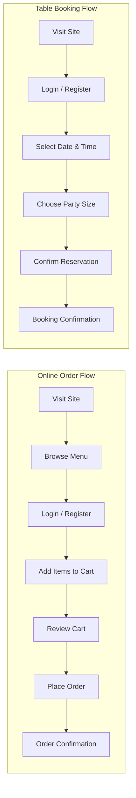

#### Essential Integrations

| Integration Point | Description |
|---|---|
| Frontend ↔ Backend API | Vite.js SPA communicates with Express.js REST endpoints via HTTP |
| Backend ↔ Database | Express.js services persist and retrieve data from the database layer |
| Configuration Management | Extension of `src/config/index.js` for all environment-specific settings |
| Testing Pipeline | Jest + Supertest integration for API and unit testing |

#### Key Technical Requirements

| Requirement | Specification |
|---|---|
| Frontend Build Tool | Vite.js (latest stable) |
| Frontend Language | TypeScript (strict mode) |
| Backend Framework | Express.js 5.1.0 (existing) |
| Backend Runtime | Node.js 18+ (minimum), 20.19.x LTS (recommended) |
| Module System | ES Modules (frontend), CommonJS (existing backend) |
| Package Manager | npm 8+ (minimum), 10.8.x (recommended) |
| License | MIT (as defined in `package.json`) |

### 1.3.2 Implementation Boundaries

#### System Boundaries

The application boundary encompasses:
- A **client-side SPA** served as static assets from the Vite.js build output
- A **server-side API** running on Express.js 5.1.0, bound to the configurable `HOST` and `PORT` (defaults: `127.0.0.1:3000` as defined in `src/config/index.js`)
- A **database layer** for persistent storage of users, menu items, orders, and reservations

#### User Groups Covered

| User Group | Access Level | Capabilities |
|---|---|---|
| Guest Visitors | Public | Browse menu, view restaurant information |
| Registered Customers | Authenticated | Login, order online, book tables |
| Restaurant Staff (implied) | Administrative | Manage orders, manage reservations |

#### Data Domains Included

The system manages four primary data domains:
1. **Users** — Account credentials, profile information, authentication tokens
2. **Menu Items** — Burger catalog with names, descriptions, pricing, categories, and availability
3. **Orders** — Customer orders with line items, quantities, pricing, and order status
4. **Reservations** — Table bookings with date, time, party size, and reservation status

### 1.3.3 Out-of-Scope

The following items are explicitly excluded from the current implementation scope and represent potential future-phase considerations:

| Excluded Item | Rationale |
|---|---|
| **Native Mobile Applications** | The user requirement specifies a web application built with Vite.js and TypeScript; native iOS/Android apps are not included |
| **Payment Gateway Integration** | While implied by online ordering, payment processing requires separate PCI-DSS compliance considerations and is not explicitly specified |
| **Delivery Tracking** | Real-time order delivery tracking and logistics management are beyond the current scope |
| **HTTPS/TLS Configuration** | As documented in the existing Technical Specifications, TLS termination is not handled at the application level |
| **Multi-Location Support** | The system serves a single restaurant location |
| **Loyalty/Rewards Program** | Customer loyalty points and rewards are not part of the initial feature set |
| **Real-Time Notifications** | WebSocket-based push notifications for order status updates are deferred |
| **CI/CD Pipeline** | Continuous integration and deployment automation, while recommended, is not in the current scope |
| **Containerization** | Docker/container orchestration is not included in the initial implementation |
| **Third-Party Delivery Aggregator Integration** | Integrations with platforms such as UberEats, DoorDash, or Grubhub are excluded |
| **Advanced Analytics Dashboard** | Business intelligence and reporting tools are deferred to future phases |
| **Internationalization (i18n)** | Multi-language support is not included in the initial release |

---

## 1.4 TECHNOLOGY CONTEXT

### 1.4.1 Current Technology Stack

The existing repository provides the following foundational technologies that will be extended:

| Layer | Technology | Version | Source |
|---|---|---|---|
| Backend Framework | Express.js | ^5.1.0 (locked 5.1.0) | `package.json` |
| Testing Framework | Jest | ^30.2.0 (locked 30.2.0) | `package.json` |
| HTTP Testing | Supertest | ^7.1.4 (locked 7.1.4) | `package.json` |
| Runtime | Node.js | 18+ (min), 20.19.x (rec.) | `README.md` |

### 1.4.2 Planned Technology Additions

| Layer | Technology | Purpose |
|---|---|---|
| Frontend Build Tool | Vite.js | Fast development server with HMR and optimized production bundling |
| Frontend Language | TypeScript | Type-safe JavaScript superset for robust frontend development |
| Database | To be determined | Persistent storage for users, orders, menu, reservations |
| Authentication Library | To be determined | Secure user authentication and session management |

### 1.4.3 Repository Structure (Current State)

The current repository follows a well-organized modular structure as documented in `README.md`:

```
hello_world/
├── server.js                  # Entry point (currently empty)
├── package.json               # npm manifest (hello_world v1.0.0)
├── package-lock.json          # Dependency lockfile
├── jest.config.js             # Jest test configuration
├── README.md                  # Project documentation
├── .gitignore                 # Git ignore patterns
├── src/                       # Application source
│   ├── app.js                 # Express application factory
│   ├── config/
│   │   └── index.js           # Environment variable management
│   └── routes/
│       ├── index.js           # Route aggregator (barrel pattern)
│       └── main.routes.js     # GET / and GET /evening handlers
├── tests/                     # Test suite (unit, integration, lifecycle)
└── blitzy/
    └── documentation/         # Technical documentation
```

---

#### References

- `package.json` — Project metadata, dependency declarations, npm scripts, and license information
- `README.md` — Project overview, prerequisites, API reference, and directory structure documentation
- `blitzy/documentation/Technical Specifications.md` — Comprehensive technical blueprint including scope boundaries, architecture patterns, dependency analysis, and implementation status
- `src/app.js` — Express application factory implementation demonstrating the Factory Pattern
- `src/routes/main.routes.js` — Current route handler implementations (GET `/` and GET `/evening`)
- `src/routes/index.js` — Barrel pattern route aggregator
- `src/config/index.js` — Twelve-Factor environment configuration module (HOST, PORT, NODE_ENV)
- `server.js` — Designated entry point (currently empty, requiring bootstrap implementation)
- `jest.config.js` — Jest test framework configuration with coverage thresholds
- `.gitignore` — Repository ignore patterns
- https://vite.dev/guide/ — Vite.js official documentation for build tool capabilities and Node.js requirements
- https://expressjs.com/2024/10/15/v5-release.html — Express.js v5 official release announcement
- https://github.com/expressjs/express/releases — Express.js release notes for v5.0.0 feature details

# 2. Product Requirements

This section defines the complete set of product requirements for the burger restaurant web application, organized as discrete, testable features derived from the user requirement to build a burger website where users can log in, order online, or book tables for dine-in — built with Vite.js and TypeScript. All requirements are grounded in the technical scope defined in Section 1.3, the system capabilities outlined in Section 1.2, and the current codebase evidence found in `src/`, `server.js`, and `package.json`.

---

## 2.1 FEATURE CATALOG

The system is decomposed into five core features, each corresponding to a distinct capability identified in the project scope. Every feature is classified as **Must-have** priority, as established in Section 1.3.1.

### 2.1.1 F-001: User Authentication

| Attribute | Detail |
|---|---|
| **Feature ID** | F-001 |
| **Feature Name** | User Authentication |
| **Category** | Security / Identity Management |
| **Priority** | Critical |
| **Status** | Approved |

#### Description

**Overview:** A secure authentication system enabling users to register new accounts, log in with credentials, maintain active sessions, and log out. This feature transforms the currently stateless Express.js backend — which has no authentication or authorization capabilities (as documented in Section 1.2.1) — into a user-aware platform.

**Business Value:** Authenticated user accounts create the foundation for personalized customer relationships, repeat engagement, and access control for ordering and reservation workflows. As noted in Section 1.1.4, this addresses the "customer identification gap" that prevents personalized experiences.

**User Benefits:** Registered customers gain the ability to place online orders and book tables for dine-in, both of which require authenticated sessions per the primary user workflows defined in Section 1.3.1.

**Technical Context:** The backend framework Express.js 5.1.0 (`package.json`) provides native async/await error handling that simplifies secure middleware development. The existing configuration module `src/config/index.js` will be extended to manage authentication secrets and token settings. The authentication library is to be determined per Section 1.4.2.

#### Dependencies

| Dependency Type | Detail |
|---|---|
| **Prerequisite Features** | F-005 (Responsive Web UI) — login/register views |
| **System Dependencies** | Database layer for user credential storage |
| **External Dependencies** | Authentication library (TBD per Section 1.4.2) |
| **Integration Requirements** | `src/config/index.js` extension for auth secrets; Express.js middleware pipeline in `src/app.js` |

---

### 2.1.2 F-002: Burger Menu Catalog

| Attribute | Detail |
|---|---|
| **Feature ID** | F-002 |
| **Feature Name** | Burger Menu Catalog |
| **Category** | Product / Content Management |
| **Priority** | Critical |
| **Status** | Approved |

#### Description

**Overview:** A browsable product catalog displaying the restaurant's burger offerings with support for menu display, individual item details, category grouping, and pricing information. This feature introduces the Menu Items data domain defined in Section 1.3.2.

**Business Value:** The menu catalog serves as the primary digital storefront, enabling the restaurant to showcase its product offerings to both guest visitors and registered customers. It directly supports the revenue expansion objective stated in Section 1.1.4 by providing the product discovery layer for the online ordering channel.

**User Benefits:** Guest visitors can browse the full burger menu without authentication. Registered customers use the catalog as the entry point into the ordering workflow, as shown in the Online Order Flow (Section 1.3.1): Visit Site → Browse Menu → Login/Register → Add Items to Cart.

**Technical Context:** The catalog requires a new Menu Service on the backend (Section 1.2.2) with corresponding REST API endpoints routed through the existing barrel pattern in `src/routes/index.js`. Menu data — including names, descriptions, pricing, categories, and availability — will be persisted in the database layer.

#### Dependencies

| Dependency Type | Detail |
|---|---|
| **Prerequisite Features** | F-005 (Responsive Web UI) — menu browsing views |
| **System Dependencies** | Database layer for menu item storage |
| **External Dependencies** | None |
| **Integration Requirements** | New route module registered via `src/routes/index.js`; REST API endpoints consumed by frontend |

---

### 2.1.3 F-003: Online Ordering

| Attribute | Detail |
|---|---|
| **Feature ID** | F-003 |
| **Feature Name** | Online Ordering |
| **Category** | E-Commerce / Transactions |
| **Priority** | Critical |
| **Status** | Approved |

#### Description

**Overview:** An end-to-end ordering workflow enabling authenticated users to add burger items to a cart, modify cart contents, place orders, and receive order confirmations. This feature implements the complete Online Order Flow documented in Section 1.3.1.

**Business Value:** Online ordering represents the primary revenue-generating capability of the platform. As stated in Section 1.1.4, it "enables a direct-to-consumer online ordering channel, removing dependency on third-party delivery aggregators." The Order Completion Rate KPI (Section 1.2.3) directly measures this feature's effectiveness.

**User Benefits:** Registered customers gain a seamless digital ordering experience — from menu browsing through cart management to confirmed order placement — without needing to visit the restaurant or call by phone.

**Technical Context:** The ordering feature requires an Order Service on the backend (Section 1.2.2) that manages the Orders data domain — including line items, quantities, pricing, and order status (Section 1.3.2). Payment gateway integration is explicitly out of scope per Section 1.3.3.

#### Dependencies

| Dependency Type | Detail |
|---|---|
| **Prerequisite Features** | F-001 (User Authentication) — authenticated sessions required; F-002 (Burger Menu Catalog) — product data source |
| **System Dependencies** | Database layer for order persistence |
| **External Dependencies** | None (payment gateway excluded per Section 1.3.3) |
| **Integration Requirements** | Auth middleware for protected routes; Menu Service for item data; Order Service REST endpoints |

---

### 2.1.4 F-004: Table Reservation

| Attribute | Detail |
|---|---|
| **Feature ID** | F-004 |
| **Feature Name** | Table Reservation |
| **Category** | Booking / Scheduling |
| **Priority** | Critical |
| **Status** | Approved |

#### Description

**Overview:** A self-service table booking system allowing authenticated users to select a date and time, specify party size, confirm a reservation, and receive booking confirmation. This implements the Table Booking Flow defined in Section 1.3.1.

**Business Value:** Table reservation automates a traditionally manual, phone-based workflow. Section 1.1.4 identifies this as delivering "operational efficiency" by "reducing manual phone-based reservation overhead." The Reservation Utilization KPI (Section 1.2.3) measures the ratio of booked tables to available capacity.

**User Benefits:** Registered customers can book dine-in tables at their convenience without calling the restaurant, selecting their preferred date, time, and party size through a guided workflow.

**Technical Context:** The feature requires a Reservation Service on the backend (Section 1.2.2) managing the Reservations data domain — including date, time, party size, and reservation status (Section 1.3.2). The system serves a single restaurant location; multi-location support is explicitly out of scope per Section 1.3.3.

#### Dependencies

| Dependency Type | Detail |
|---|---|
| **Prerequisite Features** | F-001 (User Authentication) — authenticated sessions required |
| **System Dependencies** | Database layer for reservation persistence |
| **External Dependencies** | None |
| **Integration Requirements** | Auth middleware for protected routes; Reservation Service REST endpoints consumed by frontend |

---

### 2.1.5 F-005: Responsive Web UI

| Attribute | Detail |
|---|---|
| **Feature ID** | F-005 |
| **Feature Name** | Responsive Web UI |
| **Category** | Frontend / User Interface |
| **Priority** | Critical |
| **Status** | Approved |

#### Description

**Overview:** A modern, responsive single-page application (SPA) built with Vite.js and TypeScript, providing the user interface layer for all customer-facing features — authentication views, menu browsing, cart and ordering, and table reservation. This feature addresses the complete absence of a frontend layer in the current system.

**Business Value:** The SPA delivers "a fast, polished user experience that strengthens brand perception" (Section 1.1.4). It is the digital storefront through which all customer interactions occur, directly enabling every other feature in the system.

**User Benefits:** All users — both guest visitors and registered customers — interact with the system through a responsive, mobile-friendly interface that works across devices and screen sizes.

**Technical Context:** Vite.js provides fast Hot Module Replacement (HMR) during development and optimized production builds via Rolldown bundling (Section 1.2.2). TypeScript is used in strict mode (Section 1.3.1). The frontend communicates with the Express.js 5.1.0 backend via RESTful HTTP APIs, requiring CORS configuration that does not currently exist (Section 1.2.1). The frontend uses ES Modules while the existing backend uses CommonJS (Section 1.3.1).

#### Dependencies

| Dependency Type | Detail |
|---|---|
| **Prerequisite Features** | None — this is the foundational UI layer |
| **System Dependencies** | Vite.js (latest stable), TypeScript (strict mode), Node.js 18+ runtime |
| **External Dependencies** | npm 8+ (minimum), 10.8.x (recommended) |
| **Integration Requirements** | CORS configuration on Express.js backend; static asset serving from Vite.js build output; Frontend ↔ Backend API communication via HTTP |

---

## 2.2 FUNCTIONAL REQUIREMENTS

This section defines testable, discrete requirements for each feature with acceptance criteria, technical specifications, and validation rules.

### 2.2.1 F-001: User Authentication Requirements

#### Requirement Summary

| Requirement ID | Description | Priority | Complexity |
|---|---|---|---|
| F-001-RQ-001 | User Registration | Must-Have | Medium |
| F-001-RQ-002 | User Login | Must-Have | Medium |
| F-001-RQ-003 | Session Management | Must-Have | High |
| F-001-RQ-004 | User Logout | Must-Have | Low |

#### F-001-RQ-001: User Registration

**Acceptance Criteria:**
- Users can create a new account by providing valid credentials (email/username and password)
- The system validates input data and rejects duplicate registrations
- Successful registration persists user records in the Users data domain
- The registration endpoint returns a confirmation response upon success
- Registration success rate contributes to the ≥ 99.5% authentication success target (Section 1.2.3)

| Specification | Detail |
|---|---|
| **Input Parameters** | Username/email, password, optional profile information |
| **Output/Response** | User record confirmation (excluding sensitive credentials) |
| **Performance Criteria** | Registration response within acceptable API latency |
| **Data Requirements** | Users data domain: account credentials, profile information, authentication tokens (Section 1.3.2) |

**Validation Rules:**
- Email/username must be unique across the Users data domain
- Password must meet minimum security complexity requirements
- Input fields must be sanitized to prevent injection attacks
- Credentials must be securely hashed before persistence

#### F-001-RQ-002: User Login

**Acceptance Criteria:**
- Registered users can authenticate with valid credentials
- Invalid credentials return an appropriate error response without revealing whether the username or password was incorrect
- Successful login establishes an authenticated session
- Login success rate contributes to the ≥ 99.5% authentication success target (Section 1.2.3)

| Specification | Detail |
|---|---|
| **Input Parameters** | Username/email, password |
| **Output/Response** | Authentication token/session identifier |
| **Performance Criteria** | Login response within acceptable API latency |
| **Data Requirements** | Credential verification against Users data domain |

**Validation Rules:**
- Credential verification must use constant-time comparison to prevent timing attacks
- Failed login attempts should be rate-limited
- Authentication tokens must have a defined expiration period

#### F-001-RQ-003: Session Management

**Acceptance Criteria:**
- Authenticated sessions persist across page navigations within the SPA
- Session tokens are validated on every protected API request
- Expired sessions redirect users to the login view
- Session state is maintained securely (token storage approach)

| Specification | Detail |
|---|---|
| **Input Parameters** | Session token (sent with each request) |
| **Output/Response** | Session validation result; refreshed token if applicable |
| **Performance Criteria** | Token validation adds minimal overhead per request |
| **Data Requirements** | Authentication tokens stored in Users data domain (Section 1.3.2) |

**Validation Rules:**
- Tokens must be validated server-side on every protected request
- Session configuration managed via `src/config/index.js` extension
- Sessions must be invalidated upon logout or expiration

#### F-001-RQ-004: User Logout

**Acceptance Criteria:**
- Authenticated users can terminate their active session
- Logout invalidates the session token server-side
- After logout, the user is redirected to the public-access area
- Subsequent requests with the invalidated token are rejected

| Specification | Detail |
|---|---|
| **Input Parameters** | Active session token |
| **Output/Response** | Logout confirmation; session invalidation |
| **Performance Criteria** | Immediate session termination |
| **Data Requirements** | Token invalidation in persistence layer |

---

### 2.2.2 F-002: Burger Menu Catalog Requirements

#### Requirement Summary

| Requirement ID | Description | Priority | Complexity |
|---|---|---|---|
| F-002-RQ-001 | Menu Display | Must-Have | Medium |
| F-002-RQ-002 | Item Details View | Must-Have | Low |
| F-002-RQ-003 | Category Filtering | Must-Have | Medium |
| F-002-RQ-004 | Pricing Display | Must-Have | Low |

#### F-002-RQ-001: Menu Display

**Acceptance Criteria:**
- The system displays all available burger menu items to both guest visitors and registered customers
- Menu items include name, description, price, and category
- Items marked as unavailable are appropriately indicated or hidden
- The menu loads and renders within the < 3 second page load target (Section 1.2.3)

| Specification | Detail |
|---|---|
| **Input Parameters** | Optional category filter, pagination parameters |
| **Output/Response** | Array of menu item objects with name, description, price, category, availability |
| **Performance Criteria** | Menu data retrieval within acceptable API latency; frontend render under 3 seconds |
| **Data Requirements** | Menu Items data domain: names, descriptions, pricing, categories, availability (Section 1.3.2) |

**Validation Rules:**
- Menu data is read-only for guest visitors and registered customers
- Pricing values must be non-negative numerical values
- Category values must conform to the predefined category list

#### F-002-RQ-002: Item Details View

**Acceptance Criteria:**
- Users can view expanded details for any individual menu item
- Details include full description, pricing, and category information
- The item details view is accessible from the menu listing

| Specification | Detail |
|---|---|
| **Input Parameters** | Menu item identifier |
| **Output/Response** | Complete menu item object with all attributes |
| **Performance Criteria** | Single item retrieval with minimal latency |
| **Data Requirements** | Individual record from Menu Items data domain |

#### F-002-RQ-003: Category Filtering

**Acceptance Criteria:**
- Users can filter the menu display by category
- Filtering dynamically updates the displayed items without full page reload (SPA behavior)
- All defined categories are presented as selectable filter options

| Specification | Detail |
|---|---|
| **Input Parameters** | Category identifier |
| **Output/Response** | Filtered array of menu items matching the selected category |
| **Performance Criteria** | Filter response within acceptable latency |
| **Data Requirements** | Category field within Menu Items data domain |

#### F-002-RQ-004: Pricing Display

**Acceptance Criteria:**
- All menu items display their current pricing
- Pricing is formatted consistently across the UI
- Price values accurately reflect the data stored in the database

| Specification | Detail |
|---|---|
| **Input Parameters** | None (pricing embedded in menu item data) |
| **Output/Response** | Formatted price as part of menu item display |
| **Performance Criteria** | No additional latency beyond menu retrieval |
| **Data Requirements** | Pricing field within Menu Items data domain |

---

### 2.2.3 F-003: Online Ordering Requirements

#### Requirement Summary

| Requirement ID | Description | Priority | Complexity |
|---|---|---|---|
| F-003-RQ-001 | Add to Cart | Must-Have | Medium |
| F-003-RQ-002 | Modify Cart | Must-Have | Medium |
| F-003-RQ-003 | Place Order | Must-Have | High |
| F-003-RQ-004 | Order Confirmation | Must-Have | Medium |

#### F-003-RQ-001: Add to Cart

**Acceptance Criteria:**
- Authenticated users can add menu items to their cart from the catalog
- Each cart addition captures the item identifier and quantity
- The cart state persists during the user's active session
- Users receive visual feedback upon successful cart addition

| Specification | Detail |
|---|---|
| **Input Parameters** | Menu item identifier, quantity |
| **Output/Response** | Updated cart state with item list and totals |
| **Performance Criteria** | Cart update reflected immediately in the SPA |
| **Data Requirements** | References Menu Items data domain for item details and pricing |

**Validation Rules:**
- User must be authenticated (F-001 session required)
- Quantity must be a positive integer
- Referenced menu item must exist and be available

#### F-003-RQ-002: Modify Cart

**Acceptance Criteria:**
- Users can update the quantity of any item in the cart
- Users can remove individual items from the cart
- Cart totals recalculate automatically upon modification
- An empty cart is handled gracefully (no order placement allowed)

| Specification | Detail |
|---|---|
| **Input Parameters** | Cart item identifier, new quantity (or removal flag) |
| **Output/Response** | Updated cart state reflecting modifications |
| **Performance Criteria** | Immediate recalculation and UI update |
| **Data Requirements** | Cart state linked to user session |

**Validation Rules:**
- Updated quantity must be a non-negative integer (zero triggers removal)
- Cart modifications are only permitted for the authenticated cart owner

#### F-003-RQ-003: Place Order

**Acceptance Criteria:**
- Authenticated users can submit their cart as a completed order
- The order is persisted in the Orders data domain with line items, quantities, pricing, and an initial order status
- The cart is cleared upon successful order placement
- The system returns a unique order identifier
- This requirement drives the Order Completion Rate KPI (Section 1.2.3)

| Specification | Detail |
|---|---|
| **Input Parameters** | Cart contents (item IDs, quantities), user identifier |
| **Output/Response** | Order confirmation with unique order ID and order status |
| **Performance Criteria** | Order persistence and confirmation within acceptable latency |
| **Data Requirements** | Orders data domain: line items, quantities, pricing, order status (Section 1.3.2) |

**Validation Rules:**
- Cart must contain at least one item
- All referenced menu items must be valid and available at submission time
- Order total must be recalculated server-side to prevent client-side tampering
- Payment processing is out of scope (Section 1.3.3)

#### F-003-RQ-004: Order Confirmation

**Acceptance Criteria:**
- Upon successful order placement, the user sees a confirmation view
- The confirmation displays the order ID, ordered items, quantities, and total
- The confirmation is accessible after initial placement (order history)

| Specification | Detail |
|---|---|
| **Input Parameters** | Order identifier |
| **Output/Response** | Full order details including items, quantities, pricing, and status |
| **Performance Criteria** | Confirmation retrieval within acceptable latency |
| **Data Requirements** | Persisted order record in Orders data domain |

---

### 2.2.4 F-004: Table Reservation Requirements

#### Requirement Summary

| Requirement ID | Description | Priority | Complexity |
|---|---|---|---|
| F-004-RQ-001 | Date and Time Selection | Must-Have | Medium |
| F-004-RQ-002 | Party Size Specification | Must-Have | Low |
| F-004-RQ-003 | Book Table | Must-Have | High |
| F-004-RQ-004 | Booking Confirmation | Must-Have | Medium |

#### F-004-RQ-001: Date and Time Selection

**Acceptance Criteria:**
- Authenticated users can select a desired date and time for dine-in
- Only future dates and valid time slots are available for selection
- The date/time picker renders correctly across devices (responsive UI)

| Specification | Detail |
|---|---|
| **Input Parameters** | Desired date, desired time slot |
| **Output/Response** | Validated date/time selection acknowledged |
| **Performance Criteria** | Date/time validation within acceptable latency |
| **Data Requirements** | Existing reservations for availability checking |

**Validation Rules:**
- Selected date must be in the future
- Selected time must fall within restaurant operating hours
- Date/time combination must have available capacity

#### F-004-RQ-002: Party Size Specification

**Acceptance Criteria:**
- Users can specify the number of guests for their reservation
- Party size is bounded by a minimum (1) and a maximum capacity
- Party size selection integrates with the date/time selection step

| Specification | Detail |
|---|---|
| **Input Parameters** | Number of guests (integer) |
| **Output/Response** | Validated party size confirmation |
| **Performance Criteria** | Immediate input validation |
| **Data Requirements** | Party size stored in Reservations data domain |

**Validation Rules:**
- Party size must be a positive integer within the defined range
- Capacity for the selected date/time must accommodate the party size

#### F-004-RQ-003: Book Table

**Acceptance Criteria:**
- Authenticated users can confirm a reservation with selected date, time, and party size
- The reservation is persisted in the Reservations data domain with a confirmed status
- A unique reservation identifier is returned
- This requirement drives the Reservation Utilization KPI (Section 1.2.3)

| Specification | Detail |
|---|---|
| **Input Parameters** | Date, time, party size, user identifier |
| **Output/Response** | Reservation confirmation with unique reservation ID and status |
| **Performance Criteria** | Reservation persistence and confirmation within acceptable latency |
| **Data Requirements** | Reservations data domain: date, time, party size, reservation status (Section 1.3.2) |

**Validation Rules:**
- User must be authenticated (F-001 session required)
- All input fields must pass validation before persistence
- Duplicate reservations for the same user at the same date/time should be prevented
- Table availability must be verified server-side before confirmation

#### F-004-RQ-004: Booking Confirmation

**Acceptance Criteria:**
- Upon successful reservation, the user sees a booking confirmation view
- The confirmation displays the reservation ID, date, time, party size, and status
- The confirmation is accessible after initial booking (reservation history)

| Specification | Detail |
|---|---|
| **Input Parameters** | Reservation identifier |
| **Output/Response** | Full reservation details including date, time, party size, and status |
| **Performance Criteria** | Confirmation retrieval within acceptable latency |
| **Data Requirements** | Persisted reservation record in Reservations data domain |

---

### 2.2.5 F-005: Responsive Web UI Requirements

#### Requirement Summary

| Requirement ID | Description | Priority | Complexity |
|---|---|---|---|
| F-005-RQ-001 | Vite.js SPA Architecture | Must-Have | High |
| F-005-RQ-002 | TypeScript Implementation | Must-Have | High |
| F-005-RQ-003 | Responsive Layout | Must-Have | Medium |
| F-005-RQ-004 | Frontend-Backend Integration | Must-Have | High |

#### F-005-RQ-001: Vite.js SPA Architecture

**Acceptance Criteria:**
- The frontend is implemented as a single-page application using Vite.js as the build tool
- The application supports HMR during development for rapid iteration
- Production builds produce optimized static assets
- Initial page load time is < 3 seconds (Section 1.2.3)

| Specification | Detail |
|---|---|
| **Input Parameters** | N/A (build tool configuration) |
| **Output/Response** | Static assets served from Vite.js build output |
| **Performance Criteria** | < 3 second initial page load (Vite production build) |
| **Data Requirements** | None (build-time configuration) |

**Validation Rules:**
- Vite.js must be latest stable version (Section 1.3.1)
- Frontend module system must use ES Modules (Section 1.3.1)
- Build output must be deployable as static assets

#### F-005-RQ-002: TypeScript Implementation

**Acceptance Criteria:**
- All frontend code is authored in TypeScript with strict mode enabled
- Type definitions cover all API request/response interfaces
- The TypeScript compiler produces zero type errors in production builds

| Specification | Detail |
|---|---|
| **Input Parameters** | N/A (language-level requirement) |
| **Output/Response** | Type-checked, compiled JavaScript output |
| **Performance Criteria** | No runtime type errors in production |
| **Data Requirements** | Type definitions for all four data domains (Users, Menu Items, Orders, Reservations) |

#### F-005-RQ-003: Responsive Layout

**Acceptance Criteria:**
- The UI renders correctly on desktop, tablet, and mobile screen sizes
- All interactive elements (buttons, forms, navigation) are touch-friendly on mobile devices
- Layout adapts fluidly without horizontal scrolling on standard device widths

| Specification | Detail |
|---|---|
| **Input Parameters** | Device viewport dimensions |
| **Output/Response** | Properly rendered UI for the given viewport |
| **Performance Criteria** | Smooth layout transitions without jank |
| **Data Requirements** | None (CSS/layout concern) |

#### F-005-RQ-004: Frontend-Backend Integration

**Acceptance Criteria:**
- The Vite.js SPA communicates with Express.js REST endpoints via HTTP (Section 1.3.1)
- CORS is properly configured on the Express.js backend to accept frontend requests
- API error responses are handled gracefully in the UI
- Network failures present meaningful feedback to the user

| Specification | Detail |
|---|---|
| **Input Parameters** | HTTP requests from SPA to REST API |
| **Output/Response** | JSON API responses rendered in the UI |
| **Performance Criteria** | API round-trip latency within acceptable UX thresholds |
| **Data Requirements** | All four data domains accessible via REST endpoints |

**Validation Rules:**
- CORS must be configured on the Express.js backend (`src/app.js`)
- API requests must include authentication tokens for protected endpoints
- All API responses must use consistent JSON format

---

## 2.3 FEATURE RELATIONSHIPS

### 2.3.1 Feature Dependencies Map

The following diagram illustrates the dependency relationships between features. Arrows indicate a "depends on" relationship — a feature at the source of an arrow requires the target feature to be implemented first.

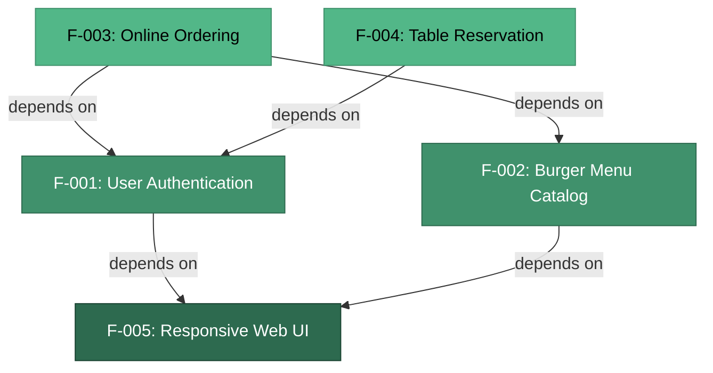

#### Dependency Summary

| Feature | Depends On | Depended Upon By |
|---|---|---|
| F-005: Responsive Web UI | None | F-001, F-002 |
| F-001: User Authentication | F-005 | F-003, F-004 |
| F-002: Burger Menu Catalog | F-005 | F-003 |
| F-003: Online Ordering | F-001, F-002 | None |
| F-004: Table Reservation | F-001 | None |

The dependency chain establishes a clear implementation order: **F-005 → F-001 / F-002 → F-003 / F-004**.

### 2.3.2 Integration Points

All features integrate through a common set of architectural touch points, as documented in Section 1.3.1 and grounded in the existing codebase structure.

| Integration Point | Features Involved | Mechanism |
|---|---|---|
| Frontend ↔ Backend API | All features | HTTP REST calls from Vite.js SPA to Express.js endpoints |
| Backend ↔ Database | F-001, F-002, F-003, F-004 | Express.js services persist/retrieve data from database layer |
| Authentication Middleware | F-001, F-003, F-004 | Shared auth middleware validates sessions on protected routes |
| Configuration Module | All features | `src/config/index.js` extended for feature-specific settings |

### 2.3.3 Shared Components and Common Services

The following shared components are identified from the existing codebase architecture and the target system design:

| Shared Component | Source | Used By |
|---|---|---|
| Express App Factory | `src/app.js` (Factory Pattern) | All backend services mount routes via this factory |
| Route Aggregator | `src/routes/index.js` (Barrel Pattern) | All feature route modules are registered here |
| Configuration Module | `src/config/index.js` (Twelve-Factor) | All features consume environment-specific settings |
| Database Layer | New (TBD per Section 1.4.2) | F-001, F-002, F-003, F-004 share the data persistence layer |
| Auth Middleware | New (extends Express.js pipeline) | F-003 and F-004 share the same auth gate for protected endpoints |
| Test Infrastructure | `jest.config.js` + `tests/` | All features share Jest 30.2.0 + Supertest 7.1.4 for testing |

---

## 2.4 IMPLEMENTATION CONSIDERATIONS

### 2.4.1 Technical Constraints

The following constraints are derived from the current system state (Section 1.2.1), technology requirements (Section 1.3.1), and out-of-scope boundaries (Section 1.3.3).

| Constraint | Impact | Source |
|---|---|---|
| Empty `server.js` entry point | Server bootstrap logic must be implemented before any feature can run | `server.js` (current state) |
| No database layer exists | All data-driven features (F-001 through F-004) are blocked until persistence is added | Section 1.2.1 |
| No CORS configuration | Frontend-backend communication (F-005-RQ-004) requires CORS setup on `src/app.js` | Section 1.2.1 |
| Dual module systems | Frontend uses ES Modules; backend uses CommonJS — requires careful boundary management | Section 1.3.1 |
| Payment processing excluded | F-003 (Online Ordering) cannot include a payment step in the current scope | Section 1.3.3 |
| Single restaurant location | F-004 (Table Reservation) need not support multi-location booking logic | Section 1.3.3 |

### 2.4.2 Performance Requirements

Performance targets are drawn from the success criteria defined in Section 1.2.3 and the existing test configuration in `jest.config.js`.

| Requirement | Target | Feature Scope |
|---|---|---|
| Initial page load time | < 3 seconds (Vite production build) | F-005 |
| Authentication success rate | ≥ 99.5% for registration + login | F-001 |
| End-to-end ordering | Fully operational | F-003 |
| Reservation creation | Fully operational | F-004 |
| Test coverage — branches | ≥ 75% | All features |
| Test coverage — functions | ≥ 90% | All features |
| Test coverage — lines | ≥ 80% | All features |
| Test coverage — statements | ≥ 80% | All features |

### 2.4.3 Scalability Considerations

| Consideration | Detail | Affected Features |
|---|---|---|
| Stateless API design | Express.js REST endpoints should remain stateless, with session state managed via tokens, to allow horizontal scaling | F-001, F-003, F-004 |
| Database connection management | The shared database layer must handle concurrent connections from all services efficiently | F-001, F-002, F-003, F-004 |
| Static asset delivery | Vite.js production build output should be cacheable and CDN-compatible for frontend scalability | F-005 |
| Modular service architecture | The existing factory pattern (`src/app.js`) and barrel pattern (`src/routes/index.js`) support adding new services without restructuring | All features |

### 2.4.4 Security Implications

| Security Concern | Mitigation | Affected Features |
|---|---|---|
| Credential storage | Passwords must be hashed before persistence; plaintext storage is prohibited | F-001 |
| Authentication tokens | Tokens must expire and be validated server-side on every protected request | F-001, F-003, F-004 |
| Input validation | All user inputs must be validated and sanitized on the server to prevent injection attacks | All features |
| Server-side price verification | Order totals must be recalculated server-side to prevent client-side manipulation | F-003 |
| CORS configuration | Origin restrictions must be configured to permit only the legitimate frontend origin | F-005 |
| HTTPS/TLS | Out of scope per Section 1.3.3; not handled at the application level | N/A |

### 2.4.5 Maintenance Requirements

| Requirement | Detail | Source |
|---|---|---|
| Automated testing | All features must maintain test coverage above the thresholds in `jest.config.js` (75% branches, 90% functions, 80% lines, 80% statements) | `jest.config.js` |
| Three-tier test organization | Tests must follow the existing unit → integration → lifecycle structure in the `tests/` directory | `tests/unit/`, `tests/integration/`, `tests/lifecycle/` |
| Configuration extensibility | New environment variables must be added via the Twelve-Factor pattern in `src/config/index.js` | `src/config/index.js` |
| Route registration | New feature routes must be registered through the barrel pattern in `src/routes/index.js` | `src/routes/index.js` |
| Architectural preservation | The factory, barrel, and separation-of-concerns patterns must be maintained as new features are added | Section 1.2.1 |

---

## 2.5 TRACEABILITY MATRIX

The following matrix maps each feature to its data domains, user groups, success metrics, and primary workflow references to ensure complete traceability.

### 2.5.1 Feature-to-Data Domain Mapping

| Feature ID | Data Domain(s) |
|---|---|
| F-001 | Users |
| F-002 | Menu Items |
| F-003 | Orders, Menu Items |
| F-004 | Reservations |
| F-005 | All (presentation layer) |

### 2.5.2 Feature-to-User Group Mapping

| Feature ID | Guest Visitors | Registered Customers | Restaurant Staff |
|---|---|---|---|
| F-001 | Registration only | Full access | Implied management |
| F-002 | Browse only | Browse only | Implied management |
| F-003 | No access | Full access | Order processing |
| F-004 | No access | Full access | Reservation management |
| F-005 | Public views | All views | Administrative views |

### 2.5.3 Feature-to-KPI Mapping

| Feature ID | KPI | Measurement Method |
|---|---|---|
| F-001 | Authentication Adoption | User registration analytics |
| F-002 | (Supports Order Completion Rate) | Indirect — menu browsing drives ordering |
| F-003 | Order Completion Rate | Backend order status analytics |
| F-004 | Reservation Utilization | Reservation database queries |
| F-005 | Frontend Performance (< 3s load) | Vite production build load time |
| All | Test Coverage | Jest coverage reports |

### 2.5.4 Requirement-to-Workflow Mapping

| Requirement ID | Workflow Step | Workflow |
|---|---|---|
| F-001-RQ-001 | Login / Register | Online Order Flow, Table Booking Flow |
| F-001-RQ-002 | Login / Register | Online Order Flow, Table Booking Flow |
| F-002-RQ-001 | Browse Menu | Online Order Flow |
| F-003-RQ-001 | Add Items to Cart | Online Order Flow |
| F-003-RQ-002 | Review Cart | Online Order Flow |
| F-003-RQ-003 | Place Order | Online Order Flow |
| F-003-RQ-004 | Order Confirmation | Online Order Flow |
| F-004-RQ-001 | Select Date & Time | Table Booking Flow |
| F-004-RQ-002 | Choose Party Size | Table Booking Flow |
| F-004-RQ-003 | Confirm Reservation | Table Booking Flow |
| F-004-RQ-004 | Booking Confirmation | Table Booking Flow |

---

## 2.6 ASSUMPTIONS AND CONSTRAINTS

### 2.6.1 Assumptions

| ID | Assumption | Rationale |
|---|---|---|
| A-001 | A single database engine will serve all four data domains | Section 1.4.2 lists one database (TBD) for all persistence needs |
| A-002 | The authentication library will support token-based sessions | Token-based auth aligns with the stateless REST API design and SPA architecture |
| A-003 | The restaurant operates from a single location | Multi-location is explicitly out of scope (Section 1.3.3) |
| A-004 | Menu items are managed outside the customer-facing application | No menu management UI is defined in the customer-facing feature set |
| A-005 | Order fulfillment occurs outside the system | The system scope covers order placement and confirmation, not kitchen/delivery workflows |

### 2.6.2 Constraints

| ID | Constraint | Impact |
|---|---|---|
| C-001 | No payment gateway integration | Orders are placed without a payment step; payment is deferred to a future phase |
| C-002 | No real-time notifications | Users must manually check order/reservation status; WebSocket push is out of scope |
| C-003 | No native mobile apps | The system is accessible via web browser only; iOS/Android apps are excluded |
| C-004 | MIT License | All selected technologies and libraries must be compatible with the MIT license declared in `package.json` |
| C-005 | No HTTPS at application level | TLS termination is not handled by the application; assumed to be managed by infrastructure |

---

## 2.7 REFERENCES

#### Files and Folders Examined

- `package.json` — Project metadata, dependency declarations (Express.js ^5.1.0, Jest ^30.2.0, Supertest ^7.1.4), npm scripts, and MIT license
- `src/app.js` — Express application factory implementation demonstrating the Factory Pattern used by all backend services
- `src/config/index.js` — Twelve-Factor environment configuration module managing HOST, PORT, and NODE_ENV with safe defaults
- `src/routes/main.routes.js` — Current route handler implementations (GET `/` and GET `/evening`) representing the existing API surface
- `src/routes/index.js` — Barrel pattern route aggregator through which all feature route modules are registered
- `jest.config.js` — Jest test framework configuration with coverage thresholds (75% branches, 90% functions, 80% lines, 80% statements)
- `server.js` — Designated entry point, currently empty, requiring bootstrap implementation
- `tests/unit/` — Unit test directory containing `config.test.js` and `routes.test.js`
- `tests/integration/` — Integration test directory containing `endpoints.test.js`
- `tests/lifecycle/` — Lifecycle test directory containing `server.test.js`

#### Technical Specification Sections Referenced

- **Section 1.1 EXECUTIVE SUMMARY** — Business problem, stakeholders, value proposition
- **Section 1.2 SYSTEM OVERVIEW** — System capabilities, components, success criteria, KPIs
- **Section 1.3 SCOPE** — In-scope features, user workflows, data domains, out-of-scope exclusions
- **Section 1.4 TECHNOLOGY CONTEXT** — Current and planned technology stack, repository structure

# 3. Technology Stack

This section provides a comprehensive inventory and justification of every technology used (or planned) in the burger restaurant web application. Each selection is grounded in the project's actual codebase and Technical Specification, with clear separation between technologies that are **currently implemented** and those that are **planned** for future implementation.

> **Important Note on Default Stack Override:** The system-suggested default stack (Python/Flask, React, MongoDB, Auth0, AWS, Docker, Terraform, GitHub Actions, React Native, Swift, Kotlin, Objective-C, Electron, TailwindCSS, Langchain) is **not applicable** to this repository. The codebase and Technical Specification unambiguously define a **Node.js/Express.js backend** with a **Vite.js + TypeScript frontend**. This section documents only the technologies evidenced in the repository and Technical Specification.

---

## 3.1 PROGRAMMING LANGUAGES

### 3.1.1 JavaScript (ES5+ / CommonJS)

**Platform:** Backend (Server-Side)
**Status:** Currently Implemented
**Module System:** CommonJS (`require()` / `module.exports`)

JavaScript is the sole programming language currently in use across all existing source files. The entire backend — including the Express application factory (`src/app.js`), the Twelve-Factor configuration module (`src/config/index.js`), the route definitions (`src/routes/main.routes.js`, `src/routes/index.js`), and the test configuration (`jest.config.js`) — is written in JavaScript using the CommonJS module system.

**Selection Justification:**
- **Native runtime compatibility:** JavaScript is the native language of the Node.js runtime, eliminating any compilation or transpilation overhead for the backend layer.
- **Express.js 5 ecosystem alignment:** Express.js and its middleware ecosystem are natively authored in JavaScript, ensuring first-class compatibility with no interop friction.
- **Established codebase foundation:** The existing `hello_world` project was built in JavaScript, and the Technical Specification (Section 1.4.1) mandates extending — not replacing — this foundation.

**Constraints:**
- The backend uses **CommonJS** (`require()` / `module.exports`), as evidenced by all existing source files. Section 2.4.1 of the Technical Specification identifies the dual module system (CommonJS on the backend, ES Modules on the frontend) as a technical constraint requiring careful boundary management.

### 3.1.2 TypeScript (Strict Mode)

**Platform:** Frontend (Client-Side)
**Status:** Planned — Not Yet Implemented
**Module System:** ES Modules (ESM)

TypeScript in strict mode is the designated frontend language, as specified in the Technical Specification Section 1.3.1 and reinforced by the user requirement to build the application "with Vite.js and TypeScript." Feature F-005-RQ-002 mandates that all frontend code be authored in TypeScript with strict mode enabled.

**Selection Justification:**
- **Type safety for UI complexity:** The frontend encompasses authentication views, a browsable menu catalog, cart and ordering workflows, and table reservation — all of which benefit from compile-time type checking to prevent runtime errors.
- **Vite.js native support:** Vite.js provides first-class TypeScript support with zero-config transformation, making it the natural companion for a Vite-powered SPA.
- **Developer productivity:** TypeScript's IntelliSense, refactoring support, and interface contracts accelerate development and reduce regression risk.

**Constraints:**
- Minimum TypeScript version **5.4** is required for compatibility with Jest 30 type definitions (per the Jest 30 migration guide).
- No `.ts`, `.tsx`, or `tsconfig.*` files currently exist in the repository — the frontend is entirely unimplemented.

### 3.1.3 Language Summary

| Language | Platform | Module System | Status | Key Files |
|---|---|---|---|---|
| JavaScript (ES5+) | Backend | CommonJS | **Implemented** | `src/app.js`, `src/config/index.js`, `src/routes/*.js`, `jest.config.js` |
| TypeScript (Strict) | Frontend | ES Modules | **Planned** | None yet — pending Vite.js SPA scaffold |

---

## 3.2 FRAMEWORKS & LIBRARIES

### 3.2.1 Express.js — Backend Framework

| Attribute | Value |
|---|---|
| **Version (range)** | `^5.1.0` (declared in `package.json`) |
| **Version (locked)** | `5.1.0` (resolved in `package-lock.json`) |
| **Minimum Node.js** | 18+ |
| **License** | MIT |
| **Status** | **Implemented** — Foundation operational |

Express.js 5.1.0 serves as the backend HTTP framework. It is the sole runtime dependency declared in `package.json` and the backbone of the REST API layer defined in Section 1.2.2 of the Technical Specification.

**Key Capabilities Leveraged:**
- **Native async/await error handling:** Express 5 supports returned rejected Promises in middleware, eliminating manual `try-catch` blocks — a significant improvement for building the authentication, ordering, and reservation services defined in the feature catalog (Section 2.1).
- **ReDoS-safe routing:** Express 5 updated to `path-to-regexp@8.x`, removing sub-expression regex patterns that previously posed Regular Expression Denial-of-Service (ReDoS) risks. This directly supports the security requirements in Section 2.4.4.
- **Modern router API:** The `app.router` object provides a clean reference to the base Express router, supporting the Barrel Pattern route aggregation already implemented in `src/routes/index.js`.

**Architecture Patterns Established:**

| Pattern | Implementation | File |
|---|---|---|
| Factory Pattern | Express app creation separated from server binding | `src/app.js` |
| Barrel Pattern | Route aggregation through single entry point | `src/routes/index.js` |
| Separation of Concerns | App config vs. server binding vs. routing | `server.js` / `src/app.js` / `src/routes/` |
| Twelve-Factor Configuration | Environment variables with safe defaults | `src/config/index.js` |

**Current API Surface:**
- `GET /` — Returns greeting message (implemented in `src/routes/main.routes.js`)
- `GET /evening` — Returns evening greeting (implemented in `src/routes/main.routes.js`)

**Planned Extensions:**
Four new service domains will be added as route modules registered through the Barrel Pattern, as defined in Sections 2.1.1–2.1.4: Auth Service, Menu Service, Order Service, and Reservation Service.

### 3.2.2 Vite.js — Frontend Build Tool

| Attribute | Value |
|---|---|
| **Target Version** | Latest stable (8.x as of writing) |
| **Minimum Node.js** | 20.19+ or 22.12+ |
| **Bundler** | Rolldown (unified Rust-based bundler) |
| **License** | MIT |
| **Status** | **Planned** — Not yet added to `package.json` |

Vite.js is the designated frontend build tool, selected per the user requirement and documented in the Technical Specification Section 1.3.1 and Section 1.4.2. No `vite.config.*` files or Vite-related packages currently exist in the repository.

**Selection Justification:**
- **Hot Module Replacement (HMR):** Vite provides extremely fast HMR during development, enabling near-instant feedback cycles for UI development (Section 1.2.2).
- **Optimized production builds:** Vite 8 ships with Rolldown as its single, unified, Rust-based bundler, delivering significantly faster builds while maintaining full plugin compatibility. The Technical Specification references Rolldown bundling for production output (Section 1.2.2).
- **TypeScript first-class support:** Vite natively transforms TypeScript without requiring additional configuration, aligning with the frontend language decision.
- **Performance target:** The production build output must achieve a sub-3-second initial page load time (Section 1.2.3 success criteria).
- **Static asset delivery:** Vite production builds produce cacheable, CDN-compatible static assets for frontend scalability (Section 2.4.3).

**Compatibility Consideration:**
Vite 7+ requires Node.js 20.19+ or 22.12+, having dropped support for Node.js 18. While Express.js 5 accepts Node.js 18+, the Vite dependency effectively elevates the project's minimum Node.js version to **20.19+** for full-stack development. This aligns with the Technical Specification's recommended runtime of **Node.js 20.19.x LTS**.

### 3.2.3 Jest — Testing Framework

| Attribute | Value |
|---|---|
| **Version (range)** | `^30.2.0` (declared in `package.json`, dev dependency) |
| **Version (locked)** | `30.2.0` (resolved in `package-lock.json`) |
| **Minimum Node.js** | `^18.14.0 \|\| ^20.0.0 \|\| ^22.0.0 \|\| >=24.0.0` |
| **Minimum TypeScript** | 5.4 (for type definitions) |
| **License** | MIT |
| **Status** | **Implemented** — 41 tests passing, 100% coverage |

Jest 30 is the project's testing framework, configured via `jest.config.js` with the following specifications:

| Configuration | Value | Source |
|---|---|---|
| Test environment | `node` | `jest.config.js` |
| Test discovery | `**/tests/**/*.test.js` | `jest.config.js` |
| Branch coverage threshold | 75% | `jest.config.js` |
| Function coverage threshold | 90% | `jest.config.js` |
| Line coverage threshold | 80% | `jest.config.js` |
| Statement coverage threshold | 80% | `jest.config.js` |
| Coverage reporters | `text`, `lcov`, `html` | `jest.config.js` |
| Test timeout | 10,000 ms | `jest.config.js` |
| Verbose output | Enabled | `jest.config.js` |

**Selection Justification:**
- **Performance improvements:** Jest 30 delivers real-world performance gains through optimized module resolution via `unrs-resolver`, reduced memory consumption, and improved test isolation.
- **Three-tier test architecture:** The existing test suite is organized into `tests/unit/`, `tests/integration/`, and `tests/lifecycle/` directories — a structure that Jest's test discovery pattern (`**/tests/**/*.test.js`) cleanly supports.
- **Established ecosystem:** Jest is the most widely adopted JavaScript testing framework, with comprehensive mocking, assertion, and snapshot capabilities.

### 3.2.4 Supertest — HTTP Testing Library

| Attribute | Value |
|---|---|
| **Version (range)** | `^7.1.4` (declared in `package.json`, dev dependency) |
| **Version (locked)** | `7.1.4` (resolved in `package-lock.json`) |
| **Minimum Node.js** | `>=14.18.0` |
| **License** | MIT |
| **Status** | **Implemented** — Used for integration tests |

Supertest provides a high-level abstraction for testing HTTP endpoints, used in `tests/integration/endpoints.test.js` for black-box HTTP assertion testing against the Express application factory.

**Selection Justification:**
- **Express.js integration:** Supertest accepts an Express app instance directly (via the Factory Pattern in `src/app.js`), enabling in-process HTTP testing without binding to a network port.
- **SuperAgent API:** The fluent API enables readable, chainable HTTP assertions that align with the project's test readability goals.
- **Ephemeral port binding:** Supertest automatically binds the server to an ephemeral port for each test, preventing port conflicts in parallel test execution.

---

## 3.3 OPEN SOURCE DEPENDENCIES

### 3.3.1 Direct Dependencies

The project maintains a minimal dependency footprint with only three direct packages, as declared in `package.json`:

| Package | Version Range | Locked Version | Dependency Type | Purpose |
|---|---|---|---|---|
| `express` | `^5.1.0` | `5.1.0` | **Runtime** | Backend HTTP framework |
| `jest` | `^30.2.0` | `30.2.0` | **Dev** | Testing framework |
| `supertest` | `^7.1.4` | `7.1.4` | **Dev** | HTTP endpoint testing |

### 3.3.2 Transitive Dependencies

| Metric | Value | Source |
|---|---|---|
| Total packages in `node_modules` | 405 | `package-lock.json` |
| Lockfile version | 3 (npm v3 lockfile format) | `package-lock.json` |
| Package registry | npm (default public registry) | `package-lock.json` |

The `package-lock.json` uses lockfile version 3, ensuring deterministic, reproducible installs across all development environments. All 405 transitive packages are resolved and integrity-verified via the lockfile.

### 3.3.3 Planned Dependencies (Not Yet Added)

The following packages will be required to implement the feature set defined in the Technical Specification (Section 2.1) but are not yet present in `package.json`:

| Package Category | Purpose | Status | Specification Reference |
|---|---|---|---|
| **Vite.js** | Frontend build tool (dev server + production bundler) | To be added | Section 1.4.2 |
| **TypeScript** | Frontend language compiler and type checker | To be added | Section 1.3.1 |
| **Database driver** | Persistent storage for users, menu items, orders, reservations | Engine TBD | Section 1.4.2 |
| **Authentication library** | Secure user authentication and session management | Library TBD | Section 1.4.2 |
| **CORS middleware** | Cross-origin resource sharing for frontend-backend communication | To be added | Section 2.4.1 |

### 3.3.4 License Compliance

All dependencies must comply with the **MIT License** declared in `package.json` (line 13). This is formalized as Constraint C-004 in Section 2.6.2: "All selected technologies and libraries must be compatible with the MIT license declared in `package.json`." All three currently installed packages (Express.js, Jest, Supertest) are MIT-licensed.

### 3.3.5 Dependency Architecture

```mermaid
graph TD
    subgraph RuntimeDeps["Runtime Dependencies"]
        Express["express 5.1.0"]
    end

    subgraph DevDeps["Development Dependencies"]
        Jest["jest 30.2.0"]
        Supertest["supertest 7.1.4"]
    end

    subgraph PlannedDeps["Planned Dependencies"]
        Vite["Vite.js (latest stable)"]
        TS["TypeScript (5.4+)"]
        DBDriver["Database Driver (TBD)"]
        AuthLib["Auth Library (TBD)"]
        CORS["CORS Middleware"]
    end

    subgraph Runtime["Node.js Runtime 20.19.x LTS"]
        NPM["npm 10.8.x"]
    end

    NPM --> Express
    NPM --> Jest
    NPM --> Supertest
    NPM -.-> Vite
    NPM -.-> TS
    NPM -.-> DBDriver
    NPM -.-> AuthLib
    NPM -.-> CORS

    Supertest --> Express
    Vite -.-> TS
end
```

---

## 3.4 THIRD-PARTY SERVICES

### 3.4.1 Current External Service Dependencies

The application is currently **entirely self-contained** with zero external service dependencies. No API keys, OAuth configurations, third-party SDK integrations, or cloud service bindings exist in the codebase or configuration layer.

### 3.4.2 Planned Service Dependencies

| Service Category | Decision | Specification Reference |
|---|---|---|
| Authentication service/library | **To be determined** | Section 1.4.2 |

The authentication library (Section 1.4.2) must support the following requirements once selected:

- **Token-based sessions** — Assumption A-002 specifies token-based authentication aligning with the stateless REST API design and SPA architecture.
- **Token expiry and server-side validation** — Section 2.4.4 mandates that tokens expire and are validated server-side on every protected request.
- **Password hashing** — Section 2.4.4 prohibits plaintext password storage; the chosen library must support or integrate with secure hashing algorithms.

### 3.4.3 Explicitly Excluded Services

The following services from the suggested default stack or common patterns are **explicitly out of scope**, as documented in Section 1.3.3:

| Excluded Service | Rationale | Specification Reference |
|---|---|---|
| **Auth0** | Authentication library is TBD per Section 1.4.2; Auth0 is not specified | Section 1.4.2 |
| **Payment gateway** (Stripe, etc.) | Orders are placed without a payment step; PCI-DSS compliance deferred | Section 1.3.3 |
| **Delivery aggregators** (UberEats, DoorDash, Grubhub) | Third-party delivery integration excluded from scope | Section 1.3.3 |
| **Cloud platform** (AWS, GCP, Azure) | No cloud infrastructure specified; deployment model undefined | Section 1.3.3 |
| **Real-time notification services** | WebSocket push notifications deferred to future phase | Section 1.3.3 |
| **Analytics platforms** | Advanced analytics dashboard deferred to future phases | Section 1.3.3 |
| **Internationalization (i18n) services** | Multi-language support excluded from initial release | Section 1.3.3 |

---

## 3.5 DATABASES & STORAGE

### 3.5.1 Current State

No database layer exists in the current system. Section 2.4.1 of the Technical Specification explicitly identifies this as a blocking constraint: "No database layer exists — All data-driven features (F-001 through F-004) are blocked until persistence is added."

The application is currently entirely **stateless**, serving only hardcoded greeting responses via `GET /` and `GET /evening`.

### 3.5.2 Planned Database Layer

| Attribute | Value | Source |
|---|---|---|
| **Database engine** | To be determined | Section 1.4.2 |
| **Number of databases** | Single database for all data domains | Assumption A-001 |
| **Data domains** | 4 (Users, Menu Items, Orders, Reservations) | Section 1.3.2 |

A single database engine (Assumption A-001) will serve all four data domains defined in Section 1.3.2:

| Data Domain | Key Attributes | Feature Dependency |
|---|---|---|
| **Users** | Account credentials, profile information, authentication tokens | F-001 (User Authentication) |
| **Menu Items** | Names, descriptions, pricing, categories, availability | F-002 (Burger Menu Catalog) |
| **Orders** | Line items, quantities, pricing, order status | F-003 (Online Ordering) |
| **Reservations** | Date, time, party size, reservation status | F-004 (Table Reservation) |

### 3.5.3 Database Requirements

The database selection must satisfy the following technical requirements drawn from the Technical Specification:

- **Concurrent connection handling:** The shared database layer must handle concurrent connections from all services efficiently (Section 2.4.3).
- **Credential security:** User credential storage must use hashed passwords; plaintext storage is prohibited (Section 2.4.4).
- **Token management:** Support for token-based session management with server-side validation and expiry (Assumption A-002, Section 2.4.4).
- **Configuration integration:** Database connection parameters will be managed via the Twelve-Factor configuration pattern in `src/config/index.js` (Section 2.4.5).
- **MIT compatibility:** The database driver must be compatible with the project's MIT license (Constraint C-004).

### 3.5.4 Caching Strategy

No dedicated caching solution (e.g., Redis, Memcached) is specified in the Technical Specification. The primary caching mechanism is:

- **Static asset caching:** Vite.js production builds produce content-hashed, cacheable static assets that are CDN-compatible for frontend scalability (Section 2.4.3).

### 3.5.5 Storage Architecture (Planned)

```mermaid
graph LR
    subgraph FrontendLayer["Frontend (Vite.js + TypeScript SPA)"]
        SPA["Browser Client"]
    end

    subgraph BackendLayer["Backend (Express.js 5.1.0)"]
        AuthSvc["Auth Service"]
        MenuSvc["Menu Service"]
        OrderSvc["Order Service"]
        ResSvc["Reservation Service"]
        ConfigMod["src/config/index.js"]
    end

    subgraph DataLayer["Data Layer (Engine TBD)"]
        DB[("Single Database")]
        Users["Users Domain"]
        MenuItems["Menu Items Domain"]
        Orders["Orders Domain"]
        Reservations["Reservations Domain"]
    end

    SPA -->|"REST API (HTTP)"| AuthSvc
    SPA -->|"REST API (HTTP)"| MenuSvc
    SPA -->|"REST API (HTTP)"| OrderSvc
    SPA -->|"REST API (HTTP)"| ResSvc

    AuthSvc --> DB
    MenuSvc --> DB
    OrderSvc --> DB
    ResSvc --> DB

    DB --- Users
    DB --- MenuItems
    DB --- Orders
    DB --- Reservations

    ConfigMod -.->|"DB connection config"| DB
end
```

---

## 3.6 DEVELOPMENT & DEPLOYMENT

### 3.6.1 Runtime Environment

| Component | Minimum Version | Recommended Version | Source |
|---|---|---|---|
| **Node.js** | 18+ (Express.js) / 20.19+ (Vite.js) | **20.19.x LTS** (codename 'Iron') | `README.md`, Section 1.3.1 |
| **npm** | 8+ | **10.8.x** | `README.md`, Section 1.3.1 |

**Node.js Version Compatibility Matrix:**

| Technology | Minimum Node.js | Effective Constraint |
|---|---|---|
| Express.js 5.1.0 | 18+ | Backend can run on Node 18+ |
| Jest 30.2.0 | ^18.14.0 \|\| ^20.0.0 \|\| ^22.0.0 \|\| >=24.0.0 | Tests can run on Node 18.14+ |
| Supertest 7.1.4 | >=14.18.0 | No practical constraint |
| Vite.js 8.x (planned) | 20.19+ or 22.12+ | Elevates full-stack minimum to 20.19+ |

The recommended Node.js 20.19.x LTS satisfies all dependency requirements and is the **Iron** LTS release line with support through April 2026. This version also enables `require(esm)` by default, which aids the CommonJS–ESM boundary management identified as a constraint in Section 2.4.1.

### 3.6.2 Build System

#### Backend Build

The backend requires **no build step**. All source files are plain JavaScript with CommonJS modules, executed directly by the Node.js runtime. This zero-compilation approach keeps the backend deployment pipeline minimal.

#### Frontend Build (Planned)

The frontend will use Vite.js for both development and production:

| Mode | Tool | Output |
|---|---|---|
| **Development** | Vite dev server | Native ES Module serving with HMR |
| **Production** | Vite build (Rolldown bundler) | Optimized, content-hashed static assets |

The production build output must achieve the sub-3-second initial page load target defined in Section 1.2.3.

### 3.6.3 npm Scripts

The following npm scripts are defined in `package.json` and constitute the project's task runner interface:

| Command | Script | Purpose |
|---|---|---|
| `npm start` | `node server.js` | Start the application server |
| `npm test` | `jest` | Run the full test suite |
| `npm run test:watch` | `jest --watch` | Run tests in watch mode for development |
| `npm run test:coverage` | `jest --coverage` | Run tests with coverage reporting |
| `npm run test:ci` | `jest --ci --coverage --reporters=default` | Run tests in CI-compatible mode |

> **Note:** The `npm start` script currently targets an empty `server.js` file. Server bootstrap logic must be implemented before the application can start (Section 2.4.1).

### 3.6.4 Test Infrastructure

The project employs a three-tier test architecture organized under the `tests/` directory:

| Tier | Directory | Purpose | Example Files |
|---|---|---|---|
| **Unit** | `tests/unit/` | Configuration and route contract validation | `config.test.js`, `routes.test.js` |
| **Integration** | `tests/integration/` | HTTP endpoint testing via Supertest | `endpoints.test.js` |
| **Lifecycle** | `tests/lifecycle/` | Server bootstrap and shutdown testing | `server.test.js` |

**Current Test Metrics:** 41 automated tests with 100% coverage across all measured dimensions. Section 2.4.5 requires that all new features maintain coverage above the thresholds configured in `jest.config.js`.

### 3.6.5 Environment Configuration

The application follows the **Twelve-Factor App** methodology for configuration, implemented in `src/config/index.js`:

| Variable | Default Value | Purpose |
|---|---|---|
| `HOST` | `127.0.0.1` | Server bind address |
| `PORT` | `3000` (parsed with `parseInt`, radix 10) | Server listen port |
| `NODE_ENV` | `development` | Runtime environment identifier |

Section 2.4.5 requires this module to be extended with additional environment variables for:
- Database connection strings
- Authentication secrets and token settings
- CORS origin allowlists
- Service-specific configuration

Sensitive values (`.env`, `.env.local`) are excluded from version control via `.gitignore`.

### 3.6.6 Containerization & CI/CD

Both containerization and CI/CD are **explicitly out of scope** for the current implementation, as documented in Section 1.3.3:

| Item | Status | Specification Reference |
|---|---|---|
| **Docker / Containerization** | Out of scope | Section 1.3.3 |
| **CI/CD Pipeline** (GitHub Actions, etc.) | Out of scope | Section 1.3.3 |
| **Infrastructure as Code** (Terraform, etc.) | Not applicable | Not referenced in tech spec |

No `Dockerfile`, `docker-compose.yml`, or CI/CD workflow files (e.g., `.github/workflows/`) exist in the repository.

### 3.6.7 Version Control Configuration

The `.gitignore` file excludes the following categories from version control:

| Category | Patterns | Purpose |
|---|---|---|
| Dependencies | `node_modules/` | Prevent committing installed packages |
| Environment | `.env`, `.env.local` | Protect sensitive configuration values |
| Test output | `coverage/` | Exclude generated coverage reports |
| Logs | Log files | Exclude runtime log output |
| OS artifacts | OS-specific files | Prevent platform-specific clutter |
| IDE files | Editor configurations | Prevent developer-specific settings |

---

## 3.7 TECHNOLOGY STACK SUMMARY

### 3.7.1 Full Stack Overview

```mermaid
graph TB
    subgraph ClientTier["Client Tier"]
        Browser["Web Browser"]
        ViteSPA["Vite.js + TypeScript SPA<br/>(Planned)"]
    end

    subgraph ServerTier["Server Tier"]
        NodeRuntime["Node.js 20.19.x LTS"]
        ExpressApp["Express.js 5.1.0"]
        AppFactory["src/app.js<br/>(Factory Pattern)"]
        ConfigMgr["src/config/index.js<br/>(Twelve-Factor)"]
        RouteAgg["src/routes/index.js<br/>(Barrel Pattern)"]
    end

    subgraph DataTier["Data Tier (Planned)"]
        Database[("Database (TBD)")]
    end

    subgraph TestingTier["Testing Tier"]
        JestFW["Jest 30.2.0"]
        SupertestLib["Supertest 7.1.4"]
    end

    Browser --> ViteSPA
    ViteSPA -->|"HTTP REST API"| ExpressApp
    NodeRuntime --- ExpressApp
    ExpressApp --- AppFactory
    AppFactory --- ConfigMgr
    AppFactory --- RouteAgg
    RouteAgg -->|"Service Routes"| Database

    JestFW -->|"Unit Tests"| AppFactory
    SupertestLib -->|"Integration Tests"| ExpressApp
end
```

### 3.7.2 Implementation Status Matrix

| Technology | Layer | Version | Status | Priority |
|---|---|---|---|---|
| Node.js | Runtime | 20.19.x LTS (rec.) | ✅ Operational | — |
| npm | Package Manager | 10.8.x (rec.) | ✅ Operational | — |
| Express.js | Backend Framework | 5.1.0 | ✅ Foundation | — |
| Jest | Testing | 30.2.0 | ✅ Operational | — |
| Supertest | HTTP Testing | 7.1.4 | ✅ Operational | — |
| Vite.js | Frontend Build | Latest stable (8.x) | 🔲 Planned | Must-have |
| TypeScript | Frontend Language | 5.4+ (strict mode) | 🔲 Planned | Must-have |
| Database | Data Persistence | TBD | 🔲 Planned | Must-have |
| Auth Library | Authentication | TBD | 🔲 Planned | Must-have |
| CORS Middleware | Cross-Origin Support | TBD | 🔲 Planned | Must-have |

### 3.7.3 Key Compatibility Constraints

| Constraint | Detail | Impact |
|---|---|---|
| Dual Module System | Backend: CommonJS; Frontend: ES Modules | Requires careful import/export boundary management (Section 2.4.1) |
| Node.js Version Floor | Vite.js 8.x requires Node 20.19+; Express.js requires 18+ | Full-stack development requires Node 20.19.x minimum |
| MIT License Compliance | All packages must be MIT-compatible | Constrains future library/database driver selection (Constraint C-004) |
| Single Database Engine | One database for four data domains | Simplifies operations but requires schema design for diverse domains (Assumption A-001) |
| No Payment Integration | Orders placed without payment step | Limits ordering workflow; deferred to future phase (Constraint C-001) |

---

#### References

#### Repository Files Examined

- `package.json` — Project metadata, dependency declarations (Express.js ^5.1.0, Jest ^30.2.0, Supertest ^7.1.4), npm scripts, and MIT license
- `package-lock.json` — Resolved dependency versions, engine requirements, 405 transitive packages, lockfile version 3
- `jest.config.js` — Jest test framework configuration with coverage thresholds, test discovery patterns, and timeout settings
- `src/app.js` — Express application factory implementation (Factory Pattern, CommonJS module)
- `src/config/index.js` — Twelve-Factor environment configuration module (HOST, PORT, NODE_ENV)
- `src/routes/index.js` — Barrel pattern route aggregator for feature route registration
- `src/routes/main.routes.js` — Express Router with GET `/` and GET `/evening` handlers
- `server.js` — Designated entry point (currently empty)
- `.gitignore` — Repository ignore patterns for node_modules, .env, coverage, IDE files

#### Technical Specification Sections Referenced

- Section 1.1 EXECUTIVE SUMMARY — Project overview, business context, stakeholders
- Section 1.2 SYSTEM OVERVIEW — Architecture, components, success criteria, KPIs
- Section 1.3 SCOPE — In-scope features, technical requirements, out-of-scope exclusions
- Section 1.4 TECHNOLOGY CONTEXT — Current and planned technology stack, repository structure
- Section 2.1 FEATURE CATALOG — Five core features (Authentication, Menu, Ordering, Reservations, UI)
- Section 2.4 IMPLEMENTATION CONSIDERATIONS — Constraints, performance, security, scalability
- Section 2.6 ASSUMPTIONS AND CONSTRAINTS — Assumptions A-001 through A-005, Constraints C-001 through C-005
- Section 2.7 REFERENCES — Files and sections referenced throughout specification

#### External Sources Consulted

- https://expressjs.com/ — Express.js 5.1.0 official documentation and LTS timeline
- https://github.com/expressjs/express/releases — Express.js release notes for v5.0.0 and v5.1.0
- https://vite.dev/guide/ — Vite.js official documentation, Node.js version requirements (20.19+, 22.12+)
- https://vite.dev/blog/announcing-vite8 — Vite 8.0 release announcement (Rolldown unification)
- https://www.npmjs.com/package/vite — Vite npm package (latest version 8.0.8)
- https://jestjs.io/blog/2025/06/04/jest-30 — Jest 30 release announcement (performance, Node.js requirements)
- https://jestjs.io/docs/upgrading-to-jest30 — Jest 30 migration guide (TypeScript 5.4 minimum)
- https://www.npmjs.com/package/supertest — Supertest npm package (version 7.1.4)
- https://nodejs.org/en/about/previous-releases — Node.js LTS release schedule
- https://nodejs.org/en/blog/release/v20.19.0/ — Node.js 20.19.0 'Iron' LTS release notes

# 4. Process Flowchart

This section documents all major system workflows, integration processes, state transitions, and error handling flows for the burger restaurant web application. Each process is mapped to its corresponding feature requirements (Section 2.2), architectural components (Section 1.2.2), and data domains (Section 1.3.2). The diagrams capture end-to-end user journeys, decision points, validation checkpoints, system boundary crossings, and error recovery paths across the three-tier architecture consisting of the Vite.js + TypeScript SPA client, the Express.js 5.1.0 backend API, and the planned database layer.

---

## 4.1 HIGH-LEVEL SYSTEM WORKFLOW

This subsection establishes the top-level architectural flow and feature dependency model that govern all subsequent process flows.

### 4.1.1 End-to-End System Architecture Flow

The system operates as a three-tier architecture where user requests originate from the Vite.js + TypeScript SPA, traverse the Express.js 5.1.0 middleware chain, reach the appropriate backend service, and interact with the single shared database (Assumption A-001). The following diagram illustrates the complete data flow path across all four system boundaries — user, client, server, and data tiers — grounded in the component architecture defined in Section 1.2.2 and the storage architecture in Section 3.5.5.

Guest visitors have access only to public routes (menu browsing and authentication views), while registered customers can access all views including cart, ordering, and table reservation. The CORS middleware layer in `src/app.js` gates all incoming HTTP REST requests, and the shared Auth Middleware protects the Order Service and Reservation Service endpoints as specified in Section 2.3.2.

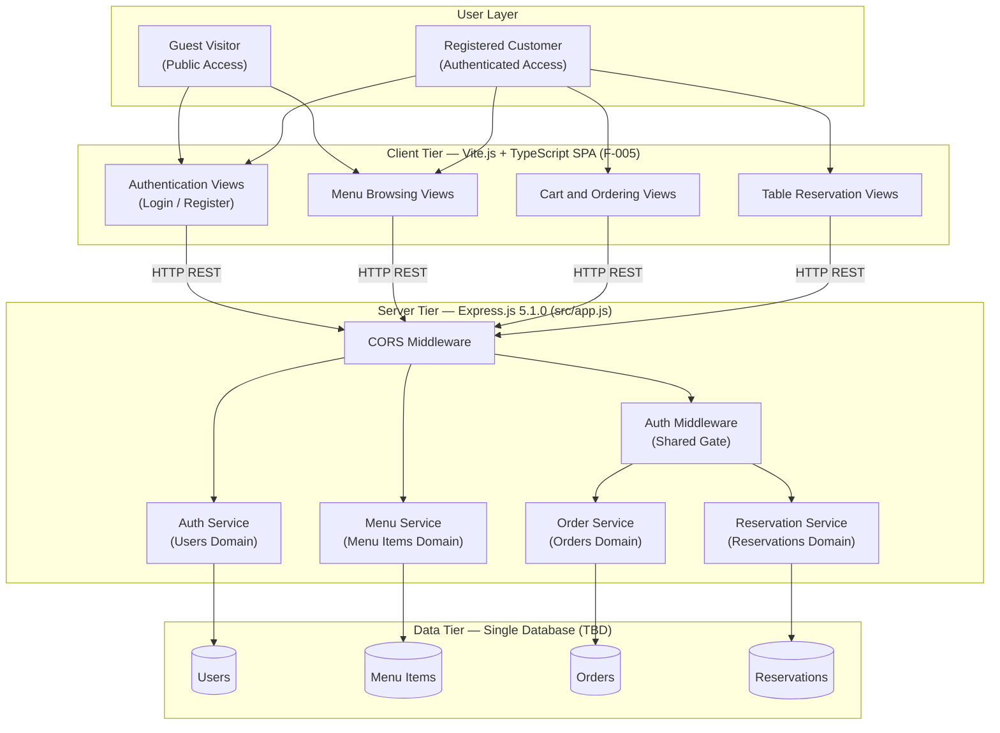

Key architectural observations grounded in the codebase and specification:

- The Express application factory in `src/app.js` creates the Express app without binding to a port, enabling testability via Supertest (Section 1.2.1). All feature route modules are registered through the barrel pattern aggregator in `src/routes/index.js` (Section 2.3.3).
- The Auth Middleware is a shared component consumed by both F-003 (Online Ordering) and F-004 (Table Reservation) to enforce authenticated sessions on protected endpoints (Section 2.3.2).
- All backend services persist data to a single database engine where connection parameters are managed via the Twelve-Factor configuration pattern in `src/config/index.js` (Section 3.5.3).
- CORS must be configured on the Express.js backend to accept only the legitimate frontend origin, as specified in requirement F-005-RQ-004 and security concern Section 2.4.4.

### 4.1.2 Feature Dependency and Implementation Order

The dependency chain establishes a strict implementation order: the foundational UI layer (F-005) must be implemented first, followed by authentication (F-001) and menu catalog (F-002) in parallel, and finally ordering (F-003) and reservations (F-004) which depend on authentication. This chain is defined in Section 2.3.1 and directly governs the phased delivery of all process workflows documented in this section.

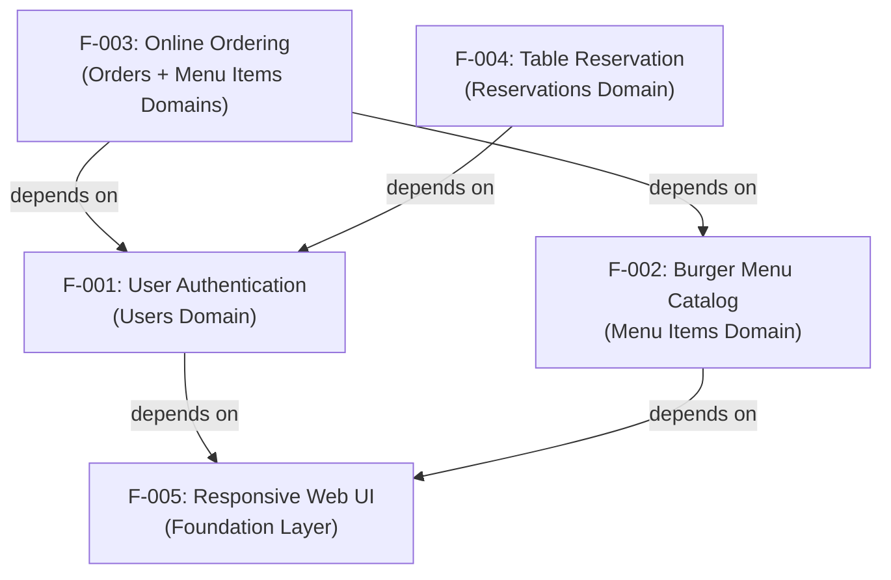

| Implementation Phase | Features | Prerequisite | Workflow Enabled |
|---|---|---|---|
| Phase 1 | F-005: Responsive Web UI | None | Public page rendering, responsive layout |
| Phase 2a | F-001: User Authentication | F-005 | Registration, login, session management, logout |
| Phase 2b | F-002: Burger Menu Catalog | F-005 | Menu browsing, category filtering, item details |
| Phase 3a | F-003: Online Ordering | F-001, F-002 | Cart management, order placement, confirmation |
| Phase 3b | F-004: Table Reservation | F-001 | Date/time selection, booking, confirmation |

### 4.1.3 Primary User Journey Overview

The system supports two primary end-to-end user journeys as defined in Section 1.3.1. These journeys represent the complete user-facing process flows from site entry through task completion.

| Step | Online Order Flow | Table Booking Flow |
|---|---|---|
| 1 | Visit Site (F-005) | Visit Site (F-005) |
| 2 | Browse Menu (F-002-RQ-001) | Login / Register (F-001) |
| 3 | Login / Register (F-001) | Select Date and Time (F-004-RQ-001) |
| 4 | Add Items to Cart (F-003-RQ-001) | Choose Party Size (F-004-RQ-002) |
| 5 | Review Cart (F-003-RQ-002) | Confirm Reservation (F-004-RQ-003) |
| 6 | Place Order (F-003-RQ-003) | Booking Confirmation (F-004-RQ-004) |
| 7 | Order Confirmation (F-003-RQ-004) | — |

As mapped in Section 2.5.4, every step in these journeys corresponds to a specific functional requirement. The Online Order Flow traverses three features (F-002, F-001, F-003), while the Table Booking Flow traverses two (F-001, F-004). Both flows share the F-001 authentication prerequisite and begin with the F-005 responsive web interface.

---

## 4.2 AUTHENTICATION PROCESS FLOWS

Authentication (F-001) is the foundational security layer that gates access to ordering and reservation workflows. This section documents the four authentication sub-processes — registration, login, session management, and logout — as defined in Section 2.2.1. The authentication library is to be determined (Section 1.4.2), but all process flows adhere to the security requirements in Section 2.4.4.

### 4.2.1 User Registration Flow

The registration process transforms a guest visitor into a registered customer by creating a new user record in the Users data domain. This flow implements requirement F-001-RQ-001 and enforces input sanitization, uniqueness validation, and secure password hashing before persistence. The target authentication success rate is ≥ 99.5% (Section 1.2.3).

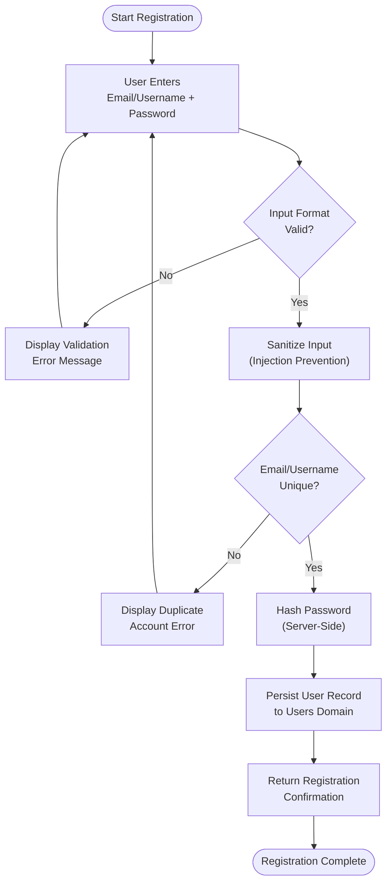

#### Registration Validation Rules

| Checkpoint | Rule | Error Response | Source |
|---|---|---|---|
| Input Format | Password meets minimum complexity requirements | Validation error with guidance | F-001-RQ-001 |
| Input Sanitization | All fields sanitized to prevent injection attacks | Rejected request | Section 2.4.4 |
| Uniqueness Check | Email/username must be unique in Users domain | Duplicate account error | F-001-RQ-001 |
| Credential Storage | Password hashed before persistence; plaintext prohibited | N/A (server-side enforcement) | Section 2.4.4 |

### 4.2.2 User Login Flow

The login process authenticates a registered customer by verifying credentials and establishing an active session with an expiring token. This flow implements requirement F-001-RQ-002 and incorporates constant-time comparison to prevent timing attacks, rate limiting on failed attempts, and generic error messaging to avoid credential enumeration.

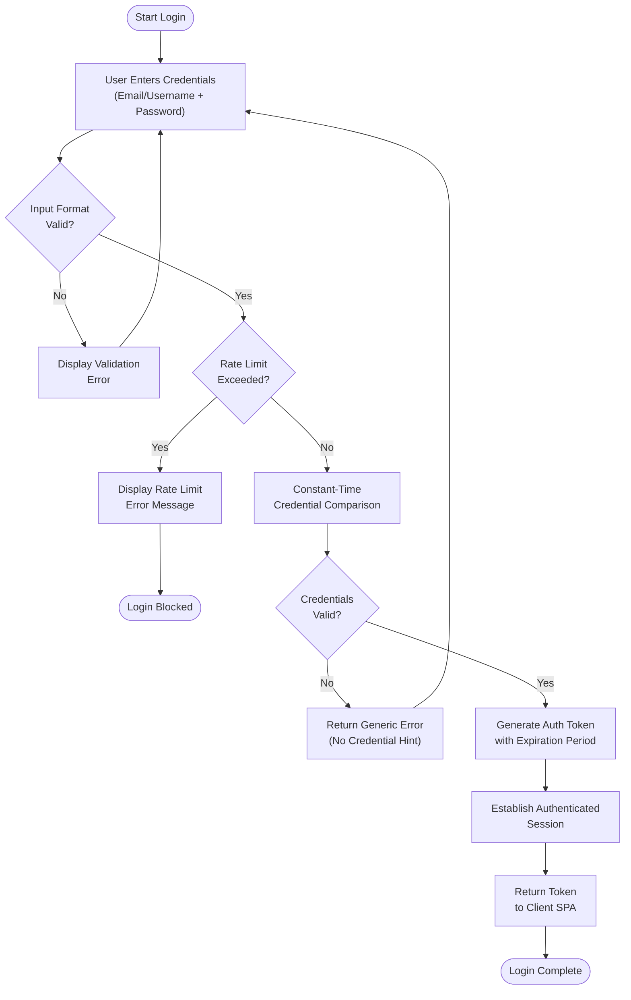

#### Login Security Considerations

| Security Measure | Implementation | Source |
|---|---|---|
| Constant-Time Comparison | Credential verification prevents timing attack side-channels | F-001-RQ-002 |
| Rate Limiting | Failed login attempts are throttled to prevent brute-force attacks | F-001-RQ-002 |
| Generic Error Response | Error messages do not reveal whether username or password was incorrect | F-001-RQ-002 |
| Token Expiration | Authentication tokens have a defined expiration period | F-001-RQ-002 |
| Token Validation | Tokens validated server-side on every protected request | F-001-RQ-003 |

### 4.2.3 Session Lifecycle and Logout

Once a user successfully logs in, an authenticated session is maintained via a token that is sent with each subsequent API request. The session management process (F-001-RQ-003) ensures that the SPA session persists across page navigations, while the server validates the token on every protected route invocation. Session configuration is managed via the `src/config/index.js` extension (Section 2.2.1).

The logout process (F-001-RQ-004) terminates the active session by invalidating the token server-side. After logout, the user is redirected to the public-access area, and any subsequent requests with the invalidated token are rejected. This stateless token-based approach aligns with the horizontal scaling design documented in Section 2.4.3.

**Session Validation Per Request:**

1. Client SPA attaches the authentication token to each HTTP request targeting a protected endpoint.
2. The Auth Middleware intercepts the request and validates the token server-side against the Users data domain.
3. If the token is valid and not expired, the request proceeds to the appropriate service handler.
4. If the token is expired or invalid, a 401 Unauthorized response is returned, and the SPA redirects the user to the login view.

**Logout Process:**

1. The authenticated user triggers logout from the SPA interface.
2. The SPA sends a logout request to the Auth Service.
3. The server invalidates the token in the persistence layer.
4. The SPA clears the local token storage and redirects to the public area.
5. Any subsequent requests with the invalidated token receive a 401 response.

---

## 4.3 ONLINE ORDERING PROCESS FLOW

The online ordering workflow (F-003) represents the primary revenue-generating capability of the platform, implementing the complete Online Order Flow defined in Section 1.3.1. This end-to-end process spans three features: menu browsing (F-002), authentication (F-001), and ordering (F-003), culminating in a persisted order record in the Orders data domain. Payment processing is explicitly out of scope per Constraint C-001 (Section 2.6.2).

### 4.3.1 End-to-End Order Workflow

The following flowchart captures the complete online order journey from menu browsing through order confirmation, including all decision points, validation checkpoints, and error recovery paths. Server-side price recalculation is mandatory at order submission to prevent client-side price tampering (Section 2.4.4).

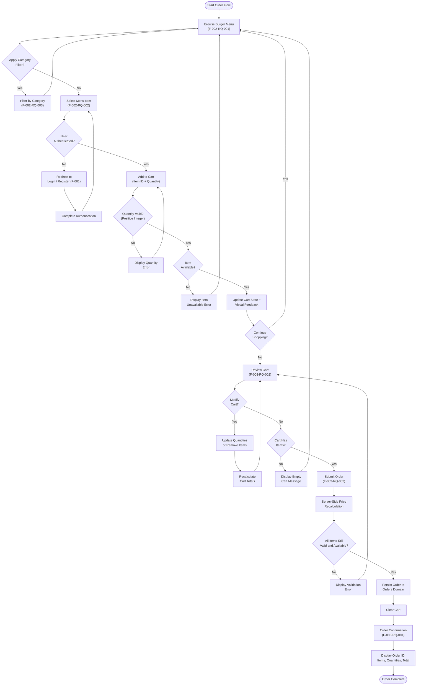

### 4.3.2 Cart Management Subprocess

The cart (F-003-RQ-001, F-003-RQ-002) acts as a session-scoped transient container that bridges menu browsing and order submission. Cart state persists during the user's active session and is linked to the authenticated user. The following rules govern cart behavior:

- **Add to Cart**: Captures the menu item identifier and quantity. The referenced menu item must exist and be available in the Menu Items data domain. Quantity must be a positive integer. Users receive immediate visual feedback upon successful addition (F-003-RQ-001).
- **Modify Cart**: Users can update item quantities (a zero quantity triggers removal) or remove individual items. Cart totals auto-recalculate upon any modification. Only the authenticated cart owner may modify their cart (F-003-RQ-002).
- **Cart Clearance**: The cart is automatically cleared upon successful order placement. An empty cart prevents order submission and redirects the user to the menu.
- **Session Binding**: Cart state is tied to the authenticated session. If the session expires or is invalidated, the cart state is lost.

### 4.3.3 Order Submission Validation Rules

At the point of order submission (F-003-RQ-003), the server performs a comprehensive validation pass before persisting the order. This is a critical security and data integrity checkpoint.

| Validation Step | Rule | Failure Response | Source |
|---|---|---|---|
| Authentication Check | User must have a valid, non-expired session token | 401 Unauthorized | F-001-RQ-003 |
| Cart Contents Check | Cart must contain at least one item | Rejection with empty cart message | F-003-RQ-002 |
| Item Availability | All referenced menu items must be valid and available at submission time | Validation error listing invalid items | F-003-RQ-003 |
| Price Recalculation | Order total recalculated server-side using current database prices | Mismatch flagged; updated total returned | Section 2.4.4 |
| Quantity Validation | All quantities must be positive integers | 400 Bad Request | F-003-RQ-001 |
| Order Persistence | Order persisted with line items, quantities, server-calculated pricing, and initial status | Database error returns 500 | F-003-RQ-003 |
| Cart Clearance | Cart cleared only after successful persistence | Cart retained on failure | F-003-RQ-003 |
| Order ID Generation | Unique order identifier returned to the client | Included in confirmation response | F-003-RQ-004 |

Order fulfillment (kitchen preparation, delivery) occurs outside the system boundary (Assumption A-005). The system scope covers order placement and confirmation only.

---

## 4.4 TABLE RESERVATION PROCESS FLOW

The table reservation workflow (F-004) enables authenticated users to book a dine-in table at the restaurant. This process implements the Table Booking Flow defined in Section 1.3.1. The system serves a single restaurant location (Assumption A-003), and menu management occurs outside the customer-facing application (Assumption A-004).

### 4.4.1 End-to-End Reservation Workflow

The following flowchart documents the complete reservation process from authentication through booking confirmation. Six server-side validation checkpoints enforce date, time, party size, capacity, and duplicate constraints before the reservation is persisted to the Reservations data domain.

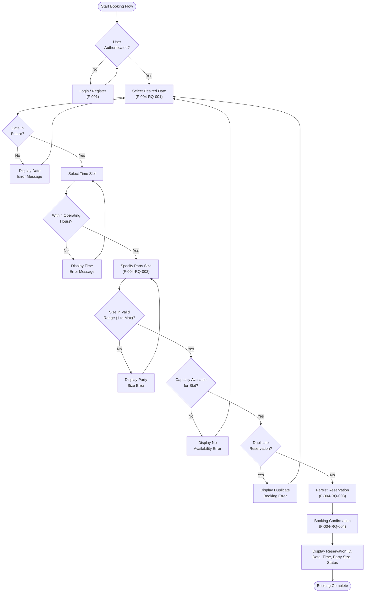

### 4.4.2 Reservation Validation Rules

All reservation inputs are validated server-side before persistence. The Reservation Service performs these checks sequentially, returning the first validation failure encountered to the client.

| Checkpoint | Rule | Error Response | Source |
|---|---|---|---|
| Authentication | User must have a valid authenticated session | 401 Unauthorized | F-001-RQ-003 |
| Date Validity | Selected date must be in the future | Past date rejection | F-004-RQ-001 |
| Time Validity | Selected time must fall within restaurant operating hours | Invalid time slot error | F-004-RQ-001 |
| Party Size Range | Party size must be a positive integer between 1 and the configured maximum | Out of range error | F-004-RQ-002 |
| Capacity Check | Date/time slot must have sufficient capacity to accommodate the party size | No availability error | F-004-RQ-001, F-004-RQ-002 |
| Duplicate Prevention | Same user cannot hold multiple reservations for the same date/time | Duplicate booking error | F-004-RQ-003 |
| Input Sanitization | All input fields sanitized to prevent injection attacks | Rejected request | Section 2.4.4 |
| Server-Side Verification | Table availability verified server-side (not relying on client state) | Stale data error | F-004-RQ-003 |

### 4.4.3 Booking Confirmation Process

Upon successful validation and persistence, the Reservation Service generates a unique reservation identifier and returns the complete booking details to the client. The confirmation view (F-004-RQ-004) displays the reservation ID, selected date, time, party size, and reservation status. This confirmation is accessible after initial booking via the user's reservation history.

Real-time notifications for reservation status changes are out of scope (Constraint C-002). Users must manually check reservation status through the application interface.

---

## 4.5 INTEGRATION WORKFLOWS

This section documents the technical integration flows that underpin all business processes, covering the API request lifecycle, middleware processing chain, and backend-to-database persistence patterns.

### 4.5.1 API Request Processing Pipeline

The following sequence diagram illustrates the complete lifecycle of an HTTP REST request from the Vite.js SPA through the Express.js 5.1.0 middleware stack to the database and back. This flow applies to all four backend services (Auth, Menu, Order, Reservation) and demonstrates the routing logic, authentication gating, input validation, and error response paths.

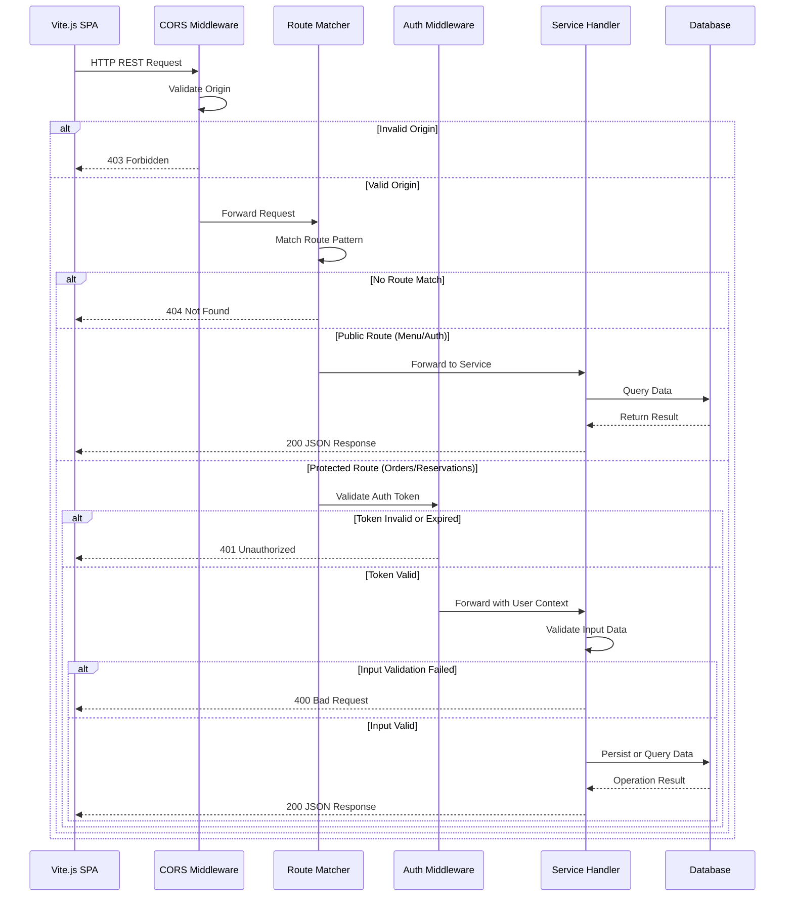

### 4.5.2 Middleware Processing Chain

The Express.js 5.1.0 middleware pipeline processes requests in a deterministic sequence through `src/app.js`. The current foundation uses the Factory Pattern to create the Express app, and all routes are aggregated via the Barrel Pattern in `src/routes/index.js`. The planned middleware chain extends this foundation as follows:

| Order | Middleware | Scope | Purpose | Source |
|---|---|---|---|---|
| 1 | CORS | All requests | Restrict cross-origin access to the legitimate Vite.js SPA origin | Section 2.4.4 |
| 2 | Body Parser | All requests | Parse JSON request bodies for POST/PUT/PATCH operations | Express.js built-in |
| 3 | Route Matcher | All requests | Match incoming URL patterns to registered route handlers | `src/routes/index.js` |
| 4 | Auth Middleware | Protected routes only | Validate authentication tokens for F-003 and F-004 endpoints | Section 2.3.2 |
| 5 | Service Handler | Matched routes | Execute business logic for the target feature domain | Feature-specific services |
| 6 | Error Handler | Failed requests | Express 5 native async/await rejection handling | Section 1.2.1 |

Express.js 5.1.0 provides native async/await error handling where rejected promises in middleware and route handlers are automatically caught and forwarded to the error handler, eliminating the need for manual try-catch wrappers in every handler (Section 1.2.1).

### 4.5.3 Data Persistence Flow

All four backend services interact with the single shared database (Assumption A-001) through a common persistence pattern. Each service is responsible for its respective data domain as mapped in Section 2.5.1, and database connection configuration is managed through the Twelve-Factor pattern in `src/config/index.js`.

| Service | Data Domain | Write Operations | Read Operations |
|---|---|---|---|
| Auth Service | Users | Registration (create user), Login (create/update token), Logout (invalidate token) | Credential verification, token validation |
| Menu Service | Menu Items | None in customer-facing scope (Assumption A-004) | List all items, filter by category, get item details |
| Order Service | Orders, Menu Items | Create order, update order status | Read order by ID, order history, validate menu item references |
| Reservation Service | Reservations | Create reservation | Check availability/duplicates, reservation history |

Database connection pooling is required to handle concurrent connections from all services efficiently (Section 2.4.3). The stateless REST API design with token-based sessions supports horizontal scaling of the server tier without sticky sessions.

---

## 4.6 STATE TRANSITION DIAGRAMS

This section provides formal state machine diagrams for the four primary stateful entities in the system: user sessions, orders, reservations, and shopping carts. Each state machine defines the valid states, transitions, and the events that trigger them.

### 4.6.1 User Session State Machine

The session state machine governs user authentication status throughout the application lifecycle. Transitions correspond to the authentication requirements defined in Section 2.2.1 (F-001-RQ-001 through F-001-RQ-004).

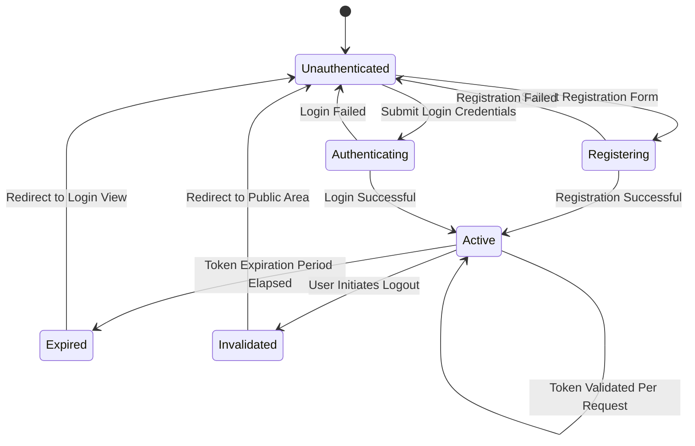

**State Descriptions:**

| State | Description | Allowed Operations |
|---|---|---|
| Unauthenticated | No valid session; user is a guest visitor | Browse menu (F-002), register, login |
| Registering | Registration form submitted; awaiting server response | None (pending) |
| Authenticating | Login credentials submitted; awaiting verification | None (pending) |
| Active | Valid authenticated session with non-expired token | All features (F-001 through F-005) |
| Expired | Token expiration period has elapsed | None; redirected to login |
| Invalidated | User has explicitly logged out; token destroyed server-side | None; redirected to public area |

### 4.6.2 Order Lifecycle State Machine

The order lifecycle tracks the progression from an empty cart through order confirmation. In the current system scope, order fulfillment (kitchen preparation, delivery) occurs outside the system boundary (Assumption A-005), so the state machine terminates at confirmation.

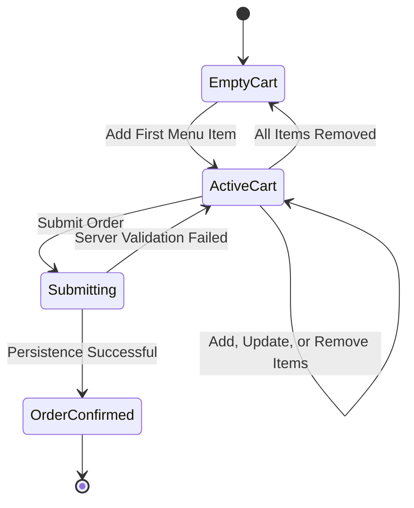

**Transition Rules:**

| Transition | Trigger | Validation | Data Effect |
|---|---|---|---|
| Empty → Active | Add first item to cart | Item exists, quantity positive | Cart state created in session |
| Active → Active | Modify cart contents | Quantity non-negative; zero triggers removal | Cart totals recalculated |
| Active → Empty | Remove last item | N/A | Cart state cleared |
| Active → Submitting | User clicks Place Order | Cart non-empty, user authenticated | Request sent to Order Service |
| Submitting → Active | Validation failure | Server-side checks fail | Cart state preserved; error displayed |
| Submitting → Confirmed | All validations pass | Prices recalculated, items verified, order persisted | Cart cleared; order ID generated |

### 4.6.3 Reservation Lifecycle State Machine

The reservation lifecycle tracks a booking request from initial date/time selection through confirmed reservation. Reservation management beyond creation (e.g., cancellation, modification) is implied for restaurant staff (Section 2.5.2) but not explicitly defined in the customer-facing scope.

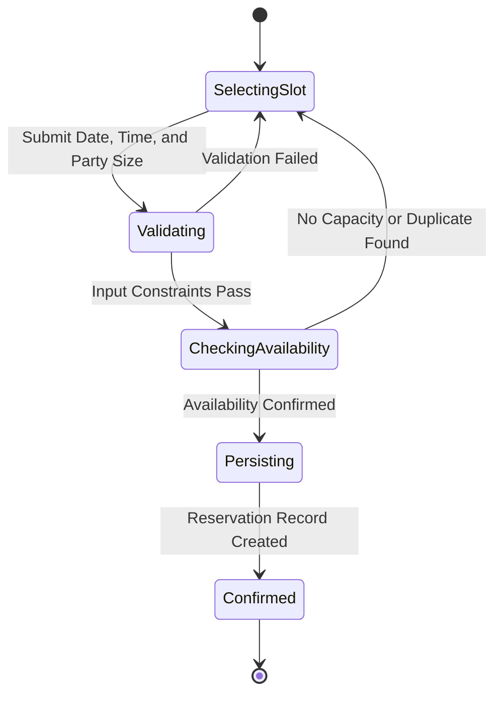

**State Descriptions:**

| State | Description | Server-Side Action |
|---|---|---|
| SelectingSlot | User is choosing date, time, and party size in the SPA | None (client-side interaction) |
| Validating | Server validates date is future, time within hours, size in range | Input constraint checks |
| CheckingAvailability | Server verifies capacity and duplicate prevention | Database queries on Reservations domain |
| Persisting | Reservation record being written to database | INSERT into Reservations table |
| Confirmed | Unique reservation ID generated and returned | Confirmation response sent |

### 4.6.4 Shopping Cart State Machine

The shopping cart is a session-scoped transient entity that bridges the menu browsing and order submission processes. Unlike orders and reservations, the cart is not independently persisted to the database — it exists only within the context of an active authenticated session.

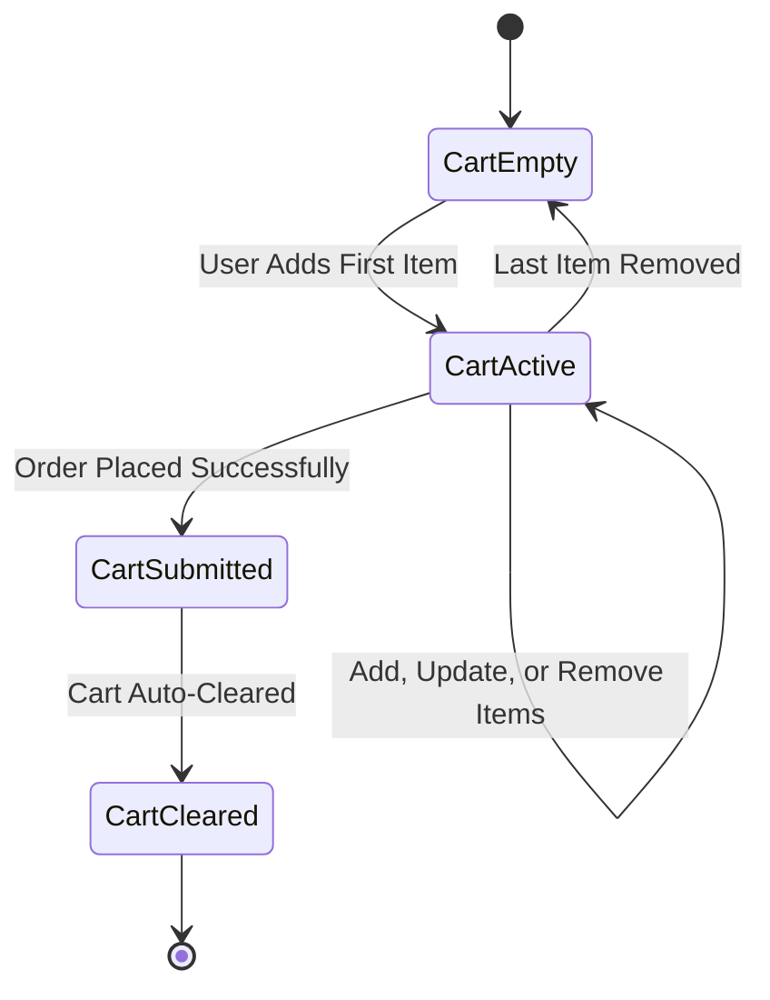

**Cart Persistence Characteristics:**

| Characteristic | Detail | Source |
|---|---|---|
| Scope | Session-bound; tied to authenticated user | F-003-RQ-001 |
| Persistence | Transient during active session; not independently persisted | Section 2.2.3 |
| Clearance Trigger | Successful order placement | F-003-RQ-003 |
| Session Loss | Cart state lost if session expires or is invalidated | F-001-RQ-003 |
| Access Control | Only the authenticated cart owner may modify contents | F-003-RQ-002 |

---

## 4.7 ERROR HANDLING AND RECOVERY FLOWS

This section documents the error handling patterns, classification logic, and client-side recovery procedures that apply across all system workflows. The Express.js 5.1.0 backend provides native async/await error handling where rejected promises are automatically forwarded to error middleware (Section 1.2.1).

### 4.7.1 API Error Classification Flow

The following flowchart illustrates the decision tree for classifying and responding to errors at each stage of API request processing. Errors are classified by HTTP status code, and each error type triggers a specific client-side recovery action.

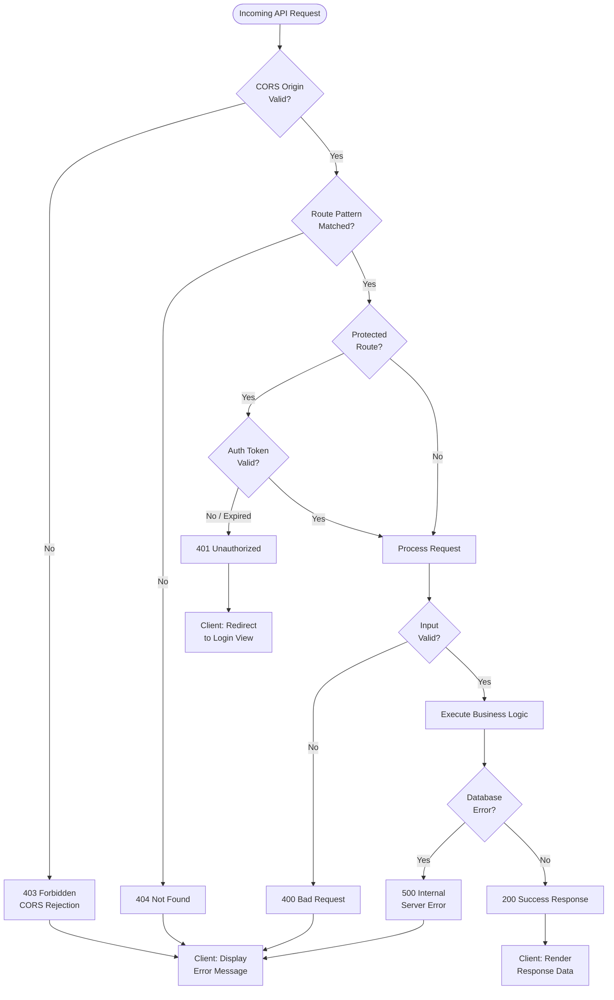

#### Error Response Summary

| HTTP Status | Trigger Condition | Client Recovery Action | Source |
|---|---|---|---|
| 200 | Successful request processing | Render response data in SPA | All features |
| 400 | Input validation failure (format, range, business rules) | Display specific validation error; allow user to correct input | Section 2.4.4 |
| 401 | Missing, invalid, or expired authentication token | Redirect to login view; clear stale session data | F-001-RQ-003 |
| 403 | CORS origin mismatch | Display connectivity error message | F-005-RQ-004 |
| 404 | Undefined route or missing resource | Display not-found message; offer navigation to valid routes | Integration tests |
| 429 | Rate limit exceeded on login attempts | Display rate limit message with retry guidance | F-001-RQ-002 |
| 500 | Unhandled server error or database failure | Display generic server error; suggest retry | Express 5 async error handling |

### 4.7.2 Authentication Error Handling

Authentication errors require special handling to maintain security while providing an acceptable user experience. The following rules apply specifically to authentication-related error scenarios:

- **Credential Errors**: When login fails due to invalid credentials, the system returns a generic error message that does not reveal whether the username or password was incorrect. This prevents credential enumeration attacks (F-001-RQ-002).
- **Rate Limiting**: After exceeding the configured threshold of failed login attempts, subsequent attempts are blocked with a rate limit error message. The rate limiting mechanism protects against brute-force attacks (F-001-RQ-002).
- **Token Expiration**: When an active session token expires during use, the Auth Middleware returns a 401 response. The SPA intercepts this response, clears the local token storage, and redirects the user to the login view (F-001-RQ-003).
- **Invalidated Tokens**: After logout, any attempt to use the previously valid token results in a 401 rejection. The server-side invalidation ensures that stolen tokens cannot be reused after the user has explicitly logged out (F-001-RQ-004).

### 4.7.3 Client-Side Error Recovery Procedures

The Vite.js SPA implements graceful error handling for all API interactions as required by F-005-RQ-004. The frontend-backend integration requirement mandates that API error responses are handled gracefully and that network failures present meaningful feedback to the user.

| Error Scenario | Client-Side Behavior | Recovery Path |
|---|---|---|
| Network Failure | Display connectivity error with retry option | User retries action; SPA re-sends request |
| 401 Unauthorized | Clear local session state; redirect to login | User re-authenticates and retries |
| 400 Validation Error | Display field-specific error messages | User corrects input and resubmits |
| 404 Not Found | Display not-found message with navigation links | User navigates to valid section |
| 500 Server Error | Display generic error with retry suggestion | User retries; if persistent, contact support |
| CORS Rejection | Display configuration error message | Requires server-side CORS fix |
| Item Unavailable (Order) | Display unavailability notice; suggest alternatives | User browses menu for available items |
| No Capacity (Reservation) | Display no availability; suggest alternative date/time | User selects different slot |

**Server Startup Error Handling**: The server lifecycle includes handling of the EADDRINUSE error condition when the configured port is already in use, as validated by the test suite in `tests/lifecycle/server.test.js`. This prevents silent startup failures and provides clear diagnostic output.

---

#### References

#### Repository Files Examined

- `src/app.js` — Express application factory (Factory Pattern); CORS middleware and route mounting point for all feature services
- `src/config/index.js` — Twelve-Factor configuration module managing HOST, PORT, NODE_ENV; extensible for database connections, auth secrets, and CORS configuration
- `src/routes/index.js` — Barrel pattern route aggregator where all feature route modules are registered
- `src/routes/main.routes.js` — Current Express Router implementation with GET `/` and GET `/evening` handlers
- `server.js` — Designated application entry point (currently empty; requires bootstrap implementation)
- `jest.config.js` — Jest test framework configuration with coverage thresholds (75% branches, 90% functions, 80% lines, 80% statements)
- `tests/lifecycle/server.test.js` — Server lifecycle tests including EADDRINUSE error handling validation

#### Repository Folders Examined

- `src/` — Application source directory containing app factory, configuration, and routing modules
- `src/config/` — Configuration module directory
- `src/routes/` — Routing layer directory with barrel pattern aggregation
- `tests/` — Three-tier test architecture (unit, integration, lifecycle)

#### Technical Specification Sections Referenced

- Section 1.2 SYSTEM OVERVIEW — Three-tier architecture, component diagram, success criteria and KPIs
- Section 1.3 SCOPE — In-scope features, primary user workflows, implementation boundaries, out-of-scope exclusions
- Section 1.4 TECHNOLOGY CONTEXT — Current and planned technology stack, repository structure
- Section 2.1 FEATURE CATALOG — Five core features (F-001 through F-005) with descriptions and dependencies
- Section 2.2 FUNCTIONAL REQUIREMENTS — Detailed requirements with acceptance criteria and validation rules for all features
- Section 2.3 FEATURE RELATIONSHIPS — Feature dependency map, integration points, shared components
- Section 2.4 IMPLEMENTATION CONSIDERATIONS — Technical constraints, performance requirements, scalability, security implications
- Section 2.5 TRACEABILITY MATRIX — Feature-to-domain, user group, KPI, and workflow mappings
- Section 2.6 ASSUMPTIONS AND CONSTRAINTS — Assumptions A-001 through A-005, Constraints C-001 through C-005
- Section 3.5 DATABASES & STORAGE — Planned database layer, data domains, storage architecture
- Section 3.7 TECHNOLOGY STACK SUMMARY — Full stack overview, implementation status matrix, compatibility constraints

# 5. System Architecture

This section provides the authoritative architectural reference for the burger restaurant web application, documenting the system's structural design, component interactions, technical decisions, and cross-cutting concerns. The architecture transforms the existing minimal Express.js 5.1.0 tutorial server into a production-grade, full-stack restaurant platform supporting user authentication, burger menu browsing, online ordering, and table reservation for dine-in — built with a Vite.js and TypeScript frontend.

---

## 5.1 HIGH-LEVEL ARCHITECTURE

### 5.1.1 System Overview

The burger restaurant web application employs a **three-tier, decoupled full-stack architecture** that cleanly separates presentation, business logic, and data persistence responsibilities. This architectural style was selected to provide independent development and scaling of each tier while maintaining well-defined integration contracts via RESTful HTTP APIs.

**Architecture Style and Rationale:**

The system is organized into three distinct tiers:

- **Client Tier (Presentation):** A Vite.js-powered TypeScript Single-Page Application (SPA) that communicates with the backend exclusively through HTTP REST endpoints. Vite.js provides extremely fast Hot Module Replacement (HMR) during development and optimized production builds via the Rolldown bundler, targeting a sub-3-second initial page load time. The frontend uses ES Modules, while the backend uses CommonJS — a dual module system that requires careful boundary management at the integration layer.

- **Server Tier (Business Logic):** An Express.js 5.1.0 application running on Node.js 20.19.x LTS that implements the application factory pattern in `src/app.js`, separating app configuration from server binding. Express 5's native async/await error handling eliminates manual try-catch wrappers, and its ReDoS-safe routing via `path-to-regexp@8.x` mitigates Regular Expression Denial-of-Service risks. The server tier hosts four domain services — Auth, Menu, Order, and Reservation — fronted by a deterministic middleware pipeline.

- **Data Tier (Persistence):** A single shared database (engine to be determined) managing four data domains: Users, Menu Items, Orders, and Reservations. Database connection parameters are managed through the Twelve-Factor configuration pattern established in `src/config/index.js`. Connection pooling is required for efficient concurrent access from all services.

**Key Architectural Principles:**

| Principle | Implementation |
|---|---|
| **Separation of Concerns** | App configuration (`src/app.js`), server binding (`server.js`), routing (`src/routes/`), and configuration (`src/config/`) are isolated |
| **Factory Pattern** | Express app creation is separated from port binding, enabling in-process testing via Supertest |
| **Barrel Pattern** | Route aggregation through a single entry point (`src/routes/index.js`) centralizes service registration |
| **Twelve-Factor Configuration** | Environment variables with safe defaults manage all runtime settings |
| **Stateless REST API** | Token-based session management supports horizontal scaling without sticky sessions |

**System Boundaries:**

The application boundary encompasses a client-side SPA served as static assets, a server-side API bound to a configurable `HOST` and `PORT` (defaults: `127.0.0.1:3000` per `src/config/index.js`), and a database layer for persistent storage. Guest visitors access only public routes (menu browsing, authentication views), while registered customers access all features including ordering and table reservation. CORS middleware gates all incoming requests, and shared Auth Middleware protects the Order Service and Reservation Service endpoints.

Items explicitly outside the system boundary include payment gateway integration, delivery tracking, native mobile applications, real-time WebSocket notifications, CI/CD pipelines, containerization, third-party delivery aggregator integration, and HTTPS/TLS termination (assumed to be handled at the infrastructure level).

### 5.1.2 Core Components

The following table catalogs all major architectural components, their current implementation status, and their role within the system.

| Component | Primary Responsibility | Status |
|---|---|---|
| **Express App Factory** (`src/app.js`) | Creates configured Express app, mounts middleware and routes without port binding | Implemented |
| **Route Aggregator** (`src/routes/index.js`) | Barrel pattern central registry for all route modules | Implemented |
| **Configuration Module** (`src/config/index.js`) | Twelve-Factor environment config (HOST, PORT, NODE_ENV) with safe defaults | Implemented |
| **Main Routes** (`src/routes/main.routes.js`) | Serves `GET /` and `GET /evening` greeting endpoints | Implemented |
| **Vite.js SPA** | Responsive TypeScript frontend with authentication, menu, cart, and reservation views | Planned |
| **Auth Service** | User registration, login, token management, logout | Planned |
| **Auth Middleware** | Shared token validation gate for protected routes (Orders, Reservations) | Planned |
| **Menu Service** | Menu item retrieval, category filtering (read-only for customers) | Planned |
| **Order Service** | Cart management, order placement, server-side price recalculation | Planned |
| **Reservation Service** | Date/time/party-size booking, capacity checking, duplicate prevention | Planned |
| **CORS Middleware** | Cross-origin access control restricting requests to legitimate SPA origin | Planned |
| **Database Layer** | Single database engine for Users, Menu Items, Orders, Reservations domains | Planned |

**Component Dependencies:**

| Component | Key Dependencies | Integration Points |
|---|---|---|
| **Vite.js SPA** | Vite.js 8.x, TypeScript 5.4+ | REST API endpoints via HTTP |
| **Auth Service** | Database Layer, Config Module, Auth Library (TBD) | Users data domain, token management |
| **Menu Service** | Database Layer, Config Module | Menu Items data domain |
| **Order Service** | Auth Middleware, Menu Service, Database Layer | Orders + Menu Items data domains |
| **Reservation Service** | Auth Middleware, Database Layer | Reservations data domain |
| **Auth Middleware** | Auth Service (token validation) | Shared by Order and Reservation services |
| **CORS Middleware** | Config Module (origin allowlist) | All incoming SPA requests |

### 5.1.3 Data Flow Description

Data flows through the system in a well-defined request-response pattern that traverses all three tiers. The following describes the primary data flow paths and transformation points.

**Primary Request-Response Flow:**

All client interactions originate from the Vite.js SPA as HTTP REST requests carrying JSON payloads. Each request first encounters the CORS middleware, which validates the request origin against the configured allowlist — rejecting unauthorized origins with a 403 response. Valid requests proceed to the Express.js Route Matcher, which maps URL patterns to registered route handlers aggregated through the barrel pattern in `src/routes/index.js`.

For **public routes** (menu browsing and authentication endpoints), requests flow directly from the Route Matcher to the appropriate Service Handler. For **protected routes** (ordering and reservation endpoints), requests must first pass through the shared Auth Middleware, which validates the authentication token server-side against the Users data domain. Invalid or expired tokens result in a 401 response, prompting the SPA to redirect to the login view.

Upon reaching a Service Handler, input data is validated and sanitized server-side to prevent injection attacks. Valid requests trigger database interactions — reads for data retrieval or writes for persistence — and the resulting data is transformed into a JSON response returned to the client. For order submissions, a critical transformation occurs: the Order Service recalculates all prices server-side using current database values, preventing client-side price tampering.

**Data Transformation Points:**

| Transformation Point | Description |
|---|---|
| **Input Sanitization** | All user inputs sanitized at service handlers before processing |
| **Password Hashing** | Credentials hashed server-side during registration; plaintext prohibited |
| **Server-Side Price Recalculation** | Order totals recomputed from database prices at submission time |
| **Token Generation** | Auth tokens created with expiration period upon successful login |
| **Token Validation** | Auth tokens verified server-side on every protected request |

**Key Data Stores:**

A single database engine (Assumption A-001) persists all four data domains. No dedicated caching solution (Redis, Memcached) is specified. The primary caching mechanism is Vite.js production builds, which produce content-hashed, CDN-compatible static assets for frontend delivery. The shopping cart is a session-scoped transient entity — not independently persisted to the database — that exists only within the context of an active authenticated session.

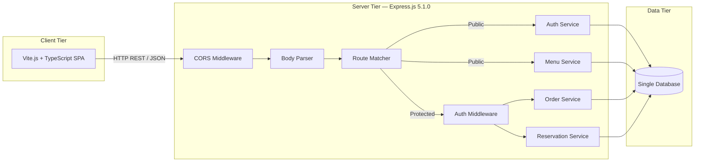

### 5.1.4 Internal Integration Points

The system has no external third-party service integrations. No payment gateway, email service, push notification service, or third-party delivery aggregator integration exists — all are explicitly out of scope. The following table documents the internal integration contracts that bind the system tiers together.

| Integration Point | Type | Data Exchange Pattern |
|---|---|---|
| **Frontend ↔ Backend API** | HTTP REST | JSON request/response over HTTP; token-authenticated for protected endpoints |
| **Backend ↔ Database** | Database Driver | Service-to-database read/write via connection pool managed by `src/config/index.js` |
| **Auth Middleware ↔ Auth Service** | In-process | Token validation delegated from middleware to Auth Service per request |
| **Configuration Module ↔ All Services** | In-process Import | Twelve-Factor config consumed by all backend components via `require()` |

---

## 5.2 COMPONENT DETAILS

### 5.2.1 Client Tier — Vite.js + TypeScript SPA

**Purpose and Responsibilities:**

The frontend layer delivers the complete user interface for the burger restaurant application as a responsive, mobile-friendly Single-Page Application. It provides five view categories: Authentication Views (login/register forms), Menu Browsing Views (burger catalog with category filtering), Cart and Ordering Views (cart management and checkout), Table Reservation Views (date/time/party-size selection and booking confirmation), and the overarching Responsive Layout framework. The SPA communicates with the backend exclusively through HTTP REST API calls, with authentication tokens attached to all requests targeting protected endpoints.

**Technologies and Frameworks:**

| Technology | Version | Purpose |
|---|---|---|
| Vite.js | 8.x (latest stable) | Build tool with HMR for development; Rolldown bundler for production |
| TypeScript | 5.4+ (strict mode) | Frontend language with full type coverage for all API interfaces |
| ES Modules | Native | Frontend module system (distinct from backend CommonJS) |

**Key Interfaces:**

The SPA consumes four backend API domains:
- **Auth API:** Registration, login, logout, session validation endpoints
- **Menu API:** Menu item listing, category filtering, item detail retrieval
- **Order API:** Cart operations, order submission, order confirmation retrieval
- **Reservation API:** Date/time/party-size booking, confirmation retrieval

**Scaling Considerations:**

Vite.js production builds generate content-hashed, cacheable static assets that are CDN-compatible. The SPA is fully stateless from a server perspective — all client state resides in the browser session, with the shopping cart tied to the authenticated user's session token. This design supports horizontal scaling of the backend without affecting the frontend deployment.

### 5.2.2 Server Tier — Express.js 5.1.0 Backend

**Purpose and Responsibilities:**

The server tier hosts all business logic, authentication enforcement, input validation, and data persistence operations. It extends the existing Express.js 5.1.0 foundation — which currently serves two static greeting endpoints — into a comprehensive REST API platform with four domain services.

**Technologies and Frameworks:**

| Technology | Version | Purpose |
|---|---|---|
| Express.js | 5.1.0 (locked) | Backend HTTP framework with native async/await error handling |
| Node.js | 20.19.x LTS | Runtime environment (satisfies all dependency version floors) |
| npm | 10.8.x | Package manager and task runner |

#### Express Application Factory

The application factory in `src/app.js` implements the Factory Pattern by creating and configuring the Express app without binding it to a network port. This separation enables Supertest to perform in-process HTTP testing by accepting the app instance directly, without requiring port binding. The factory is responsible for:
- Mounting CORS middleware for cross-origin request gating
- Mounting the JSON body parser for request payload processing
- Registering all feature route modules via the barrel pattern aggregator in `src/routes/index.js`
- Attaching the error handling middleware as the final pipeline stage

The current implementation is minimal — mounting only `mainRoutes` at the root path — and will be extended to register Auth, Menu, Order, and Reservation route modules.

#### Middleware Pipeline

The Express.js middleware pipeline processes requests in a deterministic, ordered sequence. This pipeline represents the primary control flow mechanism for all API operations.

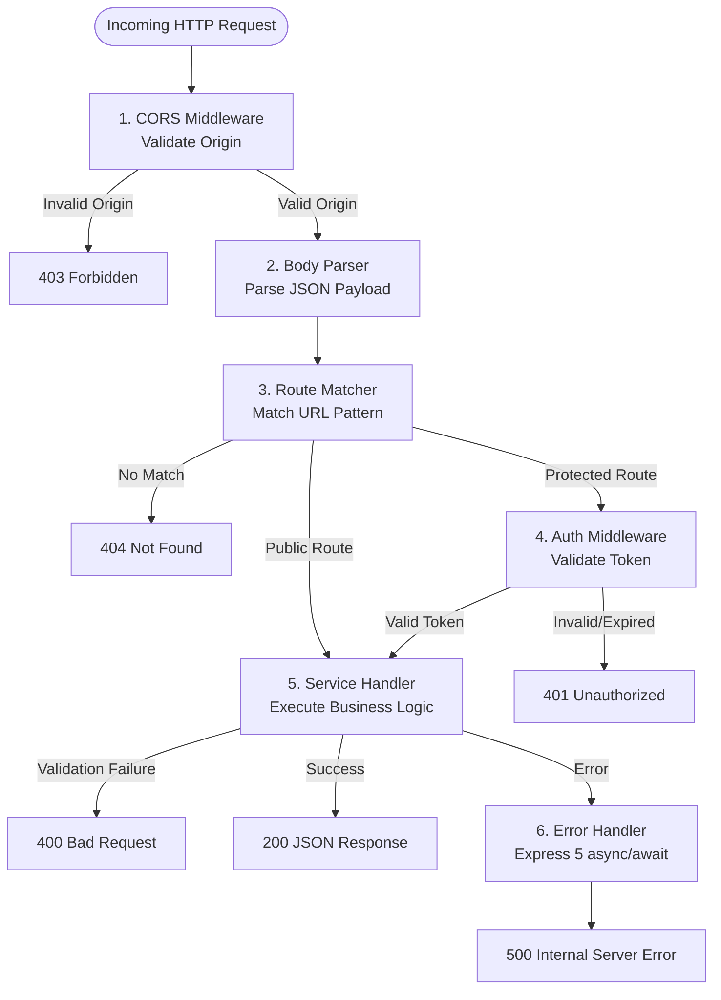

| Order | Middleware | Scope |
|---|---|---|
| 1 | CORS Middleware | All requests — restricts cross-origin access to legitimate SPA origin |
| 2 | Body Parser (Express built-in) | All requests — parses JSON request bodies for POST/PUT/PATCH |
| 3 | Route Matcher | All requests — matches URL patterns to registered handlers via `src/routes/index.js` |
| 4 | Auth Middleware | Protected routes only — validates auth tokens for Order and Reservation endpoints |
| 5 | Service Handler | Matched routes — executes domain business logic |
| 6 | Error Handler | Failed requests — Express 5 native async/await rejection handling |

#### Auth Service

The Auth Service manages the Users data domain, handling account creation, credential verification, token lifecycle, and session invalidation. It implements four operations: Registration (input validation → sanitization → uniqueness check → password hashing → persist user record), Login (input validation → rate limiting → constant-time credential comparison → token generation with expiration → session establishment), Session Validation (server-side token verification on every protected request), and Logout (server-side token invalidation → clear local storage → redirect to public area).

#### Menu Service

The Menu Service provides read-only access to the Menu Items data domain for all users — both guests and registered customers. It supports listing all available items, filtering by category, and retrieving individual item details. Menu management (create, update, delete) occurs outside the customer-facing application (Assumption A-004), meaning the customer-facing scope has no write operations against this domain.

#### Order Service

The Order Service implements the end-to-end ordering workflow across the Orders and Menu Items data domains. It manages cart state (session-scoped, transient), order submission with comprehensive server-side validation (authentication check, cart non-empty check, item availability verification, server-side price recalculation, quantity validation), and order persistence. The cart is automatically cleared upon successful order placement. Payment processing is excluded from scope (Constraint C-001), and order fulfillment (kitchen preparation, delivery) occurs outside the system boundary (Assumption A-005).

#### Reservation Service

The Reservation Service manages the Reservations data domain, implementing a six-checkpoint validation pipeline: authentication verification, future date validation, operating hours verification, party size range check, capacity availability confirmation, and duplicate booking prevention. Upon passing all validations, a unique reservation identifier is generated and the booking is persisted. Real-time notifications for reservation status changes are out of scope (Constraint C-002).

### 5.2.3 Data Tier — Database Layer

**Purpose and Responsibilities:**

The data tier provides persistent storage for all four data domains through a single database engine (Assumption A-001). No database layer currently exists — the application is entirely stateless, serving only hardcoded greeting responses. All data-driven features (F-001 through F-004) are blocked until persistence is implemented.

**Data Domains:**

| Data Domain | Key Attributes | Feature Dependency |
|---|---|---|
| **Users** | Account credentials, profile information, authentication tokens | F-001 (User Authentication) |
| **Menu Items** | Names, descriptions, pricing, categories, availability | F-002 (Burger Menu Catalog) |
| **Orders** | Line items, quantities, pricing, order status | F-003 (Online Ordering) |
| **Reservations** | Date, time, party size, reservation status | F-004 (Table Reservation) |

**Data Persistence Patterns:**

| Service | Write Operations | Read Operations |
|---|---|---|
| **Auth Service** | Create user, create/update token, invalidate token | Credential verification, token validation |
| **Menu Service** | None (customer-facing scope) | List items, filter by category, get item details |
| **Order Service** | Create order, update order status | Read order, order history, validate menu item references |
| **Reservation Service** | Create reservation | Check availability/duplicates, reservation history |

**Database Requirements:**

- Concurrent connection handling via connection pooling for all services
- Password hashing enforcement (plaintext storage prohibited)
- Token-based session management with server-side validation and expiry
- Configuration integration via Twelve-Factor pattern in `src/config/index.js`
- MIT license compatibility for the database driver (Constraint C-004)

### 5.2.4 Component Interaction — Key Flow Sequences

The following sequence diagram illustrates the complete API request processing lifecycle for both public and protected endpoints.

```mermaid
sequenceDiagram
    participant Client as Vite.js SPA
    participant CORS as CORS Middleware
    participant Router as Route Matcher
    participant Auth as Auth Middleware
    participant Service as Service Handler
    participant DB as Database

    Client->>CORS: HTTP REST Request
    CORS->>CORS: Validate Origin

    alt Invalid Origin
        CORS-->>Client: 403 Forbidden
    else Valid Origin
        CORS->>Router: Forward Request
        Router->>Router: Match Route Pattern

        alt No Route Match
            Router-->>Client: 404 Not Found
        else Public Route
            Router->>Service: Forward to Handler
            Service->>DB: Query Data
            DB-->>Service: Return Result
            Service-->>Client: 200 JSON Response
        else Protected Route
            Router->>Auth: Validate Auth Token
            alt Token Invalid or Expired
                Auth-->>Client: 401 Unauthorized
            else Token Valid
                Auth->>Service: Forward with User Context
                Service->>Service: Validate Input Data
                alt Validation Failed
                    Service-->>Client: 400 Bad Request
                else Input Valid
                    Service->>DB: Persist or Query Data
                    DB-->>Service: Operation Result
                    Service-->>Client: 200 JSON Response
                end
            end
        end
    end
```

### 5.2.5 State Transition Diagrams

The system manages four primary stateful entities. The following diagrams capture the valid states, transitions, and triggering events for the most critical lifecycle flows.

#### User Session State Machine

The session state machine governs user authentication status and determines which features are accessible at any point. Transitions from `Active` to `Expired` or `Invalidated` clear access to protected features and redirect the user to public areas.

```mermaid
stateDiagram-v2
    [*] --> Unauthenticated
    Unauthenticated --> Registering : Submit Registration Form
    Registering --> Unauthenticated : Registration Failed
    Registering --> Active : Registration Successful
    Unauthenticated --> Authenticating : Submit Login Credentials
    Authenticating --> Unauthenticated : Login Failed
    Authenticating --> Active : Login Successful
    Active --> Active : Token Validated Per Request
    Active --> Expired : Token Expiration Period Elapsed
    Active --> Invalidated : User Initiates Logout
    Expired --> Unauthenticated : Redirect to Login View
    Invalidated --> Unauthenticated : Redirect to Public Area
```

| State | Allowed Operations |
|---|---|
| **Unauthenticated** | Browse menu (F-002), register, login |
| **Registering / Authenticating** | None (pending server response) |
| **Active** | All features (F-001 through F-005) |
| **Expired / Invalidated** | None; redirected to login or public area |

#### Order Lifecycle State Machine

The order lifecycle tracks progression from an empty cart through order confirmation. Order fulfillment (kitchen preparation, delivery) occurs outside the system boundary (Assumption A-005).

```mermaid
stateDiagram-v2
    [*] --> EmptyCart
    EmptyCart --> ActiveCart : Add First Menu Item
    ActiveCart --> ActiveCart : Add, Update, or Remove Items
    ActiveCart --> EmptyCart : All Items Removed
    ActiveCart --> Submitting : Submit Order
    Submitting --> ActiveCart : Server Validation Failed
    Submitting --> OrderConfirmed : Persistence Successful
    OrderConfirmed --> [*]
```

#### Reservation Lifecycle State Machine

The reservation lifecycle tracks a booking request from date/time selection through confirmed reservation, with sequential server-side validation at each stage.

```mermaid
stateDiagram-v2
    [*] --> SelectingSlot
    SelectingSlot --> Validating : Submit Date, Time, and Party Size
    Validating --> SelectingSlot : Validation Failed
    Validating --> CheckingAvailability : Input Constraints Pass
    CheckingAvailability --> SelectingSlot : No Capacity or Duplicate Found
    CheckingAvailability --> Persisting : Availability Confirmed
    Persisting --> Confirmed : Reservation Record Created
    Confirmed --> [*]
```

---

## 5.3 TECHNICAL DECISIONS

### 5.3.1 Architecture Style Decisions

The following table documents the key architectural decisions, the alternatives considered, and the rationale for each selection.

| Decision | Selection | Rationale |
|---|---|---|
| **Architecture Style** | Three-tier decoupled full-stack | Clean separation of presentation, business logic, and data; independent development/scaling of each tier |
| **Frontend Framework** | Vite.js 8.x + TypeScript | User requirement; fast HMR development experience; optimized Rolldown production bundling; first-class TypeScript support |
| **Backend Framework** | Express.js 5.1.0 | Existing foundation already operational; native async/await error handling; ReDoS-safe routing; modern router API |
| **API Communication** | HTTP REST with JSON | Stateless design supports horizontal scaling; simple client integration; well-established pattern for SPA-to-backend communication |
| **Module Systems** | CommonJS (backend) / ES Modules (frontend) | Backend preserves existing CommonJS foundation; frontend requires ES Modules for Vite.js compatibility; Node.js 20.19.x `require(esm)` aids boundary management |

### 5.3.2 Communication Pattern Decisions

| Decision | Selection | Rationale |
|---|---|---|
| **Client-Server Protocol** | RESTful HTTP | Stateless, cacheable, uniform interface; aligns with SPA architecture pattern |
| **Authentication Mechanism** | Token-based sessions | Supports stateless API design for horizontal scaling; server-side validation on every protected request |
| **Real-Time Updates** | Not implemented | WebSocket push notifications explicitly out of scope (Constraint C-002); users manually check status |
| **Cross-Origin Policy** | CORS middleware with allowlist | Required for SPA-to-API communication; origin restricted to legitimate frontend deployment URL |

### 5.3.3 Data Storage Decisions

| Decision | Selection | Rationale |
|---|---|---|
| **Database Count** | Single engine for all domains | Simplifies operations and deployment; one connection pool serves all four data domains (Assumption A-001) |
| **Database Engine** | To Be Determined | Engine selection deferred to implementation phase; must satisfy concurrent connection, MIT license, and security requirements |
| **Caching Strategy** | Static asset caching only | No dedicated caching layer (Redis/Memcached); Vite.js production builds produce content-hashed CDN-compatible assets |
| **Cart Persistence** | Session-scoped transient | Cart not independently persisted to database; tied to authenticated session; auto-cleared on order placement or session expiry |

### 5.3.4 Security Mechanism Decisions

| Decision | Selection | Rationale |
|---|---|---|
| **Password Storage** | Server-side hashing | Plaintext storage prohibited; hashing protects credentials even if database is compromised |
| **Credential Comparison** | Constant-time algorithm | Prevents timing attack side-channels during login credential verification |
| **Login Protection** | Rate limiting on failed attempts | Throttles brute-force attacks while maintaining legitimate user access |
| **Error Messaging** | Generic login errors | Prevents credential enumeration by not revealing whether username or password was incorrect |
| **Price Integrity** | Server-side recalculation | Order totals recalculated from database prices at submission, preventing client-side manipulation |
| **Input Security** | Server-side validation and sanitization | All user inputs validated and sanitized at service handlers to prevent injection attacks |
| **TLS/HTTPS** | Out of scope | TLS termination handled at infrastructure level, not within the application (Constraint C-005) |

```mermaid
flowchart TD
    subgraph SecurityDecisions["Security Architecture Decision Flow"]
        Q1{{"Does the request<br/>cross origins?"}}
        Q1 -->|"Yes"| D1["Apply CORS<br/>Origin Validation"]
        Q1 -->|"No"| Q2

        Q2{{"Does the route<br/>require auth?"}}
        Q2 -->|"Yes"| D2["Validate Auth Token<br/>Server-Side"]
        Q2 -->|"No"| Q3

        Q3{{"Does the request<br/>contain user input?"}}
        Q3 -->|"Yes"| D3["Sanitize & Validate<br/>All Inputs"]
        Q3 -->|"No"| D4["Process Request"]

        D1 --> Q2
        D2 --> Q3
        D3 --> Q4

        Q4{{"Does the operation<br/>involve pricing?"}}
        Q4 -->|"Yes"| D5["Recalculate Prices<br/>Server-Side"]
        Q4 -->|"No"| D4

        D5 --> D4
    end
```

---

## 5.4 CROSS-CUTTING CONCERNS

### 5.4.1 Error Handling Patterns

Error handling is implemented as a layered classification system that maps each failure condition to a specific HTTP status code and client-side recovery action. Express.js 5.1.0 provides native async/await error handling where rejected promises in middleware and route handlers are automatically caught and forwarded to the error handler, eliminating manual try-catch blocks throughout the codebase.

**Error Classification Flow:**

```mermaid
flowchart TD
    ErrStart(["Incoming API Request"]) --> ErrCORS{{"CORS Origin<br/>Valid?"}}
    ErrCORS -->|"No"| Err403["403 Forbidden"]
    ErrCORS -->|"Yes"| ErrRoute{{"Route Pattern<br/>Matched?"}}
    ErrRoute -->|"No"| Err404["404 Not Found"]
    ErrRoute -->|"Yes"| ErrProt{{"Protected<br/>Route?"}}
    ErrProt -->|"Yes"| ErrTok{{"Auth Token<br/>Valid?"}}
    ErrTok -->|"No / Expired"| Err401["401 Unauthorized"]
    ErrTok -->|"Yes"| ErrProc["Process Request"]
    ErrProt -->|"No"| ErrProc
    ErrProc --> ErrInput{{"Input<br/>Valid?"}}
    ErrInput -->|"No"| Err400["400 Bad Request"]
    ErrInput -->|"Yes"| ErrBiz["Execute Business Logic"]
    ErrBiz --> ErrDB{{"Database<br/>Error?"}}
    ErrDB -->|"Yes"| Err500["500 Internal Server Error"]
    ErrDB -->|"No"| ErrOk["200 Success Response"]
```

**Error Response Classification:**

| HTTP Status | Trigger Condition | Client Recovery Action |
|---|---|---|
| 200 | Successful request processing | Render response data in SPA |
| 400 | Input validation failure | Display field-specific validation errors; allow user correction |
| 401 | Missing, invalid, or expired token | Clear local session state; redirect to login view |
| 403 | CORS origin mismatch | Display connectivity error message |
| 404 | Undefined route or missing resource | Display not-found message with navigation links |
| 429 | Rate limit exceeded on login | Display rate limit message with retry guidance |
| 500 | Unhandled server error or database failure | Display generic error; suggest retry |

**Authentication-Specific Error Handling:**

Authentication errors receive special treatment to maintain security posture. Credential errors return generic messages that do not reveal whether the username or password was incorrect, preventing credential enumeration attacks. Rate limiting blocks login attempts after exceeding the configured failure threshold, protecting against brute-force attacks. Token expiration triggers a 401 response intercepted by the SPA, which clears local token storage and redirects to the login view. Post-logout token reuse is rejected server-side through explicit token invalidation.

**Server Startup Error Handling:**

The server lifecycle includes handling of the `EADDRINUSE` error condition when the configured port is already occupied. This is validated by the test suite in `tests/lifecycle/server.test.js`, preventing silent startup failures and providing clear diagnostic output.

### 5.4.2 Authentication and Authorization Framework

The authentication and authorization framework is the shared security gate that spans all protected features. It operates as a cross-cutting concern through the middleware pipeline, enforcing access control consistently across the Order Service (F-003) and Reservation Service (F-004).

**Access Control Model:**

| User Group | Access Level | Capabilities |
|---|---|---|
| **Guest Visitors** | Public routes only | Browse burger menu, view restaurant information, register, login |
| **Registered Customers** | Public + Protected routes | All guest capabilities plus online ordering, table reservation, session management |
| **Restaurant Staff** (implied) | Administrative | Manage orders, manage reservations (outside customer-facing scope) |

**Token Lifecycle:**

The authentication token lifecycle follows a strict server-side validation model. Tokens are generated upon successful login with a configured expiration period, validated on every protected API request, and invalidated server-side upon logout. The SPA attaches the token to each request targeting a protected endpoint, and the Auth Middleware intercepts requests to verify token validity before forwarding to service handlers. Session configuration is managed through the `src/config/index.js` extension for authentication secrets and token settings.

### 5.4.3 Performance Requirements

Performance targets are established to ensure the system delivers a responsive user experience across all features.

| Requirement | Target | Scope |
|---|---|---|
| Initial page load time | < 3 seconds | Vite.js production build (F-005) |
| Authentication success rate | ≥ 99.5% | Registration + Login (F-001) |
| End-to-end ordering | Fully operational | Complete workflow (F-003) |
| Reservation creation | Fully operational | Complete workflow (F-004) |
| Test coverage — branches | ≥ 75% | All features (`jest.config.js`) |
| Test coverage — functions | ≥ 90% | All features (`jest.config.js`) |
| Test coverage — lines | ≥ 80% | All features (`jest.config.js`) |
| Test coverage — statements | ≥ 80% | All features (`jest.config.js`) |

**Scalability Patterns:**

| Pattern | Implementation | Benefit |
|---|---|---|
| **Stateless REST API** | Token-based sessions; no server-side session storage | Enables horizontal scaling without sticky sessions |
| **Database Connection Pooling** | Shared pool across all services | Efficient concurrent access management |
| **Static Asset Caching** | Content-hashed Vite.js production output | CDN-compatible delivery; reduced server load |
| **Modular Service Architecture** | Factory + Barrel patterns | New services added without restructuring existing components |

### 5.4.4 Testing Infrastructure

The system employs a three-tier test architecture that serves as a cross-cutting quality assurance layer for all components.

| Tier | Directory | Purpose |
|---|---|---|
| **Unit Tests** | `tests/unit/` | Config parsing, route contract validation (no HTTP) |
| **Integration Tests** | `tests/integration/` | Black-box Supertest HTTP assertions against Express app factory |
| **Lifecycle Tests** | `tests/lifecycle/` | Server bootstrap, graceful shutdown, EADDRINUSE error handling |

The current test suite includes 41 automated tests achieving 100% coverage across all measured dimensions. Jest 30.2.0 provides the testing framework with Supertest 7.1.4 enabling in-process HTTP endpoint testing. The Factory Pattern in `src/app.js` is critical to testability — by separating app creation from port binding, Supertest can accept the Express app instance directly, binding to ephemeral ports for each test to prevent port conflicts in parallel execution.

### 5.4.5 Configuration Management

All runtime configuration follows the Twelve-Factor App methodology, centralized in `src/config/index.js`. The module currently manages three environment variables with safe defaults:

| Variable | Default | Purpose |
|---|---|---|
| `HOST` | `127.0.0.1` | Server bind address |
| `PORT` | `3000` | Server listen port (parsed with `parseInt`, radix 10) |
| `NODE_ENV` | `development` | Runtime environment identifier |

This module must be extended to manage additional configuration for database connection strings, authentication secrets and token settings, CORS origin allowlists, and service-specific parameters. Sensitive values (`.env`, `.env.local`) are excluded from version control via `.gitignore`.

---

## 5.5 ASSUMPTIONS AND CONSTRAINTS

### 5.5.1 Architectural Assumptions

| ID | Assumption | Architectural Impact |
|---|---|---|
| A-001 | Single database engine for all four data domains | Simplifies schema design and connection management; single connection pool |
| A-002 | Token-based session management with server-side validation | Stateless API design enables horizontal scaling; no server-side session store required |
| A-003 | Single restaurant location | No multi-location routing, capacity partitioning, or location-based reservation logic |
| A-004 | Menu managed outside customer-facing app | Menu Service is read-only in customer scope; no admin UI required |
| A-005 | Order fulfillment outside system boundary | State machine terminates at OrderConfirmed; no kitchen/delivery tracking |

### 5.5.2 Architectural Constraints

| ID | Constraint | Impact |
|---|---|---|
| C-001 | No payment gateway integration | Orders placed without payment step; deferred to future phase |
| C-002 | No real-time notifications | No WebSocket push; users manually check order/reservation status |
| C-003 | No native mobile apps | Web browser only; responsive SPA serves all device form factors |
| C-004 | MIT license compliance | All technologies and libraries must be MIT-compatible |
| C-005 | No HTTPS at application level | TLS termination assumed at infrastructure layer |

### 5.5.3 Current System Limitations

| Limitation | Impact on Architecture |
|---|---|
| Empty `server.js` entry point | Server bootstrap logic must be implemented before any feature can run |
| No database layer | All data-driven features (F-001 through F-004) are blocked until persistence is added |
| No CORS configuration | Frontend-backend communication requires CORS setup on `src/app.js` |
| Dual module systems (CommonJS / ES Modules) | Requires careful import/export boundary management between frontend and backend |

---

## 5.6 FEATURE IMPLEMENTATION ROADMAP

### 5.6.1 Phased Delivery Architecture

The feature dependency chain establishes a strict implementation order that directly governs the architectural build-out sequence. Each phase introduces new components into the three-tier architecture.

```mermaid
graph TD
    P1["Phase 1: F-005<br/>Responsive Web UI<br/>(Foundation Layer)"]
    P2A["Phase 2a: F-001<br/>User Authentication<br/>(Users Domain)"]
    P2B["Phase 2b: F-002<br/>Burger Menu Catalog<br/>(Menu Items Domain)"]
    P3A["Phase 3a: F-003<br/>Online Ordering<br/>(Orders + Menu Items)"]
    P3B["Phase 3b: F-004<br/>Table Reservation<br/>(Reservations Domain)"]

    P3A -->|"depends on"| P2A
    P3A -->|"depends on"| P2B
    P3B -->|"depends on"| P2A
    P2A -->|"depends on"| P1
    P2B -->|"depends on"| P1
```

| Phase | Features | Architectural Additions |
|---|---|---|
| **Phase 1** | F-005: Responsive Web UI | Vite.js SPA scaffold, CORS middleware, server bootstrap in `server.js` |
| **Phase 2a** | F-001: User Authentication | Auth Service, Auth Middleware, Users data domain, token management |
| **Phase 2b** | F-002: Burger Menu Catalog | Menu Service, Menu Items data domain, category filtering endpoints |
| **Phase 3a** | F-003: Online Ordering | Order Service, Orders data domain, cart management, price recalculation |
| **Phase 3b** | F-004: Table Reservation | Reservation Service, Reservations data domain, capacity/duplicate checks |

### 5.6.2 Maintenance Requirements

Architectural integrity must be preserved as new features are added. The following maintenance requirements ensure the system remains consistent, testable, and extensible:

- **Route Registration:** All new feature routes must be registered through the barrel pattern in `src/routes/index.js`
- **Configuration Extension:** New environment variables must follow the Twelve-Factor pattern in `src/config/index.js`
- **Test Coverage:** All new features must maintain coverage above thresholds in `jest.config.js` (75% branches, 90% functions, 80% lines, 80% statements)
- **Test Organization:** Tests must follow the existing three-tier structure (unit → integration → lifecycle) under the `tests/` directory
- **Pattern Preservation:** The Factory, Barrel, and Separation of Concerns patterns must be maintained as new services are introduced

---

#### References

#### Repository Files Examined

- `src/app.js` — Express application factory implementing the Factory Pattern; route mounting point for all feature services; CORS middleware attachment point
- `src/config/index.js` — Twelve-Factor configuration module managing HOST, PORT, NODE_ENV with safe defaults; extensible for database connections, auth secrets, and CORS configuration
- `src/routes/index.js` — Barrel pattern route aggregator where all feature route modules are registered centrally
- `src/routes/main.routes.js` — Current Express Router implementation with `GET /` and `GET /evening` handlers
- `server.js` — Designated application entry point (currently empty; requires bootstrap implementation)
- `package.json` — Project metadata, dependency declarations (Express.js ^5.1.0, Jest ^30.2.0, Supertest ^7.1.4), npm scripts, MIT license
- `jest.config.js` — Jest test framework configuration with coverage thresholds (75% branches, 90% functions, 80% lines, 80% statements)
- `tests/lifecycle/server.test.js` — Server lifecycle tests including EADDRINUSE error handling validation
- `.gitignore` — Version control exclusions for node_modules, .env, coverage, logs, OS artifacts, IDE files

#### Repository Folders Examined

- `src/` — Application source directory containing app factory, configuration, and routing modules
- `src/config/` — Configuration module directory with Twelve-Factor implementation
- `src/routes/` — Routing layer directory with barrel pattern aggregation
- `tests/` — Three-tier test architecture (unit, integration, lifecycle)
- `tests/unit/` — Unit tests for config parsing and route contract validation
- `tests/integration/` — Integration tests for HTTP endpoint assertions via Supertest
- `tests/lifecycle/` — Lifecycle tests for server bootstrap and shutdown behavior

#### Technical Specification Sections Referenced

- Section 1.1 EXECUTIVE SUMMARY — Project overview, business problem, stakeholders, expected impact
- Section 1.2 SYSTEM OVERVIEW — Three-tier architecture, component diagram, success criteria, KPIs
- Section 1.3 SCOPE — In-scope features, implementation boundaries, out-of-scope exclusions
- Section 2.1 FEATURE CATALOG — Five core features (F-001 through F-005) with descriptions and dependencies
- Section 2.2 FUNCTIONAL REQUIREMENTS — Detailed requirements with acceptance criteria and validation rules
- Section 2.3 FEATURE RELATIONSHIPS — Feature dependency map, integration points, shared components
- Section 2.4 IMPLEMENTATION CONSIDERATIONS — Technical constraints, performance, security, scalability, maintenance
- Section 2.6 ASSUMPTIONS AND CONSTRAINTS — Assumptions A-001 through A-005, Constraints C-001 through C-005
- Section 3.2 FRAMEWORKS & LIBRARIES — Express.js 5.1.0, Vite.js 8.x, Jest 30.2.0, Supertest 7.1.4
- Section 3.5 DATABASES & STORAGE — Planned database layer, data domains, storage architecture, caching strategy
- Section 3.6 DEVELOPMENT & DEPLOYMENT — Runtime environment, build system, npm scripts, test infrastructure, configuration
- Section 3.7 TECHNOLOGY STACK SUMMARY — Full stack overview, implementation status, compatibility constraints
- Section 4.1 HIGH-LEVEL SYSTEM WORKFLOW — End-to-end architecture flow, feature dependency, primary user journeys
- Section 4.2 AUTHENTICATION PROCESS FLOWS — Registration, login, session lifecycle, logout flows
- Section 4.3 ONLINE ORDERING PROCESS FLOW — Cart management, order submission, validation rules
- Section 4.4 TABLE RESERVATION PROCESS FLOW — Booking workflow, validation rules, confirmation
- Section 4.5 INTEGRATION WORKFLOWS — API request lifecycle, middleware pipeline, data persistence patterns
- Section 4.6 STATE TRANSITION DIAGRAMS — Session, order, reservation, cart state machines
- Section 4.7 ERROR HANDLING AND RECOVERY FLOWS — Error classification, auth error handling, client-side recovery

# 6. SYSTEM COMPONENTS DESIGN

## 6.1 Core Services Architecture

**Core Services Architecture — as defined by microservices, distributed service components, and inter-service network communication — is not applicable for this system.**

The burger restaurant web application is architected as a **monolithic three-tier Express.js application** where all domain services execute within a single Node.js process, communicate via in-process function calls, and share a single database instance. No service discovery, API gateway, circuit breakers, message queues, container orchestration, or distributed tracing mechanisms exist within the system, nor are any planned within the current scope.

This section provides a comprehensive justification for this determination, documents the modular patterns employed within the monolith, and assesses the system's scalability and resilience posture to serve as a complete architectural reference.

### 6.1.1 Architecture Classification and Applicability

#### 6.1.1.1 Formal Determination

The system employs a **three-tier, decoupled full-stack architecture** as explicitly established in Section 5.1.1 of the Technical Specification. The three tiers — Client (Vite.js + TypeScript SPA), Server (Express.js 5.1.0), and Data (single shared database) — are organized as a vertically layered monolith, not as independently deployable horizontal service units. All four domain services (Auth, Menu, Order, and Reservation) are route modules registered on a single Express application instance created in `src/app.js`, mounted through a centralized barrel pattern aggregator in `src/routes/index.js`, and executed within one operating system process initiated by `node server.js`.

This architecture was selected to provide "clean separation of presentation, business logic, and data" while maintaining operational simplicity for a single-restaurant application serving a focused feature set: user authentication, burger menu browsing, online ordering, and table reservation.

#### 6.1.1.2 Evidence Summary

The following table consolidates the definitive evidence confirming the absence of a distributed services architecture across all evaluation dimensions.

| Microservice Criterion | System Status | Evidence Source |
|---|---|---|
| Independent service deployment | **Not present** | Single `package.json` with `"main": "server.js"` |
| Inter-service network calls | **Not present** | All service communication is in-process via `require()` |
| Service discovery mechanism | **Not present or planned** | No configuration or library references |
| API gateway (external) | **Not present** | Express Route Matcher serves as internal router only |
| Circuit breaker pattern | **Not present or planned** | No resilience libraries in dependencies |
| Message queue / event bus | **Not present** | No asynchronous message-based communication |
| Container orchestration | **Explicitly out of scope** | Section 5.1.1: containerization outside system boundary |
| Distributed tracing | **Not present or planned** | No observability infrastructure |
| Service mesh | **Not present or planned** | No mesh proxy or sidecar configuration |
| CI/CD pipelines | **Explicitly out of scope** | Section 5.1.1: CI/CD outside system boundary |
| Database-per-service | **Not present** | Assumption A-001: single database for all domains |

#### 6.1.1.3 Architectural Decision Rationale

The monolithic approach was selected based on the following factors documented across the Technical Specification:

- **Single Restaurant Scope**: Assumption A-003 establishes that the system serves a single restaurant location, eliminating the need for multi-location routing, geographic partitioning, or location-aware service decomposition.
- **Four Bounded Domains Only**: The system manages exactly four data domains (Users, Menu Items, Orders, Reservations) — a scope well within the operational capacity of a monolithic Express.js process.
- **Operational Simplicity**: A single deployment unit with one `package.json`, one runtime dependency (`express ^5.1.0`), and one entry point (`server.js`) minimizes operational overhead.
- **Development Team Context**: The user requirement specifies a burger restaurant website with login, online ordering, and table booking — a scope that does not warrant the complexity of distributed systems coordination.

```mermaid
flowchart TB
    subgraph SystemBoundary["System Boundary — Monolithic Application"]
        subgraph ClientTier["Client Tier"]
            SPA["Vite.js + TypeScript SPA<br/>(Planned)"]
        end

        subgraph ServerTier["Server Tier — Single Express.js 5.1.0 Process"]
            AppFactory["App Factory<br/>src/app.js"]
            CORS["CORS Middleware"]
            BodyParser["Body Parser"]
            Router["Route Matcher<br/>src/routes/index.js"]
            AuthMW["Auth Middleware"]
            AuthSvc["Auth Service"]
            MenuSvc["Menu Service"]
            OrderSvc["Order Service"]
            ResSvc["Reservation Service"]
            ErrHandler["Error Handler"]
            Config["Config Module<br/>src/config/index.js"]
        end

        subgraph DataTier["Data Tier"]
            DB[("Single Database<br/>(Engine TBD)")]
        end
    end

    SPA -->|"HTTP REST / JSON"| CORS
    CORS --> BodyParser
    BodyParser --> Router
    Router -->|"Public"| AuthSvc
    Router -->|"Public"| MenuSvc
    Router -->|"Protected"| AuthMW
    AuthMW --> OrderSvc
    AuthMW --> ResSvc
    AuthSvc --> DB
    MenuSvc --> DB
    OrderSvc --> DB
    ResSvc --> DB
    Config -.->|"In-process import"| AppFactory
```

### 6.1.2 Monolithic Application Architecture

#### 6.1.2.1 Single-Process Domain Service Organization

All four domain services execute within a single Express.js application process. Rather than being independently deployed microservices, they are **route modules** — Express Router instances that are imported, aggregated, and mounted onto the application instance at startup time. This pattern is confirmed by the implementation in `src/routes/index.js`, which uses synchronous `require()` calls to import route modules and re-export them through the Barrel Pattern for centralized registration in `src/app.js`.

The following table documents each planned in-process domain service, its data domain, and its access control requirements:

| Domain Service | Responsibility | Data Domain | Access Level |
|---|---|---|---|
| **Auth Service** | Registration, login, token lifecycle, logout | Users | Public (unauthenticated) |
| **Menu Service** | Item listing, category filtering (read-only) | Menu Items | Public (unauthenticated) |
| **Order Service** | Cart management, order submission, price recalculation | Orders + Menu Items | Protected (Auth required) |
| **Reservation Service** | Booking, capacity checking, duplicate prevention | Reservations | Protected (Auth required) |

#### 6.1.2.2 In-Process Communication Patterns

Because all services reside within a single Node.js process, there are no inter-service network calls, serialization/deserialization overhead, or network latency between domain operations. The Technical Specification (Section 5.1.4) explicitly classifies internal integration points as follows:

| Integration Point | Communication Type | Mechanism |
|---|---|---|
| Auth Middleware ↔ Auth Service | In-process | Direct function call for token validation |
| Configuration Module ↔ All Services | In-process import | `require('../../config')` from `src/config/index.js` |
| Route Aggregator ↔ Route Modules | In-process import | `require('./main.routes')` in `src/routes/index.js` |
| Service Handlers ↔ Database | Database driver | Connection pool managed via configuration module |

The only network boundary in the system exists between the Client Tier and the Server Tier, where the Vite.js SPA communicates with the Express.js backend via HTTP REST requests carrying JSON payloads. This boundary is gated by CORS middleware for origin validation and Auth Middleware for protected endpoint access control.

#### 6.1.2.3 Shared Data Tier Architecture

All four domain services share a single database engine, as established by Assumption A-001: "A single database engine will serve all four data domains." The database engine has not yet been selected (deferred to the implementation phase per Section 3.5.2), but it must satisfy concurrent connection handling, MIT license compatibility (Constraint C-004), credential security requirements, and configuration integration via the Twelve-Factor pattern in `src/config/index.js`.

There is no database-per-service pattern, no event sourcing, no CQRS (Command Query Responsibility Segregation), and no distributed transaction management — all of which are patterns associated with microservices architectures that are unnecessary for this monolithic system.

| Data Domain | Services Accessing | Access Pattern |
|---|---|---|
| **Users** | Auth Service | Read/Write (credentials, tokens) |
| **Menu Items** | Menu Service, Order Service | Read-only (customer-facing scope) |
| **Orders** | Order Service | Read/Write (order lifecycle) |
| **Reservations** | Reservation Service | Read/Write (booking lifecycle) |

### 6.1.3 Modular Design Patterns Within the Monolith

Although the system does not employ a distributed services architecture, it implements well-established modularity patterns that organize code into cohesive, maintainable units. These patterns serve as the monolithic equivalent of service boundaries, providing clean separation of concerns without the operational complexity of distributed systems.

#### 6.1.3.1 Factory Pattern — Application Assembly

The Express Application Factory in `src/app.js` implements the Factory Pattern by creating and configuring the Express application instance without binding it to a network port. This separation serves two critical purposes: it enables Supertest to perform in-process HTTP testing by accepting the app instance directly, and it decouples application assembly from runtime execution in `server.js`.

The factory is responsible for mounting the CORS middleware, the JSON body parser, all feature route modules via the barrel aggregator, and the error handling middleware as the final pipeline stage. Currently, only `mainRoutes` is registered at the root path, but the pattern supports extensible registration of Auth, Menu, Order, and Reservation route modules.

#### 6.1.3.2 Barrel Pattern — Service Registration

The Barrel Pattern in `src/routes/index.js` provides a centralized entry point for all route module registration. Each domain service's routes are imported via `require()` and re-exported as a unified module consumed by the App Factory. This pattern serves as the monolith's internal "service registry" — analogous to service discovery in a microservices system, but implemented as a simple module aggregation at application startup rather than runtime discovery over a network.

New domain services are added by creating a route module file in `src/routes/`, importing it in `src/routes/index.js`, and registering it in `src/app.js` — a process that requires no changes to existing services.

#### 6.1.3.3 Twelve-Factor Configuration Management

The configuration module in `src/config/index.js` implements the Twelve-Factor App methodology, managing runtime settings through environment variables with safe defaults. This pattern provides the monolith with environment-aware configuration without requiring a distributed configuration service.

| Current Variable | Default Value | Purpose |
|---|---|---|
| `HOST` | `127.0.0.1` | Server bind address |
| `PORT` | `3000` | Server listen port |
| `NODE_ENV` | `development` | Runtime environment identifier |

The module must be extended to manage database connection strings, authentication secrets and token settings, CORS origin allowlists, and service-specific parameters — all consumed via in-process `require()` imports by the respective domain services.

#### 6.1.3.4 Middleware Pipeline — Cross-Cutting Execution

The Express.js middleware pipeline provides a deterministic, ordered execution flow that applies cross-cutting concerns (CORS validation, body parsing, authentication enforcement, error handling) consistently across all domain services without duplicating logic. This pipeline is the monolith's mechanism for achieving what microservices architectures accomplish through sidecar proxies, API gateways, or service meshes.

| Pipeline Stage | Order | Scope |
|---|---|---|
| CORS Middleware | 1 | All requests |
| Body Parser | 2 | All requests |
| Route Matcher | 3 | All requests |
| Auth Middleware | 4 | Protected routes only |
| Service Handler | 5 | Matched routes |
| Error Handler | 6 | Failed requests |

```mermaid
flowchart LR
    subgraph MiddlewarePipeline["Express.js Middleware Pipeline (In-Process)"]
        direction LR
        MW1["CORS<br/>Middleware"] --> MW2["Body<br/>Parser"]
        MW2 --> MW3["Route<br/>Matcher"]
        MW3 -->|"Public"| MW5["Service<br/>Handler"]
        MW3 -->|"Protected"| MW4["Auth<br/>Middleware"]
        MW4 --> MW5
        MW5 --> MW6["Error<br/>Handler"]
    end

    Request(["HTTP Request"]) --> MW1
    MW6 --> Response(["HTTP Response"])
```

### 6.1.4 Scalability Posture

#### 6.1.4.1 Horizontal Scaling Readiness

While the system does not implement any distributed scaling infrastructure, its architectural design includes several characteristics documented in Sections 2.4.3 and 5.4.3 that theoretically support horizontal scaling of the Express.js monolith behind an external load balancer at a future date:

| Scalability Pattern | Implementation | Scaling Benefit |
|---|---|---|
| **Stateless REST API** | Token-based sessions with no server-side session storage (Assumption A-002) | Multiple Express instances can serve requests without sticky sessions |
| **Database Connection Pooling** | Shared connection pool for all services (planned) | Concurrent database access from multiple instances |
| **Static Asset Caching** | Content-hashed Vite.js production output | CDN-compatible delivery; frontend scales independently |
| **Modular Service Architecture** | Factory + Barrel patterns in `src/app.js` and `src/routes/index.js` | New services added without restructuring existing code |

#### 6.1.4.2 Current Scalability Limitations

The following scalability-related mechanisms are **not present** in the current system and are not specified in the Technical Specification:

| Scalability Concern | Status | Implication |
|---|---|---|
| Load balancer | Not present | No request distribution across instances |
| Auto-scaling triggers | Not defined | No dynamic instance scaling |
| Resource allocation rules | Not defined | No CPU/memory thresholds or limits |
| Rate limiting (global) | Login-only | Only login endpoint has rate limiting |
| Capacity planning guidelines | Not defined | No documented throughput targets |
| Horizontal instance count | Not specified | Single instance assumed |

These limitations are consistent with the system's scope as a single-restaurant burger ordering and reservation platform where high-availability distributed infrastructure is not a current requirement.

#### 6.1.4.3 Performance Optimization Targets

The Technical Specification does establish application-level performance targets that guide optimization within the monolithic architecture:

| Performance Target | Value | Scope |
|---|---|---|
| Initial page load time | < 3 seconds | Vite.js production build |
| Authentication success rate | ≥ 99.5% | Registration + Login flows |
| End-to-end ordering | Fully operational | Complete order workflow |
| Reservation creation | Fully operational | Complete booking workflow |

These targets are addressed through application-level optimizations (efficient Express.js 5 async handling, Vite.js Rolldown bundling, database connection pooling) rather than distributed scaling infrastructure.

### 6.1.5 Application-Level Resilience

#### 6.1.5.1 Error Handling Framework

The system implements a layered error classification framework at the application level, documented in Section 5.4.1. Express.js 5.1.0's native async/await error handling automatically catches rejected promises in middleware and route handlers, forwarding them to the centralized error handler without requiring manual try-catch blocks throughout the codebase.

| HTTP Status | Trigger Condition | Client Recovery Action |
|---|---|---|
| 400 | Input validation failure | Display field-specific validation errors |
| 401 | Missing, invalid, or expired token | Clear session state; redirect to login |
| 403 | CORS origin mismatch | Display connectivity error |
| 404 | Undefined route or missing resource | Display not-found message |
| 429 | Rate limit exceeded on login | Display retry guidance |
| 500 | Unhandled server error or database failure | Display generic error; suggest retry |

Additionally, the server lifecycle includes handling of the `EADDRINUSE` error condition at startup, validated by the test suite in `tests/lifecycle/server.test.js`, preventing silent startup failures.

#### 6.1.5.2 Security Resilience Measures

The application implements several defensive measures that contribute to operational resilience within the monolith:

- **Rate Limiting on Login**: Throttles brute-force attacks while maintaining legitimate user access, as documented in Section 5.3.4.
- **Constant-Time Credential Comparison**: Prevents timing attack side-channels during login verification.
- **Server-Side Price Recalculation**: Order totals recalculated from database prices at submission time, preventing client-side manipulation of pricing.
- **Generic Error Messaging**: Authentication errors do not reveal whether the username or password was incorrect, preventing credential enumeration.
- **Input Validation and Sanitization**: All user inputs validated and sanitized at service handlers to prevent injection attacks.

#### 6.1.5.3 Absent Resilience Patterns

The following distributed resilience patterns are **not implemented** and are not specified in the Technical Specification. Their absence is consistent with the monolithic architecture classification:

| Resilience Pattern | Status | Rationale for Absence |
|---|---|---|
| Circuit breakers | Not applicable | No inter-service network calls to protect |
| Retry with backoff | Not applicable | No remote service calls that may transiently fail |
| Bulkhead isolation | Not applicable | All services share the same process |
| Failover configuration | Not defined | Single-instance deployment assumed |
| Disaster recovery procedures | Not defined | Outside current system scope |
| Data redundancy / replication | Not defined | Single database instance assumed |
| Service degradation policies | Not defined | No partial-availability design |
| Health check endpoints | Not present | No orchestrator to consume health signals |

### 6.1.6 Distributed vs. Current Architecture Comparison

The following diagram and table provide a side-by-side comparison to clarify why the distributed Core Services Architecture paradigm does not apply to this system, and what the system implements instead.

```mermaid
flowchart TB
    subgraph NotApplicable["Distributed Services Architecture (NOT This System)"]
        direction TB
        GW["API Gateway"] --> S1["Auth<br/>Service"]
        GW --> S2["Menu<br/>Service"]
        GW --> S3["Order<br/>Service"]
        GW --> S4["Reservation<br/>Service"]
        S1 --> DB1[("Auth DB")]
        S2 --> DB2[("Menu DB")]
        S3 --> DB3[("Order DB")]
        S4 --> DB4[("Reservation DB")]
        SD["Service Discovery"] -.-> S1
        SD -.-> S2
        SD -.-> S3
        SD -.-> S4
        CB["Circuit Breakers"] -.-> GW
    end

    subgraph ActualArchitecture["Monolithic Three-Tier Architecture (This System)"]
        direction TB
        ExpressApp["Single Express.js 5.1.0<br/>Application Instance"]
        ExpressApp --> AuthR["Auth Routes"]
        ExpressApp --> MenuR["Menu Routes"]
        ExpressApp --> OrderR["Order Routes"]
        ExpressApp --> ResR["Reservation Routes"]
        AuthR --> SharedDB[("Single Shared<br/>Database")]
        MenuR --> SharedDB
        OrderR --> SharedDB
        ResR --> SharedDB
    end
```

| Aspect | Distributed Architecture | This System |
|---|---|---|
| Deployment unit | Multiple independent services | Single Express.js application |
| Communication | Network (HTTP/gRPC/messaging) | In-process `require()` calls |
| Data storage | Database-per-service | Single shared database (A-001) |
| Service discovery | Registry (Consul, Eureka, etc.) | Barrel Pattern module imports |
| Scaling unit | Individual services | Entire monolith instance |
| Failure isolation | Per-service circuit breakers | Shared process; error handler |
| Configuration | Distributed config service | `src/config/index.js` (in-process) |

### 6.1.7 Future Architecture Evolution Considerations

While the current monolithic architecture is appropriate for the system's scope, the existing design patterns provide a foundation that could support future decomposition if scale demands change:

- **Stateless API Design** (Assumption A-002) means the Express.js process can be replicated behind a load balancer without session affinity requirements.
- **Modular Route Organization** means domain services are logically separated in the codebase, reducing the effort required to extract them into independent services if needed.
- **Twelve-Factor Configuration** in `src/config/index.js` means environment-specific settings are externalized, easing deployment across different infrastructure configurations.
- **Factory Pattern Testability** means each domain service's routes can be independently tested via Supertest without requiring a full application bootstrap.

However, no roadmap for microservices migration exists within the current Technical Specification, and items such as containerization, CI/CD pipelines, and real-time WebSocket notifications remain explicitly out of scope per Section 5.1.1 and Constraint C-002.

#### References

- `src/app.js` — Express Application Factory; confirms single-app monolith with in-process route mounting via Factory Pattern
- `src/routes/index.js` — Route Aggregator; confirms Barrel Pattern for in-process route module registration
- `src/config/index.js` — Configuration Module; confirms centralized Twelve-Factor configuration consumed by all services via `require()`
- `src/routes/main.routes.js` — Main Routes; confirms Express Router handler pattern (currently 2 GET endpoints)
- `server.js` — Server Entry Point; confirms single deployment unit (currently empty, pending implementation)
- `package.json` — Project Metadata; confirms single `"main": "server.js"` entry point with `express ^5.1.0` as sole runtime dependency
- `tests/lifecycle/server.test.js` — Lifecycle Tests; confirms EADDRINUSE error handling validation
- `tests/` — Test Directory; confirms three-tier test structure (unit, integration, lifecycle)
- **Section 5.1 HIGH-LEVEL ARCHITECTURE** — Three-tier architecture definition, component catalog, data flow, integration points
- **Section 5.2 COMPONENT DETAILS** — Domain service descriptions, middleware pipeline, state machines
- **Section 5.3 TECHNICAL DECISIONS** — Architecture style, communication, data storage, security decisions
- **Section 5.4 CROSS-CUTTING CONCERNS** — Error handling, authentication framework, performance targets, configuration management
- **Section 5.5 ASSUMPTIONS AND CONSTRAINTS** — Architectural assumptions A-001 through A-005 and constraints C-001 through C-005
- **Section 1.2 SYSTEM OVERVIEW** — Project context, system capabilities, success criteria
- **Section 2.4 IMPLEMENTATION CONSIDERATIONS** — Scalability considerations, technical constraints, performance requirements
- **Section 3.5 DATABASES & STORAGE** — Single database architecture, data domains, caching strategy

## 6.2 Database Design

The database design for the burger restaurant web application is entirely **prescriptive** — no database implementation currently exists in the repository. As documented in Section 3.5.1, the application is currently stateless, serving only hardcoded greeting responses, and all data-driven features (F-001 through F-004) are blocked until persistence is added. This section defines the complete database architecture derived from the functional requirements in Section 2.2, the data domain definitions in Section 1.3.2, the technical decisions in Section 5.3.3, and the architectural assumptions in Section 5.5.1. The schema is presented in an engine-agnostic manner, as the database engine selection has been deferred to the implementation phase per Section 3.5.2.

### 6.2.1 Implementation Status and Database Engine

#### 6.2.1.1 Current State Assessment

The repository contains zero database-related artifacts. A thorough examination of the codebase confirms the complete absence of a persistence layer:

| Artifact Category | Status | Evidence |
|---|---|---|
| Database drivers | Not present | `package.json` lists only `express ^5.1.0` as a runtime dependency |
| Database configuration | Not present | `src/config/index.js` manages only `HOST`, `PORT`, and `NODE_ENV` |
| Schema definitions | Not present | No model, schema, or migration files exist in `src/` |
| Database initialization | Not present | `src/app.js` mounts only route middleware; `server.js` is empty |

This absence is formally recognized as a blocking constraint: Section 5.5.3 states that the missing database layer blocks all data-driven features (F-001 User Authentication, F-002 Burger Menu Catalog, F-003 Online Ordering, and F-004 Table Reservation) until persistence is implemented.

#### 6.2.1.2 Database Engine Selection Criteria

The database engine has not been determined (Section 3.5.2), but the Technical Specification establishes five mandatory selection criteria drawn from Sections 3.5.3, 5.3.3, and 5.5.2:

| Criterion | Requirement | Source |
|---|---|---|
| Concurrent connections | Shared connection pool serving all four domain services simultaneously | Section 2.4.3 |
| Credential security | Support for hashed password storage; plaintext prohibited | Section 5.3.4 |
| Token management | Server-side token validation with configurable expiry | Section 3.5.3 |
| Configuration integration | Twelve-Factor pattern via `src/config/index.js` environment variables | Section 5.4.5 |
| MIT license compatibility | Database driver must be MIT-compatible | Constraint C-004 |

#### 6.2.1.3 Architectural Context

The database operates within a monolithic three-tier architecture as established in Section 6.1. All four domain services — Auth, Menu, Order, and Reservation — execute within a single Express.js 5.1.0 process and share a single database instance per Assumption A-001. There is no database-per-service pattern, no event sourcing, no CQRS, and no distributed transaction management, as confirmed in Section 6.1.2.3.

| Architecture Attribute | Value |
|---|---|
| Database count | Single instance for all domains |
| Access pattern | Shared connection pool |
| Service communication | In-process `require()` calls |
| Restaurant scope | Single location (A-003) |
| Cart persistence | Session-scoped transient; NOT persisted |

### 6.2.2 Schema Design

#### 6.2.2.1 Entity-Relationship Model

The database schema encompasses seven tables organized across four data domains defined in Section 1.3.2: Users, Menu Items, Orders, and Reservations. The following entity-relationship diagram illustrates the complete data model and all inter-entity relationships.

```mermaid
erDiagram
    users ||--o{ orders : "places"
    users ||--o{ reservations : "makes"
    users ||--o{ auth_tokens : "holds"
    categories ||--o{ menu_items : "classifies"
    orders ||--|{ order_line_items : "contains"
    menu_items ||--o{ order_line_items : "referenced_in"

    users {
        uuid id PK
        varchar username UK
        varchar email UK
        varchar password_hash
        varchar profile_name
        timestamp created_at
        timestamp updated_at
    }

    auth_tokens {
        uuid id PK
        uuid user_id FK
        varchar token_hash UK
        timestamp issued_at
        timestamp expires_at
        boolean is_invalidated
    }

    categories {
        uuid id PK
        varchar name UK
        varchar description
        integer sort_order
        timestamp created_at
    }

    menu_items {
        uuid id PK
        uuid category_id FK
        varchar name
        text description
        decimal price
        boolean is_available
        timestamp created_at
        timestamp updated_at
    }

    orders {
        uuid id PK
        uuid user_id FK
        varchar status
        decimal total_amount
        timestamp created_at
        timestamp updated_at
    }

    order_line_items {
        uuid id PK
        uuid order_id FK
        uuid menu_item_id FK
        integer quantity
        decimal unit_price
        decimal line_total
    }

    reservations {
        uuid id PK
        uuid user_id FK
        date reservation_date
        time reservation_time
        integer party_size
        varchar status
        timestamp created_at
        timestamp updated_at
    }
```

#### 6.2.2.2 Entity Definitions

The schema comprises seven tables mapped to four data domains. Each entity definition is derived directly from the functional requirements in Section 2.2 and the data domain attributes specified in Section 1.3.2.

#### Users Domain

The Users domain supports Feature F-001 (User Authentication), storing account credentials, profile information, and authentication token references as specified in Section 2.2.1.

**`users` Table**

| Attribute | Data Type | Constraints |
|---|---|---|
| `id` | UUID | PRIMARY KEY, auto-generated |
| `username` | VARCHAR(255) | UNIQUE, NOT NULL |
| `email` | VARCHAR(255) | UNIQUE, NOT NULL |
| `password_hash` | VARCHAR(255) | NOT NULL |
| `profile_name` | VARCHAR(255) | NULLABLE |
| `created_at` | TIMESTAMP | NOT NULL, DEFAULT CURRENT_TIMESTAMP |
| `updated_at` | TIMESTAMP | NOT NULL, auto-updated on modification |

The `password_hash` column stores only hashed credential values — plaintext password storage is explicitly prohibited by Section 5.3.4. The `username` and `email` columns each enforce uniqueness constraints to satisfy the registration validation rule requiring unique identifiers across the Users data domain (F-001-RQ-001).

**`auth_tokens` Table**

| Attribute | Data Type | Constraints |
|---|---|---|
| `id` | UUID | PRIMARY KEY, auto-generated |
| `user_id` | UUID | FOREIGN KEY → `users.id`, NOT NULL |
| `token_hash` | VARCHAR(512) | UNIQUE, NOT NULL |
| `issued_at` | TIMESTAMP | NOT NULL, DEFAULT CURRENT_TIMESTAMP |
| `expires_at` | TIMESTAMP | NOT NULL |
| `is_invalidated` | BOOLEAN | NOT NULL, DEFAULT FALSE |

The `auth_tokens` table manages the server-side token lifecycle required by F-001-RQ-003 (Session Management) and F-001-RQ-004 (Logout). Tokens are stored as hashed values to prevent token theft from database exposure. When a user logs out, the corresponding token record is marked `is_invalidated = TRUE`, ensuring subsequent requests with that token are rejected per F-001-RQ-004. This table supports the Assumption A-002 design of stateless token-based sessions — the token itself carries session identity, while this table enables server-side invalidation without a traditional session store.

#### Menu Items Domain

The Menu Items domain supports Feature F-002 (Burger Menu Catalog) and provides read-only reference data for the Order Service. Menu management occurs outside the customer-facing application per Assumption A-004.

**`categories` Table**

| Attribute | Data Type | Constraints |
|---|---|---|
| `id` | UUID | PRIMARY KEY, auto-generated |
| `name` | VARCHAR(100) | UNIQUE, NOT NULL |
| `description` | VARCHAR(500) | NULLABLE |
| `sort_order` | INTEGER | NOT NULL, DEFAULT 0 |
| `created_at` | TIMESTAMP | NOT NULL, DEFAULT CURRENT_TIMESTAMP |

The `categories` table normalizes the category data referenced by F-002-RQ-003 (Category Filtering), which requires that "all defined categories are presented as selectable filter options." The validation rule in F-002-RQ-001 specifying that "category values must conform to the predefined category list" is enforced through the foreign key relationship from `menu_items.category_id`.

**`menu_items` Table**

| Attribute | Data Type | Constraints |
|---|---|---|
| `id` | UUID | PRIMARY KEY, auto-generated |
| `category_id` | UUID | FOREIGN KEY → `categories.id`, NOT NULL |
| `name` | VARCHAR(255) | NOT NULL |
| `description` | TEXT | NULLABLE |
| `price` | DECIMAL(10,2) | NOT NULL, CHECK (price >= 0) |
| `is_available` | BOOLEAN | NOT NULL, DEFAULT TRUE |
| `created_at` | TIMESTAMP | NOT NULL, DEFAULT CURRENT_TIMESTAMP |
| `updated_at` | TIMESTAMP | NOT NULL, auto-updated on modification |

The `price` column enforces the non-negative numerical value constraint from F-002-RQ-004. The `is_available` flag controls item visibility per F-002-RQ-001, which states that "items marked as unavailable are appropriately indicated or hidden." This table serves as the authoritative price source for server-side order price recalculation (Section 5.3.4).

#### Orders Domain

The Orders domain supports Feature F-003 (Online Ordering) and implements the order lifecycle defined in Section 4.6.2.

**`orders` Table**

| Attribute | Data Type | Constraints |
|---|---|---|
| `id` | UUID | PRIMARY KEY, auto-generated |
| `user_id` | UUID | FOREIGN KEY → `users.id`, NOT NULL |
| `status` | VARCHAR(50) | NOT NULL, DEFAULT 'confirmed' |
| `total_amount` | DECIMAL(10,2) | NOT NULL, CHECK (total_amount >= 0) |
| `created_at` | TIMESTAMP | NOT NULL, DEFAULT CURRENT_TIMESTAMP |
| `updated_at` | TIMESTAMP | NOT NULL, auto-updated on modification |

The `status` column tracks order lifecycle state. Per Section 4.6.2 and Assumption A-005, order fulfillment occurs outside the system boundary, so the state machine terminates at `OrderConfirmed`. The `total_amount` is computed server-side at order submission time from current `menu_items.price` values to prevent client-side price manipulation per Section 5.3.4.

**`order_line_items` Table**

| Attribute | Data Type | Constraints |
|---|---|---|
| `id` | UUID | PRIMARY KEY, auto-generated |
| `order_id` | UUID | FOREIGN KEY → `orders.id`, NOT NULL, ON DELETE CASCADE |
| `menu_item_id` | UUID | FOREIGN KEY → `menu_items.id`, NOT NULL |
| `quantity` | INTEGER | NOT NULL, CHECK (quantity > 0) |
| `unit_price` | DECIMAL(10,2) | NOT NULL, CHECK (unit_price >= 0) |
| `line_total` | DECIMAL(10,2) | NOT NULL, CHECK (line_total >= 0) |

The `unit_price` column captures a **price snapshot** at the moment of order submission — the value is copied from `menu_items.price` during the server-side recalculation step, not maintained as a live reference. This ensures historical order records remain accurate even if menu prices change subsequently. The `line_total` is pre-computed as `quantity × unit_price` for efficient retrieval. The `ON DELETE CASCADE` constraint on `order_id` ensures orphan line items are removed if an order record is deleted.

#### Reservations Domain

The Reservations domain supports Feature F-004 (Table Reservation) and implements the six-checkpoint validation pipeline described in Section 5.2.2.

**`reservations` Table**

| Attribute | Data Type | Constraints |
|---|---|---|
| `id` | UUID | PRIMARY KEY, auto-generated |
| `user_id` | UUID | FOREIGN KEY → `users.id`, NOT NULL |
| `reservation_date` | DATE | NOT NULL |
| `reservation_time` | TIME | NOT NULL |
| `party_size` | INTEGER | NOT NULL, CHECK (party_size >= 1) |
| `status` | VARCHAR(50) | NOT NULL, DEFAULT 'confirmed' |
| `created_at` | TIMESTAMP | NOT NULL, DEFAULT CURRENT_TIMESTAMP |
| `updated_at` | TIMESTAMP | NOT NULL, auto-updated on modification |

The `reservation_date` and `reservation_time` columns are stored as separate typed fields to facilitate date-based availability queries and time-slot capacity checks per the six-checkpoint validation pipeline (Section 5.2.2). The `party_size` minimum constraint of 1 maps directly to F-004-RQ-002. Since the system serves a single restaurant location (Assumption A-003), no location identifier column is required.

#### Session-Scoped Cart — Excluded by Design

The shopping cart is **explicitly excluded** from the database schema. Per Section 5.3.3, the cart is a session-scoped transient entity tied to the authenticated user's session that is not independently persisted to the database. Cart contents exist only in-memory during an active session and are transformed into `order_line_items` records upon successful order submission (F-003-RQ-003). Cart state is lost if the session expires or is invalidated, as documented in Section 4.6.4.

#### 6.2.2.3 Relationship Specifications

The following table documents all foreign key relationships, their cardinality, and the functional requirement that drives each relationship.

| Parent Entity | Child Entity | Cardinality | Driving Requirement |
|---|---|---|---|
| `users` | `orders` | One-to-Many | F-003-RQ-004: Order history per user |
| `users` | `reservations` | One-to-Many | F-004-RQ-004: Reservation history per user |
| `users` | `auth_tokens` | One-to-Many | F-001-RQ-003: Multi-session support |
| `categories` | `menu_items` | One-to-Many | F-002-RQ-003: Category filtering |
| `orders` | `order_line_items` | One-to-Many (min 1) | F-003-RQ-003: Order with line items |
| `menu_items` | `order_line_items` | One-to-Many | F-003-RQ-001: Cart references menu items |

There is no direct relationship between the `orders` and `reservations` tables — these domains operate independently per the system scope defined in Section 1.3.

#### 6.2.2.4 Indexing Strategy

Indexes are designed to optimize the primary access patterns identified in Section 5.2.3 for each domain service. All primary keys are automatically indexed. The following table documents additional indexes required for query performance.

**Users Domain Indexes**

| Index Name | Table | Column(s) | Purpose |
|---|---|---|---|
| `idx_users_username` | `users` | `username` | Unique login credential lookup (F-001-RQ-002) |
| `idx_users_email` | `users` | `email` | Unique registration validation (F-001-RQ-001) |
| `idx_tokens_user_active` | `auth_tokens` | `user_id, is_invalidated` | Active token lookup for session validation |
| `idx_tokens_expiry` | `auth_tokens` | `expires_at` | Expired token cleanup operations |

**Menu Items Domain Indexes**

| Index Name | Table | Column(s) | Purpose |
|---|---|---|---|
| `idx_items_category` | `menu_items` | `category_id, is_available` | Category filtering with availability (F-002-RQ-003) |
| `idx_items_available` | `menu_items` | `is_available` | Available items listing (F-002-RQ-001) |
| `idx_categories_sort` | `categories` | `sort_order` | Ordered category display |

**Orders Domain Indexes**

| Index Name | Table | Column(s) | Purpose |
|---|---|---|---|
| `idx_orders_user_date` | `orders` | `user_id, created_at` | Order history retrieval (F-003-RQ-004) |
| `idx_lineitems_order` | `order_line_items` | `order_id` | Order detail retrieval |
| `idx_lineitems_menu` | `order_line_items` | `menu_item_id` | Menu item reference lookup |

**Reservations Domain Indexes**

| Index Name | Table | Column(s) | Purpose |
|---|---|---|---|
| `idx_res_datetime` | `reservations` | `reservation_date, reservation_time` | Availability and capacity checking |
| `idx_res_user_date` | `reservations` | `user_id, reservation_date, reservation_time` | Duplicate booking prevention (F-004-RQ-003) |
| `idx_res_user_history` | `reservations` | `user_id, created_at` | Reservation history retrieval (F-004-RQ-004) |

#### 6.2.2.5 Constraints and Validation Rules

Database-level constraints enforce the validation rules defined in Section 2.2 as a last line of defense behind application-layer validation in the service handlers.

| Constraint Type | Table | Rule | Source |
|---|---|---|---|
| UNIQUE | `users` | `username` must be unique | F-001-RQ-001 |
| UNIQUE | `users` | `email` must be unique | F-001-RQ-001 |
| CHECK | `menu_items` | `price >= 0` | F-002-RQ-004 |
| CHECK | `order_line_items` | `quantity > 0` | F-003-RQ-002 |
| CHECK | `reservations` | `party_size >= 1` | F-004-RQ-002 |
| UNIQUE | `reservations` | `user_id + reservation_date + reservation_time` | F-004-RQ-003 |
| FOREIGN KEY | `order_line_items` | `order_id` → `orders.id` CASCADE | F-003-RQ-003 |
| FOREIGN KEY | `order_line_items` | `menu_item_id` → `menu_items.id` RESTRICT | F-003-RQ-001 |
| FOREIGN KEY | `orders` | `user_id` → `users.id` RESTRICT | F-003-RQ-003 |
| FOREIGN KEY | `reservations` | `user_id` → `users.id` RESTRICT | F-004-RQ-003 |

The composite unique constraint on `reservations(user_id, reservation_date, reservation_time)` directly implements the duplicate booking prevention rule from F-004-RQ-003, which states that "duplicate reservations for the same user at the same date/time should be prevented."

#### 6.2.2.6 Partitioning Approach

Partitioning is **not required** for the initial implementation scope. The system serves a single restaurant location (Assumption A-003) with a focused feature set that does not generate the data volumes that would warrant partitioning strategies. The following assessment documents this determination:

| Factor | Assessment |
|---|---|
| Data volume | Single restaurant; moderate transaction volume expected |
| Query patterns | Simple key-based lookups and date-range filters |
| Geographic distribution | Not applicable (A-003: single location) |
| Multi-tenancy | Not applicable (single restaurant) |

Should data volume grow significantly over time, the recommended partitioning strategy would be **time-based range partitioning** on the `orders` and `reservations` tables using their respective date columns (`created_at` for orders, `reservation_date` for reservations), enabling efficient archival of historical data while maintaining fast access to current records.

#### 6.2.2.7 Replication Configuration

Replication is **not specified** in the Technical Specification. Section 6.1.5.3 explicitly lists "Data redundancy / replication" as not defined, and the system assumes a single database instance. The following diagram illustrates the planned single-instance storage architecture:

```mermaid
flowchart TD
    subgraph ApplicationLayer["Server Tier — Express.js 5.1.0"]
        AuthSvc["Auth Service"]
        MenuSvc["Menu Service"]
        OrderSvc["Order Service"]
        ResSvc["Reservation Service"]
    end

    subgraph PoolLayer["Connection Management"]
        ConnPool["Shared Connection Pool"]
    end

    subgraph DatabaseLayer["Data Tier — Single Database Instance"]
        UsersTbl["users + auth_tokens"]
        MenuTbl["categories + menu_items"]
        OrdersTbl["orders + order_line_items"]
        ResTbl["reservations"]
    end

    AuthSvc --> ConnPool
    MenuSvc --> ConnPool
    OrderSvc --> ConnPool
    ResSvc --> ConnPool
    ConnPool --> UsersTbl
    ConnPool --> MenuTbl
    ConnPool --> OrdersTbl
    ConnPool --> ResTbl
```

For future high-availability needs beyond the current scope, a primary-replica topology is recommended where the primary instance handles all write operations and a read replica serves read-heavy queries (menu browsing, order history). This would align with the system's stateless API design (Assumption A-002), which already supports horizontal scaling without sticky sessions.

### 6.2.3 Data Management

#### 6.2.3.1 Migration Procedures

Database migration tooling is **not defined** in the Technical Specification. Per Section 5.6.2, all new environment variables must follow the Twelve-Factor pattern in `src/config/index.js`, and new features must maintain established patterns — this principle extends to database schema changes. The following migration framework is recommended:

| Aspect | Recommendation |
|---|---|
| Migration tool | Version-controlled migration scripts (engine-specific tool selected with database engine) |
| Naming convention | Sequential timestamp-prefixed files (e.g., `20260101120000_create_users_table`) |
| Execution | Forward-only migrations with rollback scripts |
| Environment parity | Same migration scripts applied across development, staging, and production |
| Integration point | Migration runner invoked before server bootstrap in `server.js` |

The phased delivery architecture in Section 5.6.1 dictates migration ordering: Users and Menu Items domains (Phase 2a/2b) must be migrated before Orders (Phase 3a) and Reservations (Phase 3b), as the `order_line_items` table requires foreign key references to both `orders` and `menu_items`.

#### 6.2.3.2 Versioning Strategy

Schema versioning must track each migration applied to the database to ensure consistency across environments. A dedicated `schema_migrations` metadata table is recommended:

| Attribute | Data Type | Purpose |
|---|---|---|
| `id` | INTEGER | Auto-incrementing identifier |
| `migration_name` | VARCHAR(255) | Unique migration filename |
| `applied_at` | TIMESTAMP | When the migration was executed |

This table is managed by the migration tool and is not part of the application domain. All schema changes must be recorded as versioned migration scripts committed to the repository, preserving a complete audit trail of structural changes.

#### 6.2.3.3 Data Storage and Retrieval Mechanisms

Each domain service interacts with the database through a shared connection pool managed via configuration parameters in `src/config/index.js`. Section 5.1.4 specifies the integration pattern as "Service-to-database read/write via connection pool." The following table maps each service to its data access operations as defined in Section 5.2.3:

| Service | Write Operations | Read Operations |
|---|---|---|
| Auth Service | Create user, create/update token, invalidate token | Credential verification, token validation, uniqueness check |
| Menu Service | None (read-only in customer scope per A-004) | List items, filter by category, get item details |
| Order Service | Create order with line items, update order status | Read order, order history, validate menu item references |
| Reservation Service | Create reservation | Check availability, duplicate check, reservation history |

All database interactions follow the request-response pattern documented in Section 5.1.3: incoming HTTP requests traverse the middleware pipeline, reach the service handler, trigger database operations, and return JSON responses to the client.

#### 6.2.3.4 Caching Policies

No dedicated application-level data caching solution (e.g., Redis, Memcached) is specified in the Technical Specification per Section 3.5.4. The caching landscape for this system is:

| Caching Layer | Status | Mechanism |
|---|---|---|
| Static asset caching | Specified | Vite.js content-hashed production builds; CDN-compatible |
| Database query caching | Not specified | Engine-level query cache may be leveraged if available |
| Application data caching | Not specified | No in-memory caching layer planned |

The Menu Items domain is the strongest candidate for future application-level caching, as it is read-only in the customer-facing scope (Assumption A-004) with infrequent data changes. Should caching be introduced, cache invalidation would need to coordinate with the external menu management system that operates outside the application boundary.

#### 6.2.3.5 Archival Policies

Archival policies are **not defined** in the Technical Specification. For the single-restaurant scope, the recommended approach is:

| Data Domain | Archival Recommendation |
|---|---|
| Users | Retain indefinitely while account is active; soft-delete on account closure |
| Menu Items | Retain all records; use `is_available` flag for logical removal |
| Orders | Archive completed orders older than a configurable retention period |
| Reservations | Archive past reservations older than a configurable retention period |
| Auth Tokens | Purge expired and invalidated tokens on a scheduled basis |

The `auth_tokens` table is the most critical archival target, as expired and invalidated tokens accumulate rapidly and serve no functional purpose after expiry. A scheduled cleanup process should purge records where `expires_at < CURRENT_TIMESTAMP` or `is_invalidated = TRUE`.

#### 6.2.3.6 Backup Architecture

Backup architecture is **not defined** in the Technical Specification. Section 6.1.5.3 explicitly lists "Disaster recovery procedures" and "Data redundancy / replication" as absent from the current system. For a production deployment, the following backup strategy is recommended:

| Backup Type | Frequency | Scope |
|---|---|---|
| Full database backup | Daily | All tables and schema |
| Incremental/WAL backup | Continuous | Transaction log shipping |
| Pre-migration backup | Before each migration | Full snapshot |
| Configuration backup | On change | `src/config/` environment files |

Backup files should be stored in a geographically separate location from the primary database instance and tested regularly through restoration drills to verify integrity.

### 6.2.4 Compliance Considerations

#### 6.2.4.1 Data Retention Rules

Data retention rules are **not explicitly defined** in the Technical Specification. The following retention framework is recommended based on the data sensitivity classification of each domain:

| Data Domain | Sensitivity | Recommended Retention |
|---|---|---|
| User credentials | High (password hashes, emails) | Duration of active account |
| Auth tokens | Medium (session identifiers) | Until expiry + 30-day grace period for audit |
| Menu items | Low (public catalog data) | Indefinite |
| Orders | Medium (transaction records) | Minimum 7 years for financial compliance |
| Reservations | Low (booking records) | Minimum 2 years |

#### 6.2.4.2 Backup and Fault Tolerance

The current system assumes a single database instance with no failover configuration per Section 6.1.5.3. Fault tolerance is limited to application-level error handling as defined in Section 5.4.1, where database errors trigger a 500 Internal Server Error response with a generic error message to the client. The Express.js 5.1.0 native async/await error handling captures database failures automatically and forwards them to the centralized error handler.

| Fault Scenario | Current Handling | Recommended Enhancement |
|---|---|---|
| Database connection failure | 500 error response | Connection retry with exponential backoff |
| Query timeout | 500 error response | Configurable query timeout limits |
| Database instance failure | System unavailable | Automated failover to standby replica |
| Data corruption | No recovery mechanism | Point-in-time recovery from WAL backups |

#### 6.2.4.3 Privacy Controls

The security mechanism decisions in Section 5.3.4 establish several privacy controls that directly impact database design:

| Control | Implementation | Database Impact |
|---|---|---|
| Password hashing | Hashed before persistence; plaintext prohibited | `password_hash` column stores only derived values |
| Token hashing | Token values hashed in storage | `token_hash` column prevents theft from DB exposure |
| Generic error messages | No credential enumeration | Query results never surfaced in error responses |
| Input sanitization | All inputs validated at service layer | Prevents SQL injection and stored XSS |

User records returned by the Auth Service must exclude the `password_hash` column from all API responses, as specified by F-001-RQ-001: "User record confirmation (excluding sensitive credentials)."

#### 6.2.4.4 Access Controls

Database access is governed by the service-level access control model defined in Section 5.4.2 and the route protection scheme in Section 6.1.2.1. The database itself is accessed exclusively through the shared connection pool — no direct client access is permitted.

| Service | Data Access | Route Protection |
|---|---|---|
| Auth Service | Read/Write on `users`, `auth_tokens` | Public (unauthenticated) |
| Menu Service | Read-only on `categories`, `menu_items` | Public (unauthenticated) |
| Order Service | Read/Write on `orders`, `order_line_items`; Read on `menu_items` | Protected (Auth Middleware) |
| Reservation Service | Read/Write on `reservations` | Protected (Auth Middleware) |

Per Section 5.4.5, database credentials are stored as environment variables managed through `src/config/index.js` and excluded from version control via `.gitignore`. A least-privilege database user configuration is recommended where each logical service uses credentials granting only the minimum required permissions.

#### 6.2.4.5 Audit Mechanisms

Audit mechanisms are **not defined** in the Technical Specification. Section 6.1.1.2 confirms that no distributed tracing or observability infrastructure exists. For baseline auditability, the following mechanisms are recommended:

| Mechanism | Implementation |
|---|---|
| Record timestamps | `created_at` and `updated_at` on all mutable tables |
| Token lifecycle tracking | `issued_at`, `expires_at`, `is_invalidated` on `auth_tokens` |
| Order immutability | Completed orders are append-only; price snapshots preserved in `order_line_items` |
| Schema change tracking | `schema_migrations` metadata table records all structural changes |

The `created_at` and `updated_at` timestamp columns on every mutable entity provide a minimal audit trail for record lifecycle tracking without requiring a dedicated audit log table.

### 6.2.5 Performance Optimization

#### 6.2.5.1 Query Optimization Patterns

Query optimization targets the primary access patterns identified in Section 5.2.3. The following table documents the critical query paths and their optimization strategies:

| Query Pattern | Frequency | Optimization Strategy |
|---|---|---|
| Credential lookup by username/email | Every login attempt | Unique index on `username` and `email` |
| Token validation | Every protected request | Composite index on `user_id, is_invalidated` |
| Menu item listing with availability | Every page load | Composite index on `category_id, is_available` |
| Order history by user | Per user session | Composite index on `user_id, created_at` (descending) |
| Reservation availability check | Every booking attempt | Composite index on `reservation_date, reservation_time` |
| Duplicate booking detection | Every booking attempt | Composite unique index on `user_id, reservation_date, reservation_time` |

Server-side price recalculation during order submission (Section 5.3.4) requires fetching current prices for all cart items in a single query. This operation should use an `IN` clause against `menu_items.id` with the primary key index to minimize round trips, retrieving all referenced item prices in one database call.

#### 6.2.5.2 Connection Pooling

Connection pooling is explicitly required by Sections 2.4.3 and 5.4.3 as a shared pool serving all four domain services concurrently. Configuration parameters for the connection pool must be managed through `src/config/index.js` per the Twelve-Factor pattern established in Section 5.4.5.

| Parameter | Recommendation | Rationale |
|---|---|---|
| Minimum pool size | 2 connections | Maintains ready connections for low-traffic periods |
| Maximum pool size | 10 connections | Bounds resource consumption for single-restaurant scale |
| Idle timeout | 30 seconds | Releases unused connections during low activity |
| Connection timeout | 5 seconds | Fails fast on database unavailability |
| Query timeout | 10 seconds | Prevents long-running query resource locks |

The connection pool is shared across all four services within the single Express.js process, as established by the monolithic architecture in Section 6.1. There is no per-service pool isolation. The following diagram illustrates the connection flow:

```mermaid
flowchart LR
    subgraph ExpressProcess["Single Express.js Process"]
        AS["Auth<br/>Service"]
        MS["Menu<br/>Service"]
        OS["Order<br/>Service"]
        RS["Reservation<br/>Service"]
    end

    subgraph PoolManager["Connection Pool Manager"]
        CP["Shared Pool<br/>(min: 2, max: 10)"]
    end

    subgraph DBInstance["Database Instance"]
        DB[("Single Database")]
    end

    AS --> CP
    MS --> CP
    OS --> CP
    RS --> CP
    CP --> DB
```

#### 6.2.5.3 Caching Strategy

As documented in Section 3.5.4, no dedicated caching solution is specified. Performance optimization relies on efficient database queries, proper indexing, and connection pooling rather than an application-level cache layer. The caching posture is:

| Layer | Caching Approach | Status |
|---|---|---|
| Frontend assets | Content-hashed static files via Vite.js | Specified (Section 5.2.1) |
| API responses | No HTTP response caching headers defined | Not specified |
| Database queries | Engine-level query cache (if available) | Engine-dependent |
| Application data | No in-memory cache | Not specified |

The Menu Items domain is the optimal candidate for future caching introduction, given its read-only access pattern (Assumption A-004) and high read frequency (every page load triggers a menu retrieval). If caching is introduced, a time-to-live (TTL) invalidation strategy would be appropriate since menu changes are managed externally and infrequent.

#### 6.2.5.4 Read/Write Splitting

Read/write splitting is **not applicable** to the current architecture. Section 6.1.2.3 confirms all services share a single database engine with no replication configured. All read and write operations execute against the same database instance through the shared connection pool.

Should read replicas be introduced in the future, the following splitting strategy is recommended:

| Service | Read Target | Write Target |
|---|---|---|
| Auth Service | Primary (consistency required) | Primary |
| Menu Service | Replica (read-only, tolerance for slight lag) | N/A (no writes in customer scope) |
| Order Service | Primary (price accuracy at submission) | Primary |
| Reservation Service | Primary (availability accuracy) | Primary |

The Menu Service is the only service suitable for read-replica routing due to its exclusively read-only access pattern and tolerance for minor replication lag. All write-dependent services (Auth, Order, Reservation) must target the primary instance to ensure data consistency.

#### 6.2.5.5 Batch Processing Approach

Batch processing is **not defined** in the Technical Specification. The system operates on a synchronous request-response model per Section 5.1.3. Two operational batch processes are recommended for database maintenance:

| Batch Operation | Frequency | Purpose |
|---|---|---|
| Expired token cleanup | Hourly | Purge `auth_tokens` where `expires_at < NOW()` |
| Invalidated token cleanup | Daily | Remove `auth_tokens` where `is_invalidated = TRUE` and `expires_at < NOW() - 30 days` |

These maintenance operations prevent unbounded growth of the `auth_tokens` table without impacting the functional requirements. No batch processing is needed for the Menu Items, Orders, or Reservations domains within the current scope.

### 6.2.6 Data Flow Architecture

#### 6.2.6.1 Service-to-Database Data Flow

The following diagram illustrates the complete data flow from the client tier through the server tier to the data tier, showing which tables each service accesses and the direction of data flow per the access patterns defined in Section 5.2.3.

```mermaid
flowchart TD
    subgraph ClientTier["Client Tier — Vite.js SPA"]
        Browser["Browser Client"]
    end

    subgraph MiddlewarePipeline["Middleware Pipeline"]
        CORSMiddleware["CORS Middleware"]
        BodyParser["Body Parser"]
        RouteMatch["Route Matcher"]
        AuthMW["Auth Middleware"]
    end

    subgraph ServiceLayer["Domain Services"]
        AuthS["Auth Service<br/>(Public)"]
        MenuS["Menu Service<br/>(Public)"]
        OrderS["Order Service<br/>(Protected)"]
        ResS["Reservation Service<br/>(Protected)"]
    end

    subgraph DataLayer["Data Tier — Single Database"]
        UT["users"]
        AT["auth_tokens"]
        CT["categories"]
        MT["menu_items"]
        OT["orders"]
        OLT["order_line_items"]
        RT["reservations"]
    end

    Browser -->|"HTTP REST / JSON"| CORSMiddleware
    CORSMiddleware --> BodyParser
    BodyParser --> RouteMatch
    RouteMatch -->|"Public"| AuthS
    RouteMatch -->|"Public"| MenuS
    RouteMatch -->|"Protected"| AuthMW
    AuthMW --> OrderS
    AuthMW --> ResS

    AuthS -->|"R/W"| UT
    AuthS -->|"R/W"| AT
    MenuS -->|"Read"| CT
    MenuS -->|"Read"| MT
    OrderS -->|"R/W"| OT
    OrderS -->|"R/W"| OLT
    OrderS -->|"Read"| MT
    ResS -->|"R/W"| RT
```

#### 6.2.6.2 Database State Machine Integration

The database serves as the persistence boundary for three state machines defined in Section 4.6. The following table maps state transitions to their corresponding database operations:

| State Machine | Transition | Database Operation |
|---|---|---|
| User Session (4.6.1) | Registering → Active | INSERT into `users`; INSERT into `auth_tokens` |
| User Session (4.6.1) | Authenticating → Active | SELECT from `users` (credential verify); INSERT into `auth_tokens` |
| User Session (4.6.1) | Active → Invalidated | UPDATE `auth_tokens` SET `is_invalidated = TRUE` |
| Order Lifecycle (4.6.2) | Submitting → OrderConfirmed | SELECT from `menu_items` (price recalc); INSERT into `orders`; INSERT into `order_line_items` |
| Reservation Lifecycle (4.6.3) | CheckingAvailability | SELECT from `reservations` (capacity + duplicate check) |
| Reservation Lifecycle (4.6.3) | Persisting → Confirmed | INSERT into `reservations` |

The order submission transition (Submitting → OrderConfirmed) is the most database-intensive operation, requiring a multi-step atomic transaction: price recalculation from `menu_items`, order record creation in `orders`, and line item insertion in `order_line_items`. This sequence must be executed within a database transaction to ensure atomicity — if any step fails, the entire operation rolls back and the cart state is preserved per Section 4.6.2.

### 6.2.7 Configuration Integration

The database connection must integrate with the Twelve-Factor configuration pattern established in `src/config/index.js`. Per Section 5.4.5, this module currently manages three variables (`HOST`, `PORT`, `NODE_ENV`) and must be extended with database-specific parameters:

| Variable | Purpose | Example Default |
|---|---|---|
| `DB_HOST` | Database server hostname | `127.0.0.1` |
| `DB_PORT` | Database server port | Engine-specific default |
| `DB_NAME` | Database name | `burger_restaurant` |
| `DB_USER` | Database connection username | `app_user` |
| `DB_PASSWORD` | Database connection password | No default (required) |
| `DB_POOL_MIN` | Minimum connection pool size | `2` |
| `DB_POOL_MAX` | Maximum connection pool size | `10` |

All sensitive values (`DB_PASSWORD`, `DB_USER`) must be stored in environment files (`.env`, `.env.local`) that are excluded from version control via `.gitignore`, as specified in Section 5.4.5.

#### References

#### Repository Files Examined

- `package.json` — Confirms `express ^5.1.0` as sole runtime dependency; no database driver packages present; MIT license
- `src/app.js` — Express Application Factory; no database initialization or connection setup; mounts only `mainRoutes`
- `src/config/index.js` — Twelve-Factor configuration module; manages only `HOST`, `PORT`, `NODE_ENV`; no database connection parameters
- `server.js` — Empty file; no server bootstrap or database initialization logic
- `src/routes/index.js` — Barrel pattern route aggregator; no database references
- `src/routes/main.routes.js` — Two GET endpoints (`/`, `/evening`); no database operations

#### Technical Specification Sections Referenced

- **Section 1.3 SCOPE** — In-scope features, data domain definitions, out-of-scope exclusions
- **Section 2.2 FUNCTIONAL REQUIREMENTS** — F-001 through F-004 requirements with validation rules and data requirements
- **Section 3.5 DATABASES & STORAGE** — Planned database layer, data domains, engine requirements, caching strategy
- **Section 4.6 STATE TRANSITION DIAGRAMS** — Order, reservation, session, and cart state machines
- **Section 5.1 HIGH-LEVEL ARCHITECTURE** — Three-tier architecture, data flow, integration points
- **Section 5.2 COMPONENT DETAILS** — Service definitions, data persistence patterns, middleware pipeline
- **Section 5.3 TECHNICAL DECISIONS** — Data storage decisions, security mechanism decisions, architecture style
- **Section 5.4 CROSS-CUTTING CONCERNS** — Error handling, authentication framework, performance targets, configuration management
- **Section 5.5 ASSUMPTIONS AND CONSTRAINTS** — Assumptions A-001 through A-005; Constraints C-001 through C-005
- **Section 5.6 FEATURE IMPLEMENTATION ROADMAP** — Phased delivery architecture, maintenance requirements
- **Section 6.1 Core Services Architecture** — Monolithic architecture confirmation, single database, shared access patterns, resilience posture

## 6.3 Integration Architecture

The burger restaurant web application — designed to support user authentication, burger menu browsing, online ordering, and table reservation for dine-in — is architecturally **self-contained with zero external third-party service integrations**. No payment gateways, delivery aggregators, cloud platform bindings, real-time notification services, or external authentication providers exist within the codebase or configuration layer. The sole runtime dependency is `express ^5.1.0` as confirmed by `package.json`.

However, the system implements a well-defined **internal integration architecture** across its three-tier boundary — Client Tier (Vite.js + TypeScript SPA), Server Tier (Express.js 5.1.0 on Node.js 20.19.x), and Data Tier (single shared database) — that warrants comprehensive documentation. This section covers the API design contract between client and server, the middleware pipeline that orchestrates request processing, the in-process service communication patterns, error handling integration, and database connectivity architecture.

### 6.3.1 External Integration Determination

#### 6.3.1.1 Applicability Assessment

**Integration Architecture with external systems is not applicable for this system.** The application is entirely self-contained with zero external service dependencies, as established across multiple sections of the Technical Specification. No API keys, OAuth configurations, third-party SDK integrations, or cloud service bindings exist in the codebase or configuration layer (Section 3.4.1). No service discovery, API gateway, circuit breakers, message queues, container orchestration, or distributed tracing mechanisms exist within the system, nor are any planned within the current scope (Section 6.1).

The following evidence consolidates this determination:

| Evaluation Criterion | Status | Evidence |
|---|---|---|
| Third-party SDK integrations | Not present | `package.json`: only `express ^5.1.0` runtime |
| External API keys or OAuth | Not present | `src/config/index.js`: HOST, PORT, NODE_ENV only |
| Cloud service bindings | Not present | No AWS/GCP/Azure configuration artifacts |
| External message brokers | Not present | No asynchronous messaging infrastructure |

#### 6.3.1.2 Excluded External Services

The following services are **explicitly excluded** from the system scope, as documented in Section 3.4.3 and Section 5.1.1:

| Excluded Service | Rationale |
|---|---|
| Auth0 / External Auth Provider | Authentication library is TBD per Section 1.4.2; no external provider specified |
| Payment Gateway (Stripe, etc.) | Orders placed without payment step; PCI-DSS compliance deferred (Constraint C-001) |
| Delivery Aggregators (UberEats, DoorDash, Grubhub) | Third-party delivery integration excluded from scope |
| Cloud Platforms (AWS, GCP, Azure) | No cloud infrastructure specified; deployment model undefined |
| Real-Time Notification Services | WebSocket push notifications deferred to future phase (Constraint C-002) |
| Analytics Platforms | Advanced analytics dashboard deferred to future phases |
| Internationalization (i18n) Services | Multi-language support excluded from initial release |

#### 6.3.1.3 Planned Dependencies Awaiting Selection

While no external integrations exist, the following libraries are **planned but not yet implemented**, as confirmed in Section 3.3 and Section 3.7.2. These are local dependencies that will be integrated into the monolithic application process — not external service integrations.

| Planned Package | Status | Integration Type |
|---|---|---|
| Vite.js 8.x + TypeScript 5.4+ | Planned | Client Tier build tooling |
| Database driver (engine TBD) | Planned | In-process data persistence |
| Authentication library (TBD) | Planned | In-process token management |
| CORS middleware | Planned | In-process request gating |

### 6.3.2 API Design

#### 6.3.2.1 Protocol Specification

The system employs **HTTP REST with JSON payloads** as the sole inter-tier communication protocol. This selection was made because the stateless design supports horizontal scaling, provides simple client integration, and follows a well-established pattern for SPA-to-backend communication (Section 5.3.1). All client interactions originate from the Vite.js SPA as HTTP REST requests carrying JSON payloads, as documented in Section 5.1.3.

| Protocol Attribute | Specification |
|---|---|
| Transport Protocol | HTTP (HTTPS termination at infrastructure level per Constraint C-005) |
| Data Format | JSON for request and response payloads |
| Communication Style | Synchronous request-response |
| API Paradigm | RESTful resource-oriented endpoints |

The **only network boundary** in the entire system exists between the Client Tier (browser) and the Server Tier (Express.js 5.1.0 process bound to configurable `HOST:PORT`, defaulting to `127.0.0.1:3000` per `src/config/index.js`). All server-tier internal communication occurs via in-process `require()` calls with zero network overhead.

```mermaid
flowchart LR
    subgraph ClientTier["Client Tier"]
        SPA["Vite.js + TypeScript SPA"]
    end

    subgraph NetworkBoundary["Network Boundary — HTTP REST / JSON"]
        HTTP["RESTful API<br/>Endpoints"]
    end

    subgraph ServerTier["Server Tier — Single Express.js 5.1.0 Process"]
        CORS["CORS Middleware"]
        BP["Body Parser"]
        RM["Route Matcher"]
        AMW["Auth Middleware"]
        AS["Auth Service"]
        MS["Menu Service"]
        OS["Order Service"]
        RS["Reservation Service"]
    end

    subgraph DataTier["Data Tier"]
        DB[("Single Database")]
    end

    SPA -->|"JSON Request"| HTTP
    HTTP -->|"Validated Request"| CORS
    CORS --> BP --> RM
    RM -->|"Public"| AS
    RM -->|"Public"| MS
    RM -->|"Protected"| AMW
    AMW --> OS
    AMW --> RS
    AS --> DB
    MS --> DB
    OS --> DB
    RS --> DB
```

#### 6.3.2.2 API Surface Definition

The current API surface is minimal, consisting of two greeting endpoints defined in `src/routes/main.routes.js`. The planned API surface expands to four domain-specific service APIs that collectively fulfill the core user requirements: login, burger menu browsing, online ordering, and table reservation for dine-in.

#### Current API Endpoints (Implemented)

| Method | Path | Response Type | Handler |
|---|---|---|---|
| `GET` | `/` | `text/html` | Returns "Hello, World!\n" |
| `GET` | `/evening` | `text/html` | Returns "Good evening" |

#### Planned API Domains

| API Domain | Responsibility | Access Level |
|---|---|---|
| **Auth API** (F-001) | Registration, login, session validation, logout | Public (unauthenticated) |
| **Menu API** (F-002) | Item listing, category filtering, item details | Public (unauthenticated) |
| **Order API** (F-003) | Cart operations, order submission, order confirmation | Protected (authentication required) |
| **Reservation API** (F-004) | Date/time/party-size booking, confirmation | Protected (authentication required) |

Each API domain maps to a dedicated Express Router module that is registered through the Barrel Pattern aggregator in `src/routes/index.js` and mounted onto the Express application instance in `src/app.js`. This architecture is confirmed by the existing implementation pattern where `mainRoutes` is imported and re-exported through the barrel aggregator for centralized registration.

#### 6.3.2.3 Authentication Methods

Authentication employs a **token-based session mechanism** aligned with the stateless REST API design (Assumption A-002). The specific authentication library has not been selected (Section 1.4.2), but the integration contract is fully defined:

| Authentication Aspect | Specification |
|---|---|
| Mechanism | Token-based sessions (library TBD) |
| Token Generation | Created upon successful login with configurable expiration |
| Token Storage (Server) | Hashed values in `auth_tokens` database table |
| Token Transport (Client) | Attached to each HTTP request targeting protected endpoints |
| Token Validation | Server-side verification on every protected request |
| Token Invalidation | Explicit server-side invalidation upon logout |

The token lifecycle, as documented in Section 5.4.2 and Section 4.2, follows this integration flow:

```mermaid
sequenceDiagram
    participant SPA as Vite.js SPA
    participant AuthMW as Auth Middleware
    participant AuthSvc as Auth Service
    participant DB as Database

    Note over SPA,DB: Login Flow
    SPA->>AuthSvc: POST /auth/login (credentials)
    AuthSvc->>DB: Verify credentials (constant-time comparison)
    DB-->>AuthSvc: User record
    AuthSvc->>DB: Store hashed token with expiration
    AuthSvc-->>SPA: 200 + Auth Token

    Note over SPA,DB: Protected Request Flow
    SPA->>AuthMW: Request + Auth Token
    AuthMW->>AuthSvc: Validate token (in-process call)
    AuthSvc->>DB: Check token hash, expiry, invalidation
    DB-->>AuthSvc: Token status
    alt Token Valid
        AuthMW->>AuthMW: Forward with user context
    else Token Invalid or Expired
        AuthMW-->>SPA: 401 Unauthorized
    end

    Note over SPA,DB: Logout Flow
    SPA->>AuthSvc: POST /auth/logout + Token
    AuthSvc->>DB: SET is_invalidated = TRUE
    AuthSvc-->>SPA: 200 Logout Confirmed
```

#### 6.3.2.4 Authorization Framework

Authorization is enforced through a **shared Auth Middleware** component that sits at stage 4 of the middleware pipeline, applied exclusively to protected routes. The framework implements a two-tier access control model as defined in Section 5.4.2:

| User Group | Accessible API Domains | Capabilities |
|---|---|---|
| **Guest Visitors** | Auth API, Menu API | Browse menu, register, login |
| **Registered Customers** | Auth API, Menu API, Order API, Reservation API | All guest capabilities plus ordering and reservation |

The Auth Middleware intercepts all requests to protected endpoints (Order Service and Reservation Service), delegates token validation to the Auth Service via an **in-process function call** (not a network request), and either forwards the request with enriched user context or rejects it with a 401 Unauthorized response. This delegation pattern is documented in Section 5.1.4 and Section 6.1.2.2.

#### 6.3.2.5 Rate Limiting Strategy

Rate limiting is applied **exclusively to the login endpoint** to protect against brute-force credential attacks, as specified in Section 5.3.4. There is no global rate limiting applied across all API endpoints.

| Rate Limiting Aspect | Specification |
|---|---|
| Protected Endpoint | Login (POST /auth/login) |
| Trigger Condition | Excessive failed login attempts |
| Error Response | 429 Too Many Requests |
| Client Recovery | Display retry guidance with countdown |

Global rate limiting, API quotas, and request throttling across all endpoints are not defined in the current Technical Specification (Section 6.1.4.2). This is consistent with the single-restaurant scope where high-volume external API consumption is not anticipated.

#### 6.3.2.6 Versioning and CORS Configuration

**API Versioning** is not defined in the Technical Specification. No versioning strategy (URL path versioning, header versioning, or query parameter versioning) has been established for the REST API endpoints.

**CORS Configuration** is planned but not yet implemented. As documented in Section 5.3.2, the CORS middleware will enforce a cross-origin allowlist restricting API access to the legitimate Vite.js SPA deployment origin. The origin allowlist will be managed through the `src/config/index.js` configuration extension, consistent with the Twelve-Factor pattern applied to all runtime settings.

| CORS Aspect | Planned Configuration |
|---|---|
| Middleware Position | Pipeline stage 1 (first to execute) |
| Allowed Origins | Vite.js SPA deployment URL (configurable) |
| Rejection Response | 403 Forbidden |
| Configuration Source | `src/config/index.js` extension |

### 6.3.3 Internal Integration Architecture

#### 6.3.3.1 Tier-to-Tier Integration Contracts

Since the system has no external integrations, the integration architecture is defined entirely by the **internal contracts** binding the three tiers together. Section 5.1.4 formally documents four integration points, all of which operate within the system boundary:

| Integration Point | Type | Data Exchange Pattern |
|---|---|---|
| **Frontend ↔ Backend API** | HTTP REST | JSON request/response; token-authenticated for protected endpoints |
| **Backend ↔ Database** | Database Driver | Service-to-database read/write via shared connection pool |
| **Auth Middleware ↔ Auth Service** | In-process | Token validation via direct function call (zero network overhead) |
| **Config Module ↔ All Services** | In-process Import | Twelve-Factor config consumed via `require()` from `src/config/index.js` |

The first integration point (Frontend ↔ Backend API) is the **sole network boundary** in the system, as confirmed by Section 6.1.2.2. All remaining integration points operate within the single Express.js Node.js process.

#### 6.3.3.2 Middleware Pipeline Integration

The Express.js middleware pipeline is the **primary integration mechanism** for all API operations. It provides a deterministic, ordered execution flow that applies cross-cutting concerns consistently across all domain services without duplicating logic. This pipeline serves as the monolith's equivalent of what microservices architectures accomplish through sidecar proxies, API gateways, or service meshes (Section 6.1.3.4).

The pipeline is configured in the Express Application Factory (`src/app.js`) and processes every incoming HTTP request through the following stages, as documented in Section 4.5.2 and Section 5.2.2:

| Stage | Middleware | Scope | Purpose |
|---|---|---|---|
| 1 | CORS Middleware | All requests | Validate request origin against configured allowlist |
| 2 | Body Parser | All requests | Parse JSON request bodies for POST/PUT/PATCH operations |
| 3 | Route Matcher | All requests | Match URL patterns to registered handlers via `src/routes/index.js` |
| 4 | Auth Middleware | Protected routes only | Validate auth tokens for Order and Reservation endpoints |
| 5 | Service Handler | Matched routes | Execute domain-specific business logic |
| 6 | Error Handler | Failed requests | Express 5.1.0 native async/await rejection handling |

Express.js 5.1.0 provides native async/await error handling where rejected promises in middleware and route handlers are automatically caught and forwarded to the error handler (Section 5.4.1). This eliminates manual try-catch wrappers throughout the codebase, simplifying the integration of error handling as a cross-cutting concern.

```mermaid
flowchart TD
    Start(["Incoming HTTP Request"]) --> MW1["Stage 1: CORS Middleware<br/>Validate Origin"]
    MW1 -->|"Invalid Origin"| R403["403 Forbidden"]
    MW1 -->|"Valid Origin"| MW2["Stage 2: Body Parser<br/>Parse JSON Payload"]
    MW2 --> MW3["Stage 3: Route Matcher<br/>Match URL Pattern"]
    MW3 -->|"No Match"| R404["404 Not Found"]
    MW3 -->|"Public Route<br/>(Auth/Menu)"| MW5["Stage 5: Service Handler<br/>Execute Business Logic"]
    MW3 -->|"Protected Route<br/>(Order/Reservation)"| MW4["Stage 4: Auth Middleware<br/>Validate Token"]
    MW4 -->|"Invalid/Expired Token"| R401["401 Unauthorized"]
    MW4 -->|"Valid Token"| MW5
    MW5 -->|"Validation Failure"| R400["400 Bad Request"]
    MW5 -->|"Success"| R200["200 JSON Response"]
    MW5 -->|"Unhandled Error"| MW6["Stage 6: Error Handler<br/>Express 5 async/await"]
    MW6 --> R500["500 Internal Server Error"]
```

#### 6.3.3.3 In-Process Communication Patterns

All four domain services (Auth, Menu, Order, Reservation) execute within a **single Express.js Node.js process** and communicate exclusively through in-process mechanisms, as confirmed by Section 6.1.2.2. There are no inter-service network calls, serialization/deserialization overhead, or network latency between domain operations.

| Communication Pattern | Mechanism | Example |
|---|---|---|
| Route Module Registration | `require()` import in barrel aggregator | `require('./main.routes')` in `src/routes/index.js` |
| Configuration Access | `require()` import of config module | `require('../../config')` from `src/config/index.js` |
| Auth Token Delegation | Direct function call | Auth Middleware invokes Auth Service validation function |
| Database Access | Shared connection pool | All services share a single pool via config parameters |

The Barrel Pattern in `src/routes/index.js` serves as the monolith's internal "service registry" — functionally analogous to service discovery in a microservices system but implemented as simple module aggregation at application startup time rather than runtime discovery over a network (Section 6.1.3.2). New domain services are integrated by creating a route module file in `src/routes/`, importing it in `src/routes/index.js`, and registering it in `src/app.js`.

#### 6.3.3.4 Dual Module System Boundary

The system operates with a **dual module system** that creates an important integration boundary, as documented in Section 5.3.1 and Section 3.7.3:

| Tier | Module System | Rationale |
|---|---|---|
| Backend (Express.js) | CommonJS (`require()`, `module.exports`) | Preserves existing CommonJS foundation |
| Frontend (Vite.js SPA) | ES Modules (`import`/`export`) | Required by Vite.js for HMR and tree-shaking |

The HTTP REST/JSON network boundary naturally bridges these two module systems. Node.js 20.19.x's `require(esm)` capability provides additional boundary management flexibility within the server tier. No module format conversion or transpilation is required at the integration layer because the client and server communicate exclusively through serialized JSON over HTTP.

### 6.3.4 Message Processing

#### 6.3.4.1 Event and Message Processing Determination

Event-driven and message-based processing architectures are **not applicable** to this system. The following table confirms the absence of all asynchronous messaging patterns, as documented across Sections 6.1.1.2 and 5.3.2:

| Messaging Pattern | Status | Rationale |
|---|---|---|
| Message Queues | Not present | No asynchronous message-based communication exists |
| Event Bus / Pub-Sub | Not present | All service communication is in-process via `require()` |
| Stream Processing | Not present | System operates on synchronous request-response model |
| WebSocket / Real-Time | Explicitly out of scope | Constraint C-002: real-time push notifications deferred |
| CQRS / Event Sourcing | Not present | Single shared database with standard CRUD patterns |

The system exclusively employs a **synchronous request-response model** (Section 5.1.3) where all client interactions originate as HTTP REST requests, traverse the middleware pipeline, trigger database operations via the shared connection pool, and return JSON responses within the same HTTP connection lifecycle.

#### 6.3.4.2 Batch Processing Posture

Batch processing is **not defined** in the current Technical Specification. As documented in Section 6.2.5.5, the system operates on the synchronous request-response model with no scheduled background jobs or batch data pipelines. Two operational maintenance processes are recommended for database hygiene:

| Batch Operation | Frequency | Purpose |
|---|---|---|
| Expired token cleanup | Hourly | Purge `auth_tokens` where `expires_at < NOW()` |
| Invalidated token cleanup | Daily | Remove stale `auth_tokens` records past 30-day grace |

These are operational recommendations rather than specified integration components. No batch framework, job scheduler, or background worker infrastructure is defined.

### 6.3.5 Integration Error Handling Strategy

#### 6.3.5.1 HTTP Status Code Classification

The integration layer employs a **layered error classification system** that maps each failure condition at each pipeline stage to a specific HTTP status code and client-side recovery action. This framework is documented in Section 5.4.1 and Section 4.7.1.

| HTTP Status | Pipeline Stage | Trigger |
|---|---|---|
| 200 | Stage 5 (Service Handler) | Successful request processing |
| 400 | Stage 5 (Service Handler) | Input validation failure |
| 401 | Stage 4 (Auth Middleware) | Missing, invalid, or expired token |
| 403 | Stage 1 (CORS Middleware) | CORS origin mismatch |
| 404 | Stage 3 (Route Matcher) | Undefined route or missing resource |
| 429 | Stage 5 (Auth Service) | Rate limit exceeded on login attempts |
| 500 | Stage 6 (Error Handler) | Unhandled server error or database failure |

#### 6.3.5.2 Authentication-Specific Error Handling

Authentication errors receive specialized treatment to maintain security posture while providing acceptable user experience, as specified in Section 4.7.2 and Section 5.3.4:

| Security Measure | Error Handling Behavior |
|---|---|
| Generic error messaging | Credential errors do not reveal whether username or password was incorrect |
| Constant-time comparison | Prevents timing attack side-channels during login verification |
| Rate limiting | Blocks login attempts after exceeding configured failure threshold |
| Token invalidation | Post-logout token reuse rejected server-side (401 response) |
| Session expiration | Expired tokens trigger 401; SPA clears local storage and redirects to login |

#### 6.3.5.3 Client-Side Error Recovery Integration

The Vite.js SPA implements graceful error recovery for all API interactions as required by F-005-RQ-004 (Section 4.7.3). The client-server error contract ensures that every error condition has a defined recovery path:

| Error Scenario | Client Recovery Action |
|---|---|
| 401 Unauthorized | Clear local session state; redirect to login view |
| 400 Bad Request | Display field-specific validation errors; allow correction |
| 403 CORS Rejection | Display connectivity error message |
| 404 Not Found | Display not-found message with navigation links |
| 429 Rate Limited | Display rate limit message with retry guidance |
| 500 Server Error | Display generic error; suggest retry |
| Network Failure | Display connectivity error with retry option |

**Server Startup Error Handling:** The server lifecycle includes detection and handling of the `EADDRINUSE` error condition when the configured port is already occupied. This behavior is validated by the test suite in `tests/lifecycle/server.test.js`, preventing silent startup failures.

### 6.3.6 Database Integration Architecture

#### 6.3.6.1 Connection Architecture

All four domain services access a **single shared database instance** (Assumption A-001) through a unified connection pool, as documented in Section 6.2.5.2 and Section 6.2.7. The database engine has not been selected (deferred to implementation phase per Section 3.5.2), but the integration contract is fully defined.

| Connection Parameter | Recommended Value | Configuration Source |
|---|---|---|
| `DB_HOST` | `127.0.0.1` | `src/config/index.js` extension |
| `DB_PORT` | Engine-specific default | `src/config/index.js` extension |
| `DB_NAME` | `burger_restaurant` | `src/config/index.js` extension |
| `DB_POOL_MIN` | 2 connections | `src/config/index.js` extension |
| `DB_POOL_MAX` | 10 connections | `src/config/index.js` extension |

The connection pool is shared across all four services within the single Express.js process, with no per-service pool isolation (Section 6.1.2.3). Database credentials (`DB_USER`, `DB_PASSWORD`) are stored as environment variables excluded from version control via `.gitignore`.

```mermaid
flowchart LR
    subgraph ExpressProcess["Single Express.js 5.1.0 Process"]
        AuthS["Auth<br/>Service"]
        MenuS["Menu<br/>Service"]
        OrderS["Order<br/>Service"]
        ResS["Reservation<br/>Service"]
    end

    subgraph PoolMgr["Connection Pool Manager"]
        Pool["Shared Pool<br/>(min: 2, max: 10)"]
    end

    subgraph DBLayer["Data Tier"]
        Database[("Single Database<br/>(Engine TBD)")]
    end

    AuthS --> Pool
    MenuS --> Pool
    OrderS --> Pool
    ResS --> Pool
    Pool --> Database
```

#### 6.3.6.2 Data Domain Access Patterns

Each domain service has clearly defined data access boundaries mapped to specific database tables, as documented in Section 6.2.6.1 and Section 5.2.3. The Order Service is notable for its **cross-domain read access** to `menu_items` for server-side price recalculation.

| Service | Tables Accessed | Access Mode |
|---|---|---|
| Auth Service | `users`, `auth_tokens` | Read/Write |
| Menu Service | `categories`, `menu_items` | Read-only (Assumption A-004) |
| Order Service | `orders`, `order_line_items`, `menu_items` | R/W on orders; Read on menu items |
| Reservation Service | `reservations` | Read/Write |

The most database-intensive integration operation is **order submission** (Section 6.2.6.2), which requires an atomic multi-step transaction: price recalculation from `menu_items`, order record creation in `orders`, and line item insertion in `order_line_items`. This sequence must execute within a database transaction to ensure atomicity — if any step fails, the entire operation rolls back.

#### 6.3.6.3 Service-to-Database Data Flow

The following diagram illustrates the complete data flow from client through middleware to database tables, showing access direction per service as defined in Section 6.2.6.1:

```mermaid
flowchart TD
    subgraph ClientLayer["Client Tier"]
        Browser["Vite.js SPA<br/>(TypeScript)"]
    end

    subgraph PipelineLayer["Middleware Pipeline"]
        CORSGate["CORS Gate"]
        Parser["Body Parser"]
        Matcher["Route Matcher"]
        AuthGate["Auth Middleware"]
    end

    subgraph ServiceLayer["Domain Services"]
        AuthDomain["Auth Service<br/>(Public)"]
        MenuDomain["Menu Service<br/>(Public)"]
        OrderDomain["Order Service<br/>(Protected)"]
        ResDomain["Reservation Service<br/>(Protected)"]
    end

    subgraph DatabaseLayer["Data Tier — Seven Tables"]
        UsersT["users"]
        TokensT["auth_tokens"]
        CatsT["categories"]
        ItemsT["menu_items"]
        OrdersT["orders"]
        LineItemsT["order_line_items"]
        ResT["reservations"]
    end

    Browser -->|"HTTP REST / JSON"| CORSGate
    CORSGate --> Parser --> Matcher
    Matcher -->|"Public"| AuthDomain
    Matcher -->|"Public"| MenuDomain
    Matcher -->|"Protected"| AuthGate
    AuthGate --> OrderDomain
    AuthGate --> ResDomain

    AuthDomain -->|"R/W"| UsersT
    AuthDomain -->|"R/W"| TokensT
    MenuDomain -->|"Read"| CatsT
    MenuDomain -->|"Read"| ItemsT
    OrderDomain -->|"R/W"| OrdersT
    OrderDomain -->|"R/W"| LineItemsT
    OrderDomain -->|"Read"| ItemsT
    ResDomain -->|"R/W"| ResT
```

### 6.3.7 Configuration Integration

#### 6.3.7.1 Current Configuration Surface

All runtime configuration follows the **Twelve-Factor App methodology**, centralized in `src/config/index.js`. This module currently manages three environment variables with safe defaults, as confirmed by direct examination of the source file:

| Variable | Default Value | Purpose |
|---|---|---|
| `HOST` | `127.0.0.1` | Server bind address |
| `PORT` | `3000` | Server listen port (parsed with `parseInt`, radix 10) |
| `NODE_ENV` | `development` | Runtime environment identifier |

The configuration module is consumed by all backend components via in-process `require()` imports (Section 5.4.5), establishing a centralized configuration integration point that eliminates the need for a distributed configuration service.

#### 6.3.7.2 Required Configuration Extensions

The configuration module must be extended to support the full integration surface of the planned features, as documented in Section 5.4.5 and Section 6.2.7:

| Configuration Domain | Variables | Purpose |
|---|---|---|
| Database Connection | `DB_HOST`, `DB_PORT`, `DB_NAME`, `DB_USER`, `DB_PASSWORD` | Data tier connectivity |
| Connection Pool | `DB_POOL_MIN`, `DB_POOL_MAX` | Pool sizing for concurrent access |
| Authentication | Token secrets, expiration period | Auth token generation and validation |
| CORS | Origin allowlist | Cross-origin access control |

All sensitive values (database passwords, authentication secrets) must be stored in environment files (`.env`, `.env.local`) that are excluded from version control via `.gitignore`, consistent with the Twelve-Factor pattern established by the existing implementation.

### 6.3.8 Scalability and Integration Readiness

#### 6.3.8.1 Horizontal Scaling Characteristics

While the system currently targets single-instance deployment, the integration architecture incorporates several design characteristics that support future horizontal scaling, as documented in Section 6.1.4.1 and Section 5.4.3:

| Scalability Pattern | Integration Impact |
|---|---|
| **Stateless REST API** | Multiple Express instances can serve requests without sticky sessions (Assumption A-002) |
| **Database Connection Pooling** | Concurrent database access from multiple scaled instances |
| **Content-Hashed Static Assets** | Vite.js production builds are CDN-compatible; frontend scales independently |
| **Externalized Configuration** | Twelve-Factor pattern in `src/config/index.js` supports deployment across environments |

#### 6.3.8.2 Current Scalability Limitations

The following integration-related scaling mechanisms are **not present** and not specified, as confirmed in Section 6.1.4.2:

| Limitation | Status |
|---|---|
| Load balancer | Not present; no request distribution across instances |
| Global rate limiting | Only login endpoint has rate limiting |
| API gateway (external) | Not present; Express Route Matcher serves as internal router only |
| Health check endpoints | Not present; no orchestrator to consume health signals |
| Circuit breakers | Not applicable; no inter-service network calls to protect |

These limitations are consistent with the system's scope as a single-restaurant burger ordering and reservation platform (Assumption A-003).

#### 6.3.8.3 Future Evolution Readiness

The integration patterns documented in this section provide a foundation that supports future architectural evolution without requiring fundamental restructuring (Section 6.1.7):

- **Modular Route Organization** means domain services are logically separated in the codebase via the Barrel Pattern in `src/routes/index.js`, reducing the effort required to extract them into independent services.
- **Factory Pattern Testability** in `src/app.js` means each domain service's routes can be independently tested via Supertest without requiring a full application bootstrap.
- **Twelve-Factor Configuration** ensures environment-specific settings are externalized, easing deployment across different infrastructure configurations.
- **Stateless API Design** means the Express.js process can be replicated behind a load balancer without session affinity requirements.

However, no roadmap for microservices migration exists within the current Technical Specification, and items such as containerization, CI/CD pipelines, and real-time WebSocket notifications remain explicitly out of scope.

---

#### References

#### Repository Files Examined

- `src/app.js` — Express Application Factory; confirms Factory Pattern, single route mount, and in-process middleware pipeline integration
- `src/routes/index.js` — Barrel Pattern route aggregator; confirms centralized service registration via `require()` imports
- `src/config/index.js` — Twelve-Factor configuration module; manages HOST, PORT, NODE_ENV with safe defaults
- `src/routes/main.routes.js` — Current API surface with two GET endpoints (`/`, `/evening`) using Express Router pattern
- `package.json` — Project manifest confirming `express ^5.1.0` as sole runtime dependency; MIT license; `"main": "server.js"` entry point
- `server.js` — Designated entry point (currently empty; pending bootstrap implementation)
- `tests/lifecycle/server.test.js` — Lifecycle tests validating EADDRINUSE startup error handling

#### Repository Folders Examined

- `src/` — Application source directory containing app factory, configuration, and routing modules
- `src/config/` — Configuration module directory with Twelve-Factor environment management
- `src/routes/` — Routing layer directory with Barrel Pattern aggregation
- `tests/` — Three-tier test structure (unit, integration, lifecycle)

#### Technical Specification Sections Referenced

- **Section 3.4 THIRD-PARTY SERVICES** — Zero external dependencies; planned auth library; excluded services catalog
- **Section 3.7 TECHNOLOGY STACK SUMMARY** — Full stack overview; implementation status matrix; compatibility constraints
- **Section 4.2 AUTHENTICATION PROCESS FLOWS** — Registration, login, session management, and logout integration flows
- **Section 4.5 INTEGRATION WORKFLOWS** — API request processing pipeline; middleware chain; data persistence flow
- **Section 4.7 ERROR HANDLING AND RECOVERY FLOWS** — Error classification; client-side recovery procedures
- **Section 5.1 HIGH-LEVEL ARCHITECTURE** — Three-tier architecture; core components; data flow; integration points
- **Section 5.2 COMPONENT DETAILS** — Domain service specifications; middleware pipeline; state machines
- **Section 5.3 TECHNICAL DECISIONS** — Architecture style; communication patterns; security mechanism decisions
- **Section 5.4 CROSS-CUTTING CONCERNS** — Error handling; authentication framework; performance requirements; configuration management
- **Section 6.1 Core Services Architecture** — Monolithic architecture classification; in-process communication; scalability posture
- **Section 6.2 DATABASE DESIGN** — Schema design; connection pooling; data flow architecture; configuration integration

## 6.4 Security Architecture

The security architecture for the burger restaurant web application follows a **defense-in-depth** design pattern, leveraging the Express.js 5.1.0 middleware pipeline as the primary enforcement mechanism. The system supports user authentication, burger menu browsing, online ordering, and table reservation for dine-in — built with a Vite.js and TypeScript frontend communicating with the Express.js backend via HTTP REST with JSON payloads.

All security features documented in this section are **prescriptive** — they define the complete security posture required by the Technical Specification but are not yet implemented in the repository. The current codebase contains only `express ^5.1.0` as a runtime dependency with zero security infrastructure in place, as confirmed by `package.json`, `src/app.js`, and the empty `server.js` entry point. The authentication library and database engine are both to be determined (Sections 1.4.2 and 3.5.2), and all planned security dependencies — including the authentication library, CORS middleware, and database driver — remain pending selection per Section 3.3.

### 6.4.1 Authentication Framework

The authentication framework implements Feature F-001 (User Authentication) as the foundational security layer that gates access to the ordering (F-003) and reservation (F-004) workflows. Authentication operates as a cross-cutting concern through the middleware pipeline, enforcing access control consistently across all protected features.

#### 6.4.1.1 Identity Management

User identities are managed through the `users` table within a single shared database instance (Assumption A-001). The identity schema, as defined in Section 6.2.2.2, captures account credentials and profile information required by F-001-RQ-001.

| Attribute | Data Type | Constraint | Security Purpose |
|---|---|---|---|
| `id` | UUID | PRIMARY KEY | Non-sequential identifier prevents enumeration |
| `username` | VARCHAR(255) | UNIQUE, NOT NULL | Unique login credential |
| `email` | VARCHAR(255) | UNIQUE, NOT NULL | Unique registration identity |
| `password_hash` | VARCHAR(255) | NOT NULL | Stores only hashed credential values |

Both `username` and `email` enforce uniqueness constraints to satisfy registration validation rule F-001-RQ-001. The `password_hash` column stores only derived hash values — plaintext password storage is explicitly prohibited by Section 5.3.4. User record API responses must exclude the `password_hash` column from all responses, as specified by F-001-RQ-001: the output returns user record confirmation excluding sensitive credentials.

The authentication library has not been selected (Section 1.4.2) but must satisfy four integration criteria: support for token-based sessions (Assumption A-002), support for token expiry and server-side validation (Section 2.4.4), integration with secure hashing algorithms, and MIT license compatibility (Constraint C-004).

#### 6.4.1.2 Registration Security Flow

The registration process transforms a guest visitor into a registered customer by creating a new user record in the Users data domain. This flow implements requirement F-001-RQ-001 and enforces input sanitization, uniqueness validation, and secure password hashing before persistence, as documented in Section 4.2.1.

```mermaid
flowchart TD
    RegStart(["Start Registration"]) --> RegInput["User Enters<br/>Email/Username + Password"]
    RegInput --> RegFormat{{"Input Format<br/>Valid?"}}
    RegFormat -->|"No"| RegFmtErr["Display Validation<br/>Error Message"]
    RegFmtErr --> RegInput
    RegFormat -->|"Yes"| RegSanitize["Sanitize Input<br/>(Injection Prevention)"]
    RegSanitize --> RegUnique{{"Email/Username<br/>Unique?"}}
    RegUnique -->|"No"| RegDupErr["Display Duplicate<br/>Account Error"]
    RegDupErr --> RegInput
    RegUnique -->|"Yes"| RegHash["Hash Password<br/>(Server-Side)"]
    RegHash --> RegPersist["Persist User Record<br/>to Users Domain"]
    RegPersist --> RegConfirm["Return Registration<br/>Confirmation"]
    RegConfirm --> RegEnd(["Registration Complete"])
```

#### Registration Validation Controls

| Checkpoint | Rule | Security Function |
|---|---|---|
| Input Format | Password meets minimum complexity | Prevents weak credentials |
| Input Sanitization | All fields sanitized against injection | Prevents SQL injection and XSS |
| Uniqueness Check | Email/username unique in Users domain | Prevents duplicate accounts |
| Credential Storage | Password hashed before persistence | Protects credentials at rest |

#### 6.4.1.3 Login Security Flow

The login process authenticates a registered customer by verifying credentials and establishing an active session with an expiring token. This flow implements requirement F-001-RQ-002 and incorporates multiple defensive measures, as documented in Section 4.2.2.

```mermaid
flowchart TD
    LgnStart(["Start Login"]) --> LgnInput["User Enters Credentials<br/>(Email/Username + Password)"]
    LgnInput --> LgnFormat{{"Input Format<br/>Valid?"}}
    LgnFormat -->|"No"| LgnFmtErr["Display Validation<br/>Error"]
    LgnFmtErr --> LgnInput
    LgnFormat -->|"Yes"| LgnRate{{"Rate Limit<br/>Exceeded?"}}
    LgnRate -->|"Yes"| LgnRateErr["429 Too Many Requests"]
    LgnRateErr --> LgnFail(["Login Blocked"])
    LgnRate -->|"No"| LgnCompare["Constant-Time<br/>Credential Comparison"]
    LgnCompare --> LgnValid{{"Credentials<br/>Valid?"}}
    LgnValid -->|"No"| LgnGenErr["Return Generic Error<br/>(No Credential Hint)"]
    LgnGenErr --> LgnInput
    LgnValid -->|"Yes"| LgnToken["Generate Auth Token<br/>with Expiration Period"]
    LgnToken --> LgnSession["Establish Authenticated<br/>Session"]
    LgnSession --> LgnReturn["Return Token<br/>to Client SPA"]
    LgnReturn --> LgnDone(["Login Complete"])
```

#### Login Defense Measures

| Measure | Implementation | Threat Mitigated |
|---|---|---|
| Constant-Time Comparison | Credential verification uses constant-time algorithm | Timing attack side-channels |
| Rate Limiting | Failed login attempts throttled | Brute-force attacks |
| Generic Error Response | Does not reveal which field was incorrect | Credential enumeration |
| Token Expiration | Tokens generated with configured expiry | Session hijacking exposure |

#### 6.4.1.4 Session Management

Session management operates on a stateless token-based model aligned with Assumption A-002, enabling horizontal scaling without server-side session storage. The session lifecycle is governed by the `auth_tokens` table in the database and the Auth Middleware in the Express.js pipeline.

#### Token Persistence Schema

The `auth_tokens` table manages the server-side token lifecycle required by F-001-RQ-003 (Session Management) and F-001-RQ-004 (Logout), as defined in Section 6.2.2.2.

| Attribute | Data Type | Constraint | Purpose |
|---|---|---|---|
| `id` | UUID | PRIMARY KEY | Token record identifier |
| `user_id` | UUID | FK → `users.id` | Associates token with owner |
| `token_hash` | VARCHAR(512) | UNIQUE, NOT NULL | Hashed token value |
| `issued_at` | TIMESTAMP | NOT NULL | Token generation timestamp |
| `expires_at` | TIMESTAMP | NOT NULL | Configured expiration deadline |
| `is_invalidated` | BOOLEAN | DEFAULT FALSE | Explicit invalidation flag |

Tokens are stored as hashed values in the `token_hash` column to prevent token theft from database exposure. Dedicated indexes — `idx_tokens_user_active` on `(user_id, is_invalidated)` and `idx_tokens_expiry` on `(expires_at)` — optimize active token lookup and expired token cleanup, respectively.

#### Session State Machine

The session state machine, documented in Section 5.2.5, governs user authentication status and determines feature accessibility. Transitions from the `Active` state to `Expired` or `Invalidated` clear access to protected features and redirect the user to public areas.

```mermaid
stateDiagram-v2
    [*] --> Unauthenticated
    Unauthenticated --> Registering : Submit Registration Form
    Registering --> Unauthenticated : Registration Failed
    Registering --> Active : Registration Successful + Token Issued
    Unauthenticated --> Authenticating : Submit Login Credentials
    Authenticating --> Unauthenticated : Login Failed (Generic Error)
    Authenticating --> Active : Login Successful + Token Issued
    Active --> Active : Token Validated Per Request
    Active --> Expired : Token Expiration Period Elapsed
    Active --> Invalidated : User Initiates Logout
    Expired --> Unauthenticated : 401 Response / Redirect to Login
    Invalidated --> Unauthenticated : Token Marked is_invalidated=TRUE
```

| Session State | Allowed Operations | Security Implication |
|---|---|---|
| Unauthenticated | Browse menu, register, login | Public routes only |
| Registering / Authenticating | None (pending server response) | Credentials in transit |
| Active | All features (F-001 through F-005) | Token validated per request |
| Expired / Invalidated | None; redirected | Access revoked immediately |

#### Session Validation Per Request

As documented in Section 4.2.3, the Auth Middleware enforces token validation on every protected API request:

1. The Vite.js SPA attaches the authentication token to each HTTP request targeting a protected endpoint.
2. The Auth Middleware intercepts the request and validates the token server-side against the `auth_tokens` table.
3. If the token is valid and not expired, the request proceeds to the appropriate service handler with enriched user context.
4. If the token is expired, invalidated, or missing, a 401 Unauthorized response is returned and the SPA redirects the user to the login view.

#### Logout and Token Invalidation

The logout process, implementing F-001-RQ-004, terminates the active session through explicit server-side token invalidation:

1. The authenticated user triggers logout from the SPA interface.
2. The SPA sends a logout request to the Auth Service.
3. The server sets `is_invalidated = TRUE` on the corresponding `auth_tokens` record.
4. The SPA clears local token storage and redirects to the public area.
5. Any subsequent requests with the invalidated token receive a 401 rejection.

The cart is session-scoped and transient (Section 5.3.3); cart state is lost on session expiry or invalidation, ensuring no residual order data persists after authentication terminates.

#### 6.4.1.5 Token Handling

| Token Aspect | Specification | Source |
|---|---|---|
| Mechanism | Token-based sessions (library TBD) | Assumption A-002 |
| Generation | Upon successful login with configurable expiration | F-001-RQ-002 |
| Server Storage | Hashed values in `auth_tokens` table | Section 6.2.2.2 |
| Client Transport | Attached to each HTTP request for protected endpoints | Section 4.2.3 |
| Validation | Server-side verification on every protected request | F-001-RQ-003 |
| Invalidation | Explicit server-side invalidation upon logout | F-001-RQ-004 |
| Configuration | Secrets and settings via `src/config/index.js` extension | Section 5.4.5 |

#### Token Cleanup Operations

To prevent unbounded growth of the `auth_tokens` table, Section 6.2.5.5 recommends two scheduled maintenance operations:

| Operation | Frequency | Query Criteria |
|---|---|---|
| Expired token purge | Hourly | `expires_at < NOW()` |
| Invalidated token cleanup | Daily | `is_invalidated = TRUE` AND `expires_at < NOW() - 30 days` |

#### 6.4.1.6 Password Policies

Password security is governed by the security mechanism decisions in Section 5.3.4 and the functional requirements in F-001-RQ-001 and F-001-RQ-002.

| Policy | Specification | Enforcement Point |
|---|---|---|
| Storage | Server-side hashing before persistence; plaintext prohibited | Auth Service (registration) |
| Minimum Complexity | Password must meet minimum security complexity requirements | Input validation (registration) |
| Credential Comparison | Constant-time algorithm to prevent timing attacks | Auth Service (login) |
| Brute-Force Protection | Rate limiting on failed login attempts | Auth Middleware (login) |
| Error Disclosure | Generic error messages — no credential hint | Auth Service (login) |

#### 6.4.1.7 Multi-Factor Authentication

Multi-factor authentication is **not specified** in the Technical Specification. The system implements single-factor credential-based authentication (email/username + password) only. No TOTP, SMS, biometric, or external identity provider integrations are defined within the current scope.

### 6.4.2 Authorization System

The authorization system enforces a two-tier access control model that distinguishes between public and protected resources. Authorization is enforced at the Express.js middleware pipeline level, applied consistently across all domain services without duplicating logic.

#### 6.4.2.1 Role-Based Access Control

The system defines a two-tier access control model, as established in Section 5.4.2. Access is determined by authentication status — guest visitors (unauthenticated) versus registered customers (authenticated) — rather than by a granular role hierarchy.

| User Group | Access Level | Capabilities |
|---|---|---|
| **Guest Visitors** | Public routes only | Browse burger menu, view restaurant info, register, login |
| **Registered Customers** | Public + Protected routes | All guest capabilities plus online ordering, table reservation, session management |
| **Restaurant Staff** (implied) | Administrative | Manage orders, manage reservations (outside customer-facing scope) |

The administrative user group for restaurant staff is implied by the architecture but falls outside the customer-facing application scope (Assumption A-004). No admin UI, role assignment mechanism, or privilege escalation path is defined within the current specification.

#### 6.4.2.2 Permission Management and Resource Authorization

Permissions are managed at the domain service level, where each service has a defined data access pattern and route protection requirement. Section 6.1.2.1 maps each domain service to its data domain and access control level.

| Domain Service | Data Domain | Access Level | Data Operations |
|---|---|---|---|
| **Auth Service** | Users, Auth Tokens | Public (unauthenticated) | Read/Write |
| **Menu Service** | Categories, Menu Items | Public (unauthenticated) | Read-only |
| **Order Service** | Orders, Order Line Items, Menu Items | Protected (auth required) | R/W Orders; Read Menu |
| **Reservation Service** | Reservations | Protected (auth required) | Read/Write |

Database access follows the principle of least privilege (Section 6.2.4.4): database credentials are configured per service where each logical service uses credentials granting only the minimum required permissions. No direct client database access is permitted — all operations flow through the shared connection pool managed by the domain services.

#### 6.4.2.3 Policy Enforcement Points

The Express.js middleware pipeline serves as the primary policy enforcement mechanism, providing deterministic, ordered execution that applies cross-cutting security concerns consistently across all domain services. This pipeline is the monolith's equivalent of what microservices architectures accomplish through sidecar proxies, API gateways, or service meshes, as documented in Section 6.1.3.4.

```mermaid
flowchart TD
    Start(["Incoming HTTP Request"]) --> Stage1["Stage 1: CORS Middleware<br/>Validate Origin Against Allowlist"]
    Stage1 -->|"Invalid Origin"| R403["403 Forbidden"]
    Stage1 -->|"Valid Origin"| Stage2["Stage 2: Body Parser<br/>Parse JSON Payload"]
    Stage2 --> Stage3["Stage 3: Route Matcher<br/>Match URL Pattern via src/routes/index.js"]
    Stage3 -->|"No Match"| R404["404 Not Found"]
    Stage3 -->|"Public Route<br/>(Auth API / Menu API)"| Stage5["Stage 5: Service Handler<br/>Input Validation + Business Logic"]
    Stage3 -->|"Protected Route<br/>(Order API / Reservation API)"| Stage4["Stage 4: Auth Middleware<br/>Validate Token Server-Side"]
    Stage4 -->|"Invalid / Expired Token"| R401["401 Unauthorized"]
    Stage4 -->|"Valid Token"| Stage5
    Stage5 -->|"Input Invalid"| R400["400 Bad Request"]
    Stage5 -->|"Rate Limit Exceeded"| R429["429 Too Many Requests"]
    Stage5 -->|"Success"| R200["200 JSON Response"]
    Stage5 -->|"Unhandled Error"| Stage6["Stage 6: Error Handler<br/>Express 5.1.0 Async/Await"]
    Stage6 --> R500["500 Internal Server Error"]
```

#### Enforcement Pipeline Stages

| Stage | Order | Scope | Security Function |
|---|---|---|---|
| CORS Middleware | 1 | All requests | Origin validation against configured allowlist |
| Body Parser | 2 | All requests | JSON payload parsing (built-in Express) |
| Route Matcher | 3 | All requests | URL pattern matching via `src/routes/index.js` |
| **Auth Middleware** | **4** | **Protected routes only** | **Token validation for Order + Reservation** |
| Service Handler | 5 | Matched routes | Input validation, sanitization, business logic |
| Error Handler | 6 | Failed requests | Centralized error response generation |

The Auth Middleware at stage 4 intercepts all requests to protected endpoints, delegates token validation to the Auth Service via an **in-process function call** (not a network request as confirmed by Section 6.1.2.2), and either forwards the request with enriched user context or rejects it with a 401 Unauthorized response. Express.js 5.1.0 provides native async/await error handling at stage 6, where rejected promises in middleware and route handlers are automatically caught and forwarded to the error handler without manual try-catch blocks.

#### 6.4.2.4 Audit Logging

Formal audit logging mechanisms are **not defined** in the Technical Specification. Section 6.1.1.2 confirms that no distributed tracing or observability infrastructure exists. However, the schema design provides baseline audit capabilities through the following mechanisms:

| Mechanism | Implementation | Audit Value |
|---|---|---|
| Record timestamps | `created_at`, `updated_at` on all mutable tables | Record lifecycle tracking |
| Token lifecycle tracking | `issued_at`, `expires_at`, `is_invalidated` on `auth_tokens` | Session audit trail |
| Order immutability | Price snapshots in `order_line_items.unit_price` | Financial record integrity |
| Schema change tracking | `schema_migrations` metadata table | Structural change history |

### 6.4.3 Data Protection

Data protection mechanisms safeguard sensitive information across the three-tier architecture — from the client SPA, through the Express.js server tier, to the database persistence layer.

#### 6.4.3.1 Encryption Standards

The system applies cryptographic protection to sensitive data at rest within the database tier. Transport-layer encryption (TLS/HTTPS) is explicitly out of scope at the application level per Constraint C-005, with TLS termination delegated to the infrastructure layer.

| Data Type | Protection Mechanism | Storage Location |
|---|---|---|
| User Passwords | Server-side hashing (algorithm TBD) | `users.password_hash` column |
| Auth Tokens | Hashed before storage | `auth_tokens.token_hash` column |
| TLS/HTTPS | Infrastructure-level termination | Outside application boundary |

The specific hashing algorithm is dependent on the authentication library selection, which remains TBD per Section 1.4.2. The library must support secure hashing algorithms and be MIT-compatible (Constraint C-004).

#### 6.4.3.2 Key and Secret Management

All security-sensitive configuration follows the **Twelve-Factor App methodology** centralized in `src/config/index.js`, as established in Section 5.4.5. The module currently manages only `HOST`, `PORT`, and `NODE_ENV` and must be extended with the following security-relevant parameters:

| Configuration Domain | Variables | Sensitivity |
|---|---|---|
| Authentication | Token secrets, expiration period | High |
| Database | `DB_USER`, `DB_PASSWORD` | High |
| CORS | Origin allowlist | Medium |
| Database Connection | `DB_HOST`, `DB_PORT`, `DB_NAME` | Low |

#### Secret Protection Controls

| Control | Implementation | Evidence |
|---|---|---|
| Environment variables | Sensitive values stored in `.env` / `.env.local` | Twelve-Factor pattern in `src/config/index.js` |
| Version control exclusion | `.env` and `.env.local` excluded from repository | `.gitignore` (lines 8–9) |
| Safe defaults | Non-sensitive defaults for development; no defaults for secrets | `src/config/index.js` pattern |
| No hardcoded secrets | All secrets loaded from environment at runtime | Required by `src/config/index.js` extension |

#### 6.4.3.3 Data Masking Rules

Data masking prevents exposure of sensitive information in API responses and error messages.

| Masking Rule | Implementation | Source |
|---|---|---|
| Password exclusion | User record responses exclude `password_hash` | F-001-RQ-001 |
| Generic error messages | Login errors do not reveal which field was incorrect | F-001-RQ-002 |
| Database errors suppressed | Internal database errors return generic 500 responses | Section 5.4.1 |
| Token opacity | Raw token values never stored; only hashes persisted | Section 6.2.2.2 |

#### 6.4.3.4 Secure Communication

The sole network boundary in the system exists between the Client Tier (Vite.js SPA in the browser) and the Server Tier (Express.js 5.1.0 process), as confirmed by Section 6.1.2.2. All server-tier internal communication occurs via in-process `require()` calls with zero network overhead — there are no inter-service network calls.

#### CORS Configuration

CORS middleware is planned as the first stage of the middleware pipeline (Section 5.3.2), gating all cross-origin requests from the SPA to the API.

| CORS Aspect | Planned Configuration |
|---|---|
| Pipeline Position | Stage 1 (first to execute) |
| Allowed Origins | Vite.js SPA deployment URL (configurable) |
| Configuration Source | `src/config/index.js` extension |
| Rejection Response | 403 Forbidden |

#### Communication Security Summary

| Communication Path | Security Mechanism |
|---|---|
| SPA → Express.js API | CORS origin validation; token-authenticated for protected endpoints |
| Express.js → Database | Shared connection pool; credentials via environment variables |
| Auth Middleware → Auth Service | In-process function call (zero network exposure) |
| Config Module → All Services | In-process `require()` import (zero network exposure) |

#### 6.4.3.5 Compliance Controls

The following table summarizes the compliance posture of the system based on architectural constraints and scope boundaries.

| Compliance Area | Status | Source |
|---|---|---|
| MIT License | All dependencies must be MIT-compatible | Constraint C-004 |
| Payment / PCI-DSS | Out of scope — orders placed without payment | Constraint C-001 |
| HTTPS / TLS | Out of scope at application level — infrastructure layer | Constraint C-005 |
| Real-Time / WebSocket | Out of scope — no WebSocket security concerns | Constraint C-002 |
| Privacy Controls | Password hashing, token hashing, generic errors, input sanitization | Section 5.3.4 |
| Data Retention | Not explicitly defined; recommended framework below | Section 6.2.4.1 |

#### Recommended Data Retention Framework

| Data Domain | Sensitivity | Recommended Retention |
|---|---|---|
| User credentials | High | Duration of active account |
| Auth tokens | Medium | Until expiry + 30-day grace period |
| Menu items | Low | Indefinite |
| Orders | Medium | Minimum 7 years (financial compliance) |
| Reservations | Low | Minimum 2 years |

### 6.4.4 Security Decision Matrix

This section consolidates all security mechanism decisions from Section 5.3.4 into a unified control matrix that maps each decision to its rationale, enforcement point, and the threat it mitigates.

#### 6.4.4.1 Security Mechanism Decisions

| Decision | Selection | Enforcement Point | Threat Mitigated |
|---|---|---|---|
| Password Storage | Server-side hashing | Auth Service (registration) | Credential theft from DB compromise |
| Credential Comparison | Constant-time algorithm | Auth Service (login) | Timing attack side-channels |
| Login Protection | Rate limiting on failed attempts | Auth Middleware (login) | Brute-force attacks |
| Error Messaging | Generic login errors | Auth Service (login) | Credential enumeration |
| Price Integrity | Server-side recalculation | Order Service (submission) | Client-side price manipulation |
| Input Security | Validation and sanitization | Service handlers (all domains) | SQL injection and XSS attacks |
| TLS/HTTPS | Infrastructure-level termination | Outside application boundary | Man-in-the-middle attacks |
| ReDoS Mitigation | Express 5.1.0 `path-to-regexp@8.x` | Route Matcher (stage 3) | Regular expression denial of service |

#### 6.4.4.2 Security Decision Flow

The following diagram, adapted from Section 5.3.4, illustrates the sequential security decision tree applied to every incoming request.

```mermaid
flowchart TD
    subgraph SecurityDecisionFlow["Security Architecture Decision Flow"]
        Q1{{"Does the request<br/>cross origins?"}}
        Q1 -->|"Yes"| D1["Apply CORS<br/>Origin Validation"]
        Q1 -->|"No"| Q2

        Q2{{"Does the route<br/>require auth?"}}
        Q2 -->|"Yes"| D2["Validate Auth Token<br/>Server-Side"]
        Q2 -->|"No"| Q3

        Q3{{"Does the request<br/>contain user input?"}}
        Q3 -->|"Yes"| D3["Sanitize & Validate<br/>All Inputs"]
        Q3 -->|"No"| D4["Process Request"]

        D1 --> Q2
        D2 --> Q3
        D3 --> Q4

        Q4{{"Does the operation<br/>involve pricing?"}}
        Q4 -->|"Yes"| D5["Recalculate Prices<br/>Server-Side"]
        Q4 -->|"No"| D4

        D5 --> D4
    end
```

### 6.4.5 Security Zone Architecture

The security zone diagram defines the trust boundaries, data flow paths, and enforcement points across the three-tier architecture. There is a single network boundary in the system — between the Client Tier and the Server Tier — with all server-side communication occurring in-process.

#### 6.4.5.1 Trust Zone Diagram

```mermaid
flowchart TB
    subgraph UntrustedZone["UNTRUSTED ZONE — Client Tier (Browser)"]
        SPA["Vite.js + TypeScript SPA<br/>Session Token in Local Storage"]
    end

    subgraph DMZ["NETWORK BOUNDARY — HTTP REST / JSON"]
        CORSGate["CORS Middleware<br/>Origin Allowlist Enforcement"]
    end

    subgraph TrustedZone["TRUSTED ZONE — Server Tier (Single Express.js 5.1.0 Process)"]
        BodyParser["Body Parser<br/>JSON Payload Parsing"]
        RouteMatcher["Route Matcher<br/>URL Pattern Matching"]
        AuthMiddleware["Auth Middleware<br/>Token Validation Gate"]

        subgraph PublicServices["Public Services (No Auth Required)"]
            AuthSvc["Auth Service<br/>Registration / Login / Logout"]
            MenuSvc["Menu Service<br/>Read-Only Catalog Access"]
        end

        subgraph ProtectedServices["Protected Services (Auth Required)"]
            OrderSvc["Order Service<br/>Cart + Order Management"]
            ResSvc["Reservation Service<br/>Table Booking Management"]
        end

        ErrorHandler["Error Handler<br/>Centralized Error Responses"]
    end

    subgraph RestrictedZone["RESTRICTED ZONE — Data Tier"]
        ConnPool["Shared Connection Pool<br/>(min: 2, max: 10)"]
        UsersDB["users + auth_tokens"]
        MenuDB["categories + menu_items"]
        OrdersDB["orders + order_line_items"]
        ResDB["reservations"]
    end

    SPA -->|"HTTP Request + Token"| CORSGate
    CORSGate --> BodyParser
    BodyParser --> RouteMatcher
    RouteMatcher -->|"Public"| AuthSvc
    RouteMatcher -->|"Public"| MenuSvc
    RouteMatcher -->|"Protected"| AuthMiddleware
    AuthMiddleware --> OrderSvc
    AuthMiddleware --> ResSvc
    AuthSvc --> ConnPool
    MenuSvc --> ConnPool
    OrderSvc --> ConnPool
    ResSvc --> ConnPool
    ConnPool --> UsersDB
    ConnPool --> MenuDB
    ConnPool --> OrdersDB
    ConnPool --> ResDB
    AuthSvc -.->|"Error Path"| ErrorHandler
    MenuSvc -.->|"Error Path"| ErrorHandler
    OrderSvc -.->|"Error Path"| ErrorHandler
    ResSvc -.->|"Error Path"| ErrorHandler
```

#### 6.4.5.2 Trust Zone Definitions

| Zone | Classification | Components | Access Controls |
|---|---|---|---|
| Untrusted | Client Tier | Vite.js SPA (browser) | All input treated as untrusted |
| Network Boundary | HTTP REST / JSON | CORS Middleware | Origin allowlist enforcement |
| Trusted | Server Tier | Express.js process, all services | In-process communication only |
| Restricted | Data Tier | Single database instance | Connection pool with credentials from environment variables |

#### 6.4.5.3 Attack Surface Analysis

The system's attack surface is intentionally minimized by the monolithic architecture (Section 6.1) and single-restaurant scope (Assumption A-003).

| Attack Vector | Exposure | Mitigation |
|---|---|---|
| Cross-origin requests | Single network boundary | CORS middleware with origin allowlist |
| Credential theft | Login endpoint | Rate limiting, constant-time comparison, generic errors |
| Session hijacking | Token in transit | Token expiration, server-side validation per request |
| Database exposure | Credential and token storage | Password hashing, token hashing |
| Price manipulation | Client-side cart totals | Server-side price recalculation from database |
| Injection attacks | All user input endpoints | Input validation and sanitization at service handlers |
| ReDoS | URL routing patterns | Express 5.1.0 uses `path-to-regexp@8.x` for ReDoS-safe routing |

### 6.4.6 Security Error Handling

Security-related errors receive specialized treatment to maintain the security posture while providing acceptable user experience. The error classification system maps each failure condition to a specific HTTP status code and client recovery action, as documented in Sections 4.7.1 and 5.4.1.

#### 6.4.6.1 Security Error Classification

| HTTP Status | Trigger | Security Function | Client Recovery |
|---|---|---|---|
| 401 | Missing, invalid, or expired token | Session enforcement | Clear session; redirect to login |
| 403 | CORS origin mismatch | Origin restriction | Display connectivity error |
| 429 | Rate limit exceeded on login | Brute-force protection | Display retry guidance |
| 400 | Input validation failure | Input sanitization | Display field-specific errors |
| 500 | Unhandled error / DB failure | Error containment | Generic error; suggest retry |

#### 6.4.6.2 Authentication Error Handling

Authentication errors require special handling to prevent information leakage while guiding legitimate users, as specified in Section 4.7.2:

- **Credential Errors**: The system returns a generic error message that does not reveal whether the username or password was incorrect, preventing credential enumeration attacks.
- **Rate Limiting**: After exceeding the configured threshold of failed login attempts, subsequent attempts are blocked with a 429 response and retry guidance.
- **Token Expiration**: When an active session token expires, the Auth Middleware returns a 401 response. The SPA intercepts this, clears local token storage, and redirects to the login view.
- **Invalidated Tokens**: After logout, any attempt to reuse the previously valid token results in a 401 rejection. The server-side `is_invalidated = TRUE` flag ensures stolen tokens cannot be reused after explicit logout.

### 6.4.7 Application Resilience Measures

The application implements defensive measures that contribute to security resilience within the monolithic architecture, as documented in Section 6.1.5.2.

#### 6.4.7.1 Active Security Controls

| Control | Description | Source |
|---|---|---|
| Rate Limiting on Login | Throttles brute-force attacks while maintaining legitimate access | Section 5.3.4 |
| Constant-Time Comparison | Prevents timing attack side-channels during credential verification | F-001-RQ-002 |
| Server-Side Price Recalculation | Order totals recalculated from database prices at submission time | Section 5.3.4 |
| Generic Error Messaging | Authentication errors prevent credential enumeration | F-001-RQ-002 |
| Input Validation and Sanitization | All user inputs validated and sanitized at service handlers | Section 2.4.4 |
| ReDoS-Safe Routing | Express 5.1.0 uses `path-to-regexp@8.x` for route pattern matching | Section 5.1.1 |

#### 6.4.7.2 Architectural Constraints Affecting Security

The following assumptions and constraints from Section 5.5 directly influence the security architecture.

| ID | Constraint / Assumption | Security Impact |
|---|---|---|
| A-001 | Single database for all domains | Single point of credential storage; unified access control |
| A-002 | Token-based session management | Stateless, horizontally scalable sessions |
| A-003 | Single restaurant location | No multi-tenant isolation needed |
| A-004 | Menu managed outside application | Menu Service is read-only (reduced write attack surface) |
| A-005 | Fulfillment outside system boundary | Order state terminates at confirmed (limited exposure) |
| C-001 | No payment gateway | No PCI-DSS compliance required |
| C-002 | No real-time notifications | No WebSocket security concerns |
| C-004 | MIT license compliance | Auth library must be MIT-compatible |
| C-005 | No HTTPS at application level | TLS delegated to infrastructure layer |

### 6.4.8 Implementation Status

All security features documented in this section are **planned but not yet implemented**. The following matrix captures the current implementation state of each security component, as confirmed by direct examination of `package.json`, `src/app.js`, `src/config/index.js`, and `server.js`.

#### 6.4.8.1 Security Component Status Matrix

| Component | Status | Blocking Dependency |
|---|---|---|
| Auth Service | Not implemented | Auth library TBD; no database layer |
| Auth Middleware | Not implemented | Auth Service required |
| CORS Middleware | Not implemented | CORS library selection pending |
| Password Hashing | Not implemented | Auth library TBD |
| Token Management | Not implemented | Auth library TBD; `auth_tokens` table pending |
| Rate Limiting | Not implemented | Rate limiting library selection pending |
| Input Validation | Not implemented | Service handlers not yet created |
| Database Layer | Not implemented | Database engine TBD |
| Server Bootstrap | Not implemented | `server.js` is empty |

#### 6.4.8.2 Current and Planned Dependencies

| Dependency Type | Current | Planned Security Additions |
|---|---|---|
| Runtime | `express ^5.1.0` | Authentication library (TBD), CORS middleware, Database driver (TBD) |
| Dev | `jest ^30.2.0`, `supertest ^7.1.4` | Security-focused test utilities |

The phased delivery architecture in Section 5.6.1 dictates that authentication (Phase 2a) and the database layer must be implemented before the Order Service (Phase 3a) and Reservation Service (Phase 3b) can enforce their protected route requirements.

#### References

#### Repository Files Examined

- `package.json` — Confirmed sole runtime dependency (`express ^5.1.0`), no security libraries installed, MIT license
- `src/app.js` — Express Application Factory; no security middleware mounted, no CORS, only `mainRoutes` registered
- `src/config/index.js` — Twelve-Factor configuration with `HOST`/`PORT`/`NODE_ENV` only; no auth secrets or database configuration
- `server.js` — Empty file; no bootstrap logic implemented
- `.gitignore` — Confirms `.env` and `.env.local` excluded from version control (lines 8–9)
- `src/routes/main.routes.js` — Two static GET endpoints (`/`, `/evening`); no authentication protection

#### Technical Specification Sections Referenced

- **Section 2.2 FUNCTIONAL REQUIREMENTS** — F-001 authentication requirements with validation rules and acceptance criteria
- **Section 2.4 IMPLEMENTATION CONSIDERATIONS** — Security implications, scalability, performance requirements
- **Section 4.2 AUTHENTICATION PROCESS FLOWS** — Complete registration, login, session, and logout flows with Mermaid diagrams
- **Section 4.7 ERROR HANDLING AND RECOVERY FLOWS** — Authentication error handling, client recovery procedures
- **Section 5.1 HIGH-LEVEL ARCHITECTURE** — Three-tier architecture, data flow, integration points
- **Section 5.2 COMPONENT DETAILS** — Auth Service, middleware pipeline, session state machine
- **Section 5.3 TECHNICAL DECISIONS** — Security mechanism decisions table, architecture decisions
- **Section 5.4 CROSS-CUTTING CONCERNS** — Authentication framework, error handling, performance, configuration management
- **Section 5.5 ASSUMPTIONS AND CONSTRAINTS** — Assumptions A-001 through A-005; Constraints C-001 through C-005
- **Section 6.1 Core Services Architecture** — Monolithic architecture, middleware pipeline, resilience measures
- **Section 6.2 Database Design** — Complete schema including `users`/`auth_tokens` tables, privacy controls, access controls
- **Section 6.3 Integration Architecture** — API authentication methods, authorization framework, rate limiting, CORS configuration

## 6.5 Monitoring and Observability

**Detailed Monitoring Architecture is not applicable for this system.** The burger restaurant web application — a monolithic three-tier Express.js application supporting user authentication, burger menu browsing, online ordering, and table reservation for dine-in — contains zero monitoring, observability, or logging infrastructure. No logging frameworks, metrics collection libraries, distributed tracing, health check endpoints, APM tooling, or alerting systems exist within the codebase, configuration layer, or dependency manifest, nor are any planned within the five-phase feature implementation roadmap defined in Section 5.6.1.

This determination is supported by unanimous evidence across the repository (`package.json`, `src/app.js`, `src/config/index.js`, `server.js`) and every relevant section of the Technical Specification (Sections 1.3, 3.3, 3.4, 5.1, 5.4, 6.1, 6.3, 6.4). This section provides a comprehensive justification for this determination, catalogs all monitoring-adjacent capabilities that exist within the application, documents the basic monitoring practices to be followed, and identifies performance targets that lack production tracking mechanisms.

---

### 6.5.1 Applicability Determination

#### 6.5.1.1 Formal Determination

The system does not require specific monitoring infrastructure beyond what is inherently provided by the Express.js 5.1.0 runtime, the Node.js process environment, and the application's built-in error classification system. This determination is grounded in three architectural factors:

1. **Monolithic Single-Process Architecture**: All four domain services (Auth, Menu, Order, Reservation) execute within a single Node.js process initiated by `node server.js`, communicating via in-process `require()` calls (Section 6.1.2.2). There are no inter-service network boundaries, no distributed transactions, and no service-to-service latency to trace — eliminating the primary use case for distributed tracing, service mesh observability, and circuit breaker monitoring.

2. **Single-Restaurant Scope**: Assumption A-003 establishes that the system serves a single restaurant location with a focused feature set: user login, burger ordering, and table booking. This scope does not warrant production-grade APM, log aggregation pipelines, or multi-instance dashboard infrastructure.

3. **Explicit Scope Exclusions**: Containerization, CI/CD pipelines, cloud platform integrations (AWS, GCP, Azure), and advanced analytics dashboards are all explicitly excluded from the current scope (Section 1.3.3), removing the operational infrastructure that typically hosts and necessitates monitoring systems.

#### 6.5.1.2 Evidence Summary

The following table consolidates the definitive evidence confirming the absence of monitoring and observability infrastructure across all evaluation dimensions.

| Monitoring Component | Status | Evidence Source |
|---|---|---|
| Logging framework | Not present | `package.json`: no Winston, Morgan, Bunyan, or Pino |
| Metrics collection | Not present | `package.json`: no prom-client or StatsD client |
| Distributed tracing | Not present or planned | Section 6.1.1.2: "No observability infrastructure" |
| APM tooling | Not present | No New Relic, Datadog, or Dynatrace configuration |
| Health check endpoints | Not present | Section 6.1.5.3: "No orchestrator to consume health signals" |
| Alert management | Not present | No alerting configuration or notification channels |
| Dashboard infrastructure | Not present | Section 1.3.3: Analytics dashboard deferred |
| Log aggregation | Not present | No ELK, Splunk, or cloud logging configuration |
| Error tracking services | Not present | No Sentry, Bugsnag, or Rollbar integration |
| Container health probes | Not applicable | Containerization explicitly out of scope |

#### 6.5.1.3 Dependency Verification

Direct examination of `package.json` confirms that no monitoring, logging, or observability libraries exist in either runtime or development dependencies:

| Dependency Type | Current Packages | Monitoring Libraries |
|---|---|---|
| Runtime | `express ^5.1.0` | None |
| Development | `jest ^30.2.0`, `supertest ^7.1.4` | None |

Furthermore, the planned dependencies documented in Section 3.3.3 — Vite.js, TypeScript, a database driver, an authentication library, and CORS middleware — include no monitoring, logging, or observability packages. A semantic search of the entire repository for terms related to monitoring, logging, observability, health checks, metrics, and tracing returned zero results, confirming the complete absence of monitoring-related source files.

```mermaid
flowchart TB
    subgraph MonitoringStatus["Monitoring Infrastructure — Current State"]
        direction TB
        subgraph Present["Available (Built-In)"]
            EH["Express.js 5.1.0<br/>Error Handler"]
            SC["HTTP Status Code<br/>Classification"]
            SL["Server Lifecycle<br/>EADDRINUSE Detection"]
            TS["Database Record<br/>Timestamps"]
            TQ["Test Suite<br/>41 Tests / 100% Coverage"]
        end

        subgraph NotPresent["Not Present (No Libraries / No Configuration)"]
            LF["Logging Framework<br/>(Winston/Morgan/Pino)"]
            MC["Metrics Collection<br/>(Prometheus/StatsD)"]
            DT["Distributed Tracing<br/>(OpenTelemetry/Jaeger)"]
            APM["APM Tooling<br/>(New Relic/Datadog)"]
            HC["Health Check<br/>Endpoints"]
            AL["Alert Management<br/>System"]
            DA["Dashboard<br/>Infrastructure"]
            LA["Log Aggregation<br/>(ELK/Splunk)"]
            ET["Error Tracking<br/>(Sentry/Bugsnag)"]
        end
    end
```

---

### 6.5.2 Basic Monitoring Practices

Despite the absence of formal monitoring infrastructure, the system incorporates several built-in mechanisms that provide basic observability within the monolithic architecture. These capabilities are the monitoring practices that will be followed for this system.

#### 6.5.2.1 Error Classification as Observability Proxy

The Express.js middleware pipeline implements a layered error classification system (Section 5.4.1) that maps each failure condition to a specific HTTP status code and client recovery action. This system functions as the primary observability mechanism — providing structured, categorized error responses at every stage of API request processing.

Express.js 5.1.0 provides native async/await error handling where rejected promises in middleware and route handlers are automatically caught and forwarded to the centralized error handler (pipeline stage 6), eliminating manual try-catch blocks throughout the codebase (Section 5.4.1). This ensures that no unhandled errors escape the middleware pipeline silently.

| HTTP Status | Pipeline Stage | Trigger Condition | Observability Value |
|---|---|---|---|
| 200 | Stage 5 (Handler) | Successful processing | Confirms operational health |
| 400 | Stage 5 (Handler) | Input validation failure | Signals client misuse patterns |
| 401 | Stage 4 (Auth MW) | Invalid or expired token | Tracks session health |
| 403 | Stage 1 (CORS MW) | Origin mismatch | Detects cross-origin anomalies |
| 404 | Stage 3 (Router) | Undefined route | Identifies routing issues |
| 429 | Stage 5 (Auth Svc) | Rate limit exceeded | Signals brute-force attempts |
| 500 | Stage 6 (Error MW) | Unhandled server or DB error | Indicates system-level failures |

```mermaid
flowchart TD
    subgraph ErrorObservability["Error Classification as Monitoring"]
        Req([" Incoming HTTP Request"]) --> S1{"CORS<br/>Valid?"}
        S1 -->|"No"| F403["403 — Origin Violation<br/>Log: CORS misconfiguration"]
        S1 -->|"Yes"| S3{"Route<br/>Matched?"}
        S3 -->|"No"| F404["404 — Route Unknown<br/>Log: Invalid path access"]
        S3 -->|"Yes"| S4{"Auth<br/>Required?"}
        S4 -->|"Yes"| S4a{"Token<br/>Valid?"}
        S4a -->|"No"| F401["401 — Auth Failure<br/>Log: Session expiry / tampering"]
        S4a -->|"Yes"| S5["Execute Service Handler"]
        S4 -->|"No"| S5
        S5 --> S5a{"Input<br/>Valid?"}
        S5a -->|"No"| F400["400 — Validation Error<br/>Log: Malformed input"]
        S5a -->|"Yes"| S5b{"Rate<br/>Limit?"}
        S5b -->|"Exceeded"| F429["429 — Rate Limited<br/>Log: Brute-force signal"]
        S5b -->|"OK"| S5c{"DB<br/>Error?"}
        S5c -->|"Yes"| F500["500 — Server Error<br/>Log: System-level failure"]
        S5c -->|"No"| F200["200 — Success<br/>Healthy operation confirmed"]
    end
```

#### 6.5.2.2 Server Lifecycle Health Detection

The server lifecycle includes handling of the `EADDRINUSE` error condition at startup, validated by the test suite in `tests/lifecycle/server.test.js` (Section 5.4.1). This mechanism prevents silent startup failures when the configured port (`PORT`, default `3000` per `src/config/index.js`) is already occupied, providing the system's only process-level health signal.

The application entry point (`server.js`) is designed to host bootstrap logic including a `console.log` confirmation of the `"Server running at http://host:port/"` message upon successful startup, as validated by lifecycle tests. The `src/app.js` Application Factory explicitly delegates logging and metrics concerns to the `server.js` bootstrap layer, "keeping logging, metrics, or shutdown control out of the factory and in higher-level bootstrap code."

| Lifecycle Event | Detection Method | Diagnostic Output |
|---|---|---|
| Successful startup | `console.log` in `server.js` | Server host and port confirmation |
| Port conflict | `EADDRINUSE` error handler | Port occupancy diagnostic |
| Process termination | Node.js process signals | SIGTERM / SIGINT handling |

#### 6.5.2.3 Database Record Timestamps as Audit Trail

The database schema design provides baseline audit capabilities through temporal tracking fields on all mutable tables, as documented in Section 6.4.2.4. While these do not constitute active monitoring, they enable retrospective investigation and compliance tracking.

| Audit Mechanism | Database Implementation | Observability Value |
|---|---|---|
| Record lifecycle | `created_at`, `updated_at` on all mutable tables | Trace data creation and modification |
| Session tracking | `issued_at`, `expires_at`, `is_invalidated` on `auth_tokens` | Reconstruct session timelines |
| Financial integrity | Price snapshots in `order_line_items.unit_price` | Verify order pricing consistency |
| Schema history | `schema_migrations` metadata table | Track structural database changes |

#### 6.5.2.4 Test Suite as Pre-Deployment Quality Gate

The testing infrastructure serves as the primary quality assurance mechanism in the absence of production monitoring. The three-tier test architecture (Section 5.4.4) provides comprehensive validation of system behavior before deployment.

| Test Tier | Directory | Scope | Quality Function |
|---|---|---|---|
| Unit Tests | `tests/unit/` | Config parsing, route contracts | Component correctness verification |
| Integration Tests | `tests/integration/` | HTTP assertions via Supertest | End-to-end API behavior validation |
| Lifecycle Tests | `tests/lifecycle/` | Bootstrap, shutdown, errors | Process health verification |

| Coverage Metric | Required Threshold | Current Achieved |
|---|---|---|
| Branch coverage | ≥ 75% | 100% |
| Function coverage | ≥ 90% | 100% |
| Line coverage | ≥ 80% | 100% |
| Statement coverage | ≥ 80% | 100% |

The current test suite includes 41 automated tests achieving 100% coverage across all measured dimensions. Jest 30.2.0 provides the testing framework with CI-compatible execution mode (`jest --ci --coverage --reporters=default`), functioning as a pre-deployment monitoring surrogate that verifies system behavior before release rather than during production operation.

#### 6.5.2.5 Console-Based Operational Logging

The system follows Node.js native console-based logging as the basic operational output mechanism. The `.gitignore` file excludes `logs/`, `*.log`, and `npm-debug.log*` (lines 11–14), indicating that basic log file output is anticipated at the filesystem level. However, no structured logging framework (Winston, Morgan, Bunyan, Pino) is installed or planned.

| Logging Mechanism | Scope | Limitations |
|---|---|---|
| `console.log` | Server startup confirmation | No structured format or log levels |
| `console.error` | Error output (Node.js default) | No correlation IDs or metadata |
| Express.js error middleware | Application-level errors | Returns HTTP status; no persistent log |
| `.gitignore` log exclusions | Log file management | Implies file output but no framework |

---

### 6.5.3 Performance Targets Without Production Tracking

#### 6.5.3.1 Defined Performance Requirements

The Technical Specification establishes application-level performance targets (Section 5.4.3) that define the system's expected operational quality. These targets are stated as requirements but lack the production monitoring infrastructure needed to track them in real time.

| Performance Requirement | Target Value | Monitoring Status |
|---|---|---|
| Initial page load time | < 3 seconds | **No tracking mechanism** |
| Authentication success rate | ≥ 99.5% | **No tracking mechanism** |
| End-to-end ordering | Fully operational | **No tracking mechanism** |
| Reservation creation | Fully operational | **No tracking mechanism** |

#### 6.5.3.2 Tracking Capability Gap

The gap between defined performance targets and monitoring capability is a direct consequence of the system's scope boundaries. No metrics collection library, APM agent, or performance monitoring dashboard exists to measure actual production performance against these targets. The Vite.js SPA's production build — with content-hashed, CDN-compatible static assets — addresses the sub-3-second page load target through build optimization rather than runtime monitoring (Section 5.4.3).

| Scalability Pattern | Implementation | Monitoring Implication |
|---|---|---|
| Stateless REST API | Token-based sessions | No session store to monitor |
| Database connection pool | Shared pool (planned) | No pool metrics instrumented |
| Static asset caching | Vite.js content-hashed output | No cache-hit ratio tracking |
| Modular service architecture | Factory + Barrel patterns | No per-service metrics |

#### 6.5.3.3 SLA and Capacity Considerations

No Service Level Agreements (SLAs) are formally defined in the Technical Specification. The system operates under a single-instance deployment model (Section 6.1.4.2) with the following documented limitations relevant to capacity and availability:

| Capacity Concern | Status | Source |
|---|---|---|
| Load balancer | Not present | Section 6.1.4.2 |
| Auto-scaling triggers | Not defined | Section 6.1.4.2 |
| Resource allocation rules | Not defined | Section 6.1.4.2 |
| Capacity planning guidelines | Not defined | Section 6.1.4.2 |
| Horizontal instance count | Not specified | Single instance assumed |
| Uptime SLA | Not defined | No SLA monitoring infrastructure |

---

### 6.5.4 Absent Monitoring Components — Detailed Assessment

#### 6.5.4.1 Monitoring Infrastructure Absence Matrix

The following matrix documents every standard monitoring component, its absence rationale, and the architectural reason it is not applicable to this system.

| Component Category | Specific Tool Class | Absence Rationale |
|---|---|---|
| **Metrics Collection** | Prometheus, Grafana, StatsD | Single-process monolith; no metrics endpoints defined |
| **Log Aggregation** | ELK Stack, Splunk, CloudWatch | No cloud infrastructure; single-instance deployment |
| **Distributed Tracing** | OpenTelemetry, Jaeger, Zipkin | All communication is in-process; zero network calls between services |
| **APM** | New Relic, Datadog, Dynatrace | Single runtime dependency (`express`); operational simplicity prioritized |
| **Error Tracking** | Sentry, Bugsnag, Rollbar | No third-party error reporting configured |
| **Uptime Monitoring** | Pingdom, UptimeRobot | No external monitoring endpoints |
| **Container Probes** | Kubernetes liveness/readiness | Containerization explicitly out of scope (Section 1.3.3) |
| **CI/CD Monitoring** | Pipeline dashboards, deploy tracking | CI/CD explicitly out of scope (Section 1.3.3) |

#### 6.5.4.2 Incident Response Posture

Formal incident response procedures — including alert routing, escalation procedures, runbooks, post-mortem processes, and improvement tracking — are **not defined** within the Technical Specification. This is consistent with the system's scope as a single-restaurant application without production SLA commitments.

The application-level error handling framework documented in Sections 5.4.1 and 4.7 serves as the sole error response mechanism. Each error condition maps to a specific HTTP status code with a defined client-side recovery action, providing users with structured guidance when failures occur.

| Incident Response Element | Status | Available Alternative |
|---|---|---|
| Alert routing | Not defined | HTTP status codes signal errors to the SPA |
| Escalation procedures | Not defined | Not applicable for single-restaurant scope |
| Runbooks | Not defined | Error classification table serves as reference |
| Post-mortem processes | Not defined | Database timestamps enable retrospective analysis |
| Improvement tracking | Not defined | Test suite enforces regression prevention |

#### 6.5.4.3 Absent Alert Thresholds

No alert thresholds are configured because no alerting system exists. The following table documents the metrics that would typically require alert thresholds in a production monitoring system, mapped to their current tracking status:

| Metric | Typical Alert Threshold | Current Status |
|---|---|---|
| Error rate (5xx) | > 1% of requests | Not tracked |
| Response latency (p95) | > 2 seconds | Not tracked |
| CPU utilization | > 80% sustained | Not tracked |
| Memory usage | > 85% of allocation | Not tracked |
| Database connection pool | > 90% utilization | Not instrumented |
| Failed login rate | Abnormal spike | Rate limiting active; no alerting |
| Disk space | > 90% full | Not tracked |

---

### 6.5.5 Monitoring Architecture — Current State

#### 6.5.5.1 Minimal Observability Architecture

The following diagram illustrates the actual monitoring and observability architecture of the system — showing what mechanisms exist (built-in application behaviors) and what is absent (dedicated monitoring infrastructure).

```mermaid
flowchart TB
    subgraph ApplicationLayer["Application Layer — Express.js 5.1.0 Monolith"]
        direction TB
        MW["Middleware Pipeline<br/>(6-Stage Error Classification)"]
        SH["Service Handlers<br/>(Input Validation)"]
        EH["Error Handler<br/>(Centralized Error Responses)"]
        CL["Console Output<br/>(Startup Confirmation)"]
    end

    subgraph DataLayer["Data Layer — Single Database"]
        direction TB
        TS_DB["Record Timestamps<br/>(created_at / updated_at)"]
        TK_DB["Token Lifecycle Fields<br/>(issued_at / expires_at / is_invalidated)"]
        SM_DB["Schema Migrations<br/>(Change Tracking)"]
    end

    subgraph QualityLayer["Quality Assurance Layer"]
        direction TB
        JT["Jest Test Suite<br/>(41 Tests / 100% Coverage)"]
        LT["Lifecycle Tests<br/>(EADDRINUSE Detection)"]
        CT["Coverage Thresholds<br/>(75% Branch / 90% Function)"]
    end

    subgraph AbsentLayer["Absent Infrastructure"]
        direction TB
        NoLogs["No Log Aggregation"]
        NoMetrics["No Metrics Pipeline"]
        NoTracing["No Distributed Tracing"]
        NoAPM["No APM Agent"]
        NoAlerts["No Alert System"]
        NoDash["No Dashboards"]
        NoHealth["No Health Check Endpoints"]
    end

    MW -->|"HTTP Status Codes"| EH
    SH -->|"Validation Errors"| EH
    EH -->|"JSON Error Response"| ClientSPA(["Vite.js SPA<br/>(Error Display)"])

    MW -.->|"No connection"| AbsentLayer
    ApplicationLayer -.->|"No integration"| AbsentLayer
```

#### 6.5.5.2 Alert Flow — Current State

With no dedicated alerting infrastructure, the system's only "alert flow" is the HTTP error response cycle between the Express.js backend and the Vite.js SPA. Errors are communicated to end-users via HTTP status codes rather than routed to operations teams via monitoring channels.

```mermaid
flowchart LR
    subgraph ErrorSource["Error Origin — Express.js Pipeline"]
        CORSErr["CORS Violation<br/>403"]
        AuthErr["Auth Failure<br/>401"]
        InputErr["Validation Error<br/>400"]
        RateErr["Rate Limited<br/>429"]
        ServerErr["Server Error<br/>500"]
        RouteErr["Not Found<br/>404"]
    end

    subgraph ErrorDest["Error Destination — Client SPA Only"]
        UIMsg["User-Facing<br/>Error Message"]
        UIRedir["Login<br/>Redirect"]
        UIRetry["Retry<br/>Guidance"]
    end

    CORSErr --> UIMsg
    InputErr --> UIMsg
    RouteErr --> UIMsg
    AuthErr --> UIRedir
    RateErr --> UIRetry
    ServerErr --> UIRetry

    subgraph NoOpsChannel["Operations Channel — NOT PRESENT"]
        NoPager["No PagerDuty /<br/>OpsGenie"]
        NoSlack["No Slack /<br/>Email Alerts"]
        NoDashboard["No Monitoring<br/>Dashboard"]
    end
```

#### 6.5.5.3 Dashboard Infrastructure — Current State

No dashboard infrastructure exists within the system. Advanced analytics dashboards are explicitly deferred to future phases (Section 1.3.3). Analytics platforms are excluded from the current service dependencies (Section 3.4.3). The following table documents what a monitoring dashboard would typically display, mapped to data availability:

| Dashboard Panel | Required Data Source | Availability |
|---|---|---|
| Request throughput | Metrics collection agent | **Not available** |
| Error rate by status code | Log aggregation pipeline | **Not available** |
| Response time percentiles | APM or tracing agent | **Not available** |
| Active sessions | Token table queries | **Available via DB query** |
| Database pool utilization | Pool instrumentation | **Not instrumented** |
| Recent orders | `orders` table with `created_at` | **Available via DB query** |
| Reservation activity | `reservations` table with `created_at` | **Available via DB query** |

---

### 6.5.6 Twelve-Factor Configuration for Environment Awareness

#### 6.5.6.1 Environment-Aware Runtime Configuration

The Twelve-Factor configuration module in `src/config/index.js` provides the foundation for environment-differentiated behavior, which is the system's most monitoring-relevant infrastructure capability. The `NODE_ENV` environment variable enables conditional runtime behavior across development, test, and production environments (Section 5.4.5).

| Variable | Default | Monitoring Relevance |
|---|---|---|
| `HOST` | `127.0.0.1` | Defines network bind address for process accessibility |
| `PORT` | `3000` | Defines the service port validated by lifecycle tests |
| `NODE_ENV` | `development` | Enables environment-conditional error verbosity |

#### 6.5.6.2 Configuration Extension Points

The configuration module is designed for extension (Section 5.4.5) but currently contains no monitoring-related parameters. Should monitoring capabilities be added in the future, the Twelve-Factor pattern in `src/config/index.js` would serve as the centralized configuration point for monitoring endpoints, log levels, and metrics collection intervals — consistent with the existing pattern where all runtime settings are externalized through environment variables with safe defaults.

---

### 6.5.7 Future Monitoring Evolution Considerations

#### 6.5.7.1 Architectural Readiness for Monitoring Addition

While monitoring is not part of the current scope or the five-phase implementation roadmap (Section 5.6.1), the existing architectural patterns provide a foundation for future monitoring integration without fundamental restructuring:

| Existing Pattern | Monitoring Integration Point |
|---|---|
| Express.js middleware pipeline | Logging middleware can be inserted at pipeline stage 1 |
| Factory Pattern in `src/app.js` | Monitoring middleware mountable during app assembly |
| Twelve-Factor config in `src/config/index.js` | Log levels and monitoring endpoints configurable via environment variables |
| Centralized error handler (stage 6) | Error tracking service integration point |
| Barrel Pattern in `src/routes/index.js` | Health check route registerable alongside domain routes |
| `.gitignore` log exclusions | Filesystem log rotation already anticipated |

#### 6.5.7.2 Potential Future Monitoring Stack

If the system evolves beyond its current single-restaurant scope and requires production monitoring, the following monitoring additions would be compatible with the existing Express.js architecture and MIT license requirement (Constraint C-004):

| Monitoring Need | Compatible Library | Integration Method |
|---|---|---|
| Structured logging | Morgan, Pino, or Winston | Express middleware at pipeline stage 1 |
| Health check endpoint | Custom Express route | Register via Barrel Pattern in `src/routes/index.js` |
| Metrics collection | prom-client | Express middleware + `/metrics` endpoint |
| Error tracking | Sentry Node.js SDK | Express error middleware wrapper |
| Request tracing | OpenTelemetry SDK | Express middleware instrumentation |

These additions are not planned, not specified, and not included in the implementation roadmap. They are documented here solely as architectural compatibility notes for future reference.

---

### 6.5.8 Summary

The burger restaurant web application operates without dedicated monitoring and observability infrastructure, a posture that is appropriate for its architectural scope and operational context. The following basic monitoring practices serve as the system's observability foundation:

| Practice | Mechanism | Coverage |
|---|---|---|
| **Error visibility** | Express.js 5.1.0 error classification with HTTP status codes | All API request failures |
| **Startup health** | `EADDRINUSE` detection validated by lifecycle tests | Server process startup |
| **Data auditability** | `created_at`/`updated_at` timestamps on all mutable tables | All persistent records |
| **Session traceability** | `issued_at`/`expires_at`/`is_invalidated` on `auth_tokens` | Authentication lifecycle |
| **Pre-deployment quality** | 41 automated tests with 100% coverage across 3 tiers | All implemented features |
| **Environment awareness** | Twelve-Factor `NODE_ENV` configuration in `src/config/index.js` | Runtime environment differentiation |
| **Operational output** | `console.log` at `server.js` bootstrap layer | Process lifecycle events |

These practices, combined with the system's monolithic single-process architecture and single-restaurant scope, provide adequate observability for the current operational requirements without introducing unnecessary infrastructure complexity.

---

#### References

#### Repository Files Examined

- `package.json` — Confirmed sole runtime dependency (`express ^5.1.0`); no monitoring, logging, or observability libraries present or planned
- `src/app.js` — Express Application Factory; no monitoring middleware mounted; delegates logging to `server.js` bootstrap layer
- `src/config/index.js` — Twelve-Factor configuration managing HOST, PORT, NODE_ENV only; no monitoring configuration parameters
- `server.js` — Designated application entry point (currently empty); lifecycle tests validate startup logging behavior
- `.gitignore` — Excludes `logs/`, `*.log`, `npm-debug.log*` (lines 11–14), `.env`, `.env.local` (lines 8–9)
- `tests/lifecycle/server.test.js` — Validates EADDRINUSE error handling and server startup confirmation output
- `jest.config.js` — Coverage thresholds: 75% branches, 90% functions, 80% lines, 80% statements

#### Repository Folders Examined

- `src/` — Application source directory; no monitoring modules present
- `src/config/` — Configuration module directory; no monitoring parameters
- `src/routes/` — Routing layer; no health check endpoints registered
- `tests/` — Three-tier test architecture (unit, integration, lifecycle); no monitoring-specific tests

#### Technical Specification Sections Referenced

- **Section 1.3 SCOPE** — Out-of-scope exclusions: CI/CD, containerization, analytics dashboard
- **Section 3.3 OPEN SOURCE DEPENDENCIES** — Only express, jest, supertest; no monitoring libraries in planned additions
- **Section 3.4 THIRD-PARTY SERVICES** — Zero external dependencies; analytics platforms explicitly excluded
- **Section 4.7 ERROR HANDLING AND RECOVERY FLOWS** — Error classification system, client-side recovery, server startup error handling
- **Section 5.1 HIGH-LEVEL ARCHITECTURE** — Three-tier monolith; single network boundary; system boundary exclusions
- **Section 5.4 CROSS-CUTTING CONCERNS** — Error handling patterns, performance requirements, testing infrastructure, configuration management
- **Section 5.6 FEATURE IMPLEMENTATION ROADMAP** — Five-phase plan with no monitoring phase defined
- **Section 6.1 Core Services Architecture** — Monolithic classification evidence; absent resilience patterns including health checks
- **Section 6.3 Integration Architecture** — Zero external integrations; scalability limitations including absent health endpoints
- **Section 6.4 Security Architecture** — Audit logging not defined; database timestamp-based audit capabilities

## 6.6 Testing Strategy

The testing strategy for the burger restaurant web application is grounded in a **three-tier test architecture** that validates component correctness, HTTP endpoint behavior, and server lifecycle management. The system — supporting user authentication, burger menu browsing, online ordering, and table reservation for dine-in, built with a Vite.js and TypeScript frontend — employs Jest 30.2.0 as the primary testing framework and Supertest 7.1.4 for in-process HTTP endpoint testing. The current test suite comprises **41 automated tests achieving 100% coverage** across all measured dimensions, organized into unit, integration, and lifecycle tiers under the `tests/` directory.

This section documents the complete testing approach for both the implemented backend foundation and the planned feature phases defined in the implementation roadmap (Section 5.6.1). All testing practices described here align with the Factory Pattern testability in `src/app.js`, the Barrel Pattern service registration in `src/routes/index.js`, and the Twelve-Factor configuration in `src/config/index.js` — the three architectural patterns that underpin the system's test design.

---

### 6.6.1 Testing Approach

#### 6.6.1.1 Unit Testing

Unit tests validate individual module contracts and internal logic in isolation, without making HTTP requests or requiring network connectivity. All unit tests reside in `tests/unit/` and exercise modules through direct `require()` imports with Jest's module isolation capabilities.

#### Testing Framework and Tools

| Tool | Version | Role |
|---|---|---|
| Jest | 30.2.0 | Test runner, assertions, mocking |
| Node.js test environment | `node` | Runtime context for tests |

Jest 30.2.0 was selected for its optimized module resolution via `unrs-resolver`, reduced memory consumption, and improved test isolation — capabilities that directly support the three-tier test architecture. The `node` test environment is configured in `jest.config.js`, ensuring all tests execute in a Node.js context rather than a browser-simulated environment (jsdom), consistent with the Express.js 5.1.0 backend target.

#### Test Organization Structure

Unit tests are organized by the source module they validate, following a parallel directory structure:

| Test File | Source Module | Scope |
|---|---|---|
| `tests/unit/config.test.js` | `src/config/index.js` | Configuration parsing, defaults, edge cases |
| `tests/unit/routes.test.js` | `src/routes/index.js` | Router structure, route definitions, handler presence |

Each test file begins with `'use strict';` and includes `@fileoverview` and `@module` JSDoc tags at the file header, establishing a consistent documentation standard across the test suite.

#### Mocking Strategy

The unit test tier employs exclusively Jest built-in mocking facilities — no external mocking libraries are used. The following mocking techniques are applied consistently across the test suite:

| Technique | Application | Purpose |
|---|---|---|
| `jest.resetModules()` | `config.test.js` | Fresh module evaluation per test |
| `process.env` mutation | `config.test.js` | Environment variable isolation |
| Direct `router.stack` inspection | `routes.test.js` | Router layer validation without HTTP |

The `config.test.js` test file demonstrates the core mocking pattern: each test captures the original `process.env` in a `beforeEach` hook, manipulates environment variables to test specific configuration scenarios, invokes `jest.resetModules()` to force fresh evaluation of `src/config/index.js`, and restores the original environment state in `afterAll`. This pattern validates the Twelve-Factor configuration module's behavior under various environment conditions including default values, custom values, invalid port strings, empty strings, whitespace, and decimal truncation.

The `routes.test.js` file takes an alternative approach — rather than issuing HTTP requests, it inspects the `router.stack` layers directly through helper functions `getRouteLayers()` and `getRoutePaths()`. This validates route definitions, GET method presence, handler function existence, and route ordering without requiring the Express application to be mounted.

#### Test Naming Conventions

All tests follow a consistent naming discipline:

| Convention | Pattern | Example |
|---|---|---|
| File names | `*.test.js` suffix | `config.test.js` |
| `describe()` blocks | Noun phrase grouping | `'Configuration Module'`, `'Default Values'` |
| `test()` blocks | `'should + verb'` pattern | `'should default host to 127.0.0.1 when HOST not set'` |
| Helper functions | JSDoc with `@param` / `@returns` | `loadConfigWithEnv()`, `getRouteLayers()` |
| Type documentation | `@typedef` for complex shapes | `RouteLayer`, `SupertestResponse` |

#### Test Data Management

Unit tests employ inline, deterministic test data with full state isolation:

| Strategy | Implementation |
|---|---|
| Environment variable mutation | `process.env` modified directly |
| Original state preservation | `const originalEnv = process.env` captured in `beforeEach` |
| State reset per test | `jest.resetModules()` ensures fresh module evaluation |
| No external fixtures | All test data defined inline within test files |
| Lifecycle hooks | `beforeEach` / `afterAll` manage setup and teardown |

#### 6.6.1.2 Integration Testing

Integration tests perform **black-box HTTP endpoint testing** against the Express application factory using Supertest. These tests validate complete request-response cycles through the Express middleware pipeline without requiring network port binding. All integration tests reside in `tests/integration/`.

#### HTTP Testing Strategy

| Tool | Version | Integration Method |
|---|---|---|
| Supertest | 7.1.4 | Accepts Express app instance directly |
| Express App Factory | `src/app.js` | Exported without port binding |

The Factory Pattern in `src/app.js` is the architectural foundation that enables integration testing. By separating Express app creation from server binding, Supertest can import the app instance directly via `require('../../src/app')` and bind it to an ephemeral port for each test — preventing port conflicts during parallel test execution and eliminating the need for actual network listeners.

#### Current Integration Test Coverage

The `tests/integration/endpoints.test.js` file (126 lines) validates the complete HTTP endpoint surface through the following test groups:

| Test Group | Assertions |
|---|---|
| `GET /` | 200 status, response body, content-type |
| `GET /evening` | 200 status, response body, content-type |
| Error Handling | 404 for undefined routes, 404 for unsupported methods (POST, PUT, DELETE) |
| Edge Cases | Query string resilience, double-slash path handling |

Integration tests use structured helper functions that encapsulate common assertion patterns:

| Helper Function | Purpose |
|---|---|
| `get(path)` | Wraps Supertest GET request |
| `assertSuccessfulHtmlResponse(response, expectedBody)` | Asserts 200 status, body content, content-type |
| `assert404Response(response)` | Asserts 404 status with expected body |

Each helper is documented with JSDoc `@typedef` for the `SupertestResponse` shape, maintaining type awareness throughout the test suite.

#### Planned Integration Test Expansion

As domain services are implemented through the phased delivery architecture (Section 5.6.1), integration tests must expand to cover all REST API endpoints:

| Phase | Service | Integration Tests Required |
|---|---|---|
| Phase 2a | Auth Service | Registration, login, session validation, logout |
| Phase 2b | Menu Service | Item listing, item details, category filtering |
| Phase 3a | Order Service | Cart operations, order placement, order confirmation |
| Phase 3b | Reservation Service | Availability checking, booking, confirmation |

All new integration tests must follow the established Supertest pattern: import the app factory from `src/app.js`, use the `request(app).method(path)` fluent API, and avoid binding to fixed network ports.

#### Database Integration Testing

Database integration testing is **not yet implemented** because the database engine has not been selected (Section 3.5.2) and no database driver exists in `package.json`. When the persistence layer is added, database integration tests must address:

| Concern | Approach |
|---|---|
| Test database isolation | Dedicated test database instance per environment |
| Schema setup | Migration scripts applied before test execution |
| Test data seeding | Deterministic seed data for each test scenario |
| Transaction rollback | Each test wrapped in a transaction that rolls back |
| Connection pool testing | Verify pool configuration (min: 2, max: 10) |

Database tests will validate the seven-table schema defined in Section 6.2.2 (users, auth_tokens, categories, menu_items, orders, order_line_items, reservations) and the foreign key relationships, uniqueness constraints, and check constraints documented in Section 6.2.2.5.

#### External Service Mocking

The system has **zero external third-party service integrations** — no payment gateway, email service, push notification, or delivery aggregator exists within the system scope (Section 5.1.4). All server-tier communication occurs via in-process `require()` calls with no inter-service network boundaries (Section 6.1.2.2). Therefore, external service mocking is not required for the current architecture.

#### 6.6.1.3 Lifecycle Testing

Lifecycle tests constitute the third tier of the test architecture, validating server bootstrap, graceful shutdown, and runtime error handling. All lifecycle tests reside in `tests/lifecycle/`.

#### Server Lifecycle Test Coverage

The `tests/lifecycle/server.test.js` file (205 lines) is the most complex test file in the suite, employing module-level dependency injection to validate the server entry point behavior:

| Test Group | Scope |
|---|---|
| Server Binding | Config-driven host and port binding |
| Startup Logging | `console.log` format verification (e.g., `"Server running at http://host:port/"`) |
| Custom Configuration | Non-default host/port values |
| Graceful Shutdown | Process signal handling |
| EADDRINUSE Error | Port conflict detection and diagnostic output |

#### Advanced Mocking Pattern

Lifecycle tests employ the most sophisticated mocking pattern in the suite, using `jest.doMock()` for module-level dependency injection:

| Technique | Application |
|---|---|
| `jest.doMock('../../src/app', factory)` | Injects mock Express app |
| `jest.doMock('../../src/config', factory)` | Injects deterministic config |
| `jest.fn()` | Creates mock server methods (`close`, `on`, `address`, `listen`) |
| `jest.spyOn(console, 'log').mockImplementation()` | Captures and suppresses console output |
| `createMockServer(config)` | Factory function for mock server objects |
| `createMockListen(mockServer, executeCallback)` | Factory function for mock listen behavior |
| `setupMocks(mockListen, config)` | Orchestrates complete mock injection |

The error handler capture pattern (`mockServer.on('error', handler)`) allows tests to simulate `EADDRINUSE` conditions without actually binding to occupied ports, verifying the server lifecycle handles startup failures gracefully.

A `DEFAULT_CONFIG` constant (`{ host: '127.0.0.1', port: 3000, env: 'test' }`) provides deterministic configuration for all lifecycle tests, ensuring reproducible behavior across test runs.

#### 6.6.1.4 End-to-End Testing

End-to-end testing infrastructure is **not yet implemented** and no E2E testing frameworks (Playwright, Cypress, Selenium) are currently specified in the Technical Specification or present in `package.json`. This is consistent with the system's current state: the Vite.js SPA frontend is planned but not yet added to the repository (Section 3.2.2), and all implemented functionality is limited to the backend Express.js API.

#### Planned E2E Test Scenarios

When the Vite.js + TypeScript frontend is implemented (Phase 1: F-005), E2E tests should validate complete user workflows that traverse the full three-tier architecture:

| Scenario | User Journey | Features Exercised |
|---|---|---|
| Guest Menu Browsing | Navigate → View menu → Filter categories → View item details | F-002, F-005 |
| User Registration & Login | Register → Login → Verify session → Logout | F-001, F-005 |
| Online Ordering | Login → Browse menu → Add to cart → Modify cart → Place order → View confirmation | F-001, F-002, F-003, F-005 |
| Table Reservation | Login → Select date/time → Specify party size → Book table → View confirmation | F-001, F-004, F-005 |
| Session Expiration | Login → Wait for token expiry → Attempt protected action → Redirect to login | F-001, F-005 |

#### Responsive Layout Testing

F-005-RQ-003 requires the UI to render correctly across desktop, tablet, and mobile screen sizes. When E2E testing is implemented, responsive tests should validate:

| Viewport | Width | Test Focus |
|---|---|---|
| Desktop | ≥ 1024px | Full layout, navigation, form interactions |
| Tablet | 768px – 1023px | Adapted layout, touch targets |
| Mobile | < 768px | Single-column layout, no horizontal scroll |

No specific browser matrix is defined in the Technical Specification. Cross-browser testing tooling should be selected when the frontend build tool (Vite.js 8.x) and E2E framework are introduced.

---

### 6.6.2 Test Architecture

#### 6.6.2.1 Three-Tier Test Directory Structure

The test suite is organized into a three-tier directory hierarchy that mirrors the system's architectural concerns:

```
tests/
├── README.md                      # Test suite documentation
├── unit/                          # Tier 1: Module-level validation
│   ├── config.test.js             # Configuration module tests (141 lines)
│   └── routes.test.js             # Router structure tests (95 lines)
├── integration/                   # Tier 2: HTTP endpoint validation
│   └── endpoints.test.js          # Endpoint integration tests (126 lines)
└── lifecycle/                     # Tier 3: Process lifecycle validation
    └── server.test.js             # Server lifecycle tests (205 lines)
```

#### 6.6.2.2 Test Tier Responsibilities

Each tier validates a distinct architectural layer with a specific scope and tooling approach:

| Tier | Directory | Tools | Scope |
|---|---|---|---|
| Unit | `tests/unit/` | Jest only | Module contracts, config parsing, router structure |
| Integration | `tests/integration/` | Jest + Supertest | HTTP endpoint assertions against app factory |
| Lifecycle | `tests/lifecycle/` | Jest + `jest.doMock()` | Server bootstrap, shutdown, error handling |

#### 6.6.2.3 Testability Architecture

The following diagram illustrates how the architectural patterns established in the codebase enable the three-tier test strategy:

```mermaid
flowchart TD
    subgraph ArchPatterns["Architectural Patterns Enabling Testability"]
        FP["Factory Pattern<br/>src/app.js"]
        BP["Barrel Pattern<br/>src/routes/index.js"]
        TF["Twelve-Factor Config<br/>src/config/index.js"]
    end

    subgraph TestTiers["Three-Tier Test Architecture"]
        UT["Unit Tests<br/>tests/unit/"]
        IT["Integration Tests<br/>tests/integration/"]
        LT["Lifecycle Tests<br/>tests/lifecycle/"]
    end

    FP -->|"App instance without port binding"| IT
    FP -->|"Mock injection via jest.doMock"| LT
    BP -->|"Direct router.stack inspection"| UT
    TF -->|"process.env mutation + resetModules"| UT
    TF -->|"Mock config injection"| LT

    subgraph Tooling["Testing Tooling"]
        Jest["Jest 30.2.0<br/>Framework + Mocking"]
        ST["Supertest 7.1.4<br/>HTTP Assertions"]
    end

    Jest --> UT
    Jest --> LT
    Jest --> IT
    ST --> IT
```

---

### 6.6.3 Test Configuration

#### 6.6.3.1 Jest Configuration

The Jest testing framework is configured via `jest.config.js` at the project root with the following specifications:

| Configuration Key | Value | Purpose |
|---|---|---|
| `testEnvironment` | `'node'` | Node.js execution context |
| `testMatch` | `['**/tests/**/*.test.js']` | Test file discovery pattern |
| `collectCoverage` | `true` | Always collect coverage data |
| `coverageDirectory` | `'coverage'` | Report output directory |
| `coverageReporters` | `['text', 'lcov', 'html']` | Three output formats |
| `verbose` | `true` | Detailed per-test output |
| `testTimeout` | `10000` (10 seconds) | Per-test execution limit |

Coverage collection targets `server.js` and all JavaScript files in `src/` while excluding `node_modules/`:

```
collectCoverageFrom: [
    'server.js',
    'src/**/*.js',
    '!node_modules/**'
]
```

#### 6.6.3.2 npm Test Scripts

The `package.json` defines four test-related scripts that serve different development and deployment contexts:

| Command | Script | Context |
|---|---|---|
| `npm test` | `jest` | Standard development testing |
| `npm run test:watch` | `jest --watch` | File-watching mode for active development |
| `npm run test:coverage` | `jest --coverage` | Explicit coverage report generation |
| `npm run test:ci` | `jest --ci --coverage --reporters=default` | CI-compatible execution |

The `--ci` flag in `test:ci` modifies Jest behavior: it fails on missing snapshots and prevents automatic snapshot writes, ensuring deterministic behavior in automated environments.

#### 6.6.3.3 Coverage Report Output

Coverage reports are generated in three formats to serve different consumers:

| Format | Output Location | Consumer |
|---|---|---|
| `text` | Terminal stdout | Developer immediate feedback |
| `lcov` | `coverage/lcov.info` | CI/CD tools and coverage services |
| `html` | `coverage/` directory | Browser-viewable detailed report |

The `coverage/` directory is excluded from version control via `.gitignore`, ensuring generated reports do not pollute the repository.

---

### 6.6.4 Test Automation

#### 6.6.4.1 CI/CD Integration Status

CI/CD pipelines are **explicitly out of scope** for the current implementation (Section 3.6.6). No GitHub Actions workflow files (`.github/workflows/`), Dockerfile, or `docker-compose.yml` exist in the repository. However, the test suite is pre-configured for CI-compatible execution through the `npm run test:ci` script, which invokes `jest --ci --coverage --reporters=default`.

The following diagram illustrates the current and planned test automation flow:

```mermaid
flowchart TD
    subgraph DeveloperWorkflow["Developer Workflow (Current)"]
        Dev["Developer"] -->|"npm test"| JestRun["Jest 30.2.0<br/>Test Runner"]
        Dev -->|"npm run test:watch"| JestWatch["Jest Watch Mode<br/>File-change triggered"]
        Dev -->|"npm run test:coverage"| JestCov["Jest Coverage<br/>Report Generation"]
    end

    subgraph CIWorkflow["CI-Ready Workflow (Script Available)"]
        CI["CI Trigger<br/>(Not Configured)"] -->|"npm run test:ci"| JestCI["Jest CI Mode<br/>--ci --coverage"]
        JestCI --> CovReport["Coverage Reports<br/>text + lcov + html"]
        JestCI --> ThresholdCheck{"Coverage<br/>Thresholds<br/>Met?"}
        ThresholdCheck -->|"Yes"| Pass["Build Passes"]
        ThresholdCheck -->|"No"| Fail["Build Fails"]
    end

    JestRun --> TestSuite["Three-Tier Test Suite<br/>41 Tests"]
    JestWatch --> TestSuite
    JestCov --> TestSuite
    JestCI --> TestSuite

    TestSuite --> UnitT["Unit Tests<br/>tests/unit/"]
    TestSuite --> IntT["Integration Tests<br/>tests/integration/"]
    TestSuite --> LifeT["Lifecycle Tests<br/>tests/lifecycle/"]
```

#### 6.6.4.2 Automated Test Triggers

| Trigger | Command | Scope |
|---|---|---|
| Manual execution | `npm test` | Full test suite |
| File change (watch mode) | `npm run test:watch` | Changed files and dependents |
| Pre-deployment gate | `npm run test:ci` | Full suite with coverage enforcement |
| Coverage analysis | `npm run test:coverage` | Full suite with report generation |

#### 6.6.4.3 Parallel Test Execution

Supertest's ephemeral port binding mechanism enables safe parallel test execution. Each test that uses `request(app)` binds the Express app to an automatically assigned port, preventing port conflicts when multiple test files execute concurrently. Jest's default behavior executes test files in parallel worker processes, leveraging this characteristic without additional configuration.

The 10-second `testTimeout` configured in `jest.config.js` provides a safety net for tests that may hang due to unresolved promises or network issues, ensuring the test suite does not stall indefinitely.

#### 6.6.4.4 Failed Test Handling

Jest provides built-in failed test management through:

| Mechanism | Behavior |
|---|---|
| Non-zero exit code | Jest exits with code 1 on any test failure |
| Verbose output | `verbose: true` produces per-test pass/fail detail |
| Coverage threshold enforcement | Tests fail if coverage drops below configured minimums |
| CI mode (`--ci`) | Prevents snapshot auto-creation; fails on missing snapshots |
| Test timeout | Tests exceeding 10 seconds are automatically terminated |

---

### 6.6.5 Quality Metrics

#### 6.6.5.1 Code Coverage Targets

Coverage thresholds are enforced globally in `jest.config.js`. The test suite **fails** if any metric falls below its configured minimum:

| Metric | Required Threshold | Current Achievement | Gap |
|---|---|---|---|
| Branch coverage | ≥ 75% | 100% | +25% |
| Function coverage | ≥ 90% | 100% | +10% |
| Line coverage | ≥ 80% | 100% | +20% |
| Statement coverage | ≥ 80% | 100% | +20% |

#### Maintenance Requirement

Section 5.6.2 establishes a critical maintenance mandate: **all new features must maintain coverage above the thresholds configured in `jest.config.js`**. This means that as the Auth Service (Phase 2a), Menu Service (Phase 2b), Order Service (Phase 3a), and Reservation Service (Phase 3b) are implemented, each phase must include corresponding tests that keep coverage at or above the 75/90/80/80 threshold levels.

#### 6.6.5.2 Quality Gates

The test suite functions as the primary **pre-deployment quality gate** in the absence of formal monitoring infrastructure (Section 6.5.2.4). The following quality gates must pass before any code is considered deployment-ready:

| Quality Gate | Enforcement Mechanism | Pass Criteria |
|---|---|---|
| All tests pass | `npm test` exit code | Zero test failures |
| Branch coverage | `jest.config.js` threshold | ≥ 75% |
| Function coverage | `jest.config.js` threshold | ≥ 90% |
| Line coverage | `jest.config.js` threshold | ≥ 80% |
| Statement coverage | `jest.config.js` threshold | ≥ 80% |
| CI compatibility | `npm run test:ci` | Passes with `--ci` flag |

#### 6.6.5.3 Performance Test Thresholds

The Technical Specification defines application-level performance targets (Section 5.4.3) but no dedicated performance testing tools (Artillery, k6, Lighthouse) are specified or installed:

| Performance Target | Value | Testing Mechanism |
|---|---|---|
| Initial page load time | < 3 seconds | No automated test mechanism defined |
| Authentication success rate | ≥ 99.5% | No tracking mechanism |
| End-to-end ordering | Fully operational | Validated via integration test suite |
| Reservation creation | Fully operational | Validated via integration test suite |

The sub-3-second page load target is addressed through build optimization (Vite.js Rolldown bundler producing content-hashed static assets) rather than runtime performance testing. When the Vite.js frontend is implemented, Lighthouse CI or Web Vitals instrumentation should be considered to validate this target.

#### 6.6.5.4 Test Success Rate Requirements

| Metric | Requirement |
|---|---|
| Test pass rate | 100% (all tests must pass) |
| Test suite stability | No flaky tests accepted |
| Regression prevention | Coverage thresholds prevent untested code |

The current suite of 41 tests demonstrates 100% pass rate across all three tiers. Jest's `--ci` mode provides additional stability guarantees by preventing automatic snapshot updates that could mask regressions.

---

### 6.6.6 Test Execution Flow

#### 6.6.6.1 Test Execution Pipeline

The following diagram illustrates the complete test execution flow from developer trigger through to result reporting:

```mermaid
flowchart TD
    Trigger(["Developer / CI Trigger"]) --> JestInit["Jest 30.2.0<br/>Initialize Test Runner"]
    JestInit --> Discover["Discover Test Files<br/>Pattern: **/tests/**/*.test.js"]
    Discover --> UnitSuite["Unit Test Suite<br/>tests/unit/"]
    Discover --> IntSuite["Integration Test Suite<br/>tests/integration/"]
    Discover --> LifeSuite["Lifecycle Test Suite<br/>tests/lifecycle/"]

    subgraph UnitExec["Unit Test Execution"]
        UnitSuite --> ConfigTests["config.test.js<br/>Environment isolation via<br/>jest.resetModules()"]
        UnitSuite --> RouteTests["routes.test.js<br/>Router stack inspection"]
    end

    subgraph IntExec["Integration Test Execution"]
        IntSuite --> ImportApp["Import app from<br/>src/app.js (Factory Pattern)"]
        ImportApp --> STBind["Supertest binds to<br/>ephemeral port"]
        STBind --> HTTPAssert["HTTP assertions<br/>Status / Body / Content-Type"]
    end

    subgraph LifeExec["Lifecycle Test Execution"]
        LifeSuite --> MockSetup["jest.doMock() injects<br/>mock app + config"]
        MockSetup --> BootTest["Server bootstrap<br/>verification"]
        MockSetup --> ShutTest["Graceful shutdown<br/>verification"]
        MockSetup --> ErrTest["EADDRINUSE error<br/>handling verification"]
    end

    ConfigTests --> Collect["Collect Coverage Data"]
    RouteTests --> Collect
    HTTPAssert --> Collect
    BootTest --> Collect
    ShutTest --> Collect
    ErrTest --> Collect

    Collect --> ThresholdEval{"Coverage Thresholds<br/>Branches ≥ 75%<br/>Functions ≥ 90%<br/>Lines ≥ 80%<br/>Statements ≥ 80%"}
    ThresholdEval -->|"Pass"| GenReport["Generate Reports<br/>text + lcov + html"]
    ThresholdEval -->|"Fail"| FailBuild["Fail Build<br/>Exit Code 1"]
    GenReport --> Output["Output to<br/>coverage/ directory"]
    Output --> Success(["Test Suite Complete"])
```

#### 6.6.6.2 Test Data Flow

The following diagram traces data flow through the test architecture, showing how each tier interacts with the source modules:

```mermaid
flowchart LR
    subgraph TestInput["Test Data Sources"]
        ENV["process.env<br/>mutation"]
        DCONF["DEFAULT_CONFIG<br/>constant"]
        INLINE["Inline test<br/>expectations"]
    end

    subgraph SourceModules["Source Modules Under Test"]
        Config["src/config/index.js"]
        Routes["src/routes/index.js"]
        App["src/app.js"]
        Server["server.js"]
    end

    subgraph TestOutput["Test Outputs"]
        Assertions["Jest Assertions<br/>expect().toBe()"]
        Coverage["Coverage Reports<br/>text / lcov / html"]
        Console["Verbose Test<br/>Results"]
    end

    ENV -->|"Environment variables"| Config
    Config -->|"Exported { host, port, env }"| Assertions
    Routes -->|"router.stack layers"| Assertions
    INLINE -->|"Expected responses"| Assertions
    App -->|"Express app instance"| Assertions
    DCONF -->|"Mock config values"| Server
    Server -->|"Lifecycle behavior"| Assertions
    Assertions --> Coverage
    Assertions --> Console
```

---

### 6.6.7 Test Environment Architecture

#### 6.6.7.1 Current Test Environment

The test environment operates entirely within the Node.js process, requiring no external services, containers, or network resources:

```mermaid
flowchart TB
    subgraph TestEnv["Test Environment — Single Node.js Process"]
        subgraph JestRunner["Jest 30.2.0 Test Runner"]
            Workers["Worker Processes<br/>(Parallel Execution)"]
        end

        subgraph TestFiles["Test Files"]
            UF["tests/unit/*.test.js"]
            IF["tests/integration/*.test.js"]
            LF["tests/lifecycle/*.test.js"]
        end

        subgraph SourceCode["Source Code Under Test"]
            AppJS["src/app.js<br/>(Factory Pattern)"]
            ConfigJS["src/config/index.js<br/>(Twelve-Factor)"]
            RoutesJS["src/routes/index.js<br/>(Barrel Pattern)"]
            MainRoutes["src/routes/main.routes.js"]
        end

        subgraph MockLayer["Mock Layer"]
            JestMock["jest.doMock()<br/>jest.fn()<br/>jest.spyOn()"]
            EnvMock["process.env<br/>mutation"]
        end

        subgraph OutputLayer["Output"]
            CovDir["coverage/<br/>text + lcov + html"]
            Stdout["Terminal<br/>Verbose results"]
        end
    end

    Workers --> TestFiles
    UF --> MockLayer
    LF --> MockLayer
    IF --> AppJS
    MockLayer --> SourceCode
    TestFiles --> OutputLayer

    subgraph NotPresent["External Dependencies — NOT REQUIRED"]
        NoDB["No Database"]
        NoNet["No Network Services"]
        NoDocker["No Containers"]
        NoBrowser["No Browser"]
    end
```

#### 6.6.7.2 Test Environment Requirements

| Requirement | Current Status | Specification |
|---|---|---|
| Node.js runtime | Required | 20.19.x LTS recommended (Section 3.6.1) |
| npm package manager | Required | 10.8.x recommended |
| Database instance | Not required | No database driver installed |
| Network connectivity | Not required | Supertest uses ephemeral ports |
| Browser environment | Not required | `testEnvironment: 'node'` |
| Docker/containers | Not required | Containerization out of scope |

#### 6.6.7.3 Planned Test Environment Expansion

As features are implemented through the phased delivery architecture, the test environment must expand to accommodate new dependencies:

| Phase | Environment Addition | Purpose |
|---|---|---|
| Phase 1 (F-005) | Vite.js build pipeline | Frontend asset compilation testing |
| Phase 2a (F-001) | Test database instance | User authentication persistence testing |
| Phase 2b (F-002) | Seeded menu data | Menu catalog query testing |
| Phase 3a (F-003) | Multi-table test transactions | Order workflow with line items |
| Phase 3b (F-004) | Date/time test fixtures | Reservation availability and capacity testing |

---

### 6.6.8 Security Testing Requirements

#### 6.6.8.1 Authentication Security Tests

When the Auth Service is implemented (Phase 2a), the following security-specific tests must be created to validate the defense-in-depth controls defined in Section 6.4:

| Security Control | Test Requirement | Threat Mitigated |
|---|---|---|
| Password hashing | Verify plaintext never stored in database | Credential theft from DB exposure |
| Constant-time comparison | Verify credential comparison timing consistency | Timing attack side-channels |
| Rate limiting | Test login throttling after configured failure threshold | Brute-force attacks |
| Generic error messages | Verify login errors reveal neither field was incorrect | Credential enumeration |
| Token expiration | Verify expired tokens are rejected with 401 | Session hijacking |
| Token invalidation | Verify logout invalidates token; post-logout reuse rejected | Token replay attacks |

#### 6.6.8.2 Authorization Security Tests

| Security Control | Test Requirement | Enforcement Point |
|---|---|---|
| Protected route enforcement | Verify Order/Reservation APIs reject unauthenticated requests | Auth Middleware (Stage 4) |
| CORS validation | Verify origin allowlist enforcement; invalid origins receive 403 | CORS Middleware (Stage 1) |
| Input sanitization | Verify injection payloads are sanitized at service handlers | Service Handler (Stage 5) |
| Password exclusion | Verify `password_hash` excluded from all API responses | Auth Service |

#### 6.6.8.3 Data Integrity Security Tests

| Security Control | Test Requirement | Domain |
|---|---|---|
| Server-side price recalculation | Verify order totals recalculated from database prices, not client values | Order Service |
| Cart owner validation | Verify cart modifications restricted to authenticated owner | Order Service |
| Duplicate booking prevention | Verify same user cannot double-book same date/time | Reservation Service |
| Capacity checking | Verify overbooking prevention at server-side validation | Reservation Service |

#### 6.6.8.4 Error Handling Security Tests

The error classification system defined in Section 5.4.1 must be validated through integration tests that cover every HTTP status code in the error taxonomy:

| HTTP Status | Current Test Status | Test Location |
|---|---|---|
| 200 | ✅ Implemented | `tests/integration/endpoints.test.js` |
| 404 | ✅ Implemented | `tests/integration/endpoints.test.js` |
| EADDRINUSE | ✅ Implemented | `tests/lifecycle/server.test.js` |
| 400 | ⬜ Planned | Input validation (Phase 2a+) |
| 401 | ⬜ Planned | Auth middleware (Phase 2a) |
| 403 | ⬜ Planned | CORS middleware (Phase 1) |
| 429 | ⬜ Planned | Rate limiting (Phase 2a) |
| 500 | ⬜ Planned | Database error handling (Phase 2a+) |

---

### 6.6.9 Phased Testing Roadmap

#### 6.6.9.1 Testing Requirements by Implementation Phase

Each phase of the delivery architecture introduces new domain services that require corresponding test expansion while maintaining the three-tier test structure (Section 5.6.2):

| Phase | Feature | Test Tier Additions |
|---|---|---|
| **Current** | Foundation | 41 tests: config, routes, endpoints, lifecycle |
| **Phase 1** | F-005: Responsive Web UI | CORS middleware tests, Vite.js build verification, TypeScript compilation (zero errors) |
| **Phase 2a** | F-001: User Authentication | Auth service unit tests, login/register integration tests, session lifecycle tests |
| **Phase 2b** | F-002: Burger Menu Catalog | Menu service unit tests, category filtering integration tests |
| **Phase 3a** | F-003: Online Ordering | Order service unit tests, cart management integration tests, price recalculation tests |
| **Phase 3b** | F-004: Table Reservation | Reservation service unit tests, availability/capacity integration tests |

#### 6.6.9.2 Feature-Specific Test Requirements Matrix

The following matrix maps each functional requirement from Section 2.2 to its required test coverage:

| Requirement | Unit Test | Integration Test | Security Test |
|---|---|---|---|
| F-001-RQ-001 (Registration) | Input validation logic | POST endpoint assertions | Hashing, sanitization |
| F-001-RQ-002 (Login) | Credential comparison | POST endpoint, token response | Rate limiting, timing |
| F-001-RQ-003 (Session) | Token validation logic | Protected route assertions | Expiration, 401 response |
| F-001-RQ-004 (Logout) | Token invalidation logic | POST endpoint, token rejection | Post-logout replay |
| F-002-RQ-001 (Menu Display) | Service response format | GET endpoint, item listing | N/A (public read-only) |
| F-002-RQ-003 (Category Filter) | Filter logic | GET endpoint with query params | N/A (public read-only) |
| F-003-RQ-001 (Add to Cart) | Cart state management | POST endpoint, auth required | Owner validation |
| F-003-RQ-003 (Place Order) | Price recalculation | POST endpoint, transaction | Server-side pricing |
| F-004-RQ-003 (Book Table) | Availability checking | POST endpoint, auth required | Duplicate prevention |

#### 6.6.9.3 Test Volume Growth Projection

As each phase is implemented, the test suite is expected to grow while maintaining coverage above the configured thresholds:

| Phase | Estimated New Tests | Cumulative Total |
|---|---|---|
| Current (Foundation) | — | 41 |
| Phase 1 (UI Foundation) | ~15–20 | ~55–60 |
| Phase 2a (Authentication) | ~30–40 | ~85–100 |
| Phase 2b (Menu Catalog) | ~15–20 | ~100–120 |
| Phase 3a (Online Ordering) | ~25–35 | ~125–155 |
| Phase 3b (Table Reservation) | ~20–30 | ~145–185 |

---

### 6.6.10 Testing Tools and Frameworks Summary

#### 6.6.10.1 Implemented Testing Stack

| Tool | Version | License | Status | Purpose |
|---|---|---|---|---|
| Jest | 30.2.0 | MIT | Implemented | Test runner, assertions, mocking, coverage |
| Supertest | 7.1.4 | MIT | Implemented | In-process HTTP endpoint testing |

#### 6.6.10.2 Planned Testing Additions

| Tool Category | Status | Candidates | Phase Required |
|---|---|---|---|
| E2E Testing Framework | Not selected | Playwright, Cypress | Phase 1 (F-005) |
| Performance Testing | Not specified | Lighthouse CI, k6 | Post-Phase 1 |
| Frontend Unit Testing | Not specified | Vitest, @testing-library/react | Phase 1 (F-005) |
| Security Scanning | Not specified | npm audit, Snyk | All phases |
| Database Test Utilities | Not specified | Engine-specific test helpers | Phase 2a |

All testing tool additions must comply with the MIT license compatibility constraint (Constraint C-004) established in the Technical Specification.

---

#### References

#### Repository Files Examined

- `jest.config.js` — Complete Jest configuration with coverage thresholds, test discovery patterns, and reporter configuration
- `package.json` — Dependencies (express, jest, supertest), npm test scripts, project metadata
- `tests/README.md` — Test suite documentation with coverage requirements and tier descriptions
- `tests/unit/config.test.js` — Unit test for configuration module (141 lines); environment isolation patterns
- `tests/unit/routes.test.js` — Unit test for Express router structure (95 lines); direct router stack inspection
- `tests/integration/endpoints.test.js` — Integration test for HTTP endpoints (126 lines); Supertest patterns
- `tests/lifecycle/server.test.js` — Lifecycle test for server entry point (205 lines); advanced mock injection
- `src/app.js` — Express Application Factory (28 lines); Factory Pattern enabling Supertest integration
- `src/config/index.js` — Twelve-Factor configuration module; testable via environment variable mutation
- `src/routes/index.js` — Barrel Pattern route aggregator; testable via direct router stack inspection
- `server.js` — Server entry point (currently empty); lifecycle test target

#### Repository Folders Examined

- `tests/` — Three-tier test architecture root directory
- `tests/unit/` — Unit test tier: config and route contract validation
- `tests/integration/` — Integration test tier: HTTP endpoint assertions via Supertest
- `tests/lifecycle/` — Lifecycle test tier: server bootstrap and shutdown verification
- `src/` — Application source directory containing all modules under test

#### Technical Specification Sections Referenced

- **Section 2.2 FUNCTIONAL REQUIREMENTS** — Feature requirements F-001 through F-005 with acceptance criteria and validation rules
- **Section 3.2 FRAMEWORKS & LIBRARIES** — Jest 30.2.0 and Supertest 7.1.4 specifications and selection justification
- **Section 3.6 DEVELOPMENT & DEPLOYMENT** — npm scripts, test infrastructure, CI/CD scope, runtime environment
- **Section 5.1 HIGH-LEVEL ARCHITECTURE** — Three-tier architecture, Factory Pattern, testability design
- **Section 5.4 CROSS-CUTTING CONCERNS** — Testing infrastructure, error handling, coverage requirements, performance targets
- **Section 5.6 FEATURE IMPLEMENTATION ROADMAP** — Phased delivery architecture, maintenance requirements for test coverage
- **Section 6.1 Core Services Architecture** — Monolithic architecture, in-process communication, absent distributed patterns
- **Section 6.2 Database Design** — Seven-table schema, constraints, connection pooling; planned test database requirements
- **Section 6.4 Security Architecture** — Defense-in-depth controls, authentication flows, authorization enforcement, attack surface
- **Section 6.5 Monitoring and Observability** — Test suite as pre-deployment quality gate, absent monitoring infrastructure
- **Section 4.7 ERROR HANDLING AND RECOVERY FLOWS** — Error classification system, HTTP status code taxonomy

# 7. User Interface Design

## 7.1 IMPLEMENTATION STATUS

The frontend user interface for the burger restaurant web application is **entirely prescriptive** — no frontend or UI code currently exists in the repository. The system's user requirement explicitly calls for a website where users can log in, order burgers online, or book tables for dine-in, built with Vite.js and TypeScript.

### 7.1.1 Current State Assessment

A thorough examination of the repository confirms the complete absence of any frontend implementation artifacts:

| Artifact Category | Status | Evidence |
|---|---|---|
| Frontend framework (Vite.js) | Not present | `package.json` lists only `express ^5.1.0` as a runtime dependency |
| TypeScript configuration | Not present | No `.ts`, `.tsx`, or `tsconfig.*` files exist in the repository |
| UI component files | Not present | Search for frontend, UI, components, views, screens, pages returns empty results |
| Stylesheets / CSS | Not present | Search for CSS, styling, layout, responsive, HTML templates returns empty results |
| Static assets | Not present | No images, fonts, or other UI assets in the project tree |
| SPA entry point | Not present | No `index.html` served by Vite.js exists |

The repository currently contains only the Express.js 5.1.0 backend foundation: the application factory in `src/app.js` (CommonJS), a Twelve-Factor configuration module in `src/config/index.js` managing `HOST`, `PORT`, and `NODE_ENV`, a barrel pattern route aggregator in `src/routes/index.js`, two static GET endpoints in `src/routes/main.routes.js` (`GET /` returning "Hello, World!" and `GET /evening` returning "Good evening"), and 41 backend-only Jest/Supertest tests with 100% coverage.

### 7.1.2 Frontend Implementation Requirement

The entire frontend SPA must be implemented from scratch to satisfy Feature F-005 (Responsive Web UI), which serves as the foundation layer upon which all other user-facing features depend. Phase 1 of the implementation roadmap calls for the Vite.js SPA scaffold, CORS middleware integration, and the server bootstrap logic in the currently empty `server.js` file.

---

## 7.2 CORE UI TECHNOLOGIES

The frontend technology stack is prescribed by the Technical Specification and directly derived from the user requirement to build the burger website with Vite.js and TypeScript.

### 7.2.1 Technology Stack

| Technology | Version | Purpose | License | Status |
|---|---|---|---|---|
| **Vite.js** | 8.x (latest stable) | Frontend build tool — HMR for development, Rolldown bundler for production | MIT | Planned |
| **TypeScript** | 5.4+ (strict mode) | Frontend language with full type coverage for all API interfaces | MIT | Planned |
| **ES Modules** | Native | Frontend module system (distinct from backend CommonJS) | — | Planned |
| **Node.js** | 20.19.x LTS | Required runtime — Vite.js 8.x dropped Node 18 support | MIT | Required |

### 7.2.2 Build Tool Configuration

Vite.js serves as the frontend build tool, selected for its development experience and production optimization capabilities:

- **Hot Module Replacement (HMR):** Provides extremely fast HMR during development, enabling near-instant feedback cycles for UI development.
- **Rolldown Bundler:** Vite 8 ships with Rolldown as its single, unified, Rust-based bundler for production, delivering significantly faster builds while maintaining full plugin compatibility.
- **TypeScript First-Class Support:** Vite natively transforms TypeScript without requiring additional configuration, aligning with the strict-mode TypeScript frontend language requirement.
- **Static Asset Delivery:** Production builds produce content-hashed, cacheable static assets that are CDN-compatible for frontend scalability.

### 7.2.3 Dual Module System Boundary

A critical architectural consideration is the **dual module system** that governs the full-stack application:

| Layer | Module System | Syntax | Rationale |
|---|---|---|---|
| Frontend (Vite.js SPA) | ES Modules | `import` / `export` | Required for Vite.js compatibility and tree-shaking |
| Backend (Express.js) | CommonJS | `require()` / `module.exports` | Existing pattern established in `src/app.js` |

The Vite.js build process manages this boundary transparently — the SPA communicates with the backend exclusively through HTTP REST API calls, eliminating any direct module system cross-dependency. The Node.js version floor is effectively **20.19+** for full-stack development, since Vite.js 8.x requires Node 20.19+ while Express.js requires 18+.

---

## 7.3 UI USE CASES

The frontend SPA delivers the user interface for all five system features through five distinct view categories, serving two user groups with differentiated access levels.

### 7.3.1 Feature-to-View Mapping

The SPA supports Feature F-005 (Responsive Web UI) as its foundational layer and provides the user interface for Features F-001 through F-004:

| View Category | Feature | Description | Access Level |
|---|---|---|---|
| **Authentication Views** | F-001: User Authentication | Login and registration forms with session management | Public |
| **Menu Browsing Views** | F-002: Burger Menu Catalog | Burger catalog with category filtering and item details | Public |
| **Cart and Ordering Views** | F-003: Online Ordering | Cart management, checkout, and order confirmation | Protected (Auth Required) |
| **Table Reservation Views** | F-004: Table Reservation | Date/time/party-size selection and booking confirmation | Protected (Auth Required) |
| **Responsive Layout Framework** | F-005: Responsive Web UI | Overarching responsive SPA shell, navigation, and session indicators | Public + Protected |

### 7.3.2 User Group Access Model

| User Group | Access Level | UI Capabilities |
|---|---|---|
| **Guest Visitors** | Public routes only | Browse burger menu, view restaurant information, register, login |
| **Registered Customers** | Public + Protected routes | All guest capabilities plus online ordering, table reservation, session management |

Restaurant staff administration (order management, menu management) operates outside the customer-facing application scope and does not have a UI within this system.

### 7.3.3 Primary Use Case Flows

```mermaid
flowchart LR
    subgraph OnlineOrderFlow["Online Order Flow"]
        A1["Visit Site"] --> A2["Browse Menu"]
        A2 --> A3["Login / Register"]
        A3 --> A4["Add Items to Cart"]
        A4 --> A5["Review Cart"]
        A5 --> A6["Place Order"]
        A6 --> A7["Order Confirmation"]
    end

    subgraph TableBookingFlow["Table Booking Flow"]
        B1["Visit Site"] --> B2["Login / Register"]
        B2 --> B3["Select Date & Time"]
        B3 --> B4["Choose Party Size"]
        B4 --> B5["Confirm Reservation"]
        B5 --> B6["Booking Confirmation"]
    end
```

The Online Order Flow traverses three features (F-002, F-001, F-003), while the Table Booking Flow traverses two (F-001, F-004). Both flows share the F-001 authentication prerequisite and begin with the F-005 responsive web interface.

---

## 7.4 UI / BACKEND INTERACTION BOUNDARIES

The Vite.js SPA communicates with the Express.js 5.1.0 backend through a well-defined RESTful HTTP boundary. All interactions follow a decoupled architecture where the frontend is deployed as static assets and the backend serves as a stateless JSON API.

### 7.4.1 Communication Architecture

```mermaid
sequenceDiagram
    participant Client as Vite.js SPA
    participant CORS as CORS Middleware
    participant Router as Route Matcher
    participant Auth as Auth Middleware
    participant Service as Service Handler
    participant DB as Database

    Client->>CORS: HTTP REST Request
    CORS->>CORS: Validate Origin

    alt Invalid Origin
        CORS-->>Client: 403 Forbidden
    else Valid Origin
        CORS->>Router: Forward Request
        Router->>Router: Match Route Pattern

        alt No Route Match
            Router-->>Client: 404 Not Found
        else Public Route
            Router->>Service: Forward to Handler
            Service->>DB: Query Data
            DB-->>Service: Return Result
            Service-->>Client: 200 JSON Response
        else Protected Route
            Router->>Auth: Validate Auth Token
            alt Token Invalid or Expired
                Auth-->>Client: 401 Unauthorized
            else Token Valid
                Auth->>Service: Forward with User Context
                Service->>Service: Validate Input Data
                alt Validation Failed
                    Service-->>Client: 400 Bad Request
                else Input Valid
                    Service->>DB: Persist or Query Data
                    DB-->>Service: Operation Result
                    Service-->>Client: 200 JSON Response
                end
            end
        end
    end
```

### 7.4.2 API Domain Boundaries

The SPA consumes four backend API domains, each corresponding to a backend service layer:

| API Domain | Feature | Route Protection | UI Data Direction |
|---|---|---|---|
| **Auth API** | F-001 | Public (unauthenticated) | Registration form data → server; login credentials → server; token ← server |
| **Menu API** | F-002 | Public (unauthenticated) | Filter parameters → server; menu item data ← server |
| **Order API** | F-003 | Protected (Auth Middleware) | Cart contents → server; order confirmation ← server |
| **Reservation API** | F-004 | Protected (Auth Middleware) | Date/time/party-size → server; booking confirmation ← server |

### 7.4.3 Frontend-Backend Integration Requirements

The integration between the Vite.js SPA and the Express.js backend enforces several critical requirements as specified by F-005-RQ-004:

- **CORS Configuration:** The Express.js backend must be configured to accept requests only from the legitimate SPA origin via the CORS middleware in `src/app.js`.
- **JSON Payloads:** All API responses use a consistent JSON format; the SPA parses and renders this data.
- **Authentication Token Transport:** The SPA attaches the authentication token to each HTTP request targeting a protected endpoint (Order API and Reservation API).
- **Graceful Error Handling:** API error responses are intercepted and rendered as user-friendly messages in the SPA.
- **Network Failure Feedback:** Network failures present meaningful feedback to the user rather than silent failures.

### 7.4.4 Error Response Handling in the UI

The SPA must implement client-side recovery actions for each HTTP error status returned by the backend:

| HTTP Status | Trigger Condition | UI Recovery Action |
|---|---|---|
| `200` | Successful request processing | Render response data in the appropriate SPA view |
| `400` | Input validation failure | Display field-specific validation errors; allow user correction |
| `401` | Missing, invalid, or expired authentication token | Clear local session state; redirect to login view |
| `403` | CORS origin mismatch | Display connectivity error message |
| `404` | Undefined route or missing resource | Display not-found message with navigation links |
| `429` | Rate limit exceeded on login endpoint | Display rate limit message with retry guidance |
| `500` | Unhandled server error or database failure | Display generic error message; suggest retry |

---

## 7.5 UI DATA SCHEMAS

The UI must display and interact with data organized across four backend data domains, comprising seven database tables plus a session-scoped transient cart entity. TypeScript strict mode requires full type definitions covering all API request and response interfaces.

### 7.5.1 Data Domain Overview

```mermaid
erDiagram
    users ||--o{ orders : "places"
    users ||--o{ reservations : "makes"
    users ||--o{ auth_tokens : "holds"
    categories ||--o{ menu_items : "classifies"
    orders ||--|{ order_line_items : "contains"
    menu_items ||--o{ order_line_items : "referenced_in"

    users {
        uuid id PK
        varchar username UK
        varchar email UK
        varchar password_hash
        varchar profile_name
        timestamp created_at
        timestamp updated_at
    }

    auth_tokens {
        uuid id PK
        uuid user_id FK
        varchar token_hash UK
        timestamp issued_at
        timestamp expires_at
        boolean is_invalidated
    }

    categories {
        uuid id PK
        varchar name UK
        varchar description
        integer sort_order
        timestamp created_at
    }

    menu_items {
        uuid id PK
        uuid category_id FK
        varchar name
        text description
        decimal price
        boolean is_available
        timestamp created_at
        timestamp updated_at
    }

    orders {
        uuid id PK
        uuid user_id FK
        varchar status
        decimal total_amount
        timestamp created_at
        timestamp updated_at
    }

    order_line_items {
        uuid id PK
        uuid order_id FK
        uuid menu_item_id FK
        integer quantity
        decimal unit_price
        decimal line_total
    }

    reservations {
        uuid id PK
        uuid user_id FK
        date reservation_date
        time reservation_time
        integer party_size
        varchar status
        timestamp created_at
        timestamp updated_at
    }
```

### 7.5.2 UI-Facing Data Contracts

The following tables define the data shapes the SPA renders for each domain. Sensitive fields such as `password_hash` and `token_hash` are **excluded from all API responses** per F-001-RQ-001.

#### Users Domain (F-001)

| UI Field | Source Column | Type | Display Context |
|---|---|---|---|
| Username | `users.username` | `string` | Login form, session indicator |
| Email | `users.email` | `string` | Registration form |
| Profile Name | `users.profile_name` | `string | null` | Navigation header, user greeting |

#### Menu Items Domain (F-002)

| UI Field | Source Column | Type | Display Context |
|---|---|---|---|
| Item Name | `menu_items.name` | `string` | Menu catalog, cart, order confirmation |
| Description | `menu_items.description` | `string` | Item details view |
| Price | `menu_items.price` | `DECIMAL(10,2)` | Menu listing, cart totals, order totals |
| Availability | `menu_items.is_available` | `boolean` | Availability indicator or hidden from listing |
| Category Name | `categories.name` | `string` | Category filter selectors, item grouping |
| Category Sort Order | `categories.sort_order` | `integer` | Category display ordering |

#### Orders Domain (F-003)

| UI Field | Source Column | Type | Display Context |
|---|---|---|---|
| Order ID | `orders.id` | `UUID` | Order confirmation screen |
| Order Status | `orders.status` | `string` | Order confirmation screen |
| Order Total | `orders.total_amount` | `DECIMAL(10,2)` | Cart review, order confirmation |
| Item Name | `menu_items.name` (via join) | `string` | Order line item display |
| Quantity | `order_line_items.quantity` | `integer` | Cart, order confirmation |
| Unit Price | `order_line_items.unit_price` | `DECIMAL(10,2)` | Order line item display |
| Line Total | `order_line_items.line_total` | `DECIMAL(10,2)` | Cart line items, order summary |

#### Reservations Domain (F-004)

| UI Field | Source Column | Type | Display Context |
|---|---|---|---|
| Reservation ID | `reservations.id` | `UUID` | Booking confirmation screen |
| Reservation Date | `reservations.reservation_date` | `DATE` | Reservation form, confirmation |
| Reservation Time | `reservations.reservation_time` | `TIME` | Reservation form, confirmation |
| Party Size | `reservations.party_size` | `integer (≥ 1)` | Reservation form, confirmation |
| Booking Status | `reservations.status` | `string` | Booking confirmation screen |

### 7.5.3 Session-Scoped Cart (Transient)

The shopping cart is **explicitly excluded** from database persistence. It is a session-scoped transient entity managed entirely within the SPA, tied to the authenticated user's session token:

| Cart Attribute | Type | Behavior |
|---|---|---|
| Item Reference | `UUID` (menu item ID) | References `menu_items.id` in the backend |
| Quantity | `integer (> 0)` | User-modifiable; zero triggers item removal |
| Cart Total | Computed `DECIMAL` | Auto-recalculated on every modification |
| Session Binding | Authentication token | Cart state is lost on session expiry or invalidation |
| Lifecycle Termination | Order placement | Cart auto-cleared upon successful order submission |

---

## 7.6 SCREENS REQUIRED

The SPA requires ten distinct screens organized across five functional categories. Each screen maps directly to one or more functional requirements defined in Section 2.2.

### 7.6.1 Screen Inventory

```mermaid
flowchart TB
    subgraph LayoutShell["Main Layout Shell (F-005)"]
        Nav["Navigation Bar<br/>Session Indicators"]
    end

    subgraph AuthScreens["Authentication Screens (F-001)"]
        RegScreen["Registration Screen<br/>F-001-RQ-001"]
        LoginScreen["Login Screen<br/>F-001-RQ-002"]
    end

    subgraph MenuScreens["Menu Browsing Screens (F-002)"]
        CatalogScreen["Menu Catalog Screen<br/>F-002-RQ-001, RQ-003, RQ-004"]
        ItemScreen["Item Details View<br/>F-002-RQ-002"]
    end

    subgraph OrderScreens["Cart & Ordering Screens (F-003)"]
        CartScreen["Cart Screen<br/>F-003-RQ-001, RQ-002"]
        OrderConfirm["Order Confirmation Screen<br/>F-003-RQ-004"]
    end

    subgraph BookingScreens["Reservation Screens (F-004)"]
        ReservForm["Reservation Form Screen<br/>F-004-RQ-001, RQ-002"]
        BookConfirm["Booking Confirmation Screen<br/>F-004-RQ-004"]
    end

    subgraph ErrorScreens["Error Screens"]
        NotFound["404 Not Found Screen"]
    end

    Nav --> AuthScreens
    Nav --> MenuScreens
    Nav --> OrderScreens
    Nav --> BookingScreens
    Nav --> ErrorScreens
```

### 7.6.2 Screen Specifications

##### A. Authentication Screens (F-001)

**Screen 1: Registration Screen** — Implements F-001-RQ-001

| Aspect | Detail |
|---|---|
| **Purpose** | Allow guest visitors to create a new customer account |
| **Input Fields** | Email/username, password, optional profile name |
| **Validation** | Client-side format checks; server-side uniqueness and complexity validation |
| **Error Display** | Field-specific validation errors; duplicate account messaging |
| **Success Action** | Registration confirmation; transition to Active session state |
| **Access Level** | Public (Unauthenticated only) |

**Screen 2: Login Screen** — Implements F-001-RQ-002

| Aspect | Detail |
|---|---|
| **Purpose** | Authenticate registered customers with valid credentials |
| **Input Fields** | Email/username, password |
| **Validation** | Client-side format checks; server-side credential verification |
| **Error Display** | Generic error message (does NOT reveal whether username or password was incorrect); rate limit message with retry guidance when 429 received |
| **Success Action** | Authentication token stored locally; session established; redirect to previous context or home |
| **Access Level** | Public (Unauthenticated only) |

##### B. Menu Browsing Screens (F-002)

**Screen 3: Menu Catalog Screen** — Implements F-002-RQ-001, F-002-RQ-003, F-002-RQ-004

| Aspect | Detail |
|---|---|
| **Purpose** | Display all available burger menu items with browsing and filtering capabilities |
| **Data Displayed** | Item name, description, price, category for each menu item |
| **Category Filtering** | Selectable filter options for all defined categories; dynamically updates displayed items without full page reload (SPA behavior) |
| **Pricing Display** | Formatted consistently; non-negative numerical values reflecting database-stored data |
| **Availability Handling** | Items marked as unavailable are appropriately indicated or hidden |
| **Add to Cart Action** | Authenticated users can add items to cart with quantity selection; immediate visual feedback on successful addition |
| **Access Level** | Public (all users can browse); cart actions require authentication |

**Screen 4: Item Details View** — Implements F-002-RQ-002

| Aspect | Detail |
|---|---|
| **Purpose** | Display expanded details for an individual menu item |
| **Data Displayed** | Full description, pricing, category information |
| **Navigation** | Accessible from the menu catalog listing; back navigation to catalog |
| **Add to Cart Action** | Authenticated users can add the item to cart directly from details view |
| **Access Level** | Public |

##### C. Cart and Ordering Screens (F-003)

**Screen 5: Cart Screen** — Implements F-003-RQ-001, F-003-RQ-002

| Aspect | Detail |
|---|---|
| **Purpose** | Review and manage items before order placement |
| **Data Displayed** | List of added items with quantities, unit prices, line totals, and overall cart total |
| **Modification Actions** | Update quantities for any item; remove individual items; totals auto-recalculate upon any modification |
| **Empty Cart Handling** | Order placement prevented; redirect to menu catalog with guidance |
| **Place Order Action** | Submit cart as a completed order (triggers server-side validation and price recalculation) |
| **Access Level** | Protected (Authenticated only) |

**Screen 6: Order Confirmation Screen** — Implements F-003-RQ-004

| Aspect | Detail |
|---|---|
| **Purpose** | Display confirmation of a successfully placed order |
| **Data Displayed** | Unique order ID, ordered items with quantities, unit prices, line totals, and order total |
| **Accessibility** | Accessible immediately after order placement and via order history |
| **Access Level** | Protected (Authenticated only) |

##### D. Table Reservation Screens (F-004)

**Screen 7: Reservation Form Screen** — Implements F-004-RQ-001, F-004-RQ-002

| Aspect | Detail |
|---|---|
| **Purpose** | Allow authenticated users to book a dine-in table |
| **Date Picker** | Only future dates selectable; renders correctly across devices (responsive) |
| **Time Slot Picker** | Restricted to restaurant operating hours only |
| **Party Size Selector** | Bounded by minimum (1) and maximum capacity; positive integer |
| **Validation** | Sequential server-side validation: future date → operating hours → party size range → capacity availability → duplicate prevention |
| **Error Display** | Context-specific errors for each validation checkpoint (date, time, size, capacity, duplicate) |
| **Access Level** | Protected (Authenticated only) |

**Screen 8: Booking Confirmation Screen** — Implements F-004-RQ-004

| Aspect | Detail |
|---|---|
| **Purpose** | Display confirmation of a successfully created reservation |
| **Data Displayed** | Unique reservation ID, date, time, party size, reservation status |
| **Accessibility** | Accessible immediately after booking and via reservation history |
| **Access Level** | Protected (Authenticated only) |

##### E. Layout and Navigation (F-005)

**Screen 9: Main Layout Shell** — Implements F-005-RQ-001, F-005-RQ-003

| Aspect | Detail |
|---|---|
| **Purpose** | Provide the overarching SPA navigation framework and session context |
| **Navigation Elements** | Links to menu catalog, cart (if authenticated), reservations (if authenticated), login/register or logout |
| **Session Indicators** | Display logged-in/logged-out state; username or profile name when active |
| **Responsive Behavior** | Adapts fluidly across desktop, tablet, and mobile screen sizes without horizontal scrolling |
| **Touch Friendliness** | All interactive elements (buttons, forms, navigation) are touch-friendly on mobile devices |

**Screen 10: 404 Not Found Screen**

| Aspect | Detail |
|---|---|
| **Purpose** | Handle undefined routes and missing resources gracefully |
| **Content** | Not-found message with navigation links to accessible areas of the application |
| **Access Level** | Public |

---

## 7.7 USER INTERACTIONS

This section documents the detailed user interaction flows, state transitions, and interaction patterns that govern the SPA's behavior.

### 7.7.1 Online Order Flow

The online ordering workflow represents the primary revenue-generating capability of the platform. It spans menu browsing (F-002), authentication (F-001), and ordering (F-003).

```mermaid
flowchart TD
    OrdStart(["Start Order Flow"]) --> OrdBrowse["Browse Burger Menu<br/>(F-002-RQ-001)"]
    OrdBrowse --> OrdFilter{"Apply Category<br/>Filter?"}
    OrdFilter -->|"Yes"| OrdDoFilter["Filter by Category<br/>(F-002-RQ-003)<br/>Dynamic SPA Update"]
    OrdDoFilter --> OrdBrowse
    OrdFilter -->|"No"| OrdSelect["Select Menu Item<br/>(F-002-RQ-002)"]
    OrdSelect --> OrdAuth{"User<br/>Authenticated?"}
    OrdAuth -->|"No"| OrdLogin["Redirect to<br/>Login / Register (F-001)"]
    OrdLogin --> OrdAuthDone["Complete Authentication"]
    OrdAuthDone --> OrdSelect
    OrdAuth -->|"Yes"| OrdAddCart["Add to Cart<br/>(Item ID + Quantity)"]
    OrdAddCart --> OrdCartUpdate["Update Cart State +<br/>Visual Feedback"]
    OrdCartUpdate --> OrdContinue{"Continue<br/>Shopping?"}
    OrdContinue -->|"Yes"| OrdBrowse
    OrdContinue -->|"No"| OrdReview["Review Cart<br/>(F-003-RQ-002)"]
    OrdReview --> OrdModify{"Modify<br/>Cart?"}
    OrdModify -->|"Yes"| OrdModItems["Update Quantities<br/>or Remove Items"]
    OrdModItems --> OrdRecalc["Auto-Recalculate<br/>Cart Totals"]
    OrdRecalc --> OrdReview
    OrdModify -->|"No"| OrdCartEmpty{"Cart Has<br/>Items?"}
    OrdCartEmpty -->|"No"| OrdEmptyMsg["Display Empty<br/>Cart Message"]
    OrdEmptyMsg --> OrdBrowse
    OrdCartEmpty -->|"Yes"| OrdSubmit["Submit Order<br/>(F-003-RQ-003)"]
    OrdSubmit --> OrdConfirm["Order Confirmation<br/>(F-003-RQ-004)"]
    OrdConfirm --> OrdDisplay["Display Order ID,<br/>Items, Quantities, Total"]
    OrdDisplay --> OrdEnd(["Order Complete"])
```

| Step | User Action | Feature Ref | Screen | UI Behavior |
|---|---|---|---|---|
| 1 | Visit site | F-005 | Main Layout Shell | Responsive SPA loads within < 3 seconds |
| 2 | Browse burger menu | F-002-RQ-001 | Menu Catalog | All available items displayed with names, descriptions, prices |
| 3 | Apply category filter (optional) | F-002-RQ-003 | Menu Catalog | Dynamic SPA update without full page reload |
| 4 | Select menu item | F-002-RQ-002 | Item Details View | Expanded description, pricing, category info displayed |
| 5 | Login or register (if not authenticated) | F-001 | Login / Registration | Credential entry; token stored on success |
| 6 | Add items to cart | F-003-RQ-001 | Menu Catalog / Item Details | Immediate visual feedback upon cart addition |
| 7 | Review cart | F-003-RQ-002 | Cart Screen | Items, quantities, line totals, cart total displayed |
| 8 | Place order | F-003-RQ-003 | Cart Screen | Cart submitted; server-side validation and price recalculation |
| 9 | View order confirmation | F-003-RQ-004 | Order Confirmation | Order ID, items, quantities, total displayed |

### 7.7.2 Table Booking Flow

The table reservation workflow enables authenticated users to book a dine-in table at the single restaurant location.

```mermaid
flowchart TD
    TBStart(["Start Booking Flow"]) --> TBAuth{"User<br/>Authenticated?"}
    TBAuth -->|"No"| TBLogin["Login / Register<br/>(F-001)"]
    TBLogin --> TBAuth
    TBAuth -->|"Yes"| TBDate["Select Desired Date<br/>(F-004-RQ-001)"]
    TBDate --> TBDateOk{"Date in<br/>Future?"}
    TBDateOk -->|"No"| TBDateErr["Display Date<br/>Error Message"]
    TBDateErr --> TBDate
    TBDateOk -->|"Yes"| TBTime["Select Time Slot"]
    TBTime --> TBTimeOk{"Within Operating<br/>Hours?"}
    TBTimeOk -->|"No"| TBTimeErr["Display Time<br/>Error Message"]
    TBTimeErr --> TBTime
    TBTimeOk -->|"Yes"| TBParty["Specify Party Size<br/>(F-004-RQ-002)"]
    TBParty --> TBSizeOk{"Size in Valid<br/>Range 1 to Max?"}
    TBSizeOk -->|"No"| TBSizeErr["Display Party<br/>Size Error"]
    TBSizeErr --> TBParty
    TBSizeOk -->|"Yes"| TBPersist["Confirm Reservation<br/>(F-004-RQ-003)"]
    TBPersist --> TBConfirm["Booking Confirmation<br/>(F-004-RQ-004)"]
    TBConfirm --> TBDisplay["Display Reservation ID,<br/>Date, Time, Party Size, Status"]
    TBDisplay --> TBEnd(["Booking Complete"])
```

| Step | User Action | Feature Ref | Screen | UI Behavior |
|---|---|---|---|---|
| 1 | Visit site | F-005 | Main Layout Shell | Responsive SPA loads |
| 2 | Login or register | F-001 | Login / Registration | Authentication required before booking |
| 3 | Select date | F-004-RQ-001 | Reservation Form | Only future dates selectable via date picker |
| 4 | Select time slot | F-004-RQ-001 | Reservation Form | Operating hours restriction applied |
| 5 | Specify party size | F-004-RQ-002 | Reservation Form | Bounded by 1 to max capacity |
| 6 | Confirm reservation | F-004-RQ-003 | Reservation Form | Server-side 6-checkpoint validation triggered |
| 7 | View booking confirmation | F-004-RQ-004 | Booking Confirmation | Reservation ID, date, time, party size, status |

### 7.7.3 UI Interaction Patterns

The following patterns govern consistent SPA behavior across all screens:

| Pattern | Behavior | Feature Source |
|---|---|---|
| **Cart Add Feedback** | Users receive immediate visual feedback upon successful cart addition | F-003-RQ-001 |
| **Cart Auto-Recalculate** | Cart totals recalculate automatically upon any quantity or item modification | F-003-RQ-002 |
| **Category Filtering** | Dynamic SPA content update without full page reload | F-002-RQ-003 |
| **Session Persistence** | Authenticated sessions persist across page navigations within the SPA | F-001-RQ-003 |
| **Session Expiry Redirect** | Expired sessions trigger 401 interception, clear local state, and redirect to login view | F-001-RQ-003 |
| **Post-Logout Redirect** | After logout, clear local token storage and redirect to public-access area | F-001-RQ-004 |
| **Empty Cart Prevention** | Prevent order placement on empty cart; redirect to menu with guidance | F-003-RQ-002 |
| **Field-Specific Validation** | Form errors display per-field messages to guide user correction | F-001-RQ-001 |
| **Generic Login Errors** | Login failure messages do NOT reveal whether username or password was incorrect | F-001-RQ-002 |
| **Rate Limit Guidance** | When login rate limit is exceeded (429), display retry guidance | F-001-RQ-002 |

### 7.7.4 UI State Management

Three primary state machines govern the SPA's behavior, dictating which views are accessible and what actions are permitted at any given time.

#### User Session State Machine

```mermaid
stateDiagram-v2
    [*] --> Unauthenticated
    Unauthenticated --> Registering : Submit Registration Form
    Registering --> Unauthenticated : Registration Failed
    Registering --> Active : Registration Successful
    Unauthenticated --> Authenticating : Submit Login Credentials
    Authenticating --> Unauthenticated : Login Failed
    Authenticating --> Active : Login Successful
    Active --> Active : Token Validated Per Request
    Active --> Expired : Token Expiration Period Elapsed
    Active --> Invalidated : User Initiates Logout
    Expired --> Unauthenticated : Redirect to Login View
    Invalidated --> Unauthenticated : Redirect to Public Area
```

| State | Accessible Views | Allowed Operations |
|---|---|---|
| **Unauthenticated** | Menu Catalog, Item Details, Login, Registration | Browse menu (F-002), register, login |
| **Registering / Authenticating** | Loading indicator | None (pending server response) |
| **Active** | All screens | All features (F-001 through F-005) |
| **Expired / Invalidated** | Login, public views | None; redirected to login or public area |

#### Order Lifecycle State Machine

```mermaid
stateDiagram-v2
    [*] --> EmptyCart
    EmptyCart --> ActiveCart : Add First Menu Item
    ActiveCart --> ActiveCart : Add, Update, or Remove Items
    ActiveCart --> EmptyCart : All Items Removed
    ActiveCart --> Submitting : Submit Order
    Submitting --> ActiveCart : Server Validation Failed
    Submitting --> OrderConfirmed : Persistence Successful
    OrderConfirmed --> [*]
```

#### Reservation Lifecycle State Machine

```mermaid
stateDiagram-v2
    [*] --> SelectingSlot
    SelectingSlot --> Validating : Submit Date, Time, and Party Size
    Validating --> SelectingSlot : Validation Failed
    Validating --> CheckingAvailability : Input Constraints Pass
    CheckingAvailability --> SelectingSlot : No Capacity or Duplicate Found
    CheckingAvailability --> Persisting : Availability Confirmed
    Persisting --> Confirmed : Reservation Record Created
    Confirmed --> [*]
```

---

## 7.8 VISUAL DESIGN CONSIDERATIONS

### 7.8.1 Responsive Layout Requirements

The SPA must deliver a seamless experience across all device form factors, as specified by F-005-RQ-003:

| Requirement | Specification | Source |
|---|---|---|
| **Device Support** | Desktop, tablet, and mobile screen sizes | F-005-RQ-003 |
| **Touch Friendliness** | All interactive elements (buttons, forms, navigation) are touch-friendly on mobile | F-005-RQ-003 |
| **Fluid Layout** | Layout adapts fluidly without horizontal scrolling on standard device widths | F-005-RQ-003 |
| **Smooth Transitions** | Layout transitions without jank during viewport changes | F-005-RQ-003 |
| **Date/Time Picker** | Must render correctly across devices for reservation booking | F-004-RQ-001 |

### 7.8.2 Performance Targets

| Target | Metric | Mechanism |
|---|---|---|
| **Initial Page Load** | < 3 seconds | Vite.js production build with Rolldown bundler; content-hashed static assets |
| **Cart Update Response** | Immediate | Client-side recalculation; SPA state management |
| **Category Filter Response** | Within acceptable latency | SPA-local filtering or efficient API call without full page reload |
| **Static Asset Caching** | Content-hashed filenames | CDN-compatible Vite.js production output for long-term caching |

### 7.8.3 Pricing and Data Display Standards

| Display Aspect | Specification | Source |
|---|---|---|
| **Pricing Consistency** | All menu items display pricing formatted consistently across the entire UI | F-002-RQ-004 |
| **Price Accuracy** | Price values accurately reflect the data stored in the database | F-002-RQ-004 |
| **Non-Negative Values** | Pricing values must be non-negative numerical values | F-002-RQ-004 |
| **Price Snapshot in Orders** | Order confirmation displays the `unit_price` captured at order submission time (not current menu price) | Section 6.2 |
| **Line Total Display** | Pre-computed `quantity × unit_price` displayed per order line item | Section 6.2 |

### 7.8.4 Accessibility and Navigation

| Aspect | Specification |
|---|---|
| **SPA Navigation** | Client-side routing within the single-page application; no full page reloads for navigation |
| **Session State Indicator** | Navigation bar clearly indicates logged-in or logged-out state |
| **Protected Route Guards** | Unauthenticated users attempting to access protected views (cart, reservations) are redirected to login |
| **Post-Action Navigation** | After logout, redirect to public area; after order, show confirmation; after booking, show confirmation |
| **404 Handling** | Undefined routes display a not-found screen with navigation links back to the application |

### 7.8.5 Frontend Scaling Characteristics

The SPA architecture is designed for stateless, horizontally-scalable deployment:

- **Stateless Server Perspective:** All client state resides in the browser session; the backend treats each request as independent.
- **Session Token Binding:** The shopping cart is tied to the authenticated user's session token; no server-side cart storage is required.
- **CDN-Compatible Assets:** Vite.js production builds generate content-hashed static assets suitable for CDN distribution, reducing backend load for asset serving.
- **Decoupled Deployment:** The SPA can be deployed independently of the backend API, enabling separate release cycles for frontend and backend changes.

---

## 7.9 FEATURE DEPENDENCY AND IMPLEMENTATION ORDER

The frontend implementation follows a strict phased delivery architecture governed by the feature dependency chain.

### 7.9.1 Implementation Phases

```mermaid
graph TD
    P1["Phase 1: F-005<br/>Responsive Web UI<br/>Foundation Layer"]
    P2A["Phase 2a: F-001<br/>User Authentication<br/>Users Domain"]
    P2B["Phase 2b: F-002<br/>Burger Menu Catalog<br/>Menu Items Domain"]
    P3A["Phase 3a: F-003<br/>Online Ordering<br/>Orders + Menu Items"]
    P3B["Phase 3b: F-004<br/>Table Reservation<br/>Reservations Domain"]

    P3A -->|"depends on"| P2A
    P3A -->|"depends on"| P2B
    P3B -->|"depends on"| P2A
    P2A -->|"depends on"| P1
    P2B -->|"depends on"| P1
```

| Phase | Feature | Prerequisite | UI Deliverables |
|---|---|---|---|
| **Phase 1** | F-005: Responsive Web UI | None | Vite.js + TypeScript SPA scaffold, responsive layout shell, CORS middleware, `server.js` bootstrap |
| **Phase 2a** | F-001: User Authentication | F-005 | Login screen, registration screen, session management, logout flow |
| **Phase 2b** | F-002: Burger Menu Catalog | F-005 | Menu catalog screen, item details view, category filtering |
| **Phase 3a** | F-003: Online Ordering | F-001, F-002 | Cart screen, order confirmation screen, add-to-cart interactions |
| **Phase 3b** | F-004: Table Reservation | F-001 | Reservation form screen, booking confirmation screen |

### 7.9.2 Dependency Chain

The dependency chain **F-005 → F-001/F-002 → F-003/F-004** means:

1. No authentication or menu views can be built until the Vite.js SPA scaffold (F-005) is operational.
2. No ordering views can be built until both authentication (F-001) and menu browsing (F-002) are implemented.
3. No reservation views can be built until authentication (F-001) is implemented.
4. F-002 (Menu Catalog) and F-001 (Authentication) can be developed in parallel after F-005.
5. F-003 (Online Ordering) and F-004 (Table Reservation) can be developed in parallel after their respective prerequisites.

---

## 7.10 OUT-OF-SCOPE UI ELEMENTS

The following UI elements are explicitly excluded from the current implementation scope, as documented in Section 1.3.3:

| Excluded Element | Rationale |
|---|---|
| Native mobile applications (iOS/Android) | Web-only application built with Vite.js and TypeScript |
| Payment gateway integration UI | Orders placed without payment processing (Constraint C-001) |
| Delivery tracking interface | Real-time order delivery tracking is beyond current scope |
| Real-time WebSocket notifications | Push notifications for order status deferred (Constraint C-002) |
| Loyalty/rewards program UI | Not part of the initial feature set |
| Internationalization (i18n) / multi-language | Single-language release only |
| Multi-location selector | Single restaurant location (Assumption A-003) |
| Advanced analytics dashboard | Business intelligence deferred to future phases |
| Admin/staff management UI | Menu management occurs outside the customer-facing application (Assumption A-004) |

---

## 7.11 REFERENCES

#### Repository Files Examined

- `package.json` — Confirmed `express ^5.1.0` as sole runtime dependency; no Vite.js, TypeScript, or frontend packages present; MIT license
- `src/app.js` — Express Application Factory implementing Factory Pattern (CommonJS); mounts only `mainRoutes` at root path; no UI code
- `src/config/index.js` — Twelve-Factor configuration module managing `HOST`, `PORT`, `NODE_ENV` only; no frontend configuration
- `src/routes/index.js` — Barrel pattern route aggregator; no frontend-serving routes
- `src/routes/main.routes.js` — Two GET endpoints (`/` and `/evening`); no UI rendering
- `server.js` — Empty file; no server bootstrap or static asset serving logic
- `tests/` — Backend-only Jest/Supertest test suite (41 tests, 100% coverage)

#### Repository Folders Examined

- `src/` — Application source directory (backend only: `app.js`, `config/`, `routes/`)
- `src/config/` — Twelve-Factor configuration module
- `src/routes/` — Backend routing layer with barrel pattern aggregation
- `tests/unit/`, `tests/integration/`, `tests/lifecycle/` — Backend test tiers

#### Technical Specification Sections Referenced

- **Section 1.2 SYSTEM OVERVIEW** — Architecture, component diagram, success criteria, KPIs
- **Section 1.3 SCOPE** — In-scope features, implementation boundaries, out-of-scope exclusions
- **Section 2.2 FUNCTIONAL REQUIREMENTS** — F-001 through F-005 requirements with acceptance criteria and validation rules
- **Section 2.3 FEATURE RELATIONSHIPS** — Feature dependency map, integration points, shared components
- **Section 3.2 FRAMEWORKS & LIBRARIES** — Vite.js 8.x details, TypeScript support, Express.js 5.1.0
- **Section 3.7 TECHNOLOGY STACK SUMMARY** — Full stack matrix, implementation status, compatibility constraints
- **Section 4.1 HIGH-LEVEL SYSTEM WORKFLOW** — End-to-end architecture flow, feature dependency, primary user journeys
- **Section 4.2 AUTHENTICATION PROCESS FLOWS** — Registration, login, session, logout UI flows
- **Section 4.3 ONLINE ORDERING PROCESS FLOW** — End-to-end ordering with cart management
- **Section 4.4 TABLE RESERVATION PROCESS FLOW** — End-to-end reservation with 6-checkpoint validation
- **Section 5.2 COMPONENT DETAILS** — Client tier SPA details, middleware pipeline, service specifications, state machines
- **Section 5.4 CROSS-CUTTING CONCERNS** — Error handling, auth framework, performance targets
- **Section 5.6 FEATURE IMPLEMENTATION ROADMAP** — Phased delivery architecture, maintenance requirements
- **Section 6.2 DATABASE DESIGN** — Complete schema for all 7 tables across 4 data domains
- **Section 6.4 SECURITY ARCHITECTURE** — Authentication framework, authorization system, data protection, trust zones

# 8. Infrastructure

## 8.1 INFRASTRUCTURE APPLICABILITY DETERMINATION

### 8.1.1 Formal Determination

**Detailed Infrastructure Architecture is not applicable for this system.** The burger restaurant web application — supporting user login, online ordering, and table reservation for dine-in, built with Vite.js and TypeScript — is architected as a **monolithic three-tier Express.js application** where all domain services (Auth, Menu, Order, Reservation) execute within a single Node.js process. The system has no dedicated deployment infrastructure, cloud services, container platform, orchestration layer, CI/CD pipeline, or monitoring infrastructure.

This determination is grounded in three architectural factors:

1. **Monolithic Single-Process Architecture**: All four domain services execute within a single Node.js process initiated by `node server.js`, communicating via in-process `require()` calls (Section 6.1.2.2). There are no independently deployable services, no inter-service network calls, and no distributed components requiring infrastructure coordination.

2. **Single-Restaurant Scope**: Assumption A-003 establishes that the system serves a single restaurant location. This scope does not warrant cloud platforms, container orchestration, multi-region deployment, or auto-scaling infrastructure.

3. **Explicit Scope Exclusions**: Containerization (Docker), CI/CD pipelines (GitHub Actions), cloud platform integrations (AWS, GCP, Azure), and advanced analytics dashboards are all explicitly excluded from the current scope as documented in Section 1.3.3.

### 8.1.2 Evidence Summary

The following table consolidates the definitive evidence confirming the absence of deployment infrastructure across all evaluation dimensions.

| Infrastructure Component | Status | Evidence Source |
|---|---|---|
| Cloud platform (AWS/GCP/Azure) | Explicitly excluded | Section 1.3.3, Section 3.4.3 |
| Docker / Containerization | Explicitly out of scope | Section 1.3.3, Section 3.6.6 |
| Container orchestration (K8s) | Explicitly out of scope | Section 6.1.1.2 |
| CI/CD pipeline | Explicitly out of scope | Section 1.3.3, Section 3.6.6 |
| Infrastructure as Code (Terraform) | Not referenced | Section 3.6.6 |
| Load balancer | Not present | Section 6.1.4.2 |
| Service discovery | Not present | Section 6.1.1.2 |
| Health check endpoints | Not present | Section 6.1.5.3 |
| Monitoring / APM | Not present | Section 6.5.1.1 |
| Log aggregation | Not present | Section 6.5.1.2 |

### 8.1.3 Repository Verification

Direct examination of the repository confirms the absence of infrastructure artifacts:

| Artifact | Expected Location | Status |
|---|---|---|
| `Dockerfile` | Project root | Does not exist |
| `docker-compose.yml` | Project root | Does not exist |
| `.github/workflows/` | Project root | Does not exist |
| `terraform/` or `.tf` files | Project root | Does not exist |
| `k8s/` or Helm charts | Project root | Does not exist |
| `nginx.conf` or reverse proxy config | Project root | Does not exist |
| Monitoring configuration files | Project root | Does not exist |

> **Note:** The `/app/Dockerfile` present in the development environment is a **platform-level file** for setting up the Ubuntu-based development environment (Python, Node.js, Chrome). It is NOT part of the project's application code or deployment infrastructure.

---

## 8.2 DEPLOYMENT ENVIRONMENT

### 8.2.1 Target Environment Assessment

The target deployment environment is **undefined** — no specific hosting platform, server infrastructure, or deployment target is specified in the Technical Specification or the codebase. The system is designed to run on any environment that satisfies the minimal runtime requirements documented below.

#### Runtime Requirements

| Resource | Specification | Source |
|---|---|---|
| Runtime | Node.js 20.19.x LTS | Section 3.6.1, `package.json` |
| Package Manager | npm 10.8.x | Section 3.6.1 |
| Runtime Dependency | Express.js 5.1.0 | `package.json` |
| Default Bind Address | `127.0.0.1` | `src/config/index.js` |
| Default Port | `3000` | `src/config/index.js` |
| Environment Modes | `development`, `production`, `test` | `src/config/index.js` |

#### Environment Type Assessment

| Criterion | Status | Rationale |
|---|---|---|
| On-premises / Cloud / Hybrid | **Undefined** | No deployment target specified |
| Geographic distribution | **Not applicable** | Single-restaurant, single-location (A-003) |
| Compute requirements | **Not specified** | No CPU/memory thresholds or limits defined |
| Storage requirements | **Not specified** | Database engine TBD (Section 3.5) |
| Network requirements | **Minimal** | Single HTTP port, loopback by default |
| Compliance requirements | **MIT license only** | Constraint C-004; No PCI-DSS (C-001) |

### 8.2.2 Environment Configuration Management

The application follows the **Twelve-Factor App** methodology for configuration, centralized in `src/config/index.js`. All runtime settings are externalized through environment variables with safe defaults.

| Variable | Default Value | Purpose |
|---|---|---|
| `HOST` | `127.0.0.1` | Server bind address |
| `PORT` | `3000` (parsed via `parseInt`, radix 10) | Server listen port |
| `NODE_ENV` | `development` | Runtime environment identifier |

Sensitive values are stored in `.env` and `.env.local` files, both excluded from version control via `.gitignore` (lines 8–9). The configuration module is designed for extension with database connection strings, authentication secrets, CORS origin allowlists, and service-specific parameters as the system matures through its phased implementation roadmap (Section 5.6.1).

### 8.2.3 Environment Promotion Strategy

An environment promotion strategy (development → staging → production) is **not defined** within the Technical Specification. The `NODE_ENV` variable in `src/config/index.js` supports `development`, `production`, and `test` modes, providing the foundation for environment-differentiated behavior, but no formal promotion workflow, gate criteria, or environment parity requirements exist.

### 8.2.4 Backup and Disaster Recovery

Backup and disaster recovery procedures are **not defined** and are outside the current system scope (Section 6.1.5.3). The following resilience-related patterns are confirmed absent:

| Resilience Pattern | Status | Source |
|---|---|---|
| Failover configuration | Not defined | Section 6.1.5.3 |
| Data redundancy / replication | Not defined | Section 6.1.5.3 |
| Disaster recovery procedures | Not defined | Section 6.1.5.3 |
| Service degradation policies | Not defined | Section 6.1.5.3 |

---

## 8.3 CLOUD SERVICES

### 8.3.1 Applicability Statement

**Cloud services are explicitly not applicable for this system.** Cloud platforms including AWS, GCP, and Azure are excluded from the current scope as documented in Section 1.3.3 and Section 3.4.3.

| Evidence | Detail |
|---|---|
| Section 3.4.3 | Cloud platforms listed under "Explicitly Excluded Services" |
| Section 6.3.1.1 | No AWS/GCP/Azure configuration artifacts exist |
| Section 3.4.1 | Application is "entirely self-contained" with zero external service dependencies |
| `package.json` | No cloud SDK or provider-specific packages installed |

The system maintains zero external service dependencies — no API keys, OAuth configurations, third-party SDK integrations, or cloud service bindings exist in the codebase or configuration layer (Section 3.4.1).

---

## 8.4 CONTAINERIZATION

### 8.4.1 Applicability Statement

**Containerization is explicitly out of scope** for the current implementation, as documented in Section 1.3.3 and confirmed in Section 3.6.6.

| Item | Status | Evidence |
|---|---|---|
| Docker / Containerization | Out of scope | Section 1.3.3 |
| `Dockerfile` (application) | Does not exist | Repository search confirmed |
| `docker-compose.yml` | Does not exist | Repository search confirmed |
| Container health probes | Not applicable | Section 6.1.1.2 |
| Container image registry | Not applicable | No images to store |

The monolithic single-process architecture (Section 6.1.1.1) and single-restaurant scope (Assumption A-003) do not warrant containerization overhead. The application executes directly via `node server.js` on the host runtime without any container abstraction layer.

---

## 8.5 ORCHESTRATION

### 8.5.1 Applicability Statement

**Container orchestration is not applicable** for this system. The absence of containerization eliminates the need for orchestration platforms, and the monolithic architecture has no independently deployable service units to coordinate.

| Orchestration Criterion | Status | Source |
|---|---|---|
| Container orchestration | Explicitly out of scope | Section 6.1.1.2 |
| Service discovery | Not present or planned | Section 6.1.1.2 |
| API gateway (external) | Not present | Section 6.1.1.2 |
| Service mesh | Not present or planned | Section 6.1.1.2 |
| Circuit breakers | Not applicable | Section 6.1.5.3 |
| Health check endpoints | Not present | Section 6.1.5.3 |

All four domain services (Auth, Menu, Order, Reservation) execute within a single Express.js process, communicating via in-process function calls. Service registration is handled by the Barrel Pattern in `src/routes/index.js` — the monolith's internal equivalent of service discovery — using synchronous `require()` calls at startup time rather than runtime network discovery (Section 6.1.3.2).

---

## 8.6 CI/CD PIPELINE

### 8.6.1 Pipeline Status Overview

CI/CD pipelines are **explicitly out of scope** for the current implementation (Section 1.3.3, Section 3.6.6). No GitHub Actions workflow files, Jenkins configurations, or other pipeline definitions exist in the repository. However, the project provides **CI-ready test scripts** and quality gate definitions that serve as the foundation for future pipeline integration.

```mermaid
flowchart TD
    subgraph CurrentState["Current State — Manual Developer Workflow"]
        Dev["Developer"] -->|"npm start"| StartApp["Start Application<br/>node server.js"]
        Dev -->|"npm test"| RunTests["Run Test Suite<br/>Jest 30.2.0"]
        Dev -->|"npm run test:ci"| CITests["CI-Compatible Tests<br/>--ci --coverage"]
        Dev -->|"npm run test:coverage"| CovReport["Coverage Reports<br/>text + lcov + html"]
    end

    subgraph NotConfigured["Not Configured — Future CI/CD"]
        Trigger["Source Control<br/>Trigger"]
        BuildStep["Build Step"]
        TestGate["Test Quality Gate"]
        DeployStep["Deployment Step"]
        Trigger -.->|"Not defined"| BuildStep
        BuildStep -.->|"Not defined"| TestGate
        TestGate -.->|"Not defined"| DeployStep
    end

    CITests -->|"Quality gate<br/>output"| ThresholdCheck{"Coverage<br/>Thresholds<br/>Met?"}
    ThresholdCheck -->|"Pass"| Ready["Deployment-Ready<br/>(Manual)"]
    ThresholdCheck -->|"Fail"| Fix["Fix Required"]
```

### 8.6.2 Build Pipeline

#### 8.6.2.1 Backend Build

The backend requires **no build step**. All source files in `src/` are plain JavaScript with CommonJS modules, executed directly by the Node.js runtime. This zero-compilation approach keeps the backend deployment pipeline minimal (Section 3.6.2).

| Build Aspect | Status |
|---|---|
| Compilation step | Not required |
| Module system | CommonJS (runtime-interpreted) |
| Transpilation | None |
| Bundling | None |

#### 8.6.2.2 Frontend Build (Planned)

The planned Vite.js + TypeScript frontend will introduce a build step for production deployment:

| Build Mode | Tool | Output |
|---|---|---|
| Development | Vite dev server | Native ES Module serving with HMR |
| Production | Vite build (Rolldown bundler) | Optimized, content-hashed static assets |

The production build must achieve the sub-3-second initial page load target defined in Section 1.2.3. Content-hashed output files enable CDN-compatible delivery and aggressive browser caching.

#### 8.6.2.3 npm Scripts (Build and Run)

The `package.json` (lines 6–12) defines the project's task runner interface:

| Command | Script | Purpose |
|---|---|---|
| `npm start` | `node server.js` | Start the application server |
| `npm test` | `jest` | Run the full test suite |
| `npm run test:watch` | `jest --watch` | Watch mode for development |
| `npm run test:coverage` | `jest --coverage` | Run with coverage reporting |
| `npm run test:ci` | `jest --ci --coverage --reporters=default` | CI-compatible execution |

> **Note:** The `server.js` entry point is currently **empty**. Server bootstrap logic implementing the Express Application Factory binding must be implemented before the application can start (Section 3.6.3).

### 8.6.3 Dependency Management

#### 8.6.3.1 Package Manifest

The project maintains a minimal dependency footprint as declared in `package.json`:

| Package | Version | Type | Purpose |
|---|---|---|---|
| `express` | `^5.1.0` | Runtime | Backend HTTP framework |
| `jest` | `^30.2.0` | Dev | Testing framework |
| `supertest` | `^7.1.4` | Dev | HTTP endpoint testing |

#### 8.6.3.2 Lockfile and Deterministic Installs

| Metric | Value |
|---|---|
| Lockfile version | 3 (npm v3 format) |
| Total transitive packages | 405 |
| Package registry | npm (default public) |
| Integrity verification | SHA-512 hashes in lockfile |

The `package-lock.json` ensures deterministic, reproducible installs via `npm ci` across all environments. All 405 transitive packages are resolved with integrity hashes. The `node_modules/` directory is excluded from version control via `.gitignore`.

#### 8.6.3.3 Planned Dependency Additions

| Package Category | Purpose | Status |
|---|---|---|
| Vite.js | Frontend build tool | To be added (Phase 1) |
| TypeScript | Frontend language | To be added (Phase 1) |
| Database driver | Data persistence | Engine TBD (Phase 2a) |
| Auth library | Authentication | Library TBD (Phase 2a) |
| CORS middleware | Cross-origin control | To be added (Phase 1) |

All dependency additions must comply with the MIT License requirement (Constraint C-004).

### 8.6.4 Quality Gates

The test suite serves as the **primary pre-deployment quality gate** in the absence of formal CI/CD infrastructure (Section 6.5.2.4, Section 6.6.5.2).

#### 8.6.4.1 Coverage Thresholds

Coverage thresholds are enforced globally in `jest.config.js`. The test suite **fails** if any metric falls below its configured minimum:

| Metric | Required Threshold | Current Achievement |
|---|---|---|
| Branch coverage | ≥ 75% | 100% |
| Function coverage | ≥ 90% | 100% |
| Line coverage | ≥ 80% | 100% |
| Statement coverage | ≥ 80% | 100% |

#### 8.6.4.2 Quality Gate Enforcement

| Quality Gate | Enforcement Mechanism | Pass Criteria |
|---|---|---|
| All tests pass | `npm test` exit code | Zero test failures |
| Branch coverage | `jest.config.js` threshold | ≥ 75% |
| Function coverage | `jest.config.js` threshold | ≥ 90% |
| Line coverage | `jest.config.js` threshold | ≥ 80% |
| Statement coverage | `jest.config.js` threshold | ≥ 80% |
| CI compatibility | `npm run test:ci` | Passes with `--ci` flag |

#### 8.6.4.3 Test Suite Summary

| Metric | Value |
|---|---|
| Total automated tests | 41 |
| Test tiers | 3 (unit, integration, lifecycle) |
| Framework | Jest 30.2.0 + Supertest 7.1.4 |
| Test environment | Node.js (`testEnvironment: 'node'`) |
| Per-test timeout | 10 seconds |

### 8.6.5 Artifact Generation

| Artifact | Format | Output Location | Git Tracked |
|---|---|---|---|
| Coverage report (terminal) | `text` | stdout | N/A |
| Coverage report (CI tools) | `lcov` | `coverage/lcov.info` | No (`.gitignore`) |
| Coverage report (browser) | `html` | `coverage/` directory | No (`.gitignore`) |
| Frontend build (planned) | Content-hashed static files | Vite `dist/` output | No (planned) |

### 8.6.6 Deployment Pipeline

**A deployment pipeline is not defined.** No deployment strategy (blue-green, canary, rolling), environment promotion workflow, rollback procedures, post-deployment validation, or release management process exists within the Technical Specification or codebase.

The application currently starts via `npm start` (`node server.js`) and operates as a single instance bound to the configured host and port. Manual deployment is the implicit model.

---

## 8.7 INFRASTRUCTURE MONITORING

### 8.7.1 Monitoring Infrastructure Status

**No dedicated monitoring infrastructure exists.** The system contains zero monitoring, observability, or logging frameworks as confirmed across the repository and Technical Specification (Section 6.5.1.1).

| Monitoring Component | Status |
|---|---|
| Logging framework (Winston/Morgan/Pino) | Not present |
| Metrics collection (Prometheus/StatsD) | Not present |
| Distributed tracing (OpenTelemetry) | Not present |
| APM tooling (New Relic/Datadog) | Not present |
| Health check endpoints | Not present |
| Alert management | Not present |
| Dashboard infrastructure | Not present |
| Log aggregation (ELK/Splunk) | Not present |
| Error tracking (Sentry/Bugsnag) | Not present |

### 8.7.2 Built-In Observability Mechanisms

Despite the absence of formal monitoring, the application incorporates basic built-in mechanisms that provide minimal observability:

| Mechanism | Description | Coverage |
|---|---|---|
| HTTP status code classification | Express.js middleware pipeline returns structured errors (400, 401, 403, 404, 429, 500) | All API request failures |
| EADDRINUSE detection | Server lifecycle startup error handling validated by `tests/lifecycle/server.test.js` | Server process startup |
| Console startup message | Server prints `"Server running at http://host:port/"` on successful boot | Process lifecycle |
| Database timestamps (planned) | `created_at`/`updated_at` on all mutable tables | All persistent records |
| Token lifecycle (planned) | `issued_at`/`expires_at`/`is_invalidated` on `auth_tokens` | Authentication lifecycle |
| `.gitignore` log patterns | Excludes `logs/`, `*.log`, `npm-debug.log*` | Anticipated file logging |

### 8.7.3 Performance Targets Without Tracking

The Technical Specification defines performance targets that lack production tracking mechanisms:

| Performance Target | Value | Tracking Status |
|---|---|---|
| Initial page load time | < 3 seconds | **No tracking mechanism** |
| Authentication success rate | ≥ 99.5% | **No tracking mechanism** |
| End-to-end ordering | Fully operational | **No tracking mechanism** |
| Reservation creation | Fully operational | **No tracking mechanism** |

### 8.7.4 SLA and Capacity Planning

| Capacity Concern | Status |
|---|---|
| Uptime SLA | Not defined |
| Auto-scaling triggers | Not defined |
| Resource allocation rules | Not defined |
| Capacity planning guidelines | Not defined |
| Horizontal instance count | Single instance assumed |

---

## 8.8 INFRASTRUCTURE ARCHITECTURE

### 8.8.1 Current Infrastructure Topology

The following diagram illustrates the complete infrastructure topology of the system — showing what exists and what is absent — providing a holistic view of the deployment posture.

```mermaid
flowchart TB
    subgraph ExistsLayer["EXISTS — Application Runtime"]
        direction TB
        NodeJS["Node.js 20.19.x LTS<br/>Single Process"]
        Express["Express.js 5.1.0<br/>Application Factory<br/>src/app.js"]
        Config["Twelve-Factor Config<br/>src/config/index.js<br/>HOST | PORT | NODE_ENV"]
        Routes["Route Aggregator<br/>src/routes/index.js<br/>Barrel Pattern"]
        MainR["Main Routes<br/>src/routes/main.routes.js"]
    end

    subgraph PlannedLayer["PLANNED — Not Yet Implemented"]
        direction TB
        ViteSPA["Vite.js + TypeScript SPA<br/>(Phase 1)"]
        AuthSvc["Auth Service<br/>(Phase 2a)"]
        MenuSvc["Menu Service<br/>(Phase 2b)"]
        OrderSvc["Order Service<br/>(Phase 3a)"]
        ResSvc["Reservation Service<br/>(Phase 3b)"]
        DB[("Single Database<br/>(Engine TBD)")]
    end

    subgraph AbsentLayer["ABSENT — Explicitly Out of Scope"]
        direction TB
        NoCloud["No Cloud Platform<br/>(AWS / GCP / Azure)"]
        NoDocker["No Containerization<br/>(Docker)"]
        NoK8s["No Orchestration<br/>(Kubernetes)"]
        NoCICD["No CI/CD Pipeline<br/>(GitHub Actions)"]
        NoLB["No Load Balancer"]
        NoMonitor["No Monitoring<br/>(Prometheus / Datadog)"]
        NoTLS["No Application-Level<br/>TLS/HTTPS"]
    end

    NodeJS --> Express
    Express --> Routes
    Routes --> MainR
    Config -.->|"env vars"| Express

    ViteSPA -->|"HTTP REST / JSON"| Express
    Express --> AuthSvc
    Express --> MenuSvc
    Express --> OrderSvc
    Express --> ResSvc
    AuthSvc --> DB
    MenuSvc --> DB
    OrderSvc --> DB
    ResSvc --> DB
```

### 8.8.2 Deployment Workflow

The following diagram documents the minimal manual deployment workflow that currently applies:

```mermaid
flowchart TD
    Start(["Developer"]) --> Clone["Clone Repository"]
    Clone --> Install["npm ci<br/>(Deterministic Install<br/>405 Packages)"]
    Install --> EnvSetup["Configure .env<br/>HOST, PORT, NODE_ENV"]
    EnvSetup --> Test["npm run test:ci<br/>(41 Tests, Coverage Gates)"]
    Test --> ThresholdCheck{"Coverage<br/>Thresholds<br/>Met?"}
    ThresholdCheck -->|"Fail"| Fix["Fix Code &<br/>Re-test"]
    Fix --> Test
    ThresholdCheck -->|"Pass"| RunApp["npm start<br/>(node server.js)"]
    RunApp --> Verify["Verify Server<br/>Running at<br/>http://host:port/"]
    Verify --> Live(["Application Running"])
```

### 8.8.3 Environment Promotion Flow

Although no formal promotion strategy exists, the `NODE_ENV` variable provides the foundation for environment differentiation:

```mermaid
flowchart LR
    subgraph DevEnv["Development"]
        DevConfig["NODE_ENV=development<br/>HOST=127.0.0.1<br/>PORT=3000"]
        DevTest["npm run test:watch"]
    end

    subgraph TestEnv["Testing"]
        TestConfig["NODE_ENV=test<br/>jest.config.js<br/>testEnvironment: node"]
        TestRun["npm run test:ci"]
    end

    subgraph ProdEnv["Production"]
        ProdConfig["NODE_ENV=production<br/>HOST=configurable<br/>PORT=configurable"]
        ProdRun["npm start"]
    end

    DevEnv -->|"Manual"| TestEnv
    TestEnv -->|"Manual<br/>(No automated<br/>promotion)"| ProdEnv
```

---

## 8.9 SECURITY-RELATED INFRASTRUCTURE CONSIDERATIONS

### 8.9.1 TLS/HTTPS Termination

TLS/HTTPS is **not handled at the application level** per Constraint C-005. TLS termination is delegated to the infrastructure layer — whether a reverse proxy (Nginx, Caddy), a cloud load balancer, or other network appliance. This is the single most critical infrastructure dependency that must be addressed outside the application boundary for production deployment.

| Security Aspect | Application Level | Infrastructure Level |
|---|---|---|
| TLS/HTTPS | Not implemented (C-005) | **Required for production** |
| Certificate management | Not applicable | Infrastructure responsibility |
| HTTP→HTTPS redirect | Not implemented | Infrastructure responsibility |

### 8.9.2 Secret Management

| Control | Implementation | Evidence |
|---|---|---|
| Environment variables | Sensitive values in `.env`/`.env.local` | `src/config/index.js` |
| Version control exclusion | `.env`, `.env.local` in `.gitignore` | `.gitignore` lines 8–9 |
| Safe defaults | Non-sensitive defaults only | `src/config/index.js` |
| No hardcoded secrets | All loaded from environment | Twelve-Factor pattern |

No dedicated secret management service (HashiCorp Vault, AWS KMS, etc.) is specified. For production deployment, a secure method of injecting environment variables must be established at the infrastructure level.

### 8.9.3 CORS Configuration

CORS middleware is planned as pipeline stage 1 (Section 6.4.3.4), gating all cross-origin requests from the Vite.js SPA to the Express.js API. The CORS origin allowlist will be configured via `src/config/index.js` extension, requiring the infrastructure to serve the SPA from a known, configurable origin URL.

---

## 8.10 SCALABILITY POSTURE

### 8.10.1 Horizontal Scaling Readiness

While the system operates as a single instance with no scaling infrastructure, several architectural patterns documented in Section 6.1.4.1 provide a foundation for future horizontal scaling:

| Pattern | Implementation | Scaling Benefit |
|---|---|---|
| Stateless REST API | Token-based sessions (A-002) | No sticky sessions needed |
| Database connection pooling | Shared pool (min: 2, max: 10, planned) | Concurrent access from multiple instances |
| Content-hashed assets | Vite.js production output (planned) | CDN-compatible static delivery |
| Modular architecture | Factory + Barrel patterns | New services added without restructuring |
| Twelve-Factor config | `src/config/index.js` | Environment-aware deployment |

### 8.10.2 Current Scaling Limitations

| Limitation | Status | Impact |
|---|---|---|
| Load balancer | Not present | No request distribution |
| Auto-scaling | Not defined | No dynamic scaling |
| Resource limits | Not defined | No CPU/memory thresholds |
| Rate limiting (global) | Login endpoint only | Limited throttling scope |
| Capacity planning | Not defined | No throughput targets |
| Horizontal instances | Single instance assumed | No redundancy |

---

## 8.11 ARCHITECTURAL DECISIONS IMPACTING INFRASTRUCTURE

### 8.11.1 Decision Matrix

The following architectural decisions and constraints directly influence the infrastructure requirements and posture of the system:

| Decision ID | Decision | Infrastructure Impact |
|---|---|---|
| A-001 | Single database engine for all domains | Single DB instance; no per-service databases |
| A-002 | Token-based session management | Stateless; no session store infrastructure |
| A-003 | Single restaurant location | No geographic distribution required |
| A-005 | Fulfillment outside system | No kitchen/delivery infrastructure |
| C-001 | No payment gateway | No PCI-DSS infrastructure requirements |
| C-002 | No real-time notifications | No WebSocket or push infrastructure |
| C-005 | No HTTPS at application level | TLS must be handled by infrastructure |

### 8.11.2 Infrastructure Requirements by Implementation Phase

Each phase of the delivery architecture (Section 5.6.1) introduces components with distinct infrastructure implications:

| Phase | Feature | Infrastructure Impact |
|---|---|---|
| Phase 1 | F-005: Responsive Web UI | Vite.js build toolchain, CORS middleware, `server.js` bootstrap |
| Phase 2a | F-001: User Authentication | First database dependency, auth token storage |
| Phase 2b | F-002: Burger Menu Catalog | Menu data domain, read-only DB queries |
| Phase 3a | F-003: Online Ordering | Order processing, atomic DB transactions |
| Phase 3b | F-004: Table Reservation | Reservation processing, capacity checks |

```mermaid
flowchart TD
    P1["Phase 1: UI Foundation<br/>Vite.js + TypeScript SPA<br/>CORS Middleware<br/>Server Bootstrap"]
    P2A["Phase 2a: Authentication<br/>Auth Service + DB Layer<br/>Token Management<br/>First Infrastructure Dependency"]
    P2B["Phase 2b: Menu Catalog<br/>Menu Service<br/>Category Endpoints"]
    P3A["Phase 3a: Online Ordering<br/>Order Service<br/>Atomic Transactions"]
    P3B["Phase 3b: Table Reservation<br/>Reservation Service<br/>Capacity Checks"]

    P3A -->|"depends on"| P2A
    P3A -->|"depends on"| P2B
    P3B -->|"depends on"| P2A
    P2A -->|"depends on"| P1
    P2B -->|"depends on"| P1
```

---

## 8.12 FUTURE INFRASTRUCTURE EVOLUTION

### 8.12.1 Architectural Readiness

The existing design patterns provide a foundation that could support infrastructure additions without fundamental restructuring:

| Existing Pattern | Infrastructure Integration Point |
|---|---|
| Express.js middleware pipeline | Logging, monitoring, and health check middleware insertable |
| Factory Pattern in `src/app.js` | Monitoring middleware mountable during assembly |
| Twelve-Factor config in `src/config/index.js` | Infrastructure endpoints configurable via environment variables |
| Barrel Pattern in `src/routes/index.js` | Health check route registerable alongside domain routes |
| Stateless API (A-002) | Multiple instances behind load balancer without session affinity |
| `.gitignore` log exclusions | Filesystem log rotation already anticipated |

### 8.12.2 Potential Infrastructure Additions

If the system evolves beyond its current single-restaurant scope, the following infrastructure additions are compatible with the existing architecture:

| Infrastructure Need | Compatible Technology | Integration Method |
|---|---|---|
| Reverse proxy / TLS | Nginx, Caddy | External to application process |
| Containerization | Docker | Wraps `node server.js` entry point |
| CI/CD pipeline | GitHub Actions | Triggers `npm run test:ci` quality gate |
| Structured logging | Morgan, Pino | Express middleware at pipeline stage 1 |
| Health checks | Custom Express route | Registered via Barrel Pattern |
| Metrics collection | prom-client | Express middleware + `/metrics` endpoint |
| Process management | PM2, systemd | Wraps Node.js process for production |

These additions are **not planned, not specified, and not included** in the implementation roadmap. They are documented solely as architectural compatibility notes.

---

## 8.13 INFRASTRUCTURE COST ESTIMATES

### 8.13.1 Current Infrastructure Cost

The system incurs **zero infrastructure cost** in its current state. There are no cloud services, hosting fees, container registries, CI/CD minutes, monitoring subscriptions, or third-party service charges.

| Cost Category | Current Cost | Rationale |
|---|---|---|
| Cloud hosting | $0 | No cloud platform specified |
| Container registry | $0 | No containerization |
| CI/CD pipeline | $0 | No pipeline configured |
| Monitoring / APM | $0 | No monitoring infrastructure |
| Domain / TLS certificates | $0 | Not configured |
| Third-party services | $0 | Zero external dependencies |

### 8.13.2 Minimum Production Deployment Cost Estimate

For a minimal production deployment, the following costs should be anticipated (estimates based on typical hosting tiers for a single-instance Node.js application):

| Component | Estimated Monthly Cost | Notes |
|---|---|---|
| VPS / Compute (1 vCPU, 1GB RAM) | $5–$12 | Minimum viable for single Node.js process |
| Database hosting (managed) | $5–$15 | Dependent on engine selection (TBD) |
| Domain registration | $1–$2 | Amortized annual cost |
| TLS certificate | $0 | Let's Encrypt (free, automated) |
| **Total minimum estimate** | **$11–$29/month** | Single-instance, no redundancy |

---

## 8.14 EXTERNAL DEPENDENCIES

### 8.14.1 Runtime External Dependencies

| Dependency | Type | Status |
|---|---|---|
| Node.js 20.19.x LTS | Runtime platform | Required |
| npm 10.8.x | Package manager | Required |
| npm public registry | Package source | Required (install-time only) |

### 8.14.2 Infrastructure External Dependencies

| Dependency | Type | Status |
|---|---|---|
| TLS termination provider | Reverse proxy or LB | Required for production (C-005) |
| Database server | Persistence layer | Required (engine TBD) |
| DNS provider | Domain resolution | Required for production |
| Hosting platform | Compute and network | Required (undefined) |

---

## 8.15 RESOURCE SIZING GUIDELINES

### 8.15.1 Minimum Resource Requirements

Based on the system's architecture as a single-process Node.js monolith serving a single restaurant:

| Resource | Minimum | Recommended | Notes |
|---|---|---|---|
| CPU | 1 vCPU | 2 vCPU | Single-threaded Node.js event loop |
| Memory | 512 MB | 1 GB | Express.js + 405 packages |
| Disk (application) | 100 MB | 250 MB | `node_modules` + source + logs |
| Disk (database) | 500 MB | 2 GB | Dependent on engine and data volume |
| Network | 1 Mbps | 10 Mbps | HTTP REST traffic, static assets |
| Open ports | 1 (application) | 2 (app + DB) | Default: TCP 3000 |

> **Note:** These are estimates based on the architectural scope. No formal capacity planning or load testing has been conducted (Section 6.1.4.2). Actual requirements depend on traffic patterns, database engine selection, and static asset serving strategy.

---

#### References

#### Repository Files Examined

- `package.json` — Project metadata, 3 direct dependencies (express, jest, supertest), npm scripts, MIT license; confirms zero infrastructure-related packages
- `server.js` — Application entry point (currently empty); designated as single deployment artifact via `node server.js`
- `src/app.js` — Express Application Factory (28 lines); Factory Pattern enabling testability and deployment separation
- `src/config/index.js` — Twelve-Factor configuration (42 lines); HOST, PORT, NODE_ENV with safe defaults; infrastructure configuration foundation
- `src/routes/index.js` — Barrel Pattern route aggregator; monolith's internal service registry via `require()` calls
- `jest.config.js` — Test configuration with coverage thresholds (75/90/80/80), node test environment, 10-second timeout
- `.gitignore` — Excludes `node_modules/`, `.env`, `.env.local`, `coverage/`, `logs/`, `*.log` from version control
- `package-lock.json` — Lockfile v3 with 405 transitive packages and integrity hashes for deterministic installs

#### Repository Folders Examined

- `src/` — Application source directory containing app factory, configuration, and routing modules
- `src/config/` — Configuration module directory with Twelve-Factor implementation
- `src/routes/` — Routing layer directory with barrel pattern aggregation
- `tests/` — Three-tier test architecture (unit, integration, lifecycle); 41 tests at 100% coverage

#### Technical Specification Sections Referenced

- **Section 1.3 SCOPE** — In-scope features and explicit out-of-scope exclusions (containerization, CI/CD, cloud platforms)
- **Section 2.6 ASSUMPTIONS AND CONSTRAINTS** — Assumptions A-001 through A-005; Constraints C-001 through C-005
- **Section 3.3 OPEN SOURCE DEPENDENCIES** — 3 direct dependencies, 405 transitive, planned additions, MIT compliance
- **Section 3.4 THIRD-PARTY SERVICES** — Zero external dependencies; explicitly excluded services catalog
- **Section 3.6 DEVELOPMENT & DEPLOYMENT** — Runtime environment, build system, npm scripts, test infrastructure, containerization/CI/CD out of scope
- **Section 5.1 HIGH-LEVEL ARCHITECTURE** — Three-tier monolithic architecture, data flow, system boundaries
- **Section 5.6 FEATURE IMPLEMENTATION ROADMAP** — Five-phase delivery architecture with infrastructure implications
- **Section 6.1 Core Services Architecture** — Monolithic classification, middleware pipeline, scalability posture, resilience patterns
- **Section 6.4 Security Architecture** — TLS delegation (C-005), secret management, CORS configuration, trust zones
- **Section 6.5 Monitoring and Observability** — Absent monitoring infrastructure; built-in observability mechanisms
- **Section 6.6 Testing Strategy** — Three-tier test architecture, quality gates, CI-ready scripts

# 9. Appendices

This section consolidates supplementary technical references, terminology definitions, and acronym expansions that support the complete Technical Specification for the burger restaurant web application. The appendices serve as a centralized lookup resource for cross-referencing identifiers, configuration parameters, external documentation sources, and domain-specific vocabulary used across all preceding sections.

---

## 9.1 ADDITIONAL TECHNICAL REFERENCE

### 9.1.1 External Documentation Sources

The following external references were consulted during the specification of the technology stack and are relevant for ongoing implementation and maintenance. All URLs were verified as of the specification authoring date.

## Express.js Backend Framework

| Source | URL |
|---|---|
| Express.js Official Documentation | https://expressjs.com/ |
| Express.js v5 Release Announcement | https://expressjs.com/2024/10/15/v5-release.html |
| Express.js GitHub Releases | https://github.com/expressjs/express/releases |

Express.js 5.1.0 is the operational backend framework, as declared in `package.json` with the version range `^5.1.0` and locked to `5.1.0` in `package-lock.json`. The v5 release introduced native async/await error handling and ReDoS-safe routing via `path-to-regexp@8.x`, both of which are foundational to the system's middleware pipeline and security architecture documented in Sections 5.3 and 6.4.

## Vite.js Frontend Build Tool

| Source | URL |
|---|---|
| Vite.js Official Guide | https://vite.dev/guide/ |
| Vite 8 Release Announcement | https://vite.dev/blog/announcing-vite8 |
| Vite npm Package | https://www.npmjs.com/package/vite |

Vite.js 8.x is the planned frontend build tool, selected per the user requirement to build the burger website with Vite.js and TypeScript. Vite 8 ships with Rolldown as a unified Rust-based bundler and requires Node.js 20.19+ or 22.12+, establishing the effective full-stack minimum Node.js version at 20.19.x LTS.

#### Testing Framework

| Source | URL |
|---|---|
| Jest 30 Release Announcement | https://jestjs.io/blog/2025/06/04/jest-30 |
| Jest 30 Migration Guide | https://jestjs.io/docs/upgrading-to-jest30 |
| Supertest npm Package | https://www.npmjs.com/package/supertest |

Jest 30.2.0 and Supertest 7.1.4 are both operational in the current repository as development dependencies. The Jest 30 migration guide specifies TypeScript 5.4 as the minimum required version, which aligns with the planned TypeScript strict-mode frontend requirement.

## Node.js Runtime

| Source | URL |
|---|---|
| Node.js Previous Releases | https://nodejs.org/en/about/previous-releases |
| Node.js 20.19.0 Release Notes | https://nodejs.org/en/blog/release/v20.19.0/ |

Node.js 20.19.x LTS ('Iron') is the recommended runtime version, satisfying the compatibility requirements of all current and planned dependencies.

---

### 9.1.2 Environment Variable Reference

All runtime configuration follows the Twelve-Factor App methodology, centralized in the configuration module at `src/config/index.js`. The following tables consolidate every environment variable referenced throughout the specification.

#### Currently Implemented Variables

These variables are actively managed by `src/config/index.js` and are consumed at runtime:

| Variable | Default Value | Purpose |
|---|---|---|
| `HOST` | `127.0.0.1` | Server bind address |
| `PORT` | `3000` | Server listen port (parsed via `parseInt`, radix 10) |
| `NODE_ENV` | `development` | Runtime environment identifier |

#### Planned Database Variables

These variables are prescribed by Section 6.2.7 for database connection integration:

| Variable | Sensitivity | Purpose |
|---|---|---|
| `DB_HOST` | Low | Database server hostname |
| `DB_PORT` | Low | Database server port |
| `DB_NAME` | Low | Database name |
| `DB_USER` | High | Database connection username |
| `DB_PASSWORD` | High | Database connection password |
| `DB_POOL_MIN` | Low | Minimum connection pool size |
| `DB_POOL_MAX` | Low | Maximum connection pool size |

#### Planned Security Variables

These variables are prescribed by Section 6.4.3.2 for authentication and cross-origin configuration:

| Variable Category | Sensitivity | Purpose |
|---|---|---|
| Auth token secrets | High | Token generation and validation |
| Auth token expiration | Medium | Configurable token lifetime |
| CORS origin allowlist | Medium | Allowed frontend origins for SPA-to-API communication |

All high-sensitivity values must be stored in `.env` or `.env.local` files that are excluded from version control via `.gitignore`, as confirmed by lines 8–9 of the existing `.gitignore` file.

---

### 9.1.3 npm Scripts Reference

The following scripts are defined in `package.json` and serve as the standard development workflow commands:

| Command | Script Definition | Purpose |
|---|---|---|
| `npm start` | `node server.js` | Start the application server |
| `npm test` | `jest` | Run the full test suite |
| `npm run test:watch` | `jest --watch` | Run tests in file-watching mode |
| `npm run test:coverage` | `jest --coverage` | Run tests with coverage report generation |
| `npm run test:ci` | `jest --ci --coverage --reporters=default` | Run tests in CI-compatible mode |

The `--ci` flag in the `test:ci` script modifies Jest behavior to fail on missing snapshots and prevent automatic snapshot writes, ensuring deterministic execution in automated environments. Coverage reports are generated in three formats (`text`, `lcov`, `html`) and output to the `coverage/` directory, which is excluded from version control.

---

### 9.1.4 Node.js Version Compatibility Matrix

The following matrix documents the minimum Node.js version required by each technology in the stack, establishing the effective full-stack version floor:

| Technology | Minimum Node.js | Status |
|---|---|---|
| Express.js 5.1.0 | 18+ | Operational |
| Jest 30.2.0 | ^18.14.0 / ^20.0.0 / ^22.0.0 / ≥24.0.0 | Operational |
| Supertest 7.1.4 | ≥14.18.0 | Operational |
| Vite.js 8.x | 20.19+ or 22.12+ | Planned |

The effective minimum for full-stack development is **Node.js 20.19+**, driven by Vite.js 8.x which dropped Node 18 support. The recommended runtime is **Node.js 20.19.x LTS ('Iron')**, satisfying all current and planned dependencies.

---

### 9.1.5 Feature and Requirement ID Registry

#### Feature ID Catalog

All five core features are classified as Critical priority and are documented in Section 2.1:

| Feature ID | Name | Category |
|---|---|---|
| F-001 | User Authentication | Security / Identity Management |
| F-002 | Burger Menu Catalog | Product / Content Management |
| F-003 | Online Ordering | E-Commerce / Transactions |
| F-004 | Table Reservation | Booking / Scheduling |
| F-005 | Responsive Web UI | Frontend / User Interface |

#### Requirement ID Registry

The following table provides a quick-reference mapping of all functional requirement identifiers to their descriptions, as established in Sections 2.2 and 2.5.4:

| Requirement ID | Description |
|---|---|
| F-001-RQ-001 | User Registration — unique email/username, hashed password storage, input validation |
| F-001-RQ-002 | User Login — credential verification, token generation with expiration |
| F-001-RQ-003 | Session Management — server-side token validation per protected request |
| F-001-RQ-004 | Logout — explicit server-side token invalidation |
| F-002-RQ-001 | Menu Item Display — items with names, descriptions, pricing, availability status |
| F-002-RQ-003 | Category Filtering — selectable category filter options for menu browsing |
| F-002-RQ-004 | Pricing Display — non-negative numerical values enforced at database level |
| F-003-RQ-001 | Add Items to Cart — references menu items from the catalog |
| F-003-RQ-002 | Cart Management — modify quantity, remove items from active cart |
| F-003-RQ-003 | Place Order — server-side price recalculation, atomic order persistence |
| F-003-RQ-004 | Order Confirmation — order history retrieval per authenticated user |
| F-004-RQ-001 | Select Date & Time — future date validation, business hours enforcement |
| F-004-RQ-002 | Choose Party Size — minimum 1 party size validated at database level |
| F-004-RQ-003 | Confirm Reservation — duplicate prevention, capacity checking |
| F-004-RQ-004 | Booking Confirmation — reservation history retrieval per authenticated user |
| F-005-RQ-002 | TypeScript strict mode for all frontend code |
| F-005-RQ-004 | CORS configuration for frontend-backend communication |

---

### 9.1.6 Assumption and Constraint ID Registry

#### Assumptions

| ID | Description | Rationale |
|---|---|---|
| A-001 | Single database engine serves all four data domains | Section 1.4.2 lists one database (TBD) for all persistence |
| A-002 | Authentication library supports token-based sessions | Aligns with stateless REST API design and SPA architecture |
| A-003 | Restaurant operates from a single location | Multi-location is explicitly out of scope (Section 1.3.3) |
| A-004 | Menu items managed outside the customer-facing application | No menu management UI defined in the customer-facing feature set |
| A-005 | Order fulfillment occurs outside the system | System scope covers order placement and confirmation only |

#### Constraints

| ID | Description | Impact |
|---|---|---|
| C-001 | No payment gateway integration | Orders placed without payment step; deferred to future phase |
| C-002 | No real-time notifications | Users manually check status; WebSocket push is out of scope |
| C-003 | No native mobile apps | System accessible via web browser only |
| C-004 | MIT License compliance required for all dependencies | All libraries and database drivers must be MIT-compatible |
| C-005 | No HTTPS at application level | TLS termination delegated to infrastructure layer |

---

### 9.1.7 Connection Pool Configuration Reference

The database connection pool parameters are defined in Section 6.2.5.2 and must be managed through `src/config/index.js` environment variables. The pool is shared across all four domain services within the single Express.js process:

| Parameter | Value | Rationale |
|---|---|---|
| Minimum pool size | 2 connections | Ready connections for low-traffic periods |
| Maximum pool size | 10 connections | Bounded resource consumption for single-restaurant scale |
| Idle timeout | 30 seconds | Releases unused connections during low activity |
| Connection timeout | 5 seconds | Fails fast on database unavailability |
| Query timeout | 10 seconds | Prevents long-running query resource locks |

```mermaid
flowchart LR
    subgraph ExpressProcess["Single Express.js 5.1.0 Process"]
        AS["Auth<br/>Service"]
        MS["Menu<br/>Service"]
        OS["Order<br/>Service"]
        RS["Reservation<br/>Service"]
    end

    subgraph PoolManager["Connection Pool Manager"]
        CP["Shared Pool<br/>min: 2 / max: 10"]
    end

    subgraph DBInstance["Database Instance"]
        DB[("Single Database<br/>(Engine TBD)")]
    end

    AS --> CP
    MS --> CP
    OS --> CP
    RS --> CP
    CP --> DB
```

---

### 9.1.8 Test Coverage Threshold Reference

Coverage thresholds are enforced globally in `jest.config.js`. The test suite fails if any metric falls below its configured minimum. These thresholds must be maintained across all feature implementation phases as mandated by Section 5.6.2:

| Metric | Required Threshold | Current Achievement |
|---|---|---|
| Branch coverage | ≥ 75% | 100% |
| Function coverage | ≥ 90% | 100% |
| Line coverage | ≥ 80% | 100% |
| Statement coverage | ≥ 80% | 100% |

Coverage reports are generated in three output formats:

| Format | Output Location | Consumer |
|---|---|---|
| `text` | Terminal stdout | Developer immediate feedback |
| `lcov` | `coverage/lcov.info` | CI/CD tools and coverage services |
| `html` | `coverage/` directory | Browser-viewable detailed report |

---

### 9.1.9 HTTP Status Code Reference

The following HTTP status codes are used across the system's middleware pipeline and service handlers, as defined in Sections 5.4.1, 6.1.5.1, and 6.4.6:

| Code | Meaning | Trigger |
|---|---|---|
| 200 | Success | Successful request processing |
| 400 | Bad Request | Input validation failure at service handler |
| 401 | Unauthorized | Missing, invalid, or expired authentication token |
| 403 | Forbidden | CORS origin mismatch (rejected by middleware) |
| 404 | Not Found | Undefined route or missing resource |
| 429 | Too Many Requests | Rate limit exceeded on login endpoint |
| 500 | Internal Server Error | Unhandled error or database failure |

Additionally, the `EADDRINUSE` error condition is handled at server startup when the configured port is already occupied, as validated in `tests/lifecycle/server.test.js`.

---

### 9.1.10 Database Schema Quick Reference

The database schema encompasses seven tables organized across four data domains. The complete schema is defined in Section 6.2.2. This quick reference provides a consolidated view:

#### Table Inventory

| Table | Data Domain | Primary Key |
|---|---|---|
| `users` | Users | UUID (`id`) |
| `auth_tokens` | Users | UUID (`id`) |
| `categories` | Menu Items | UUID (`id`) |
| `menu_items` | Menu Items | UUID (`id`) |
| `orders` | Orders | UUID (`id`) |
| `order_line_items` | Orders | UUID (`id`) |
| `reservations` | Reservations | UUID (`id`) |

#### Foreign Key Relationships

| Parent Table | Child Table | Cardinality |
|---|---|---|
| `users` | `orders` | One-to-Many |
| `users` | `reservations` | One-to-Many |
| `users` | `auth_tokens` | One-to-Many |
| `categories` | `menu_items` | One-to-Many |
| `orders` | `order_line_items` | One-to-Many (min 1) |
| `menu_items` | `order_line_items` | One-to-Many |

#### Service-to-Table Access Matrix

| Service | Tables Accessed | Access Pattern |
|---|---|---|
| Auth Service | `users`, `auth_tokens` | Read/Write |
| Menu Service | `categories`, `menu_items` | Read-only |
| Order Service | `orders`, `order_line_items`, `menu_items` | R/W Orders; Read Menu |
| Reservation Service | `reservations` | Read/Write |

```mermaid
erDiagram
    users ||--o{ orders : "places"
    users ||--o{ reservations : "makes"
    users ||--o{ auth_tokens : "holds"
    categories ||--o{ menu_items : "classifies"
    orders ||--|{ order_line_items : "contains"
    menu_items ||--o{ order_line_items : "referenced_in"

    users {
        uuid id PK
        varchar username UK
        varchar email UK
        varchar password_hash
        varchar profile_name
        timestamp created_at
        timestamp updated_at
    }

    auth_tokens {
        uuid id PK
        uuid user_id FK
        varchar token_hash UK
        timestamp issued_at
        timestamp expires_at
        boolean is_invalidated
    }

    categories {
        uuid id PK
        varchar name UK
        varchar description
        integer sort_order
        timestamp created_at
    }

    menu_items {
        uuid id PK
        uuid category_id FK
        varchar name
        text description
        decimal price
        boolean is_available
        timestamp created_at
        timestamp updated_at
    }

    orders {
        uuid id PK
        uuid user_id FK
        varchar status
        decimal total_amount
        timestamp created_at
        timestamp updated_at
    }

    order_line_items {
        uuid id PK
        uuid order_id FK
        uuid menu_item_id FK
        integer quantity
        decimal unit_price
        decimal line_total
    }

    reservations {
        uuid id PK
        uuid user_id FK
        date reservation_date
        time reservation_time
        integer party_size
        varchar status
        timestamp created_at
        timestamp updated_at
    }
```

---

### 9.1.11 Phased Delivery Summary

Feature implementation follows a strict dependency-driven delivery order, as defined in Section 5.6.1. Each phase introduces new architectural components into the three-tier system:

| Phase | Feature | Depends On |
|---|---|---|
| Phase 1 | F-005: Responsive Web UI | None (Foundation Layer) |
| Phase 2a | F-001: User Authentication | Phase 1 |
| Phase 2b | F-002: Burger Menu Catalog | Phase 1 |
| Phase 3a | F-003: Online Ordering | Phase 2a + Phase 2b |
| Phase 3b | F-004: Table Reservation | Phase 2a |

```mermaid
graph TD
    P1["Phase 1: F-005<br/>Responsive Web UI<br/>(Foundation Layer)"]
    P2A["Phase 2a: F-001<br/>User Authentication<br/>(Users Domain)"]
    P2B["Phase 2b: F-002<br/>Burger Menu Catalog<br/>(Menu Items Domain)"]
    P3A["Phase 3a: F-003<br/>Online Ordering<br/>(Orders + Menu Items)"]
    P3B["Phase 3b: F-004<br/>Table Reservation<br/>(Reservations Domain)"]

    P3A -->|"depends on"| P2A
    P3A -->|"depends on"| P2B
    P3B -->|"depends on"| P2A
    P2A -->|"depends on"| P1
    P2B -->|"depends on"| P1
```

#### Architectural Additions Per Phase

| Phase | Additions |
|---|---|
| Phase 1 | Vite.js SPA scaffold, CORS middleware, server bootstrap in `server.js` |
| Phase 2a | Auth Service, Auth Middleware, Users data domain, token management |
| Phase 2b | Menu Service, Menu Items data domain, category filtering endpoints |
| Phase 3a | Order Service, Orders data domain, cart management, price recalculation |
| Phase 3b | Reservation Service, Reservations data domain, capacity and duplicate checks |

---

### 9.1.12 Implementation Status Matrix

The following consolidated matrix captures the operational status of all technologies referenced in this specification, as documented in Section 3.7.2:

| Technology | Version | Status |
|---|---|---|
| Node.js | 20.19.x LTS (recommended) | ✅ Operational |
| npm | 10.8.x (recommended) | ✅ Operational |
| Express.js | 5.1.0 | ✅ Operational |
| Jest | 30.2.0 | ✅ Operational |
| Supertest | 7.1.4 | ✅ Operational |
| Vite.js | Latest stable (8.x) | 🔲 Planned |
| TypeScript | 5.4+ (strict mode) | 🔲 Planned |
| Database | TBD | 🔲 Planned |
| Auth Library | TBD | 🔲 Planned |
| CORS Middleware | TBD | 🔲 Planned |

---

### 9.1.13 Repository Structure

The current repository structure is documented in Section 1.4.3 and confirmed by direct examination of the project root:

```
hello_world/
├── server.js                  # Entry point (currently empty)
├── package.json               # npm manifest (hello_world v1.0.0)
├── package-lock.json          # Dependency lockfile (405 transitive packages)
├── jest.config.js             # Jest test configuration
├── README.md                  # Project documentation
├── .gitignore                 # Git ignore patterns
├── src/                       # Application source
│   ├── app.js                 # Express application factory (Factory Pattern)
│   ├── config/
│   │   └── index.js           # Environment variable management (Twelve-Factor)
│   └── routes/
│       ├── index.js           # Route aggregator (Barrel Pattern)
│       └── main.routes.js     # GET / and GET /evening handlers
├── tests/                     # Three-tier test suite
│   ├── unit/                  # config.test.js, routes.test.js
│   ├── integration/           # endpoints.test.js
│   └── lifecycle/             # server.test.js
└── blitzy/
    └── documentation/         # Technical documentation
```

#### Dependency Inventory

| Metric | Value |
|---|---|
| Runtime dependency | `express ^5.1.0` (locked 5.1.0) |
| Dev dependency (testing) | `jest ^30.2.0` (locked 30.2.0) |
| Dev dependency (HTTP testing) | `supertest ^7.1.4` (locked 7.1.4) |
| Total transitive packages | 405 |
| Lockfile version | 3 (npm v3 format) |
| Project license | MIT |
| Project author | hxu |

---

### 9.1.14 Project Identity

| Attribute | Value | Source |
|---|---|---|
| Package name | `hello_world` | `package.json` |
| Version | `1.0.0` | `package.json` |
| Description | Hello world in Node.js | `package.json` |
| License | MIT | `package.json` |
| Main entry point | `server.js` | `package.json` |
| Target system | Full-stack burger restaurant web application | Section 1.1.1 |

---

## 9.2 GLOSSARY

### 9.2.1 Architectural Terms

| Term | Definition |
|---|---|
| **Barrel Pattern** | A module aggregation pattern where a single index file re-exports all members from multiple modules, providing a centralized entry point. Used in `src/routes/index.js` to aggregate all route modules for Express.js registration. |
| **Defense-in-Depth** | A security strategy employing multiple layers of security controls so that if one layer is bypassed, others still provide protection. The security architecture uses layered middleware for CORS, auth, input validation, and error handling. |
| **Express Application Factory** | A design pattern where the Express app instance is created and configured in an isolated function, separate from server binding. Implemented in `src/app.js` and critical for enabling Supertest in-process testing. |
| **Factory Pattern** | A creational design pattern that provides an interface for creating objects without specifying exact classes. Used in `src/app.js` to create the Express application instance independently of runtime binding. |
| **Middleware Pipeline** | An ordered chain of request-processing functions in Express.js, where each function can inspect, modify, or terminate the request-response cycle. The system uses a six-stage pipeline: CORS → Body Parser → Route Matcher → Auth Middleware → Service Handler → Error Handler. |
| **Monolithic Architecture** | An architectural style where all application components are deployed as a single unit within a single process. The system uses a monolithic three-tier Express.js application with four domain services sharing one process. |
| **Separation of Concerns** | A design principle where each module or component addresses a distinct concern, reducing coupling. Practiced across `server.js` (binding), `src/app.js` (config), `src/routes/` (routing), and `src/config/` (settings). |
| **Three-Tier Architecture** | An architectural pattern separating an application into three logical layers: presentation, business logic, and data persistence. Client Tier (Vite.js SPA), Server Tier (Express.js 5.1.0), and Data Tier (Database). |
| **Twelve-Factor App** | A methodology for building software-as-a-service applications, emphasizing configuration via environment variables among other principles. Implemented in `src/config/index.js` for HOST, PORT, and NODE_ENV management. |

### 9.2.2 Data and Storage Terms

| Term | Definition |
|---|---|
| **Connection Pool** | A cache of database connections maintained for reuse, avoiding the overhead of creating new connections for each request. The system specifies a shared pool (min:2, max:10) serving all four domain services. |
| **Content Hashing** | The practice of including a hash of file contents in the filename to enable long-term caching with automatic cache invalidation on changes. Vite.js production builds produce content-hashed static assets. |
| **Data Domain** | A logical grouping of related data entities that serve a specific business capability. The system has four data domains: Users, Menu Items, Orders, and Reservations. |
| **Price Snapshot** | A copy of a price value captured at a specific moment (e.g., order submission), preserved for historical accuracy even if source prices change. The `order_line_items.unit_price` column stores the price at order time, not a live reference. |
| **Session-Scoped Entity** | A data object whose lifetime is tied to an active user session; it is not independently persisted to the database. The shopping cart exists only during an active authenticated session and is lost on session expiry. |

### 9.2.3 Security Terms

| Term | Definition |
|---|---|
| **Constant-Time Comparison** | A cryptographic technique that compares values in fixed time regardless of input, preventing timing-based side-channel attacks. Applied during credential verification in the Auth Service login flow. |
| **Rate Limiting** | A technique to control the number of requests a client can make within a specified timeframe, preventing abuse. Applied to the login endpoint to prevent brute-force password attacks. |
| **Token-Based Authentication** | An authentication mechanism where the server issues a signed token upon successful login, and the client includes this token in subsequent requests. Aligned with Assumption A-002 for stateless REST API design. |

### 9.2.4 Frontend and Build Terms

| Term | Definition |
|---|---|
| **Hot Module Replacement (HMR)** | A development feature that updates modules in a running application without a full page reload, preserving application state. Vite.js provides extremely fast HMR for frontend development. |
| **Rolldown** | A Rust-based JavaScript bundler that serves as Vite 8's unified bundler for production builds, replacing separate development and production bundlers. Delivers significantly faster builds with full plugin compatibility. |
| **Single-Page Application (SPA)** | A web application that loads a single HTML page and dynamically updates content via JavaScript, avoiding full page reloads. The Vite.js + TypeScript frontend is an SPA communicating with the Express.js backend via REST APIs. |
| **Tree-Shaking** | A dead-code elimination technique used by bundlers to remove unused exports from the final build, reducing bundle size. Enabled by ES Modules on the frontend via Vite.js and Rolldown. |

---

## 9.3 ACRONYMS

### 9.3.1 Core Technology Acronyms

| Acronym | Expanded Form | Context |
|---|---|---|
| **API** | Application Programming Interface | REST API endpoints for SPA-to-backend communication |
| **CJS** | CommonJS | Backend module system using `require()` / `module.exports` |
| **CORS** | Cross-Origin Resource Sharing | Middleware required for SPA-to-API cross-origin communication |
| **CSS** | Cascading Style Sheets | Frontend styling language for responsive UI |
| **ESM** | ECMAScript Modules | Frontend module system using `import` / `export` |
| **HMR** | Hot Module Replacement | Vite.js development feature for instant UI updates |
| **HTML** | HyperText Markup Language | Base markup language for the SPA |
| **HTTP** | HyperText Transfer Protocol | Communication protocol between SPA and Express.js API |
| **HTTPS** | HyperText Transfer Protocol Secure | Out of scope at application level (Constraint C-005) |
| **JSON** | JavaScript Object Notation | Data exchange format for REST API payloads |
| **REST** | Representational State Transfer | Architectural style for the HTTP API endpoints |
| **SPA** | Single-Page Application | Vite.js + TypeScript frontend application type |
| **SQL** | Structured Query Language | Database query language (engine TBD) |
| **TLS** | Transport Layer Security | Encryption protocol; terminated at infrastructure level |
| **UI** | User Interface | Frontend views for user interaction |
| **URL** | Uniform Resource Locator | Web address reference format |

### 9.3.2 Database and Data Acronyms

| Acronym | Expanded Form | Context |
|---|---|---|
| **CDN** | Content Delivery Network | Vite.js production builds produce CDN-compatible static assets |
| **CQRS** | Command Query Responsibility Segregation | Not applicable to this monolithic system |
| **DB** | Database | Single shared database instance for all data domains |
| **FK** | Foreign Key | Database relationship constraint between tables |
| **PK** | Primary Key | Unique identifier constraint on database table rows |
| **R/W** | Read/Write | Database access pattern for service-to-table operations |
| **TTL** | Time To Live | Cache expiration strategy for future caching consideration |
| **UK** | Unique Key | Database constraint enforcing uniqueness on columns |
| **UUID** | Universally Unique Identifier | Primary key type for all seven database tables |
| **WAL** | Write-Ahead Log | Database transaction logging for backup and recovery |

### 9.3.3 Security Acronyms

| Acronym | Expanded Form | Context |
|---|---|---|
| **PCI-DSS** | Payment Card Industry Data Security Standard | Not applicable; payment integration is out of scope (C-001) |
| **ReDoS** | Regular Expression Denial of Service | Mitigated by Express 5.1.0's `path-to-regexp@8.x` |
| **TOTP** | Time-Based One-Time Password | Not applicable; MFA is not specified |
| **XSS** | Cross-Site Scripting | Injection attack type; mitigated by input sanitization |

### 9.3.4 Infrastructure and Tooling Acronyms

| Acronym | Expanded Form | Context |
|---|---|---|
| **CI/CD** | Continuous Integration / Continuous Deployment | Explicitly out of scope for current implementation |
| **E2E** | End-to-End | Testing type covering complete user workflows through all tiers |
| **K8s** | Kubernetes | Container orchestration; explicitly out of scope |
| **LTS** | Long-Term Support | Node.js 20.19.x is the recommended LTS release ('Iron') |
| **MIT** | Massachusetts Institute of Technology | Open-source license applied to this project (Constraint C-004) |
| **npm** | Node Package Manager | Package manager for Node.js dependency management |

### 9.3.5 Business and Project Acronyms

| Acronym | Expanded Form | Context |
|---|---|---|
| **i18n** | Internationalization | Multi-language support; excluded from initial release |
| **KPI** | Key Performance Indicator | Measurable success metrics (e.g., Order Completion Rate) |
| **TBD** | To Be Determined | Used for decisions deferred to implementation phase |

---

## 9.4 DOCUMENT CROSS-REFERENCE INDEX

The following index maps major topics to their primary documentation locations across all sections of this Technical Specification:

### 9.4.1 Architecture References

| Topic | Primary Section | Supporting Sections |
|---|---|---|
| Three-Tier Architecture | 5.1 | 6.1, 8.1 |
| Middleware Pipeline | 6.1.3.4 | 5.2, 6.4.2.3 |
| Monolithic Justification | 6.1.1 | 5.3.1, 8.1.1 |
| Phased Delivery | 5.6.1 | 7.9, 6.6.9 |
| Factory Pattern | 6.1.3.1 | 5.1, 6.6.2.3 |

### 9.4.2 Feature References

| Topic | Primary Section | Supporting Sections |
|---|---|---|
| User Authentication (F-001) | 2.1.1 | 4.2, 6.4.1, 6.4.2 |
| Burger Menu Catalog (F-002) | 2.1.2 | 4.3, 6.2.2 |
| Online Ordering (F-003) | 2.1.3 | 4.3, 4.6.2, 6.2.2 |
| Table Reservation (F-004) | 2.1.4 | 4.4, 4.6.3, 6.2.2 |
| Responsive Web UI (F-005) | 2.1.5 | 7.2, 7.3, 7.6 |

### 9.4.3 Data and Security References

| Topic | Primary Section | Supporting Sections |
|---|---|---|
| Database Schema | 6.2.2 | 6.2.3, 6.2.5 |
| Security Architecture | 6.4 | 5.3.4, 5.4.2 |
| Authentication Flows | 4.2 | 6.4.1, 4.6.1 |
| Error Handling | 5.4.1 | 4.7, 6.4.6 |
| Testing Strategy | 6.6 | 5.4.4, 5.6.2 |

---

## 9.5 MAINTENANCE REQUIREMENTS CHECKLIST

The following checklist consolidates the maintenance mandates from Section 5.6.2 that must be followed as new features are added to the system:

| Requirement | Enforcement Mechanism |
|---|---|
| All new routes registered through `src/routes/index.js` Barrel Pattern | Code review; route registration tests in `tests/unit/routes.test.js` |
| New environment variables follow Twelve-Factor pattern in `src/config/index.js` | Code review; configuration tests in `tests/unit/config.test.js` |
| Test coverage maintained above thresholds (75% branches, 90% functions, 80% lines, 80% statements) | Automated enforcement via `jest.config.js` coverage thresholds |
| Tests follow three-tier structure (unit → integration → lifecycle) under `tests/` | Code review; directory structure conventions |
| Factory, Barrel, and Separation of Concerns patterns preserved in new services | Code review; architectural consistency validation |
| MIT license compliance verified for all new dependencies | Pre-merge dependency audit |

---

#### References

#### Repository Files Examined

- `package.json` — Project metadata, dependency declarations (`express ^5.1.0`, `jest ^30.2.0`, `supertest ^7.1.4`), npm scripts, MIT license, author
- `package-lock.json` — Resolved dependency versions, 405 transitive packages, lockfile version 3
- `jest.config.js` — Jest test framework configuration with coverage thresholds, test discovery patterns, and timeout settings
- `src/app.js` — Express Application Factory implementation (Factory Pattern, CommonJS module)
- `src/config/index.js` — Twelve-Factor environment configuration module (HOST, PORT, NODE_ENV)
- `src/routes/index.js` — Barrel Pattern route aggregator for feature route registration
- `src/routes/main.routes.js` — Express Router with GET `/` and GET `/evening` handlers
- `server.js` — Designated entry point (currently empty)
- `.gitignore` — Repository ignore patterns including `.env`, `.env.local`, `coverage/`, and `node_modules/`

#### Repository Folders Examined

- Root (`hello_world/`) — Complete repository structure verification
- `src/` — Application source directory
- `src/config/` — Configuration module directory
- `src/routes/` — Routing layer directory
- `tests/` — Three-tier test architecture root
- `tests/unit/` — Unit test tier
- `tests/integration/` — Integration test tier
- `tests/lifecycle/` — Lifecycle test tier

#### Technical Specification Sections Referenced

- Section 1.1 EXECUTIVE SUMMARY — Project overview, business context, stakeholders
- Section 1.2 SYSTEM OVERVIEW — Architecture, components, success criteria, KPIs
- Section 1.3 SCOPE — In-scope features, data domains, out-of-scope exclusions
- Section 1.4 TECHNOLOGY CONTEXT — Current and planned technology stack, repository structure
- Section 2.1 FEATURE CATALOG — Five core features (F-001 through F-005)
- Section 2.5 TRACEABILITY MATRIX — Feature-to-data domain, user group, KPI, and requirement mappings
- Section 2.6 ASSUMPTIONS AND CONSTRAINTS — Assumptions A-001 through A-005, Constraints C-001 through C-005
- Section 3.2 FRAMEWORKS & LIBRARIES — Express.js 5.1.0, Vite.js 8.x, Jest 30.2.0, Supertest 7.1.4
- Section 3.3 OPEN SOURCE DEPENDENCIES — Direct and transitive dependency inventory, license compliance
- Section 3.7 TECHNOLOGY STACK SUMMARY — Full stack overview, implementation status matrix
- Section 5.3 TECHNICAL DECISIONS — Architecture style, communication, data storage, security decisions
- Section 5.4 CROSS-CUTTING CONCERNS — Error handling, authentication, performance, configuration
- Section 5.6 FEATURE IMPLEMENTATION ROADMAP — Phased delivery architecture, maintenance requirements
- Section 6.1 Core Services Architecture — Monolithic architecture, modularity patterns, scalability, resilience
- Section 6.2 Database Design — Complete 7-table schema, indexing, constraints, connection pooling, compliance
- Section 6.4 Security Architecture — Authentication framework, authorization, data protection, security zones
- Section 6.6 Testing Strategy — Three-tier test architecture, coverage thresholds, security testing requirements
- Section 7.2 CORE UI TECHNOLOGIES — Vite.js, TypeScript, ES Modules, dual module system boundary
- Section 8.1 INFRASTRUCTURE APPLICABILITY DETERMINATION — Monolithic deployment, absent infrastructure artifacts

#### External Sources Consulted

- https://expressjs.com/ — Express.js 5.1.0 official documentation
- https://expressjs.com/2024/10/15/v5-release.html — Express.js v5 release announcement
- https://github.com/expressjs/express/releases — Express.js release notes
- https://vite.dev/guide/ — Vite.js official documentation
- https://vite.dev/blog/announcing-vite8 — Vite 8.0 release announcement
- https://www.npmjs.com/package/vite — Vite npm package
- https://jestjs.io/blog/2025/06/04/jest-30 — Jest 30 release announcement
- https://jestjs.io/docs/upgrading-to-jest30 — Jest 30 migration guide
- https://www.npmjs.com/package/supertest — Supertest npm package
- https://nodejs.org/en/about/previous-releases — Node.js LTS release schedule
- https://nodejs.org/en/blog/release/v20.19.0/ — Node.js 20.19.0 release notes